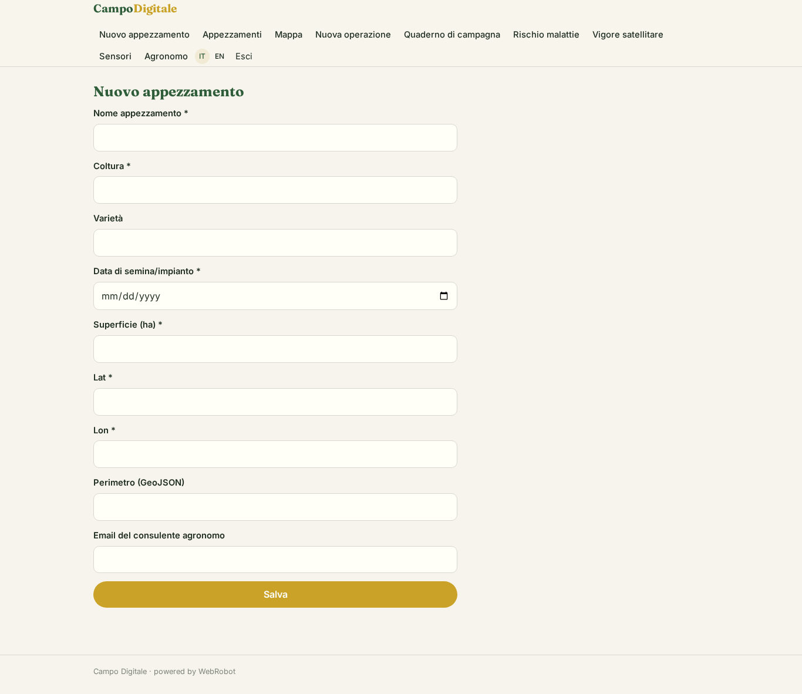
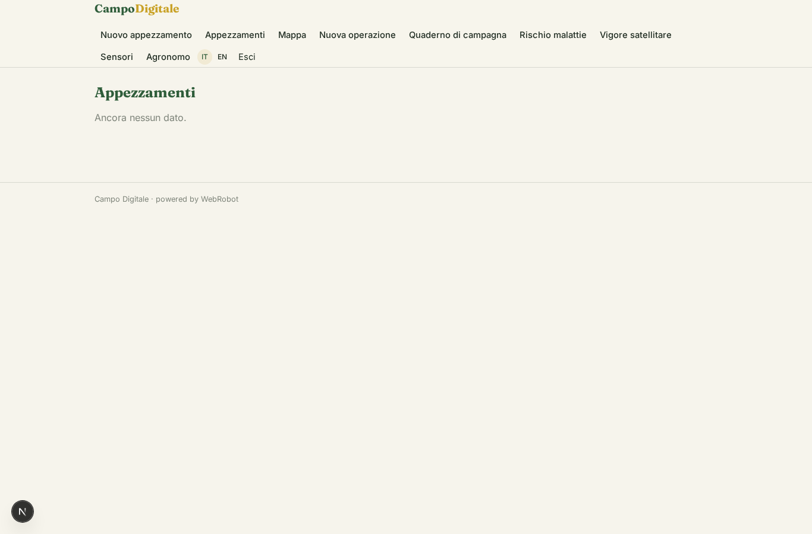
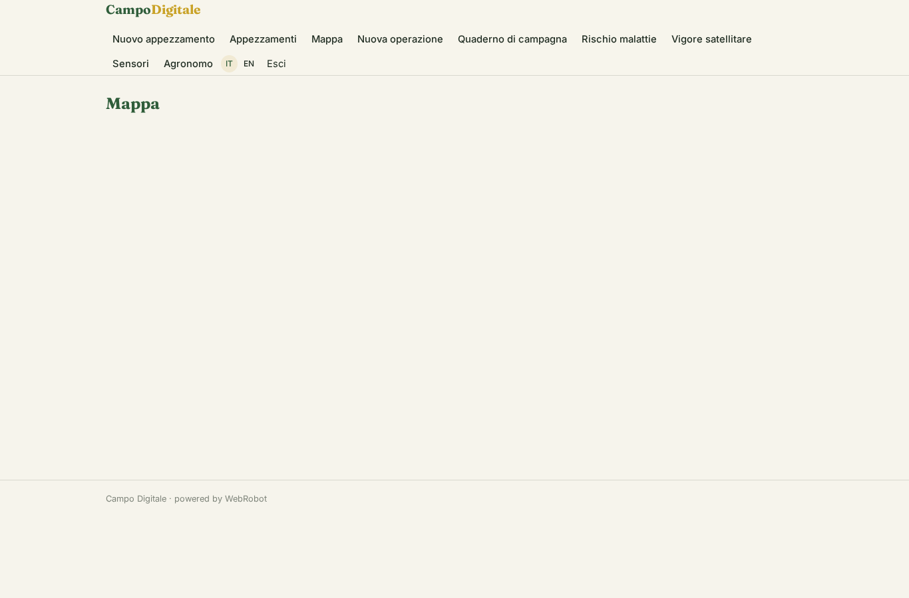
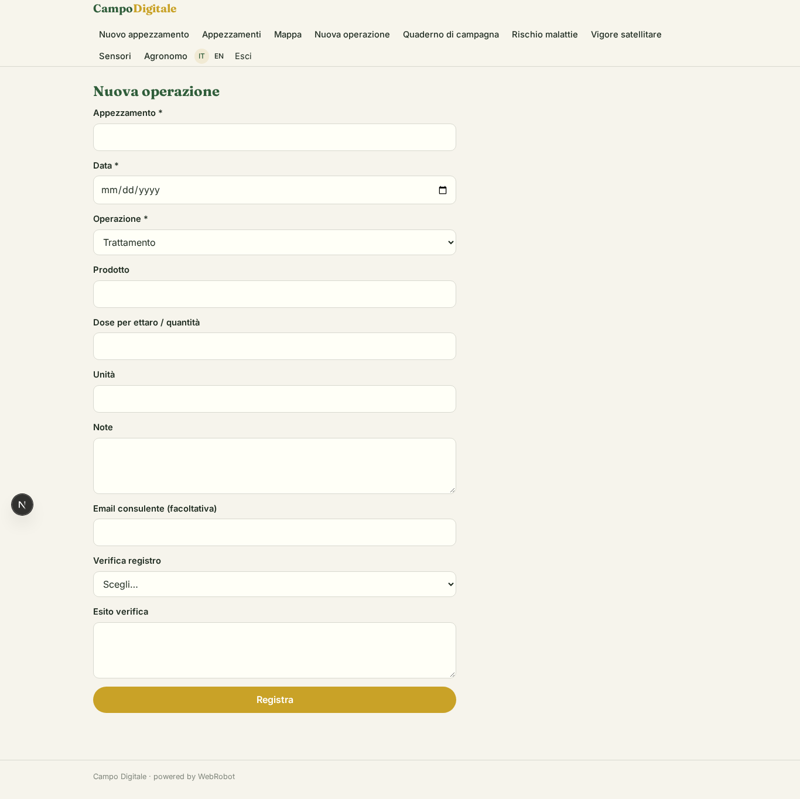
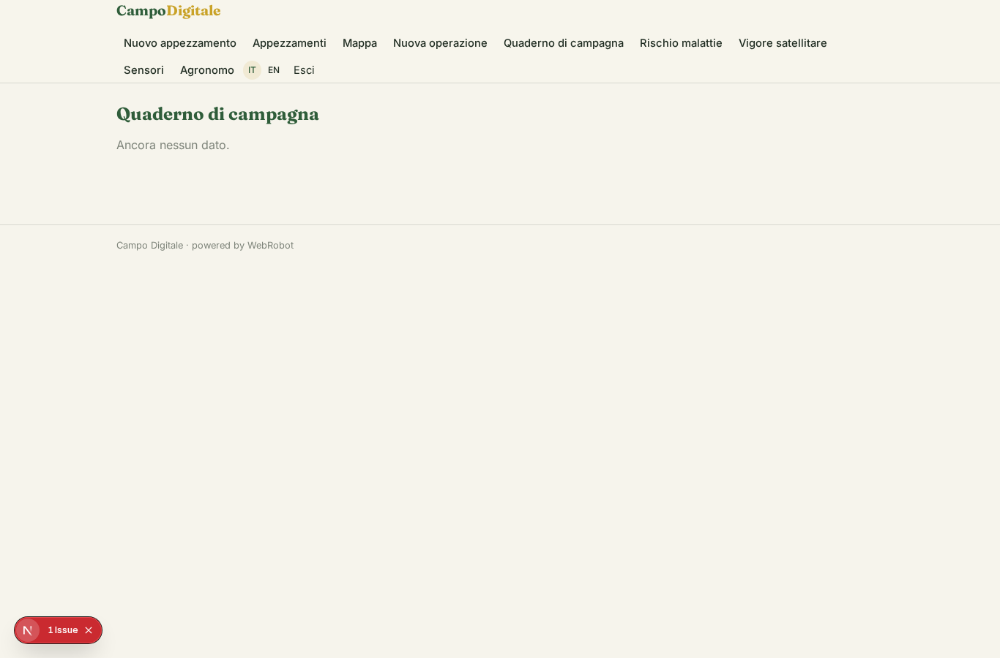
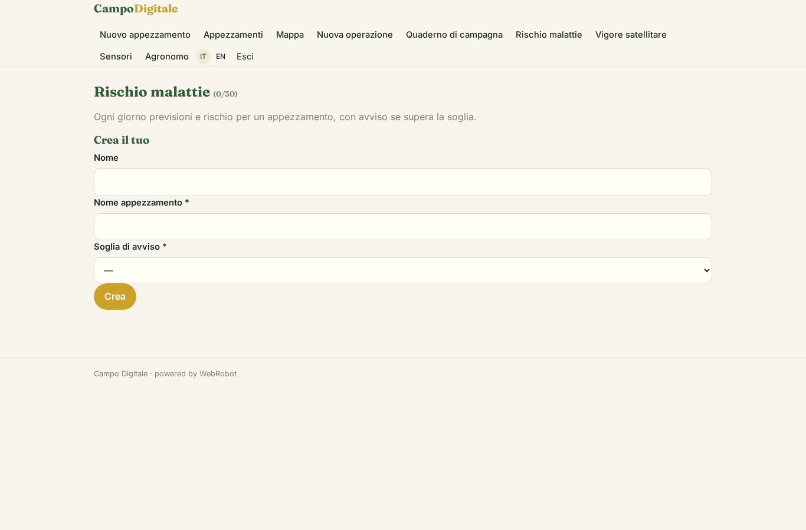
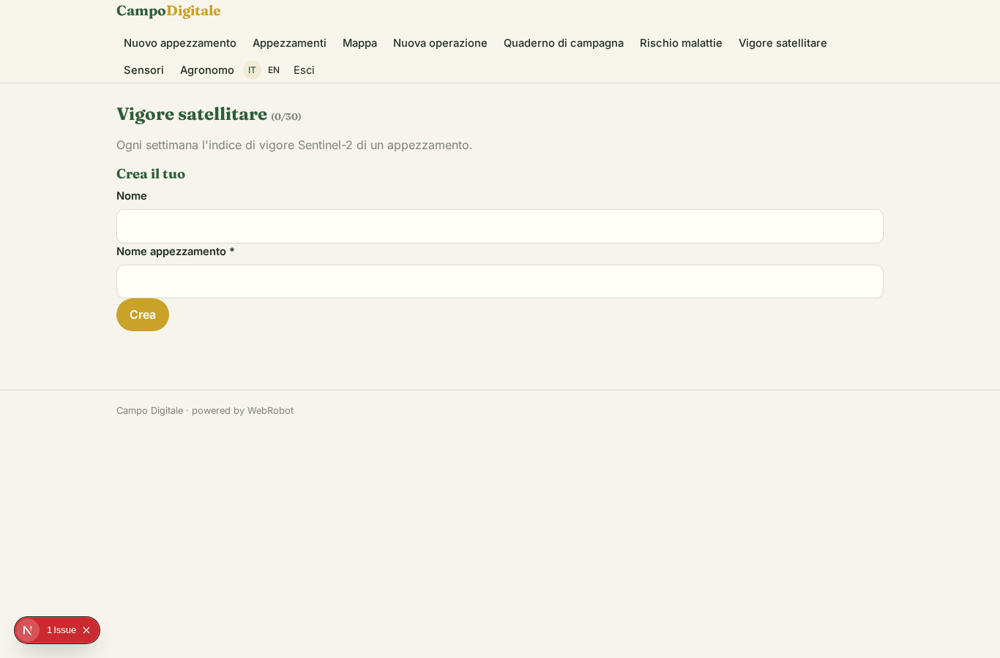
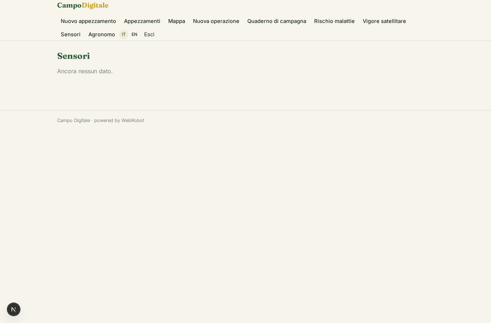
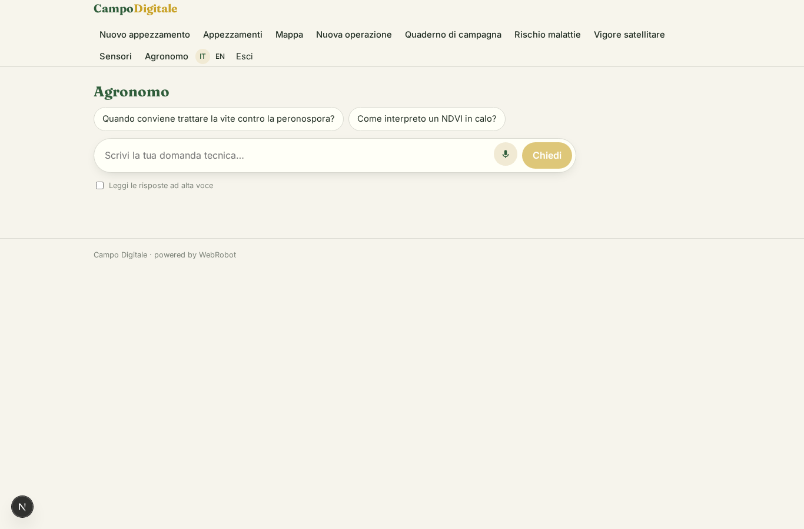
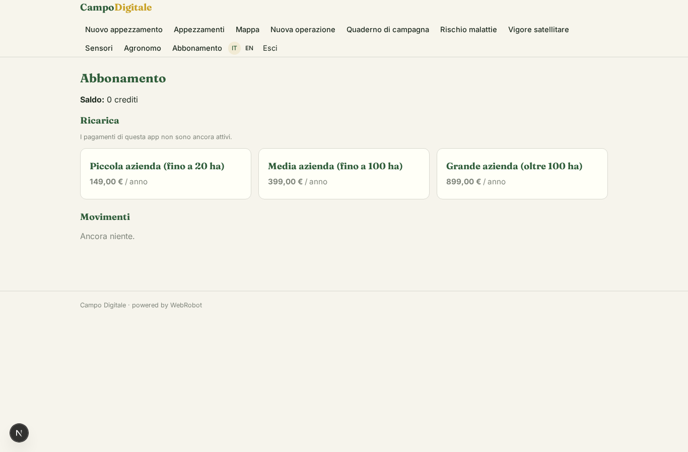

# Campo Digitale

_Il gestionale per la tua azienda agricola: appezzamenti, quaderno di campagna, meteo e satellite._

**Manifest:** valid (schema + runtime contract) · **Functional test:** passed (18 checks passed)

## Description given to the app builder (Italian)

Ci serve Campo Digitale, un gestionale per aziende agricole. L'agricoltore si registra e disegna i suoi appezzamenti su una mappa, indicando coltura, varietà, data di semina e superficie. Durante la stagione registra trattamenti, concimazioni, irrigazioni e raccolti nel quaderno di campagna; quando registra un trattamento l'app controlla nel registro pubblico dei prodotti fitosanitari del Ministero della Salute che il prodotto sia autorizzato su quella coltura e il dosaggio sia corretto. Ogni giorno un agente scarica le previsioni di Open-Meteo per ogni appezzamento, stima il rischio di malattie come la peronospora con modelli semplici, e quando il rischio supera la soglia manda un avviso. Ogni settimana usa le immagini satellitari Copernicus per calcolare un indice di vigore e segnala zone in sofferenza. Un agente agronomo risponde in chat alle domande tecniche. I sensori in campo (stazioni meteo, sonde di umidità) devono essere collegati, e serve un'app mobile da usare offline in campagna. Il consulente agronomo può seguire più aziende. Abbonamento annuale per ettari.

## Features not expressible today (spec.extensions)

- **polygon_drawing**: Disegno dei perimetri degli appezzamenti sulla mappa: la vista map mostra solo marcatori; per ora lat/lon e GeoJSON si inseriscono nel form. Serve un editor di poligoni.
- **offline_mobile**: Uso offline in campagna con sincronizzazione al ritorno della rete: il guscio mobile è dichiarato, ma la cache offline e la sincronizzazione del quaderno non sono ancora espresse nel manifest.
- **per_hectare_pricing**: Il prezzo annuale proporzionale agli ettari non è disponibile: usati tre scaglioni di piano annuale; il limite totale di ettari per piano va verificato.
- **sensor_ownership**: I dati dei sensori arrivano da webhook /api/hooks/sensor_hook senza utente: l'associazione dispositivo-azienda e l'isolamento per cliente richiedono una verifica.
- **copernicus_auth**: L'accesso a Copernicus Data Space richiede un token OAuth a breve durata: per ora il token è incollato dall'admin come chiave; serve lo scambio OAuth automatico.
- **phyto_register**: Il registro fitosanitario del Ministero della Salute non ha API pubbliche: l'agente lo consulta via scraping della banca dati; verificare termini d'uso e stabilità.
- **consultant_multi_farm**: Il consulente vede le aziende che lo indicano in consultant_email sugli appezzamenti; il quaderno è condiviso solo se la voce riporta la stessa email.

## Screenshots (interpretive runtime, no data)

### home-anon

### home-mobile

### home

### new_parcel

### parcels

### map

### new_entry

### logbook

### risk_watches

### vigor_watches

### sensors

### chat

### account

