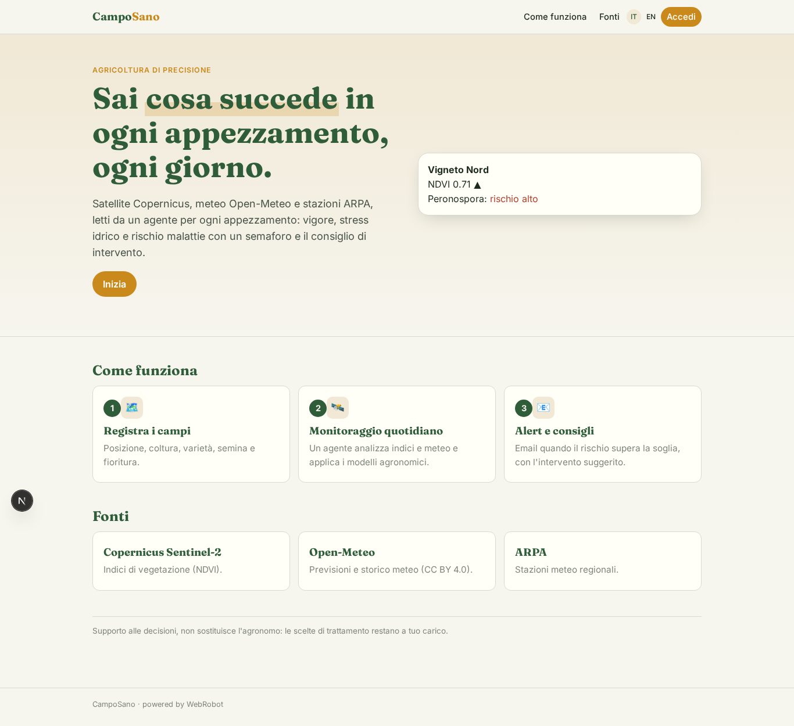
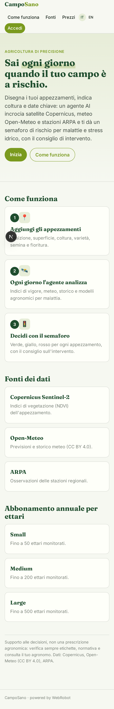
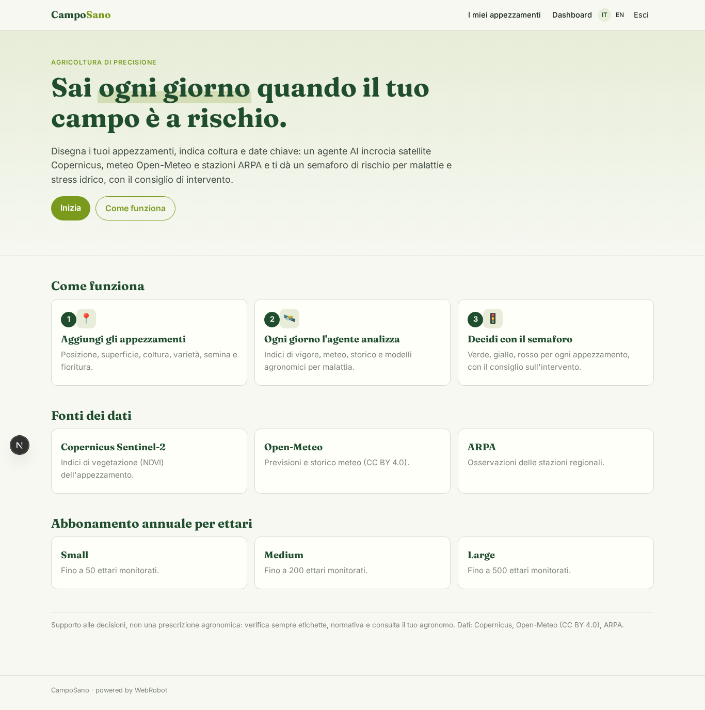
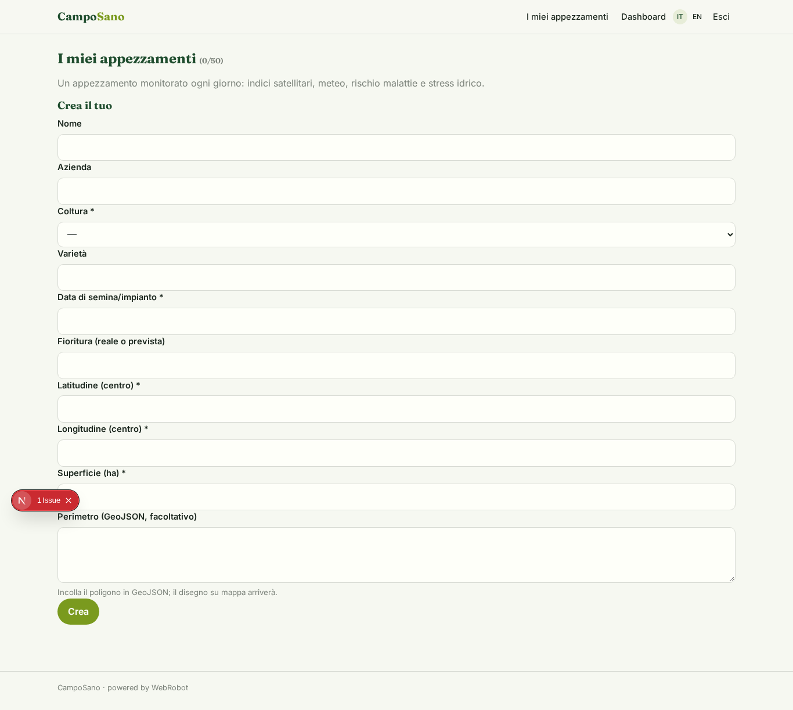
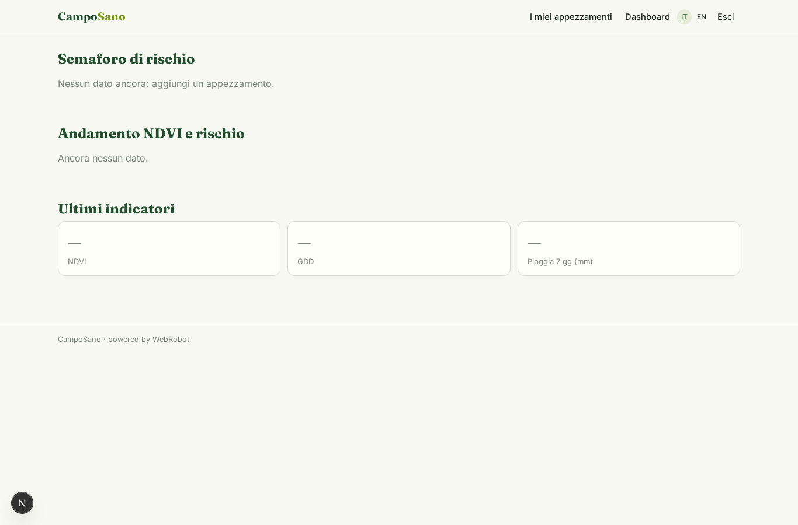
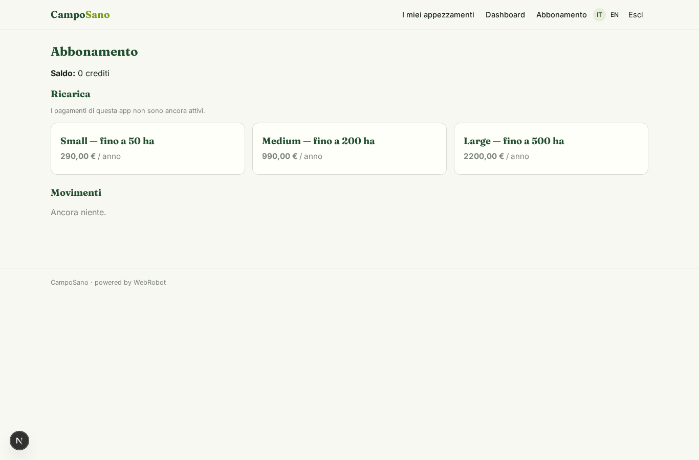

# CampoSano

_Ogni giorno, il rischio di malattie e stress idrico di ogni tuo appezzamento._

**Manifest status:** valid (schema validator + runtime contract)

## Description given to the app builder (Italian)

CampoSano e un sistema di supporto alle decisioni per l'agricoltura di precisione. L'agronomo o l'agricoltore disegna i propri appezzamenti sulla mappa e indica per ciascuno la coltura, la varieta e le date chiave (semina, fioritura). Per ogni appezzamento un agente raccoglie ogni giorno i dati satellitari Copernicus (indici di vigore della vegetazione), le previsioni e lo storico meteo da Open-Meteo e le stazioni ARPA, e calcola indicatori utili e il rischio di specifiche malattie e stress idrico in base a modelli agronomici. L'utente vede una dashboard per azienda e per appezzamento con mappe, andamento degli indici e un semaforo di rischio, e riceve un alert via email quando il rischio di una malattia supera la soglia, con il consiglio sull'intervento. Vorrei poter integrare in futuro i dati dei sensori di campo e una mappatura GIS piu ricca. L'azienda agricola vede solo i propri campi, il consulente quelli dei clienti che segue. Abbonamento annuale per ettari monitorati. In italiano e inglese.

## Features not expressible today (spec.extensions)

- **map_drawing**: Drawing parcels on a map is not available yet: for now centre coordinates and an optional pasted GeoJSON. Maps in the dashboard also pending.
- **email_alerts**: Email alerts when a disease risk exceeds the threshold are not available yet (no notifications). For now the risk traffic light and advice appear in the dashboard; the email can be added when notifications are supported.
- **consultant_access**: Consultant role seeing the fields of the clients they follow (per-client sharing of parcel instances) is not expressible yet; farms see only their own parcels.
- **hectare_billing**: Subscription is by tiers of hectares; enforcing the hectare cap against the sum of parcels' area_ha needs custom logic.
- **copernicus_access**: Copernicus Sentinel data normally needs a Data Space account/token; the agent collects public data via the WebRobot MCP and flags missing data. A dedicated connector is a future step.
- **field_sensors_gis**: Future: field sensor data (soil moisture, leaf wetness) and richer GIS layers as additional collections feeding the analyst.

## Screenshots (interpretive runtime)

### home-anon

### home-mobile

### home

### parcels

### dashboard

### account

