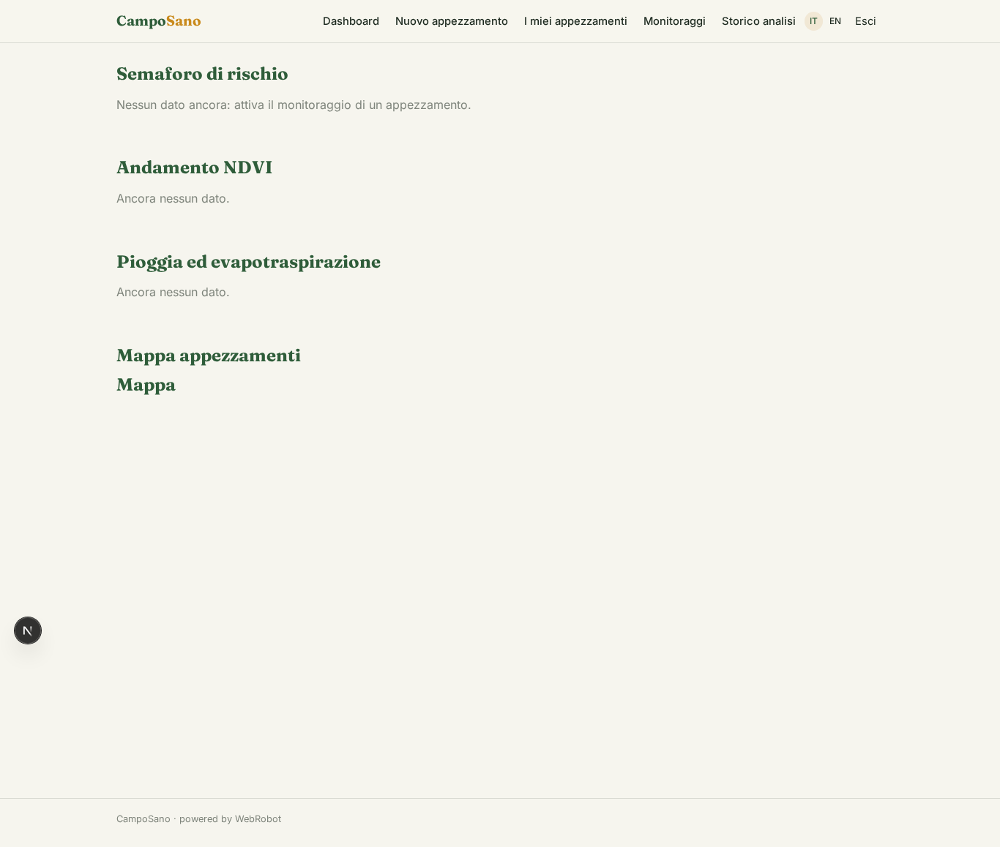
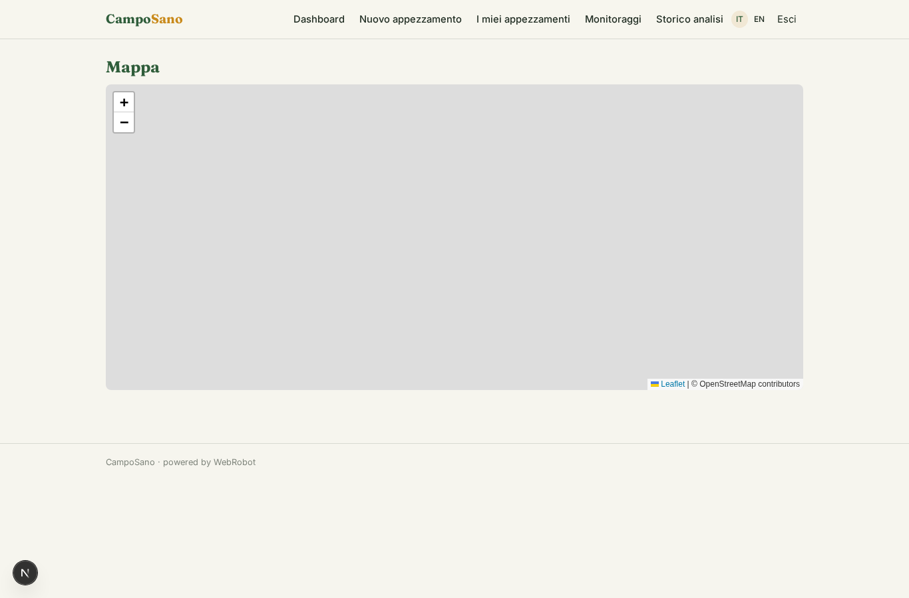
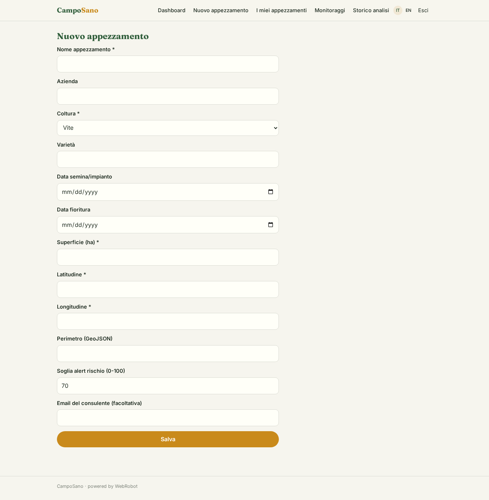
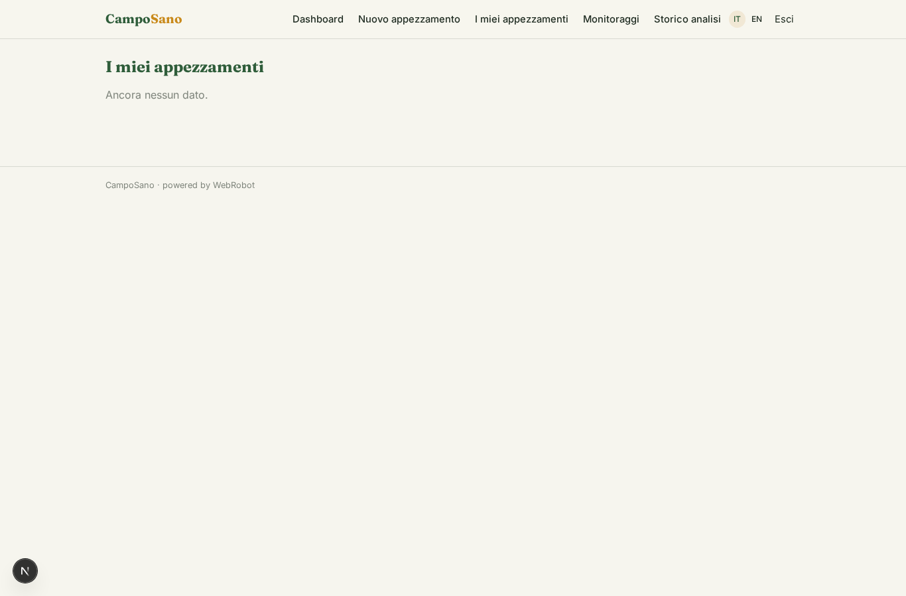
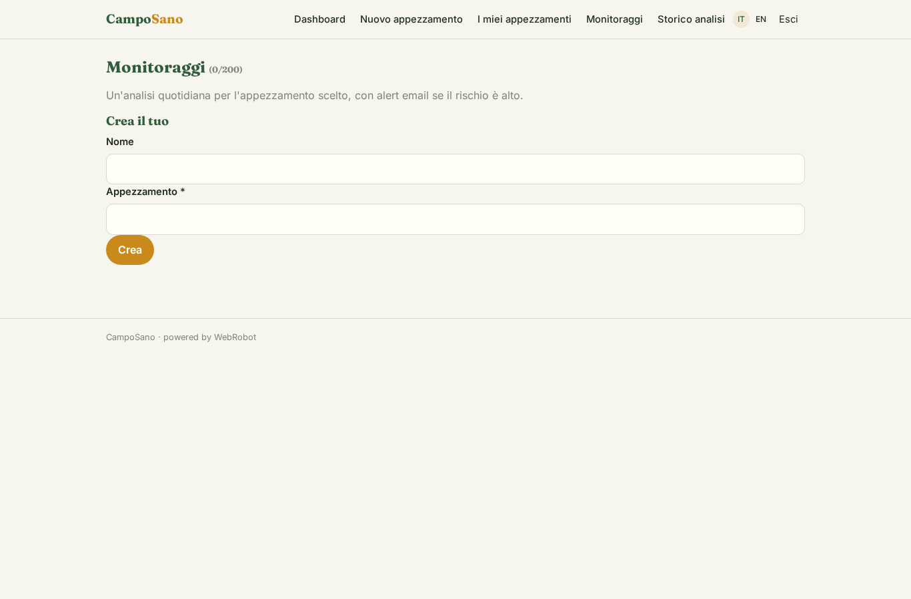
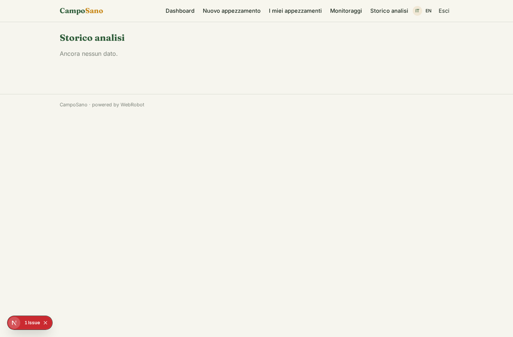
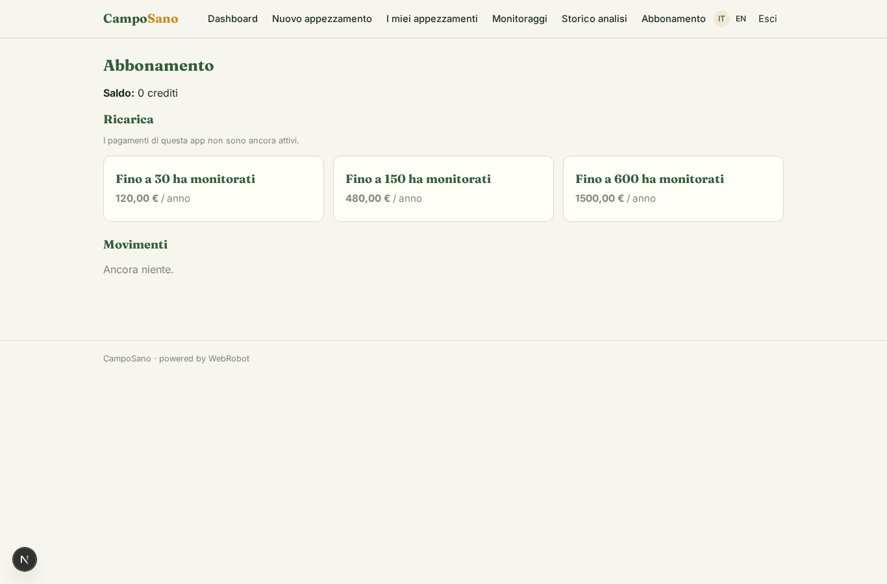

# CampoSano

_Ogni appezzamento sotto controllo: vigore, meteo e rischio malattie, ogni giorno._

**Manifest:** valid (schema + runtime contract) · **Functional test:** passed (12 checks passed)

## Description given to the app builder (Italian)

CampoSano e un sistema di supporto alle decisioni per l'agricoltura di precisione. L'agronomo o l'agricoltore disegna i propri appezzamenti sulla mappa e indica per ciascuno la coltura, la varieta e le date chiave (semina, fioritura). Per ogni appezzamento un agente raccoglie ogni giorno i dati satellitari Copernicus (indici di vigore della vegetazione), le previsioni e lo storico meteo da Open-Meteo e le stazioni ARPA, e calcola indicatori utili e il rischio di specifiche malattie e stress idrico in base a modelli agronomici. L'utente vede una dashboard per azienda e per appezzamento con mappe, andamento degli indici e un semaforo di rischio, e riceve un alert via email quando il rischio di una malattia supera la soglia, con il consiglio sull'intervento. Vorrei poter integrare in futuro i dati dei sensori di campo e una mappatura GIS piu ricca. L'azienda agricola vede solo i propri campi, il consulente quelli dei clienti che segue. Abbonamento annuale per ettari monitorati. In italiano e inglese.

## Features not expressible today (spec.extensions)

- **copernicus_auth**: Copernicus Data Space / Sentinel Hub statistics APIs need OAuth client credentials: not available yet. For now the agent reads public data via the WebRobot MCP; a direct NDVI tool needs OAuth support.
- **polygon_drawing**: Drawing plot polygons on the map is not available yet: the plot is a point (lat/lon) plus an optional GeoJSON boundary field; a richer GIS layer is a future step.
- **hectare_pricing**: Per-hectare annual pricing is approximated by plans with hectare tiers; exact per-ha billing and enforcement of total hectares is not available.
- **field_sensors**: Field sensors: future integration via a webhook trigger writing readings to a collection; not included yet.

## Screenshots (interpretive runtime, no data)

### home-anon

### home-mobile

### home

### dashboard

### plots_map

### add_plot

### plots

### watches

### readings

### account

