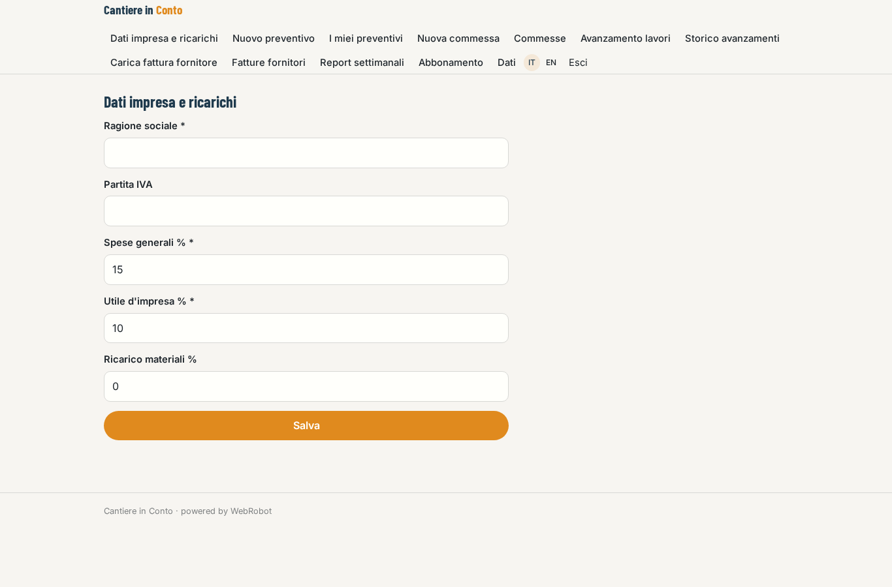
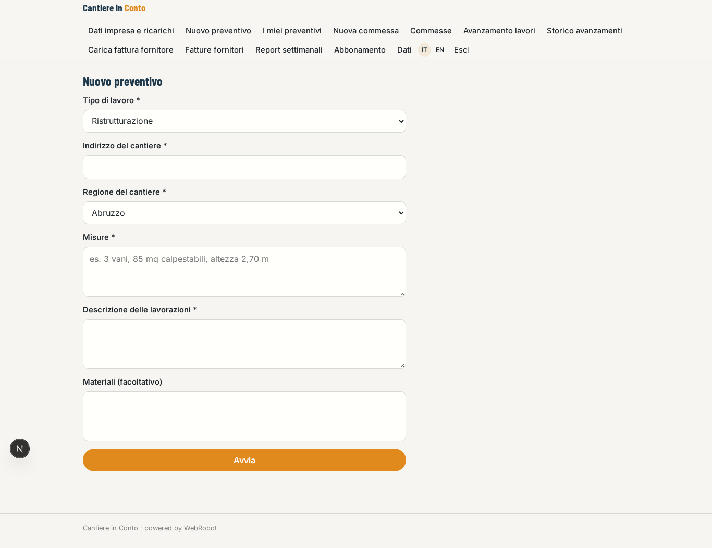
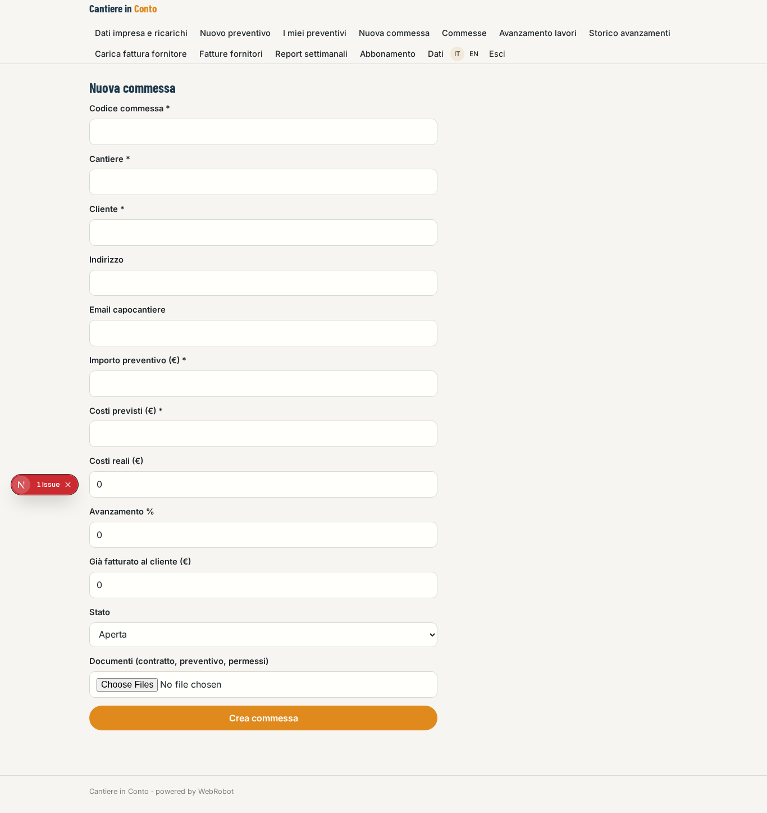
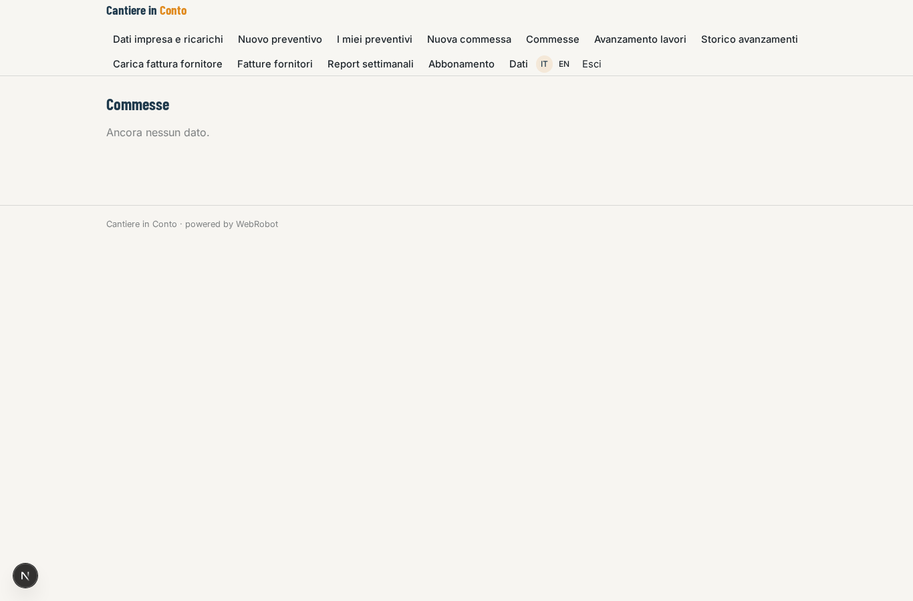
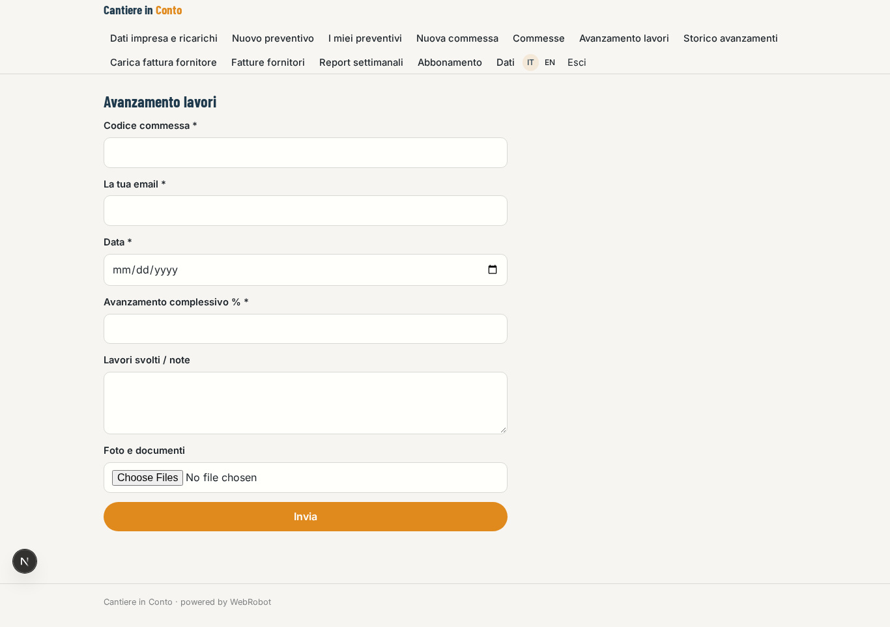
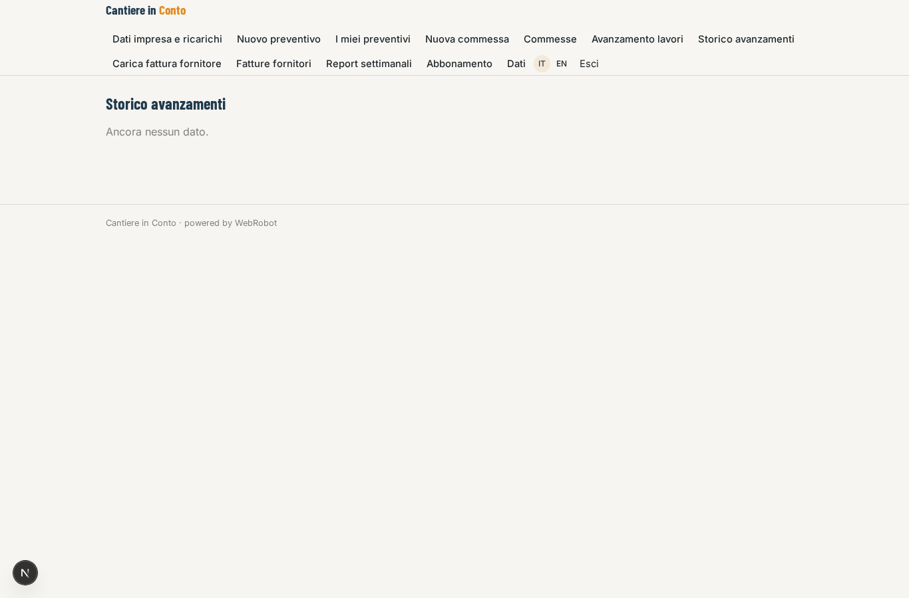
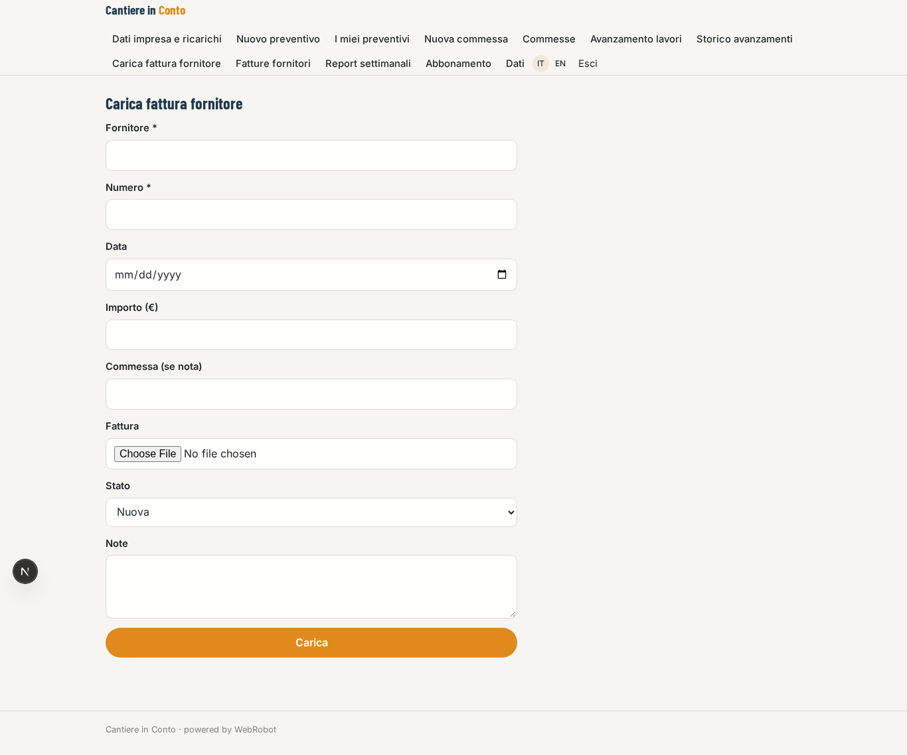
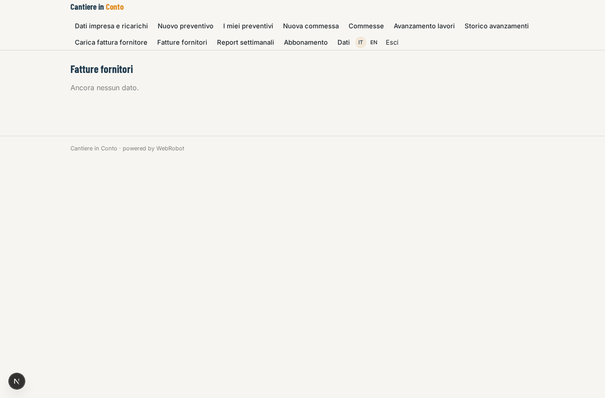
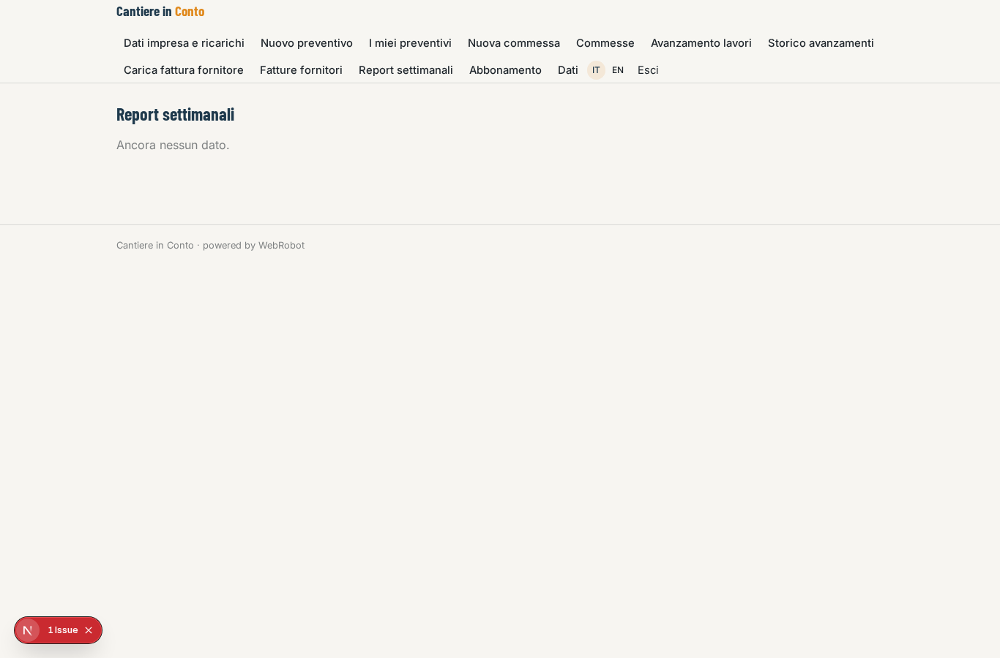
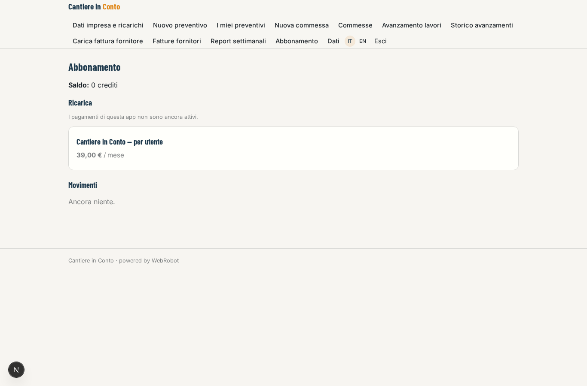

# Cantiere in Conto

_Dal preventivo alla commessa, con il margine sempre sotto controllo._

**Manifest:** valid (schema + runtime contract) · **Functional test:** passed (31 checks passed)

## Description given to the app builder (Italian)

Vorrei Cantiere in Conto, un sistema operativo per imprese edili piccole e medie. Il titolare o il tecnico inserisce una richiesta di preventivo con tipo di lavoro, indirizzo, misure, descrizione delle lavorazioni e materiali; un agente compone il computo metrico usando il prezzario regionale delle opere pubbliche della regione del cantiere, applica i ricarichi dell'impresa e produce il preventivo in PDF da mandare al cliente. Quando il preventivo è accettato diventa una commessa con costi previsti, avanzamento e documenti. Le fatture dei fornitori arrivano nella casella email collegata: un agente le legge, le abbina alla commessa giusta e aggiorna i costi reali; il capocantiere carica dal telefono foto e stati di avanzamento lavori. Ogni settimana un report mostra il margine di ogni commessa, gli scostamenti rispetto al preventivo e le fatture da emettere. Vogliamo collegare via OAuth il gestionale contabile e i conti bancari dell'impresa per riconciliare pagamenti e incassi. Il capocantiere vede solo i suoi cantieri, il titolare tutto. Abbonamento mensile per utente.

## Features not expressible today (spec.extensions)

- **oauth_accounting_bank**: Collegamento OAuth al gestionale contabile e ai conti bancari per riconciliare pagamenti e incassi: non disponibile per ora (OAuth verso altri servizi non è supportato). Nel frattempo i costi si aggiornano dalle fatture caricate.
- **mailbox_intake**: Lettura automatica della casella email collegata per le fatture dei fornitori: non disponibile per ora. Le fatture si caricano dal modulo (o si inoltrano al caricamento) e l'agente le abbina alla commessa.
- **quote_to_job**: La conversione del preventivo accettato in commessa è un passaggio manuale tramite il modulo Nuova commessa; l'invio del PDF al cliente avviene dal report stampabile.

## Screenshots (interpretive runtime, no data)

### home-anon

### home-mobile

### home

### profile

### new_quote

### quotes

### new_job

### jobs

### site_update

### updates

### new_invoice

### invoices

### reports

### account

