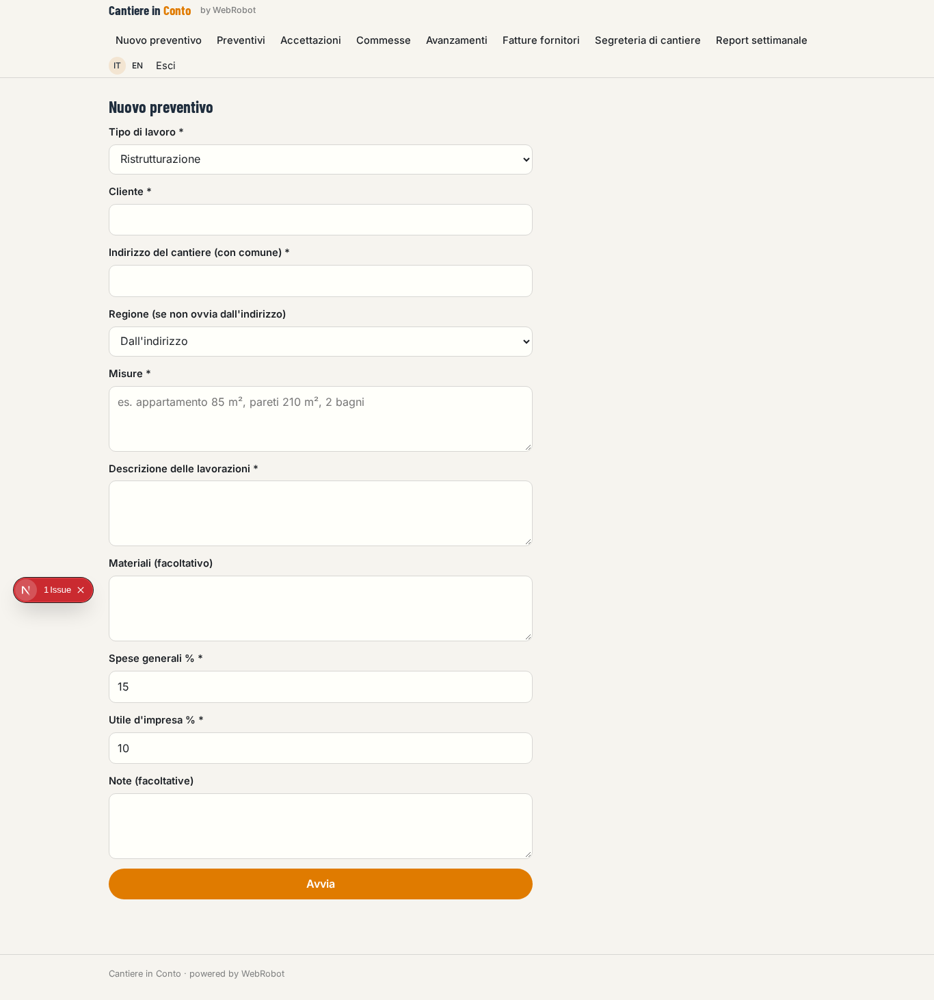
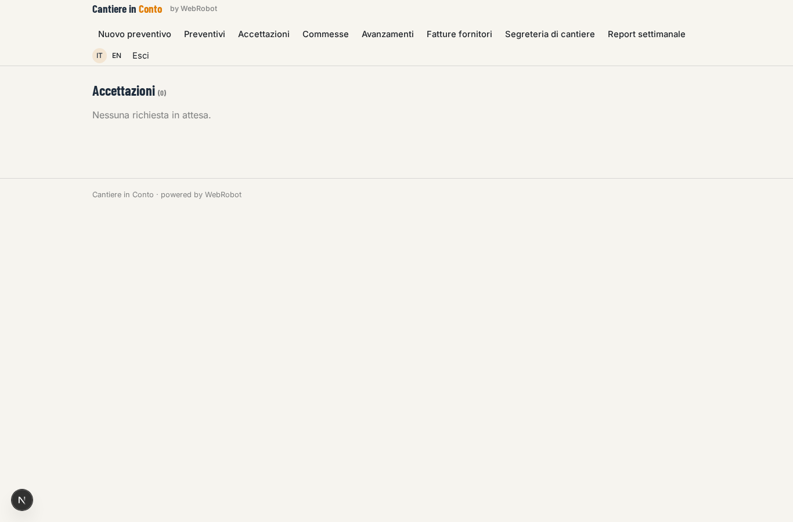
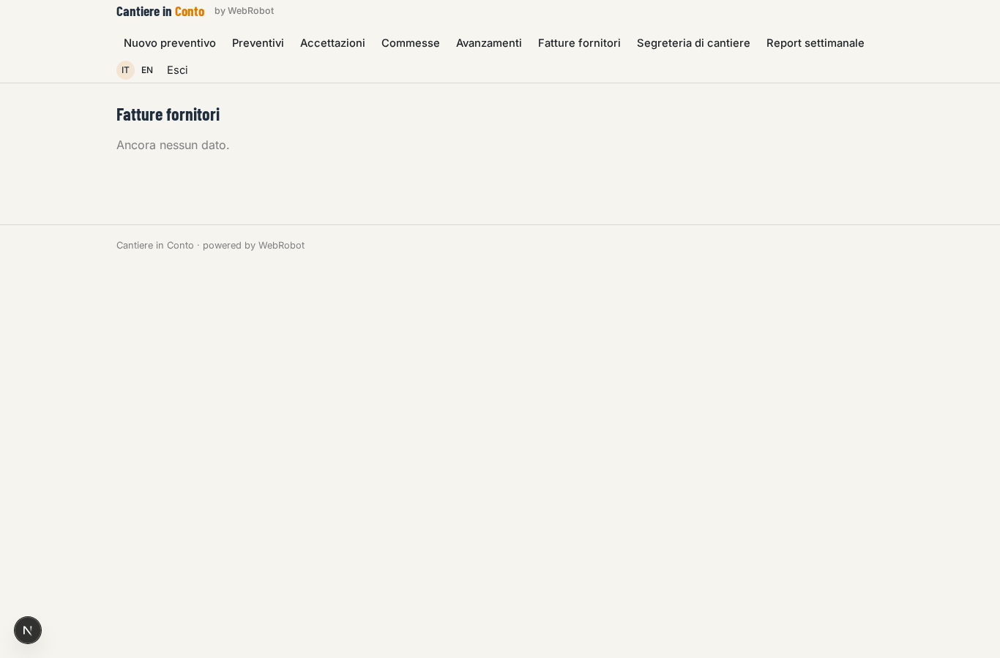
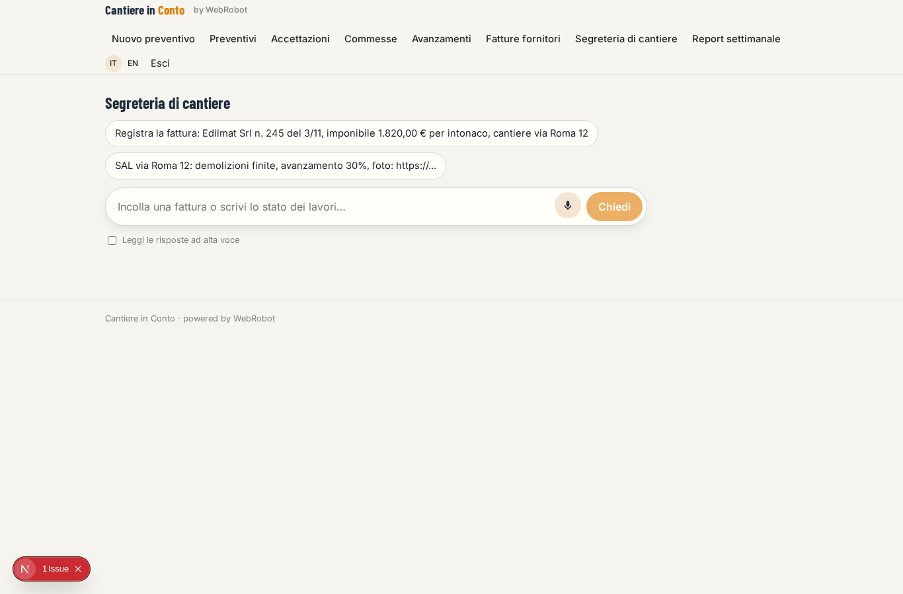
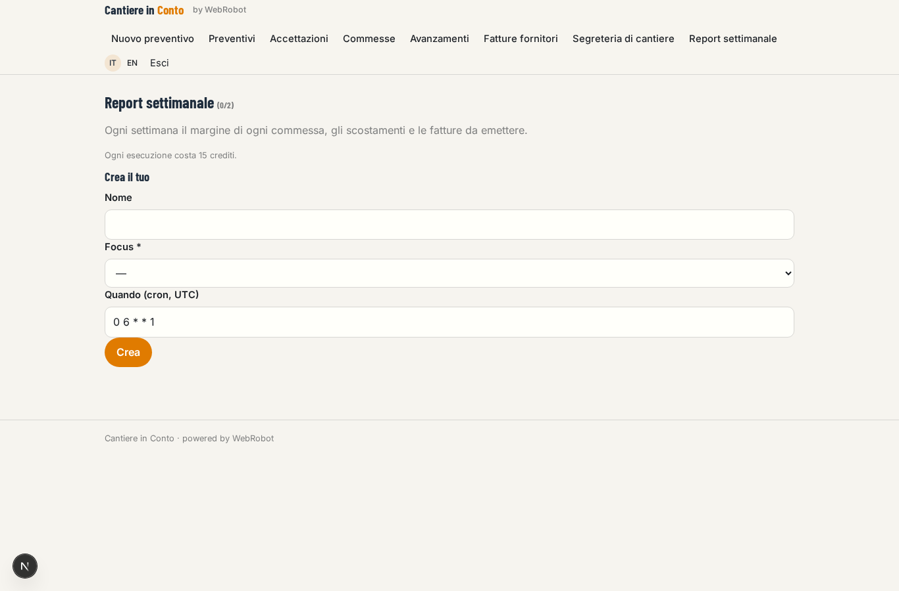
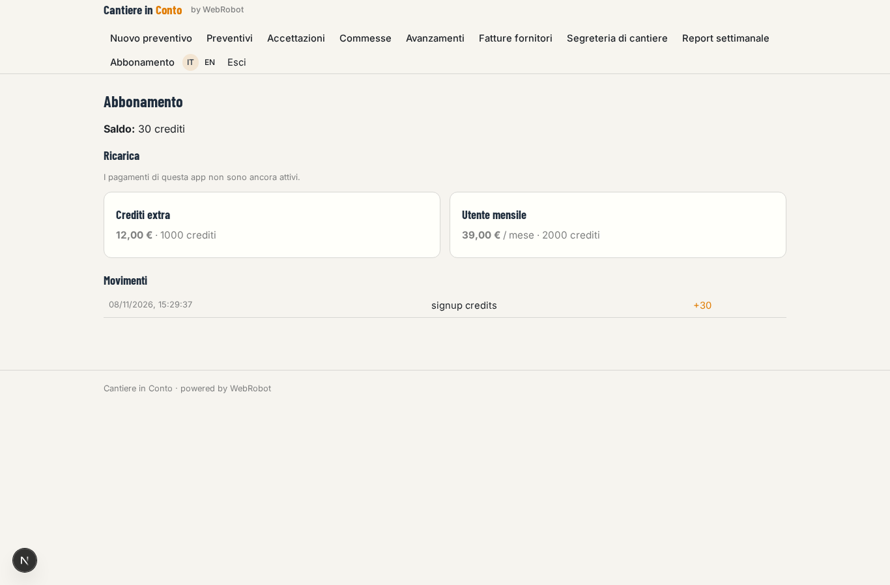

# Cantiere in Conto

_Preventivi, commesse e margini per la tua impresa edile._

**Manifest status:** valid (schema validator + runtime contract)

## Description given to the app builder (Italian)

Vorrei Cantiere in Conto, un sistema operativo per imprese edili piccole e medie. Il titolare o il tecnico inserisce una richiesta di preventivo con tipo di lavoro, indirizzo, misure, descrizione delle lavorazioni e materiali; un agente compone il computo metrico usando il prezzario regionale delle opere pubbliche della regione del cantiere, applica i ricarichi dell'impresa e produce il preventivo in PDF da mandare al cliente. Quando il preventivo è accettato diventa una commessa con costi previsti, avanzamento e documenti. Le fatture dei fornitori arrivano nella casella email collegata: un agente le legge, le abbina alla commessa giusta e aggiorna i costi reali; il capocantiere carica dal telefono foto e stati di avanzamento lavori. Ogni settimana un report mostra il margine di ogni commessa, gli scostamenti rispetto al preventivo e le fatture da emettere. Vogliamo collegare via OAuth il gestionale contabile e i conti bancari dell'impresa per riconciliare pagamenti e incassi. Il capocantiere vede solo i suoi cantieri, il titolare tutto. Abbonamento mensile per utente.

## Features not expressible today (spec.extensions)

- **accounting_oauth**: OAuth connection of the accounting software and of the company's bank accounts to reconcile payments and receipts: needs per-customer credentials, not available yet. Meanwhile invoices are pasted in the site desk chat.
- **mailbox_ingest**: Reading supplier invoices from a connected mailbox is not available yet (no email connectors); invoices are pasted as text or link in the desk chat.
- **photo_upload**: Photo and document upload from the foreman's phone is not available yet (no file fields): the foreman gives a link or writes text.
- **pdf_and_email**: The quote PDF is the printable report (print / save as PDF); sending it to the client by email is not available yet.
- **foreman_scope**: The foreman sees only the sites shared with him: the owner invites him as editor on each job and progress record; a company-wide team model is not yet declarative.

## Screenshots (interpretive runtime)

### home-anon

### home-mobile

### home

### new_quote

### quotes

### approvals

### jobs

### progress

### invoices

### desk_chat

### weekly

### account

