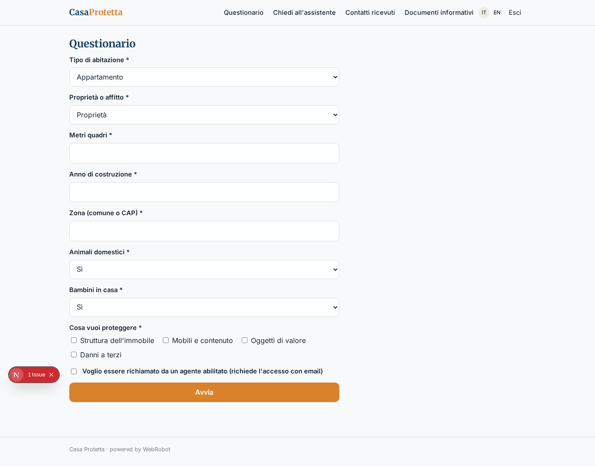
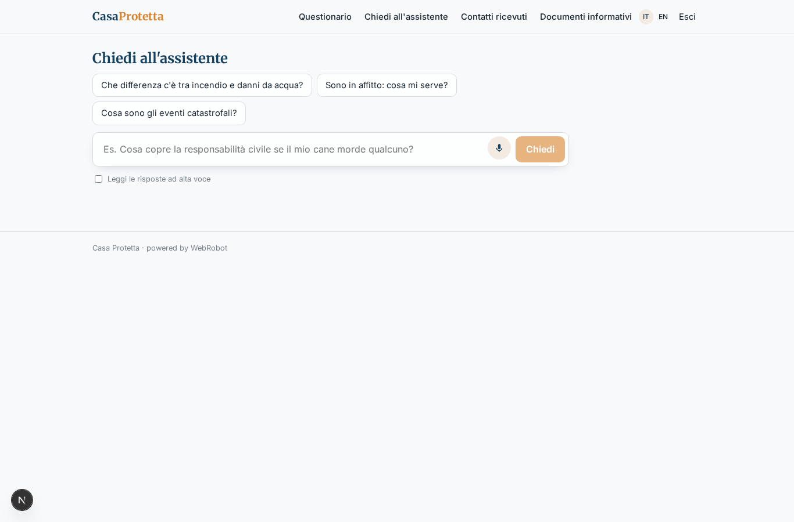
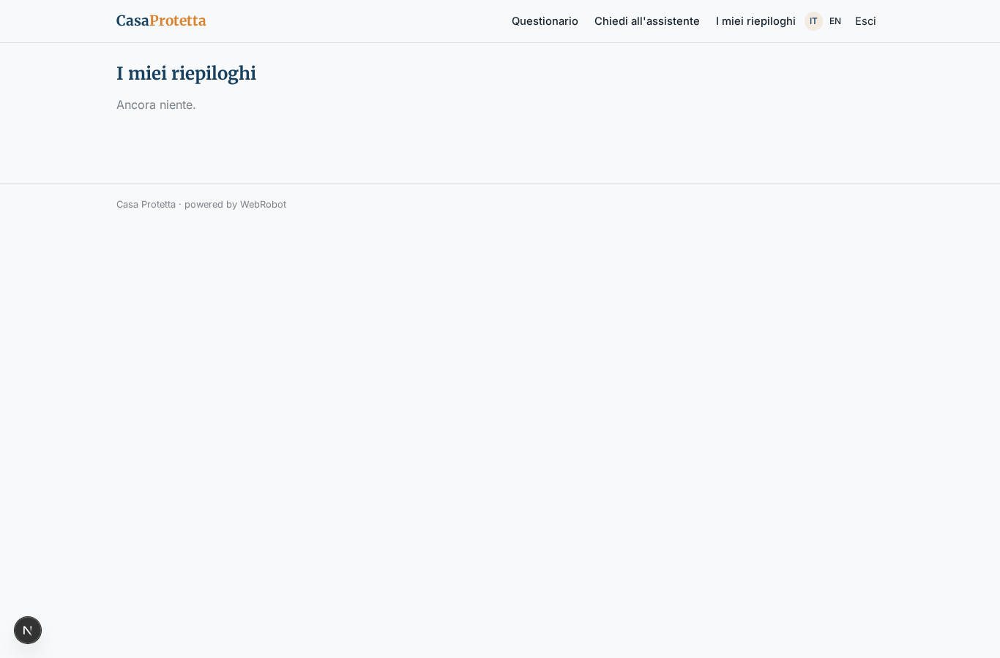
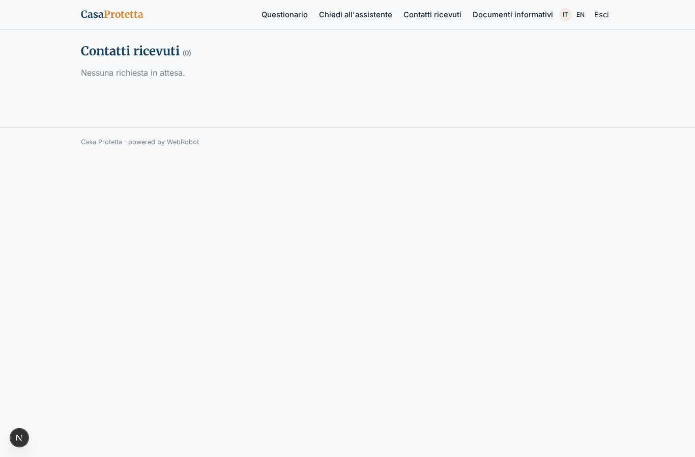
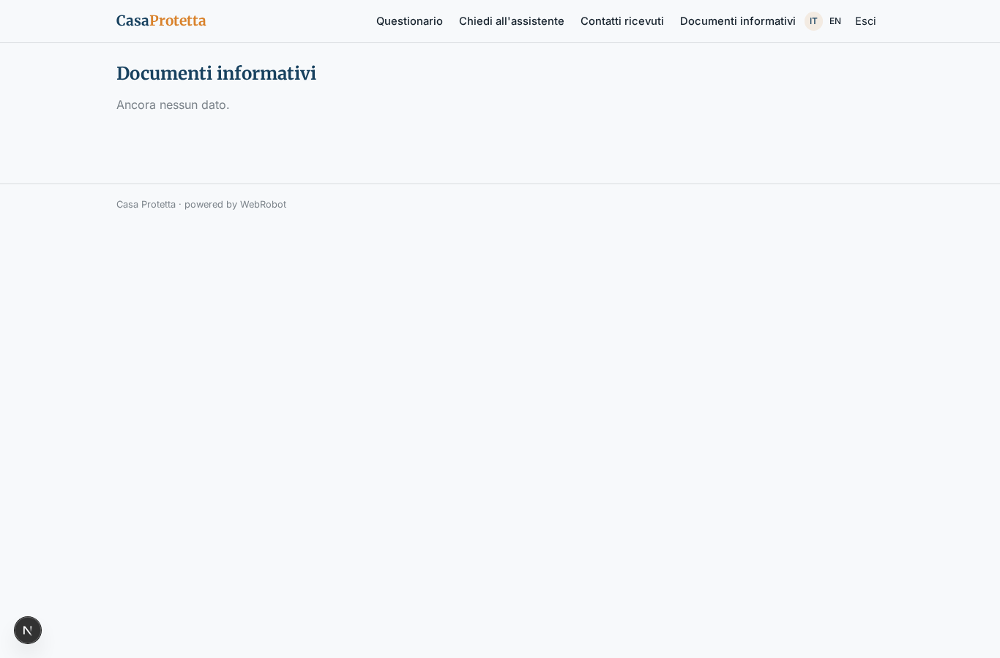

# Casa Protetta

_Capisci quali coperture servono davvero alla tua casa._

**Stato manifest:** valido (validatore Python + contratto runtime)

## Descrizione data all'app builder

Vorrei Casa Protetta, il sito informativo di una compagnia che vende polizze casa e responsabilità civile. Descrivo solo lo strato software: la quotazione vera, l'emissione delle polizze e la gestione sinistri sono attività regolamentate dell'agenzia e restano fuori. Il visitatore anonimo compila un questionario: tipo di abitazione, proprietà o affitto, metri quadri, anno di costruzione, zona, presenza di animali e bambini, cosa vuole proteggere. Un agente spiega in modo semplice quali coperture sarebbero utili e perché (incendio, danni da acqua, furto, responsabilità civile verso terzi, eventi catastrofali), usando i documenti informativi precontrattuali pubblicati dalla compagnia, e risponde in chat alle domande. Alla fine mostra un riepilogo delle coperture consigliate e, se il visitatore lascia nome, email e telefono con il consenso, un agente assicurativo abilitato riceve il contatto e lo richiama. In seguito vogliamo un'area clienti per vedere la polizza e aprire un sinistro con foto. L'agenzia vede i contatti ricevuti, il visitatore solo il suo riepilogo. Servizio gratuito per il visitatore; l'agenzia paga un abbonamento.

## Funzioni non esprimibili oggi (spec.extensions)

- **anonymous_contact**: Un visitatore anonimo non può inoltrare un contatto: la richiesta di richiamo richiede l'accesso con email (link magico), che serve anche come verifica del consenso.
- **customer_area**: Fase 2, non disponibile: area clienti con la polizza e apertura sinistro con foto (il caricamento file non è ancora disponibile; servono anche i dati polizza dal sistema dell'agenzia).
- **regulated_activities**: Quotazione, emissione e gestione sinistri restano fuori dall'app, svolte dall'agenzia.
- **documents_upload**: I documenti precontrattuali si inseriscono come testo o link nella collezione documents; il caricamento di file PDF non è ancora disponibile.
- **email_notification**: Nessuna email all'agenzia quando arriva un contatto: l'agente la vede nella vista Contatti ricevuti.

## Screenshot (runtime interpretativo)

### home-anon

### home-mobile

### home

### new

### chat

### history

### callbacks

### docs

