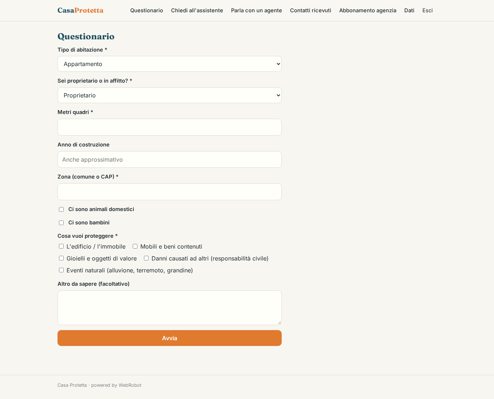
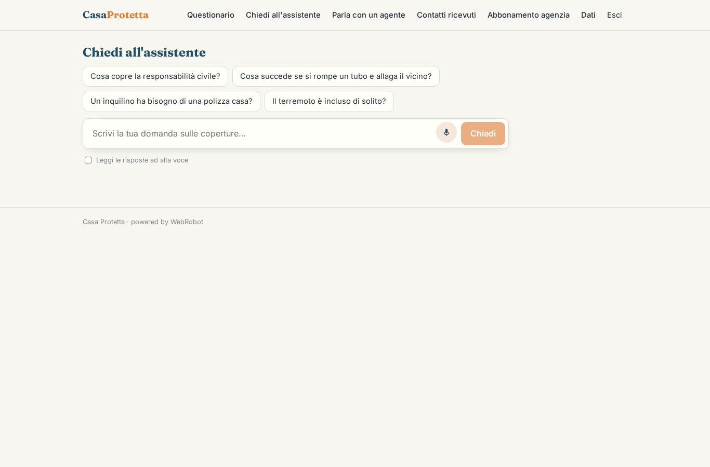
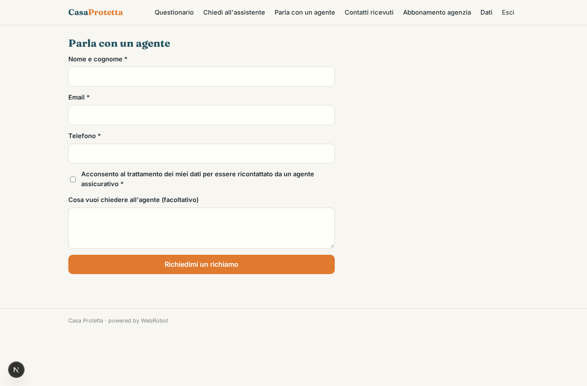
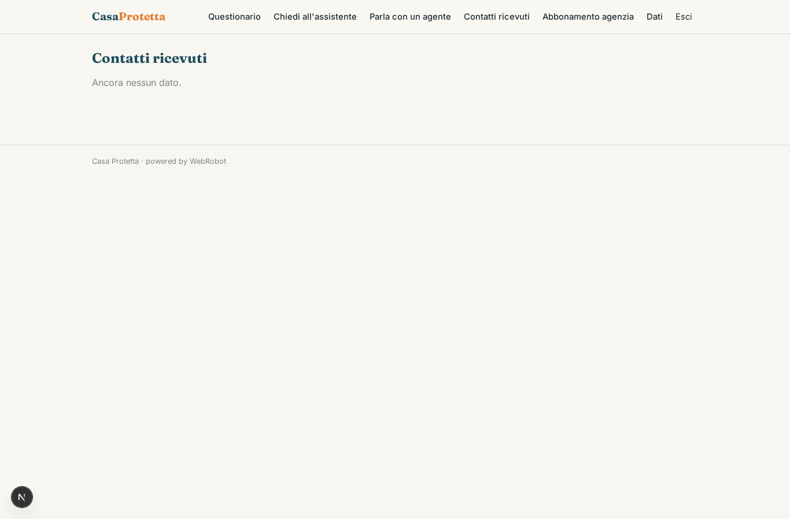
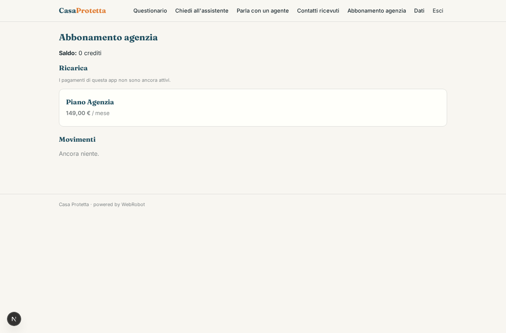

# Casa Protetta

_Scopri quali coperture servono davvero alla tua casa, in parole semplici._

**Manifest:** valid (schema + runtime contract) · **Functional test:** passed (16 checks passed)

## Description given to the app builder (Italian)

Vorrei Casa Protetta, il sito informativo di una compagnia che vende polizze casa e responsabilità civile. Descrivo solo lo strato software: la quotazione vera, l'emissione delle polizze e la gestione sinistri sono attività regolamentate dell'agenzia e restano fuori. Il visitatore anonimo compila un questionario: tipo di abitazione, proprietà o affitto, metri quadri, anno di costruzione, zona, presenza di animali e bambini, cosa vuole proteggere. Un agente spiega in modo semplice quali coperture sarebbero utili e perché (incendio, danni da acqua, furto, responsabilità civile verso terzi, eventi catastrofali), usando i documenti informativi precontrattuali pubblicati dalla compagnia, e risponde in chat alle domande. Alla fine mostra un riepilogo delle coperture consigliate e, se il visitatore lascia nome, email e telefono con il consenso, un agente assicurativo abilitato riceve il contatto e lo richiama. In seguito vogliamo un'area clienti per vedere la polizza e aprire un sinistro con foto. L'agenzia vede i contatti ricevuti, il visitatore solo il suo riepilogo. Servizio gratuito per il visitatore; l'agenzia paga un abbonamento.

## Features not expressible today (spec.extensions)

- **documenti_dip**: Caricamento dei documenti informativi precontrattuali (DIP) nella collezione documents da parte dell'agenzia: oggi va fatto dal back office dello studio; un form di caricamento per l'agenzia non è ancora disponibile.
- **area_clienti**: Fase 2, non ancora inclusa: area clienti con visualizzazione della polizza e apertura sinistro con foto. Richiede l'integrazione con il gestionale dell'agenzia (non disponibile) e un'accesso cliente con ruolo dedicato.
- **attivita_regolamentate**: Quotazione, emissione polizze e gestione sinistri restano fuori dall'app, come richiesto: sono attività regolamentate dell'agenzia.

## Screenshots (interpretive runtime, no data)

### home-anon

### home-mobile

### home

### questionario

### assistente

### richiamo

### leads

### account

