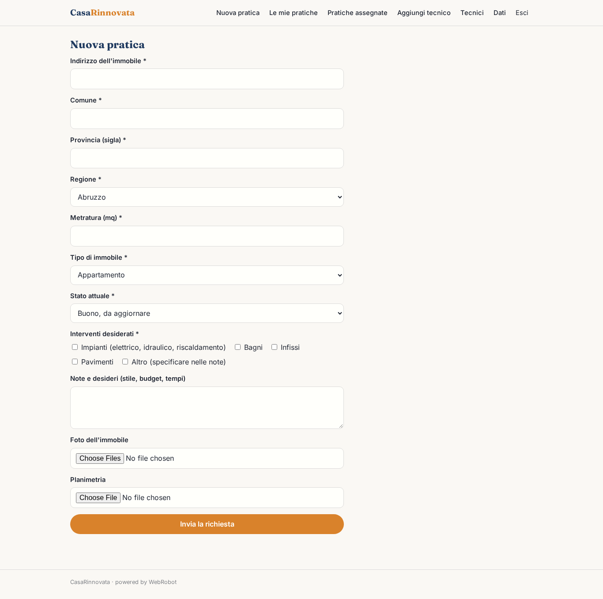
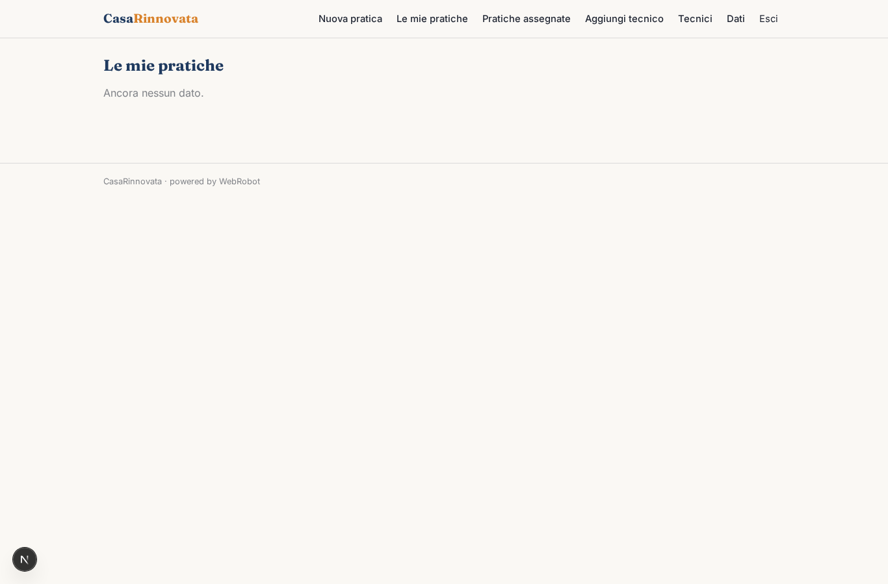
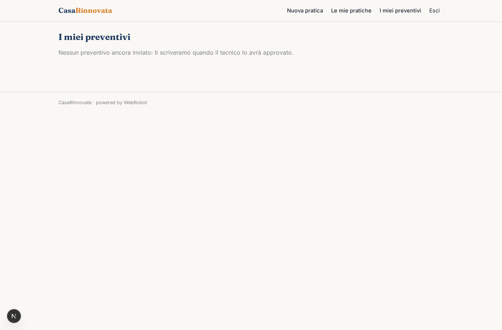
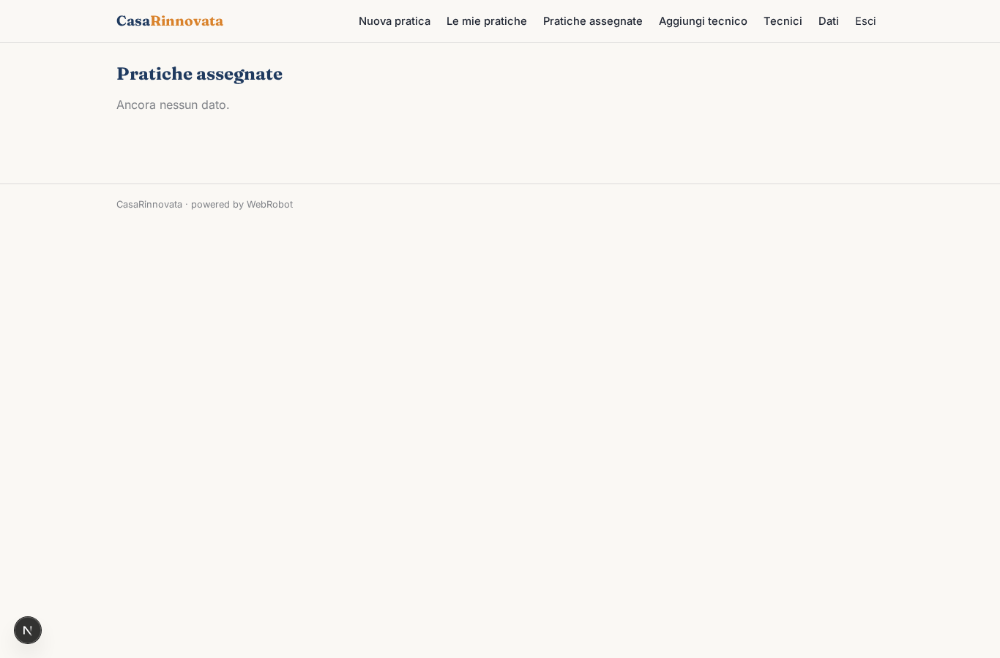
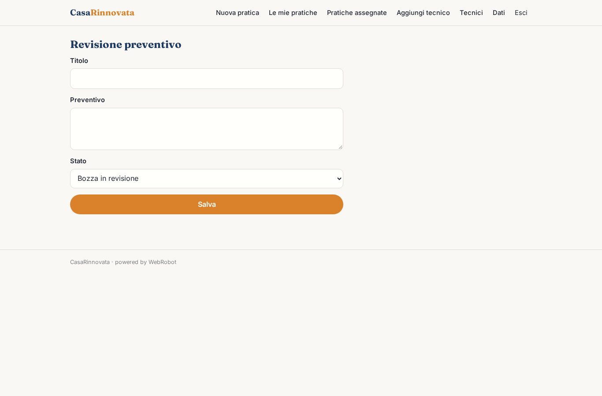
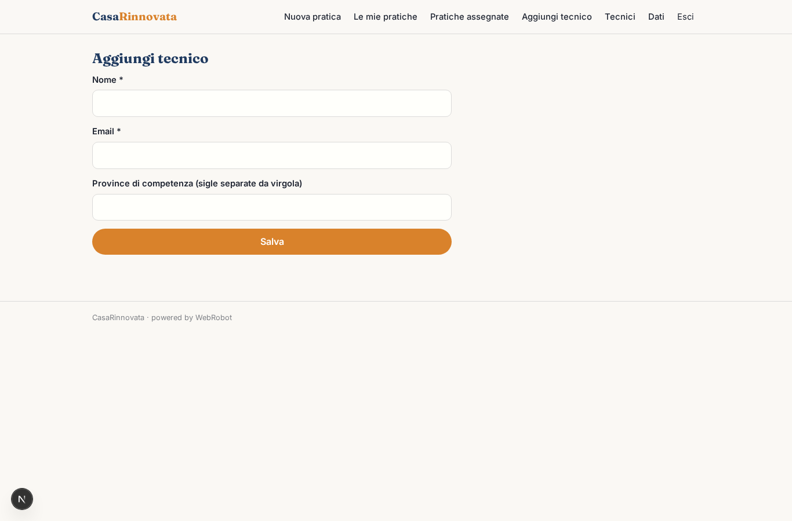
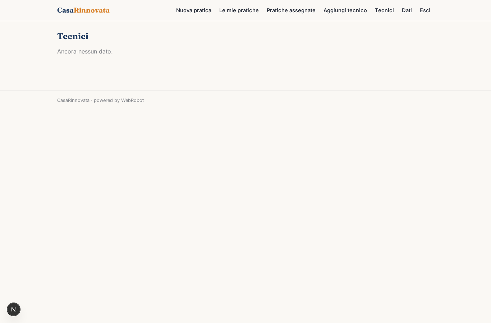

# CasaRinnovata

_Dalla valutazione al preventivo di ristrutturazione, con le agevolazioni fiscali già calcolate._

**Manifest:** valid (schema + runtime contract) · **Functional test:** passed (15 checks passed)

## Description given to the app builder (Italian)

CasaRinnovata gestisce ristrutturazioni chiavi in mano, dalla valutazione iniziale al preventivo. Il proprietario compila un modulo con indirizzo, metratura, tipo di immobile, stato attuale e interventi desiderati (impianti, bagni, infissi, pavimenti), caricando eventuali foto e la planimetria. Un agente redige un computo metrico stimato usando i prezzari regionali delle opere edili e propone un preventivo con voci, tempi e fasi. Un secondo agente valuta quali agevolazioni fiscali si possono applicare consultando le guide ufficiali dell'Agenzia delle Entrate e dell'ENEA e i valori OMI per l'immobile, e spiega all'utente il risparmio possibile. Vorrei anche mostrare un render di come potrebbe diventare l'ambiente. I dati di confronto vengono solo da fonti pubbliche come prezzari e OMI; non raccolgo annunci da portali immobiliari che lo vietano. Un tecnico dell'azienda rivede e approva il preventivo prima dell'invio al cliente via email. Il cliente vede la propria pratica, il tecnico quelle assegnate. Il preventivo e gratuito, si guadagna sui lavori affidati. In italiano.

## Functional test: what did not pass

- **trigger has its effect** (trigger notify_technician): email to record.technician_email: no such recipient in the test (role nobody holds or empty field) _(warning)_

## Features not expressible today (spec.extensions)

- **render_ai**: Render grafico dell'ambiente dopo la ristrutturazione: la generazione di immagini non è ancora disponibile. Per ora l'agente scrive una descrizione dettagliata del render (stili, materiali, colori) e il tecnico produce l'immagine.
- **job_revenue**: Il guadagno sui lavori affidati avviene fuori dall'app: nessun pagamento online per il preventivo.
- **draft_visibility**: Il cliente vede solo i preventivi approvati tramite filtro di vista; le bozze sono visibili al tecnico assegnato.

## Screenshots (interpretive runtime, no data)

### home-anon

### home-mobile

### home

### new_practice

### my_practices

### my_quotes

### assigned

### review

### add_technician

### technicians_list

