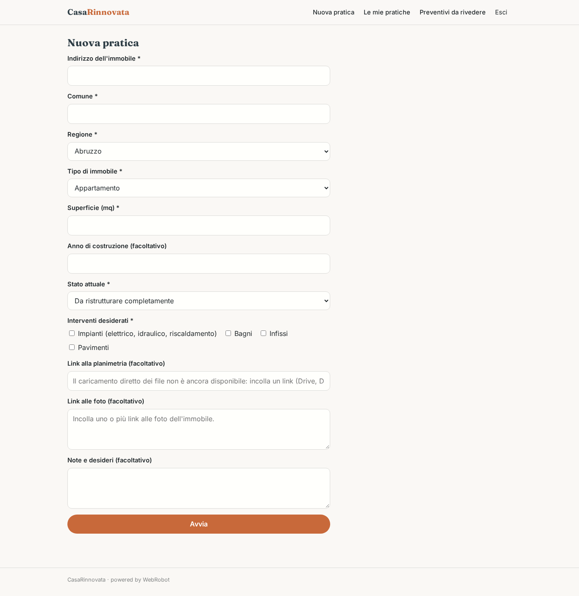
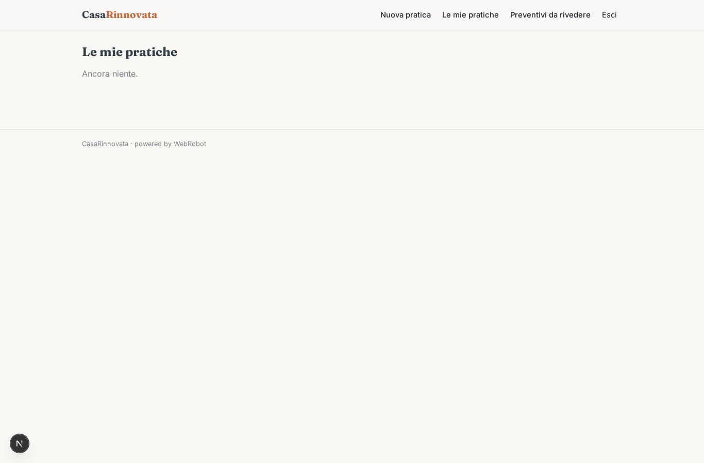
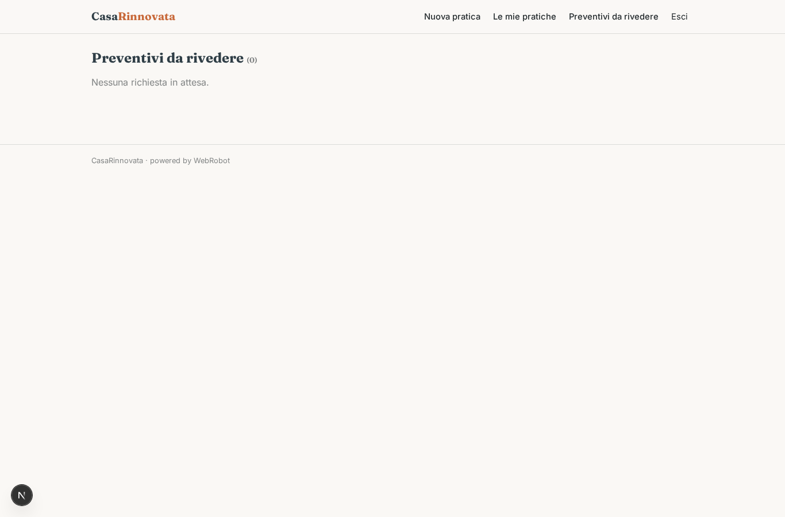

# CasaRinnovata

_Dalla valutazione al preventivo della tua ristrutturazione, in un solo posto._

**Manifest status:** valid (schema validator + runtime contract)

## Description given to the app builder (Italian)

CasaRinnovata gestisce ristrutturazioni chiavi in mano, dalla valutazione iniziale al preventivo. Il proprietario compila un modulo con indirizzo, metratura, tipo di immobile, stato attuale e interventi desiderati (impianti, bagni, infissi, pavimenti), caricando eventuali foto e la planimetria. Un agente redige un computo metrico stimato usando i prezzari regionali delle opere edili e propone un preventivo con voci, tempi e fasi. Un secondo agente valuta quali agevolazioni fiscali si possono applicare consultando le guide ufficiali dell'Agenzia delle Entrate e dell'ENEA e i valori OMI per l'immobile, e spiega all'utente il risparmio possibile. Vorrei anche mostrare un render di come potrebbe diventare l'ambiente. I dati di confronto vengono solo da fonti pubbliche come prezzari e OMI; non raccolgo annunci da portali immobiliari che lo vietano. Un tecnico dell'azienda rivede e approva il preventivo prima dell'invio al cliente via email. Il cliente vede la propria pratica, il tecnico quelle assegnate. Il preventivo e gratuito, si guadagna sui lavori affidati. In italiano.

## Features not expressible today (spec.extensions)

- **upload_file**: Il caricamento di foto e planimetria non è ancora disponibile: il modulo chiede link o testo incollato.
- **render_immagine**: La generazione di un render grafico dell'ambiente non è disponibile: il report include una descrizione testuale della resa finale.
- **invio_email**: L'invio del preventivo approvato al cliente via email non è disponibile: il cliente lo vede nella propria pratica dopo l'approvazione.
- **assegnazione_tecnico**: L'assegnazione di una pratica a un tecnico specifico e la vista dei soli casi assegnati richiedono un ruolo derivato e dati condivisi tra cliente e tecnico; per ora i tecnici vedono le richieste di revisione.

## Screenshots (interpretive runtime)

### home-anon

### home-mobile

### home

### nuova_pratica

### pratiche

### revisioni

