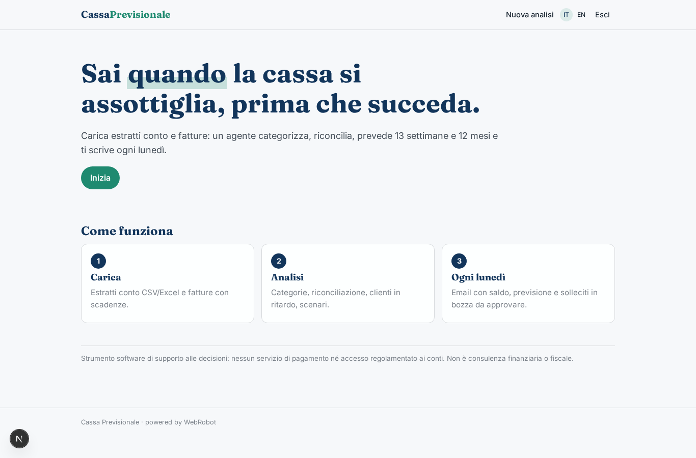
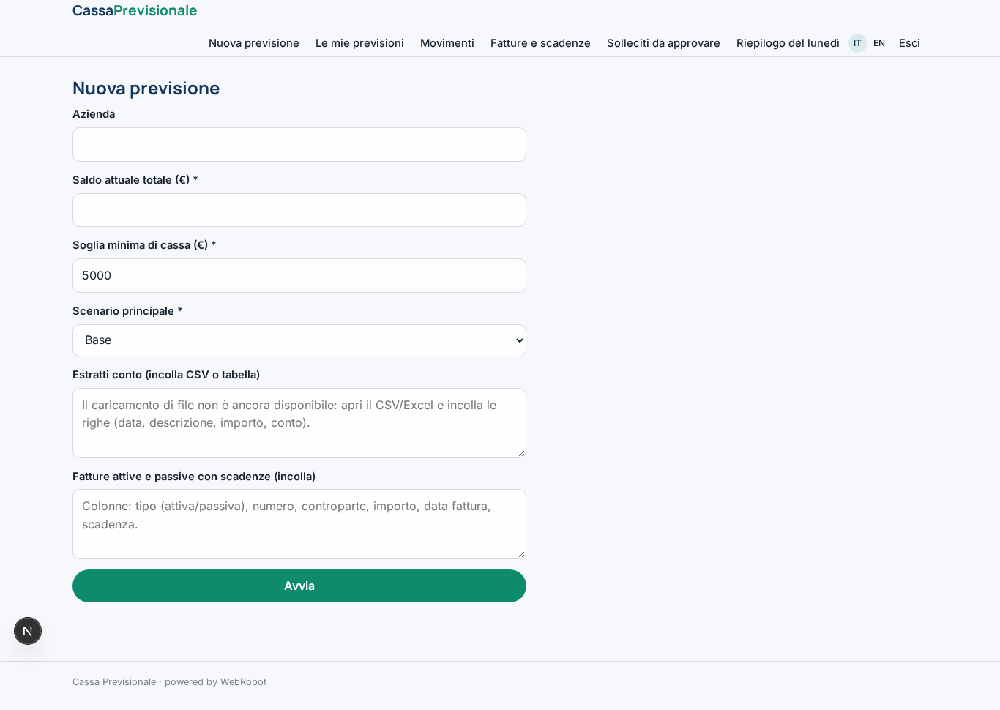
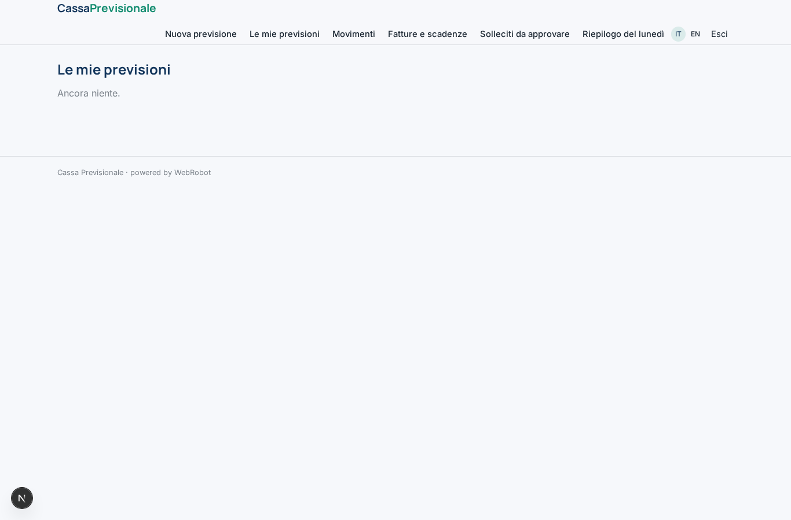
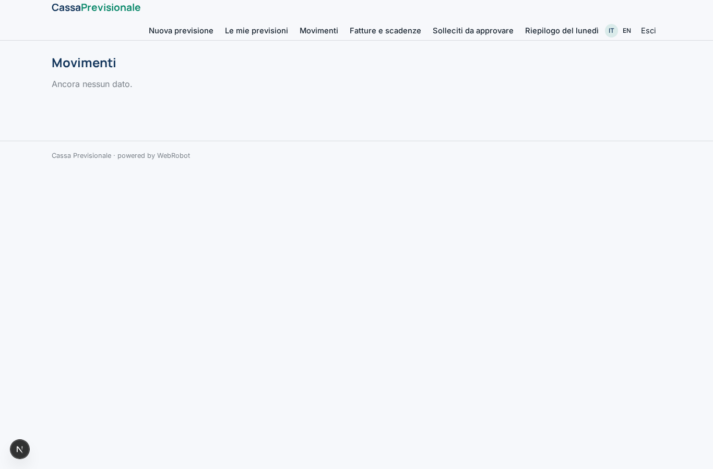
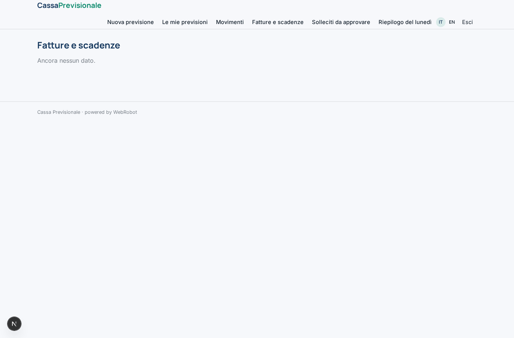
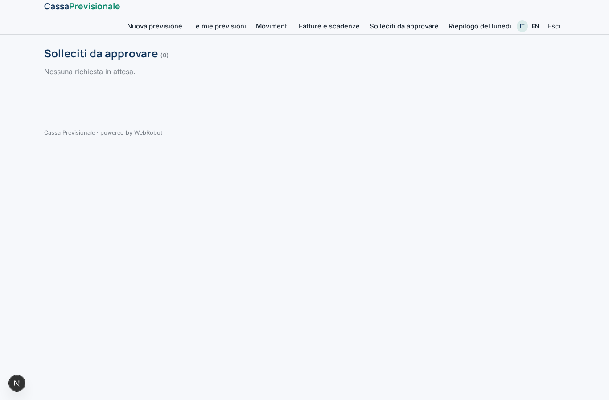
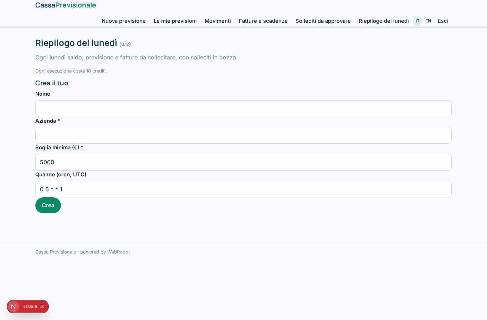
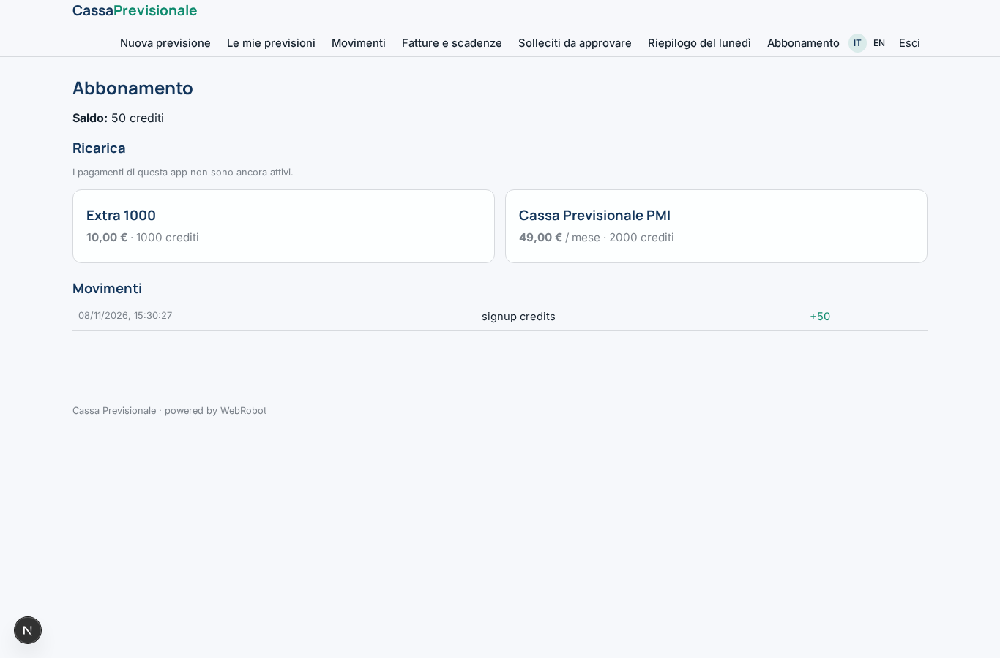

# Cassa Previsionale

_La previsione di cassa della tua PMI, sempre aggiornata._

**Manifest status:** valid (schema validator + runtime contract)

## Description given to the app builder (Italian)

Voglio Cassa Previsionale, uno strumento di tesoreria per PMI. Descrivo solo lo strato software: niente servizi di pagamento né accesso regolamentato ai conti, che restano a un istituto autorizzato. Il titolare o il responsabile amministrativo si registra e carica gli estratti conto in CSV o Excel delle sue banche e l'elenco di fatture attive e passive con scadenze; vorremmo in futuro collegare i conti via open banking tramite un provider autorizzato e importare le fatture dal cassetto fiscale. Un agente categorizza ogni movimento (fornitori, stipendi, tasse, incassi clienti), riconcilia i movimenti con le fatture e individua i clienti che pagano in ritardo. Poi costruisce una previsione di cassa a 13 settimane e a 12 mesi con scenari, e segnala in anticipo i giorni in cui il saldo rischia di andare sotto una soglia. Ogni lunedì arriva un'email con saldo, previsione e fatture da sollecitare, e l'agente prepara i solleciti in bozza da approvare. Il commercialista invitato vede in sola lettura. Ogni azienda vede solo i propri dati. Abbonamento mensile.

## Features not expressible today (spec.extensions)

- **file_upload**: Upload of CSV/Excel bank statements and invoice lists is not available yet: for now the user pastes the text.
- **email_digest**: The Monday email is not available yet: the summary is shown in the app (Monday summary view). Email notifications to be added when the platform supports them.
- **open_banking**: Account connection via an authorised open banking provider (needs per-customer credentials), planned for the future.
- **tax_drawer_import**: Import of invoices from the Italian cassetto fiscale (needs per-customer credentials), planned for the future.

## Screenshots (interpretive runtime)

### home-anon

### home-mobile

### home

### new

### forecasts

### transactions_view

### invoices_view

### approvals_view

### watches

### account

