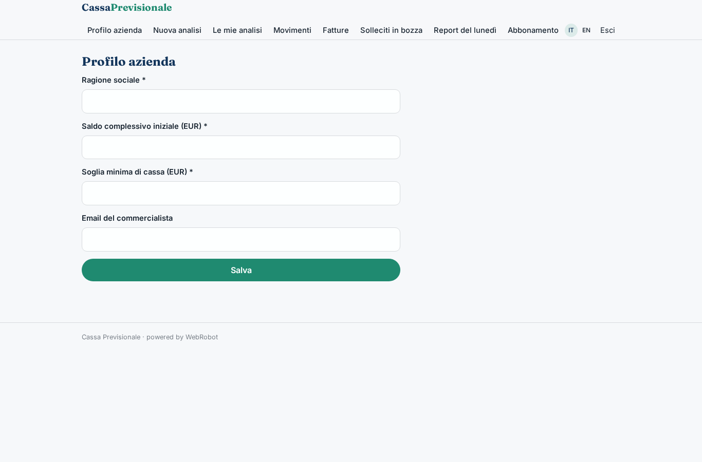
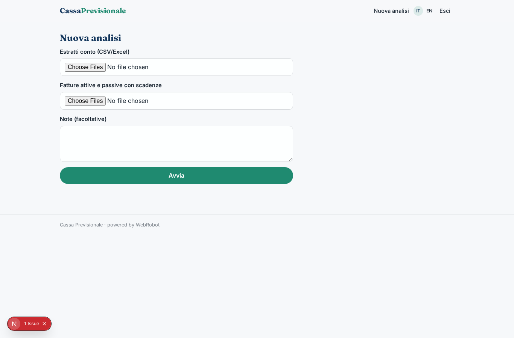
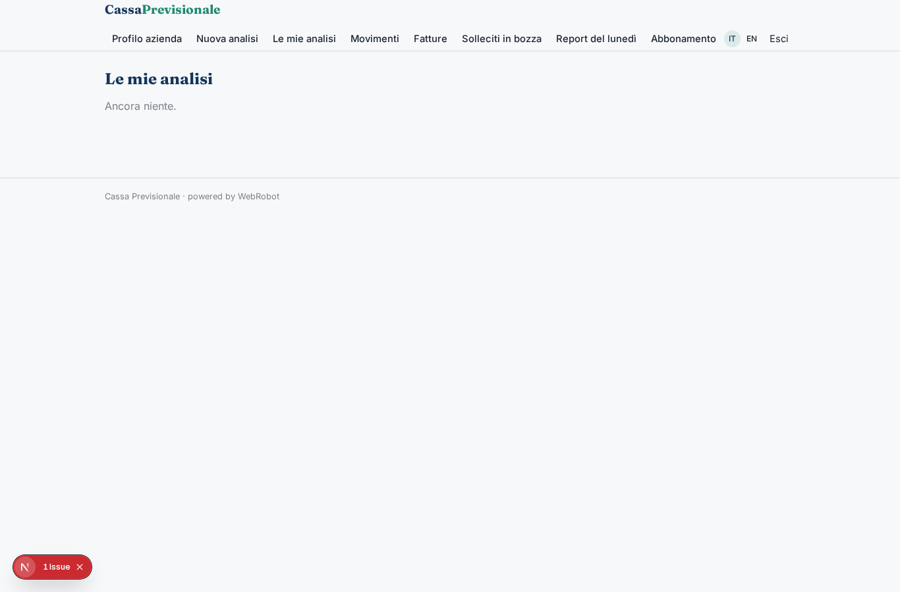
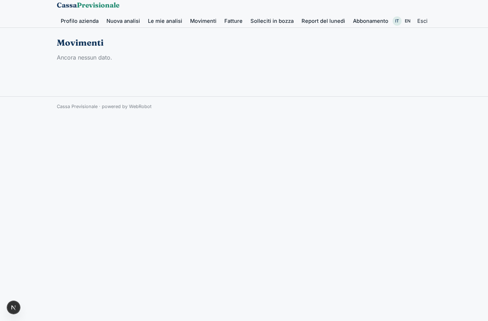
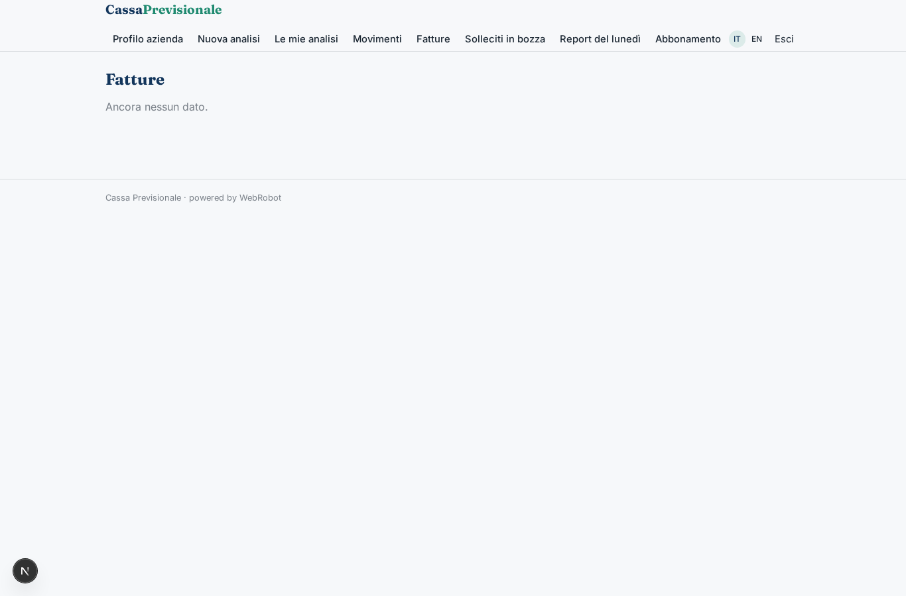
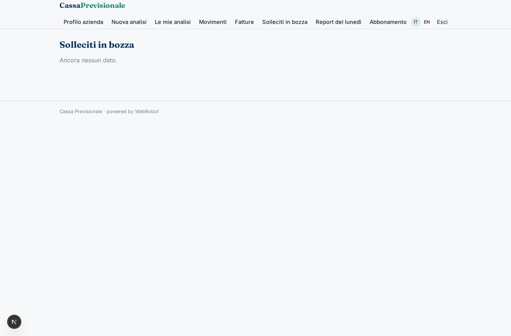
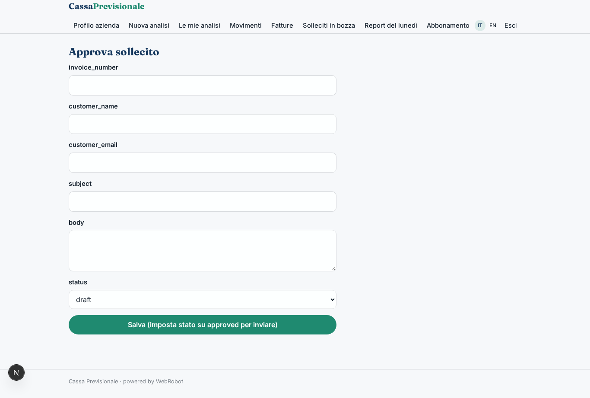
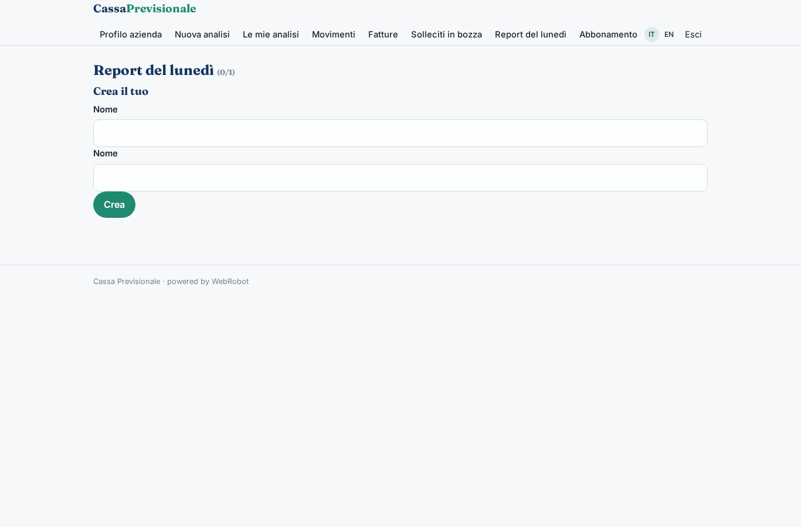
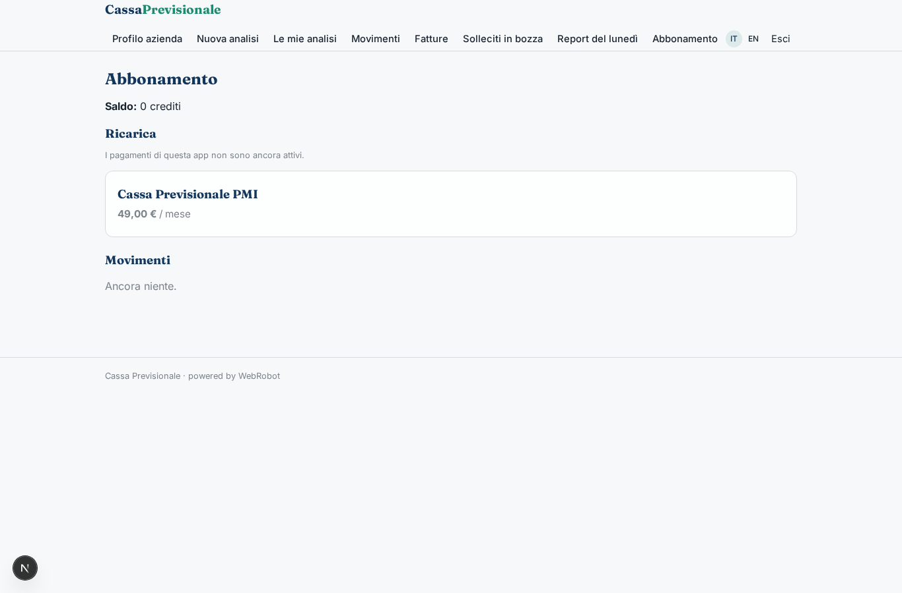

# Cassa Previsionale

_Previsione di cassa a 13 settimane e 12 mesi per la tua PMI._

**Manifest:** valid (schema + runtime contract) · **Functional test:** passed (15 checks passed)

## Description given to the app builder (Italian)

Voglio Cassa Previsionale, uno strumento di tesoreria per PMI. Descrivo solo lo strato software: niente servizi di pagamento né accesso regolamentato ai conti, che restano a un istituto autorizzato. Il titolare o il responsabile amministrativo si registra e carica gli estratti conto in CSV o Excel delle sue banche e l'elenco di fatture attive e passive con scadenze; vorremmo in futuro collegare i conti via open banking tramite un provider autorizzato e importare le fatture dal cassetto fiscale. Un agente categorizza ogni movimento (fornitori, stipendi, tasse, incassi clienti), riconcilia i movimenti con le fatture e individua i clienti che pagano in ritardo. Poi costruisce una previsione di cassa a 13 settimane e a 12 mesi con scenari, e segnala in anticipo i giorni in cui il saldo rischia di andare sotto una soglia. Ogni lunedì arriva un'email con saldo, previsione e fatture da sollecitare, e l'agente prepara i solleciti in bozza da approvare. Il commercialista invitato vede in sola lettura. Ogni azienda vede solo i propri dati. Abbonamento mensile.

## Features not expressible today (spec.extensions)

- **open_banking**: Collegamento dei conti via open banking tramite un provider autorizzato (AISP): non ancora disponibile, servono OAuth/consenso.
- **cassetto_fiscale**: Importazione automatica delle fatture dal cassetto fiscale (Agenzia delle Entrate): non ancora disponibile.

## Screenshots (interpretive runtime, no data)

### home-anon

### home-mobile

### home

### company_form

### new

### history

### movements

### invoices_view

### drafts

### draft_edit

### watches

### account

