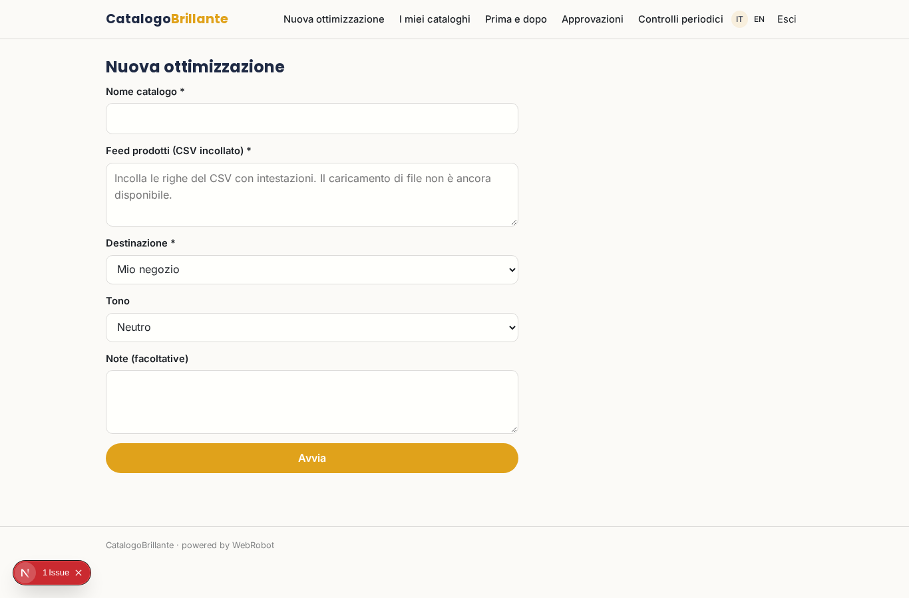
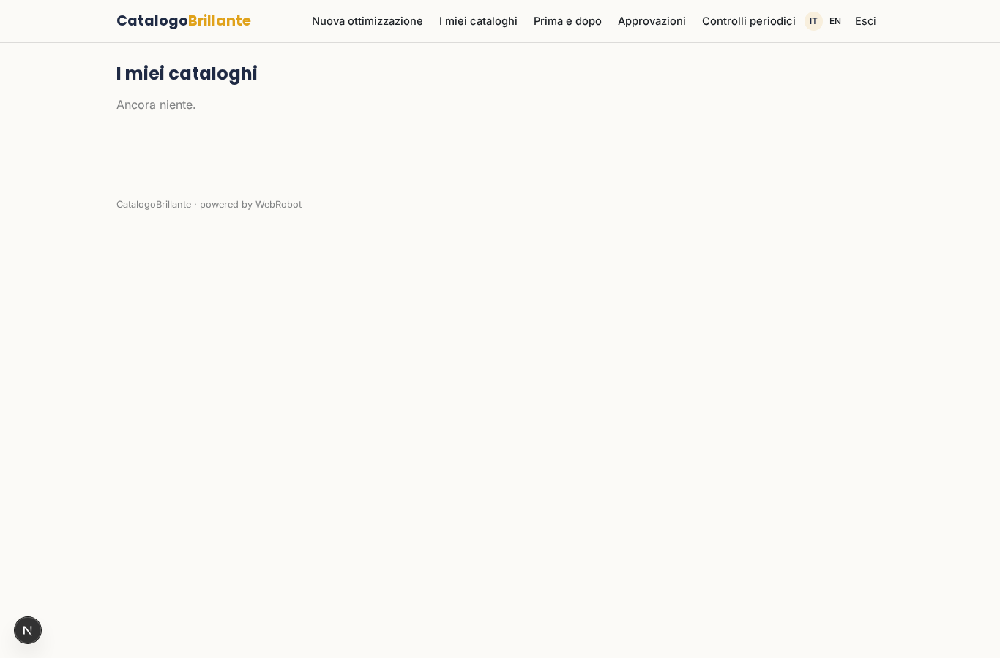
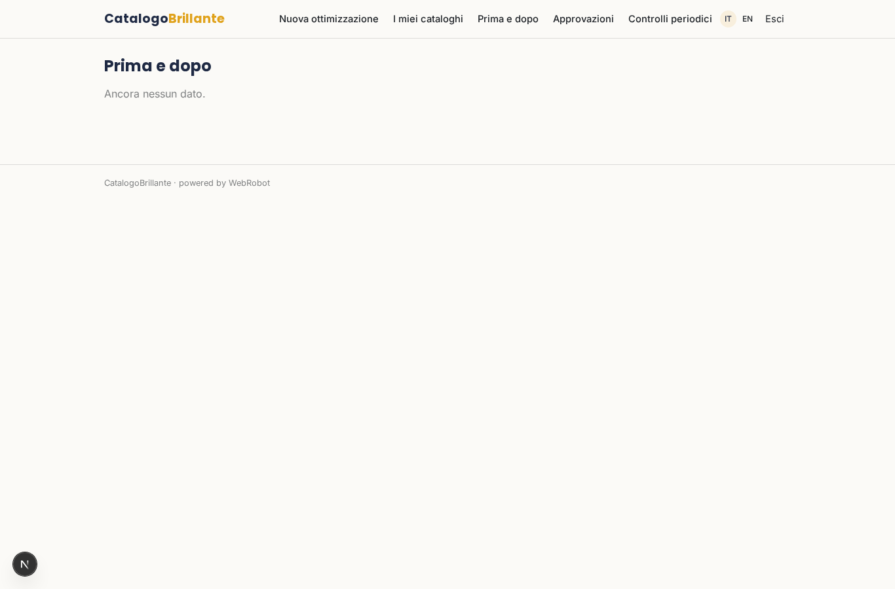
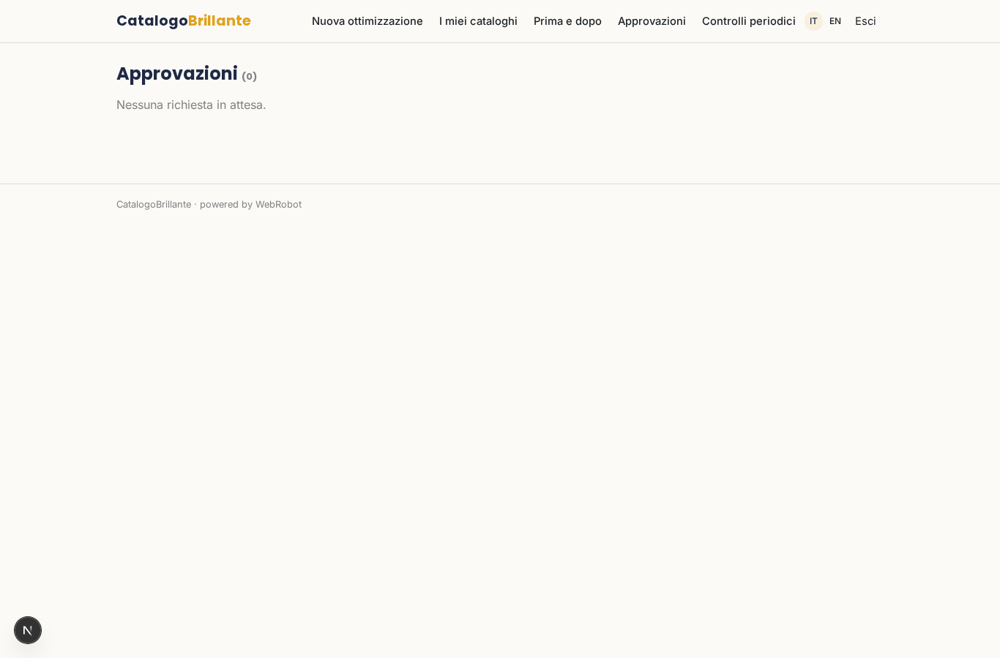
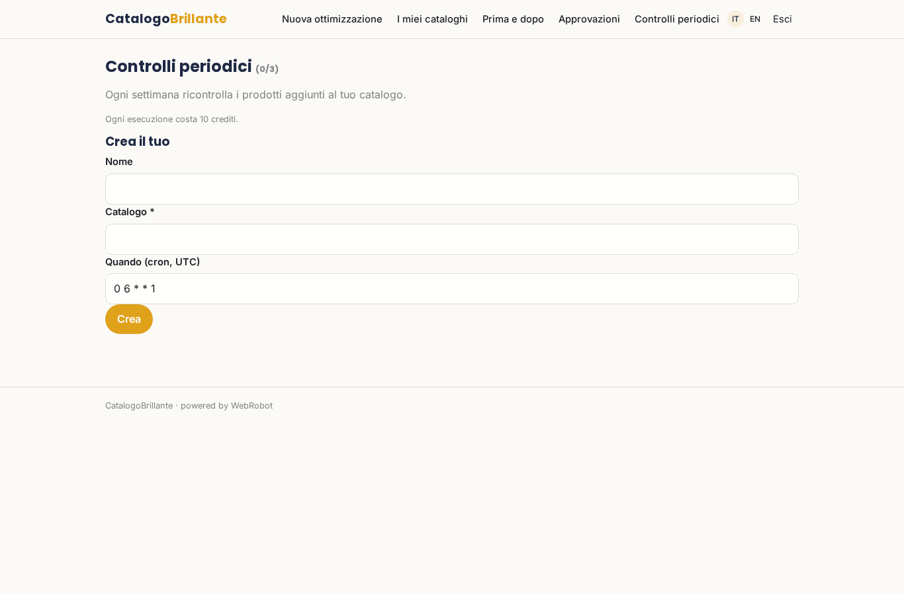
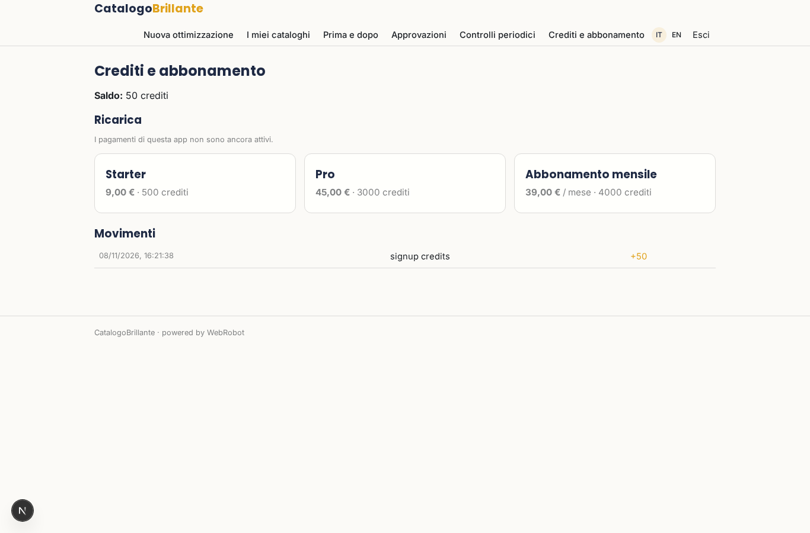

# CatalogoBrillante

_Schede prodotto complete, chiare e pronte a vendere._

**Manifest status:** valid (schema validator + runtime contract)

## Description given to the app builder (Italian)

CatalogoBrillante ottimizza i cataloghi prodotto degli e-commerce per renderli piu completi e vendibili. Il gestore del negozio carica il proprio feed prodotti (CSV, Excel o feed collegato) con titoli, descrizioni, categorie, attributi e immagini. Un agente analizza ogni scheda e trova i problemi: descrizioni troppo corte o duplicate, attributi mancanti, categorie errate, titoli poco chiari. Poi genera titoli e descrizioni migliori ottimizzati per la ricerca, propone la categoria corretta e riempie gli attributi mancanti deducendoli dai dati esistenti, sempre mantenendo i contenuti originali finche l'utente non approva le modifiche. L'utente vede una tabella con il prima e il dopo per ogni prodotto, approva in blocco o singolarmente, e riesporta il feed corretto pronto da ricaricare sul proprio store o sui marketplace. Un modello periodico ricontrolla i nuovi prodotti aggiunti. Ogni negozio vede solo i propri cataloghi. Si paga a consumo con crediti per prodotto ottimizzato, oppure abbonamento mensile. In italiano e inglese.

## Features not expressible today (spec.extensions)

- **file_upload**: Uploading CSV/Excel files is not available yet: the feed is pasted as text.
- **linked_feed**: Linked feeds from a customer's URL or store connector (credentials per shop) are not available yet.
- **approve_in_bulk**: Per-product bulk approval buttons and a ready-to-download corrected feed file are limited to the approvals view and the CSV export; a dedicated bulk-approve UI is a future extension.

## Screenshots (interpretive runtime)

### home-anon

### home-mobile

### home

### new_run

### history

### before_after

### approvals

### watches

### account

