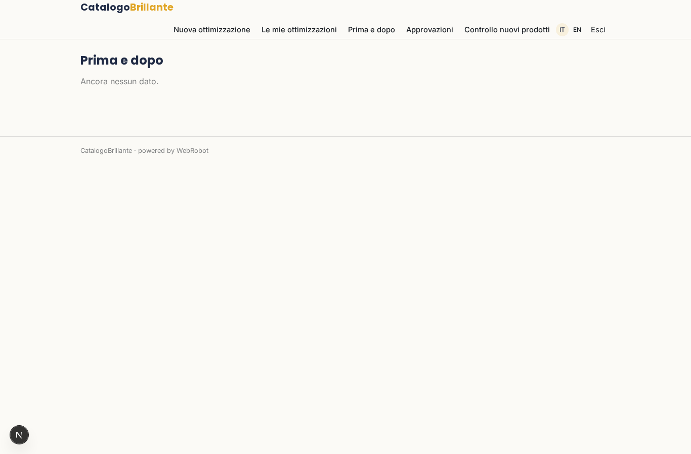
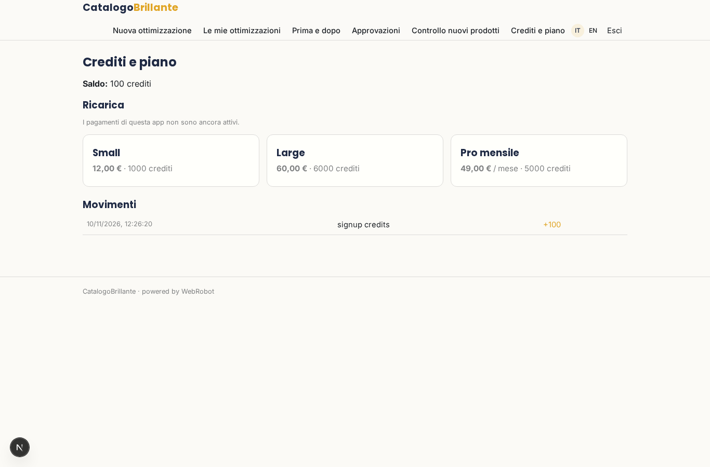

# CatalogoBrillante

_Cataloghi prodotto più completi e più vendibili._

**Manifest:** valid (schema + runtime contract) · **Functional test:** passed (13 checks passed)

## Description given to the app builder (Italian)

CatalogoBrillante ottimizza i cataloghi prodotto degli e-commerce per renderli piu completi e vendibili. Il gestore del negozio carica il proprio feed prodotti (CSV, Excel o feed collegato) con titoli, descrizioni, categorie, attributi e immagini. Un agente analizza ogni scheda e trova i problemi: descrizioni troppo corte o duplicate, attributi mancanti, categorie errate, titoli poco chiari. Poi genera titoli e descrizioni migliori ottimizzati per la ricerca, propone la categoria corretta e riempie gli attributi mancanti deducendoli dai dati esistenti, sempre mantenendo i contenuti originali finche l'utente non approva le modifiche. L'utente vede una tabella con il prima e il dopo per ogni prodotto, approva in blocco o singolarmente, e riesporta il feed corretto pronto da ricaricare sul proprio store o sui marketplace. Un modello periodico ricontrolla i nuovi prodotti aggiunti. Ogni negozio vede solo i propri cataloghi. Si paga a consumo con crediti per prodotto ottimizzato, oppure abbonamento mensile. In italiano e inglese.

## Screenshots (interpretive runtime, no data)

### home-anon

### home-mobile

### home

### new

### runs

### products_table

### review

### approvals

### watches

### account

