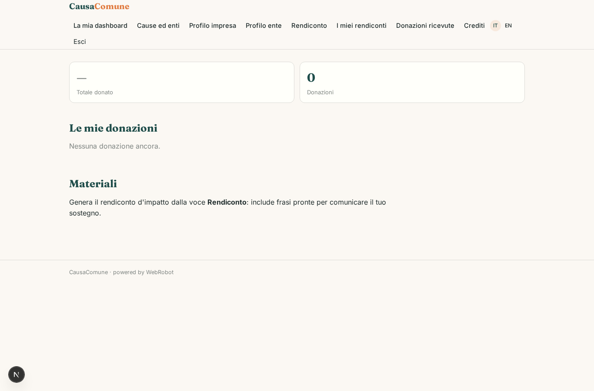
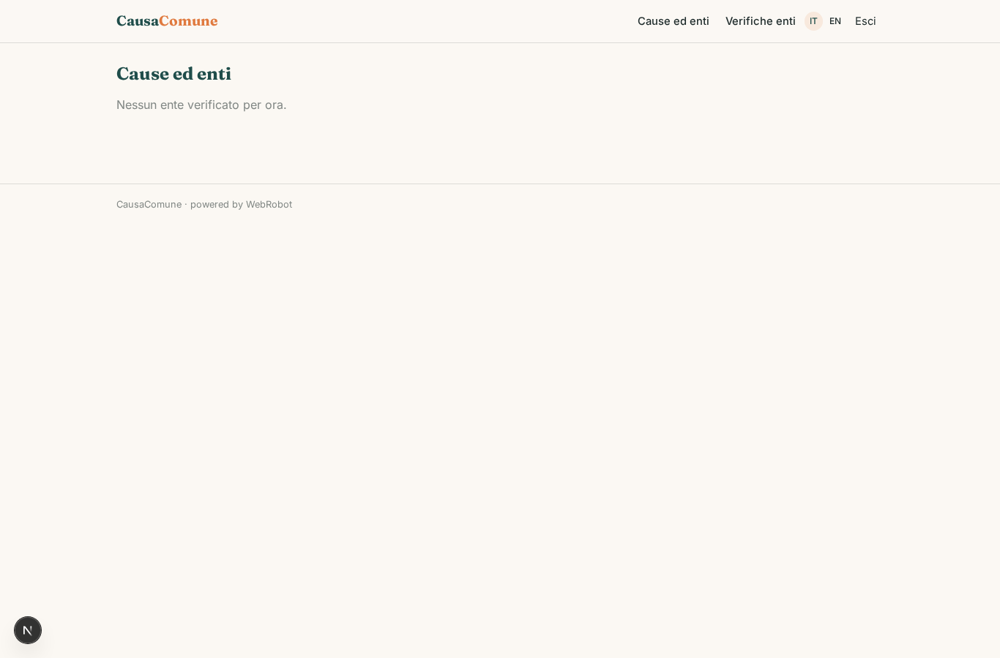
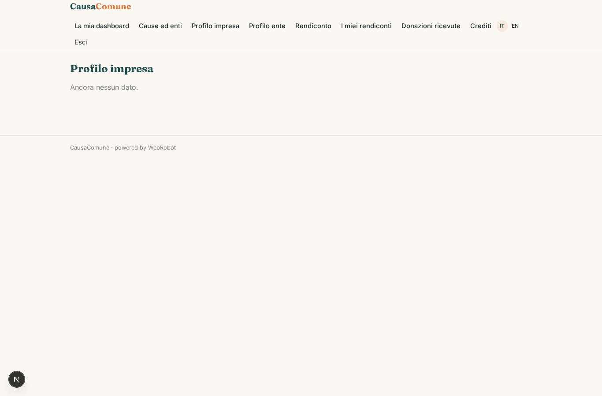
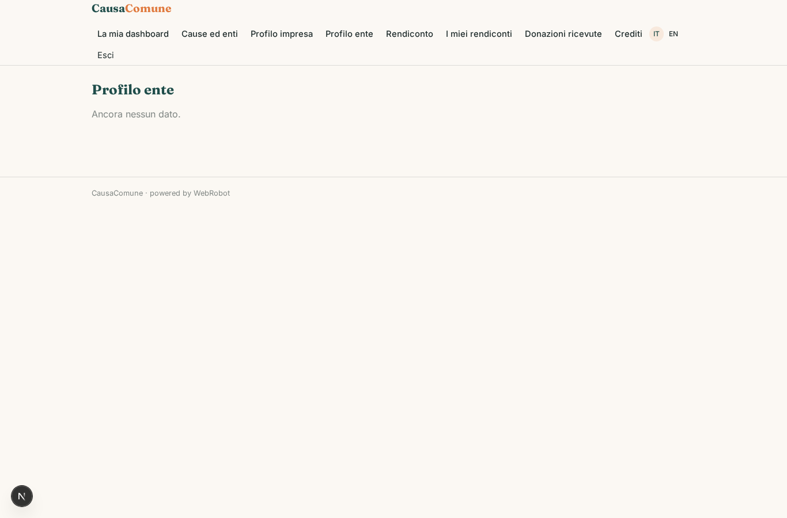
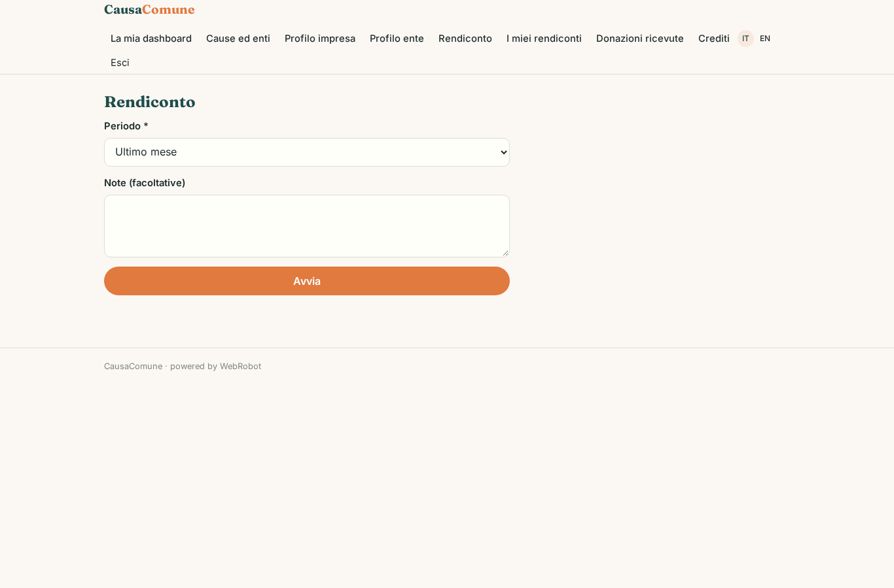
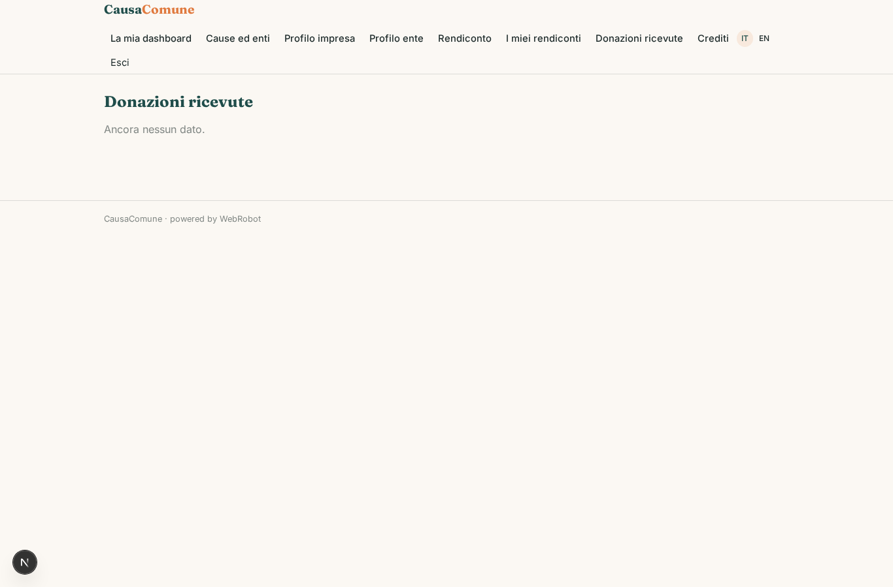
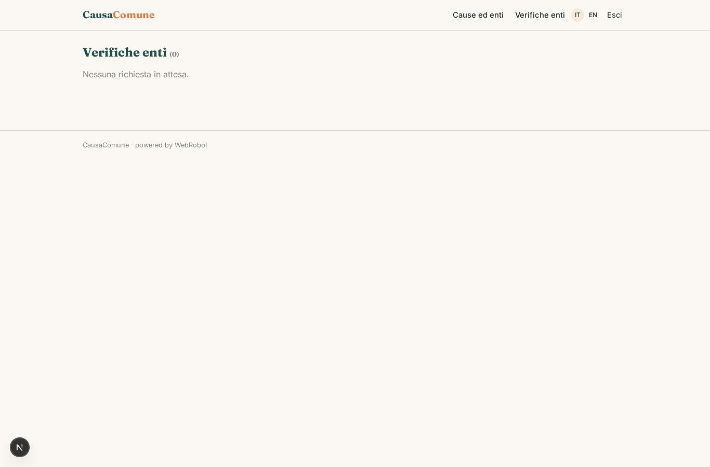
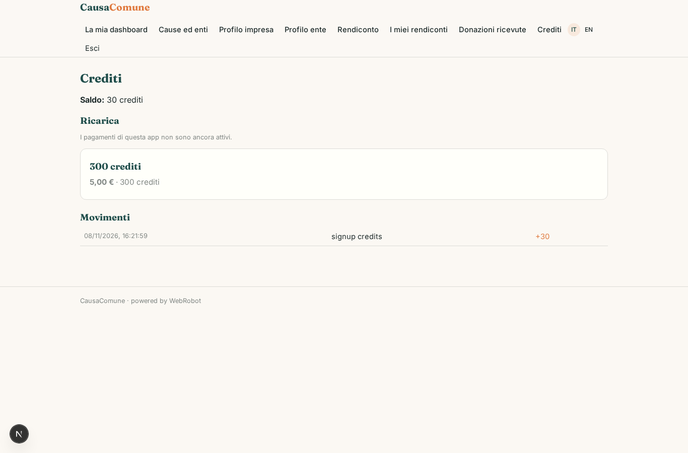

# CausaComune

_Le imprese sostengono le cause, gli enti verificati ricevono i fondi._

**Manifest status:** valid (schema validator + runtime contract)

## Description given to the app builder (Italian)

CausaComune collega imprese che vogliono sostenere cause sociali con gli enti del terzo settore. Le aziende si registrano, scelgono le cause da sostenere e attivano donazioni (una tantum o ricorrenti, oppure legate a ogni vendita) pagando tramite la piattaforma, che gira i fondi agli enti con Stripe Connect. Gli enti compilano un profilo con la loro attivita e i progetti; prima di poter ricevere fondi vengono verificati controllando l'iscrizione nel RUNTS, il registro pubblico del terzo settore. Un agente supporta la verifica confrontando i dati dichiarati con il registro e segnala le incongruenze a un operatore che approva l'ente. Le aziende vedono una dashboard con quanto hanno donato, a chi, e i materiali per comunicarlo (badge, report d'impatto); gli enti vedono le donazioni ricevute e i sostenitori. I rendiconti d'impatto vengono inviati via email. Ogni azienda e ogni ente vede solo i propri dati. La piattaforma trattiene una piccola commissione sulle donazioni. In italiano.

## Features not expressible today (spec.extensions)

- **donation_checkout**: Flusso di donazione (scelta ente, importo, una tantum o ricorrente, pagamento Stripe Connect con commissione) che crea il record in donations: non esprimibile con le viste attuali.
- **per_sale_donations**: Donazioni legate a ogni vendita: richiedono connettori allo store/POS con le credenziali di ogni impresa, non ancora disponibili.
- **ente_side_visibility**: Gli enti vedono solo le donazioni a loro destinate e i sostenitori: serve la condivisione per-record da impresa a ente (sharing viewer), da completare.
- **email_impact_reports**: Invio via email dei rendiconti d'impatto: notifiche non ancora disponibili; per ora il rendiconto si consulta e stampa nell'app.
- **badges**: Badge scaricabili del sostegno: per ora solo frasi pronte nel rendiconto, i file grafici non sono ancora gestiti.

## Screenshots (interpretive runtime)

### home-anon

### home-mobile

### home

### dashboard

### enti_catalog

### company_profile

### ente_profile

### new_report

### reports

### supporters

### checks

### account

