# CausaComune

_Le imprese sostengono le cause sociali, gli enti del terzo settore ricevono fondi verificati._

**Manifest:** valid (schema + runtime contract) · **Functional test:** passed (27 checks passed)

## Description given to the app builder (Italian)

CausaComune collega imprese che vogliono sostenere cause sociali con gli enti del terzo settore. Le aziende si registrano, scelgono le cause da sostenere e attivano donazioni (una tantum o ricorrenti, oppure legate a ogni vendita) pagando tramite la piattaforma, che gira i fondi agli enti con Stripe Connect. Gli enti compilano un profilo con la loro attivita e i progetti; prima di poter ricevere fondi vengono verificati controllando l'iscrizione nel RUNTS, il registro pubblico del terzo settore. Un agente supporta la verifica confrontando i dati dichiarati con il registro e segnala le incongruenze a un operatore che approva l'ente. Le aziende vedono una dashboard con quanto hanno donato, a chi, e i materiali per comunicarlo (badge, report d'impatto); gli enti vedono le donazioni ricevute e i sostenitori. I rendiconti d'impatto vengono inviati via email. Ogni azienda e ogni ente vede solo i propri dati. La piattaforma trattiene una piccola commissione sulle donazioni. In italiano.

## Functional test: what did not pass

- **saved record shown where its collection is read** (view sostenitori): a record was saved in donations (by user) but the page does not show it (as ente) _(warning)_

## Features not expressible today (spec.extensions)

- **donation_checkout**: Pagamento delle donazioni con Stripe Connect verso l'ente (una tantum, abbonamento ricorrente, e quota per ogni vendita da integrare con il negozio dell'azienda), compilazione di ente_email e company_name sul record, blocco delle donazioni verso enti non approvati.
- **badge_download**: Badge in formato immagine scaricabile; per ora è mostrato come HTML nella pagina Materiali.
- **ente_status_protection**: Il campo status del profilo ente dovrebbe poter essere modificato solo dagli operatori: oggi l'accesso in scrittura è condiviso con il proprietario del record.

## Screenshots (interpretive runtime, no data)

### home-anon
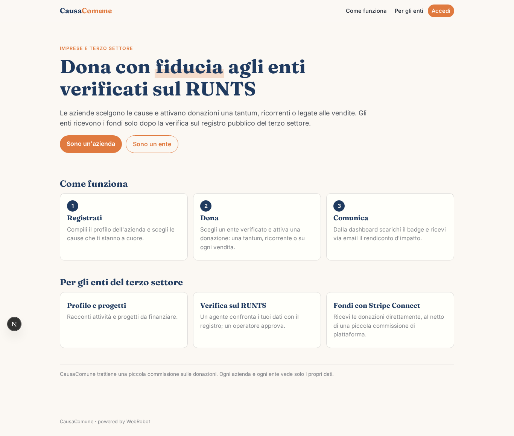

### home-mobile
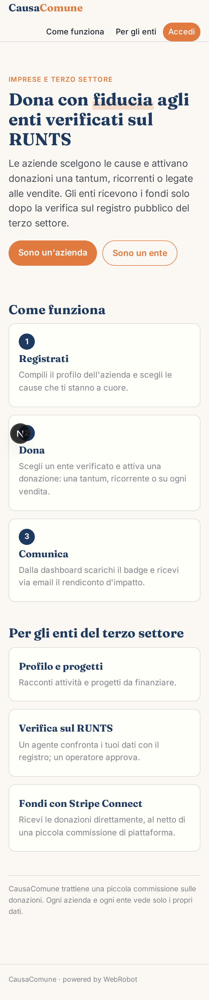

### home
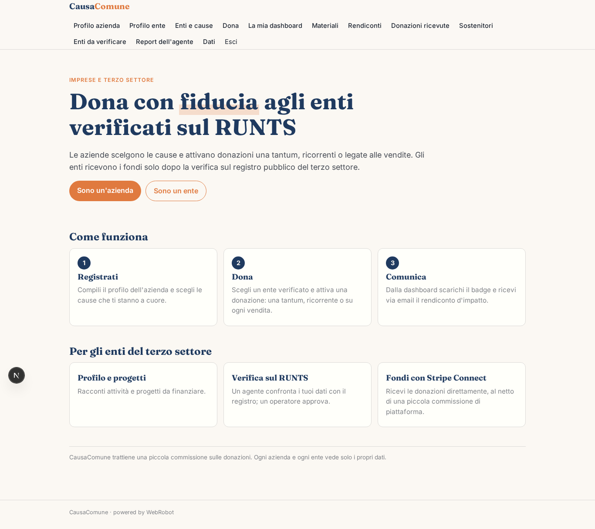

### profilo_azienda
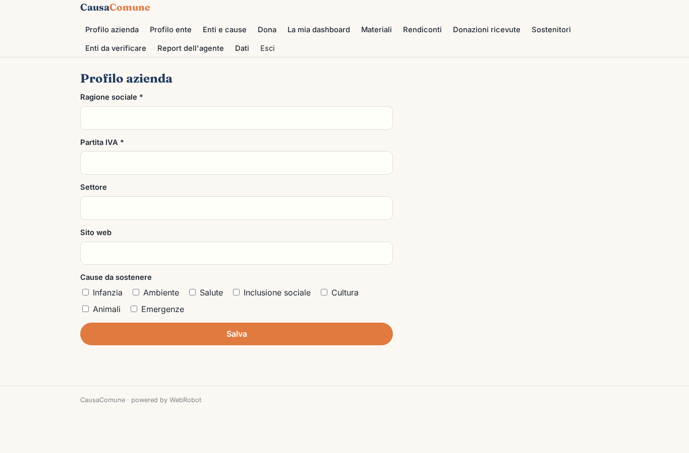

### profilo_ente
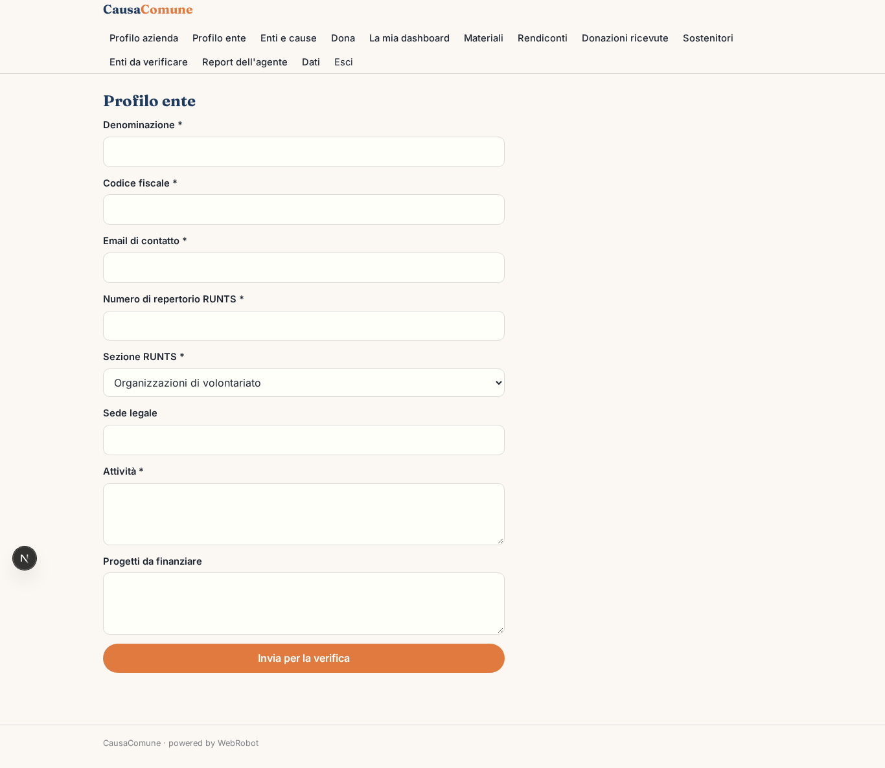

### cause
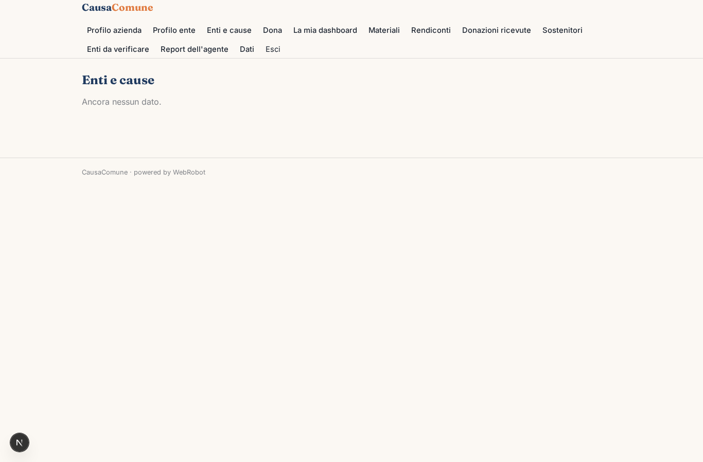

### dona
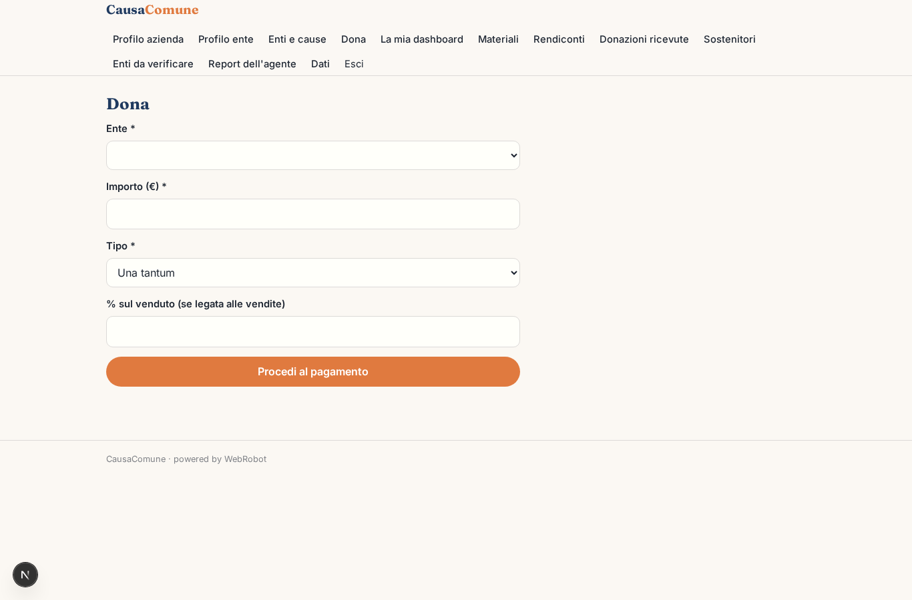

### dashboard
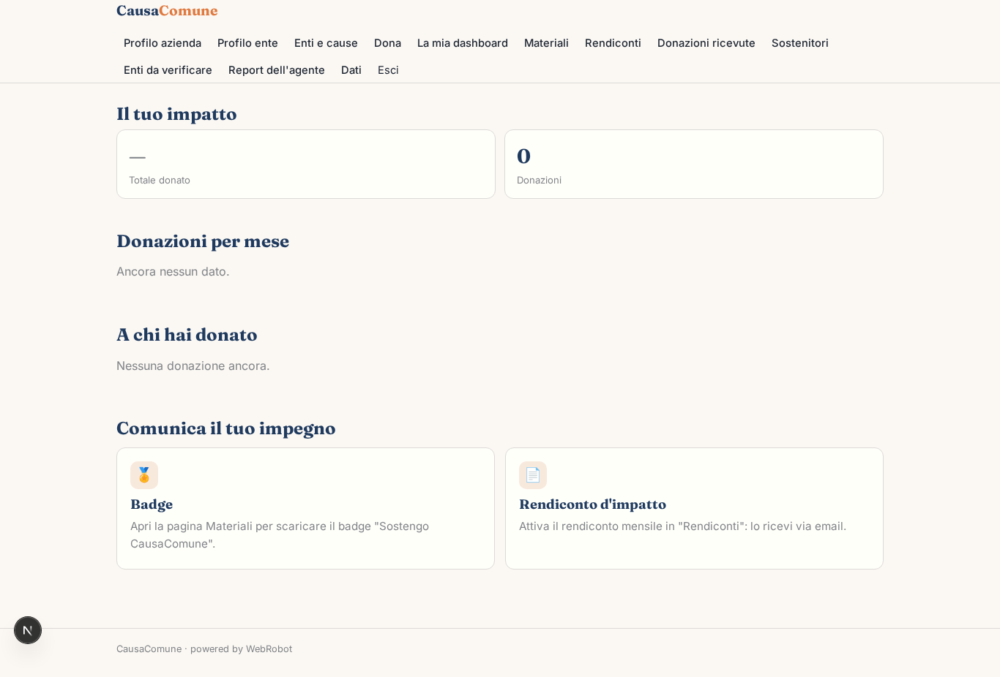

### materiali
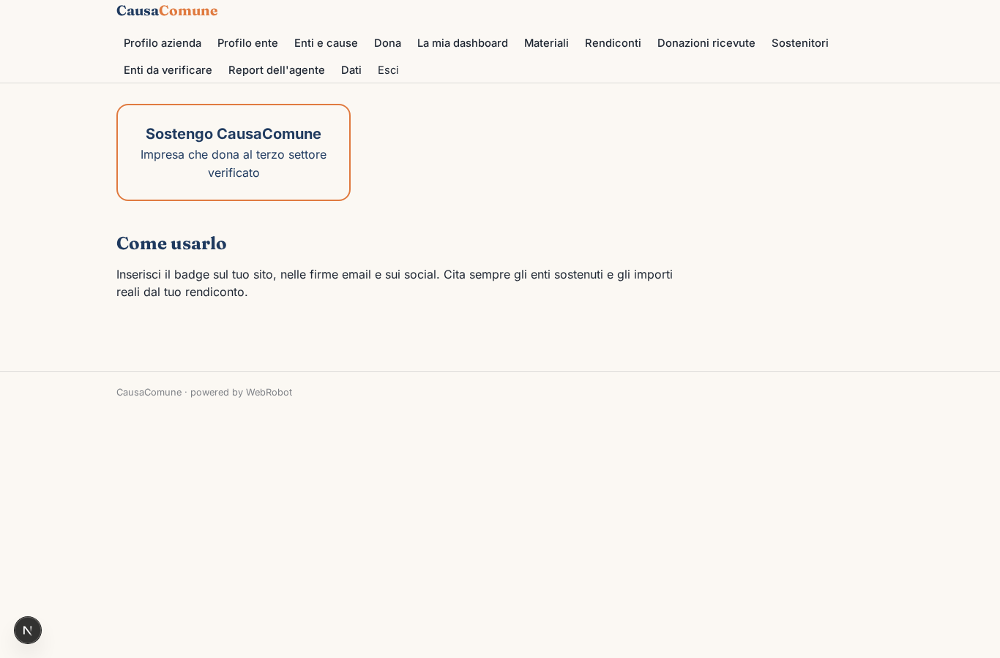

### rendiconti
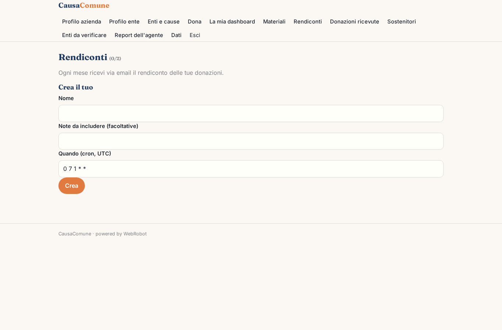

### donazioni_ente
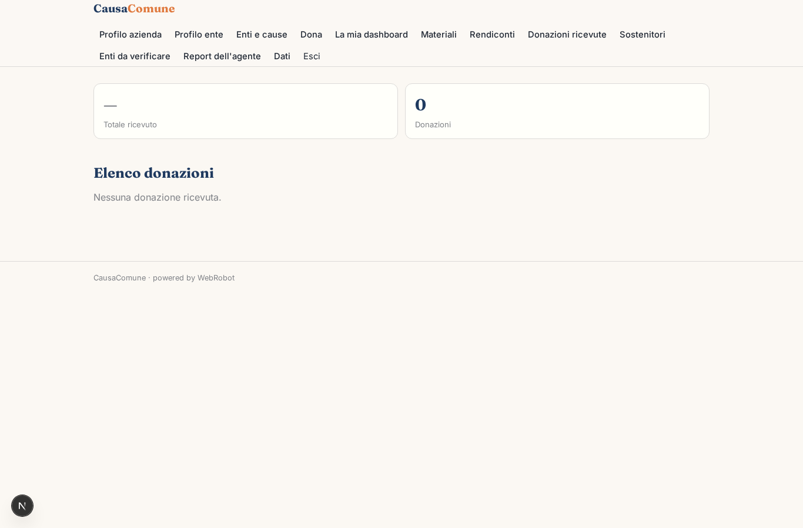

### sostenitori
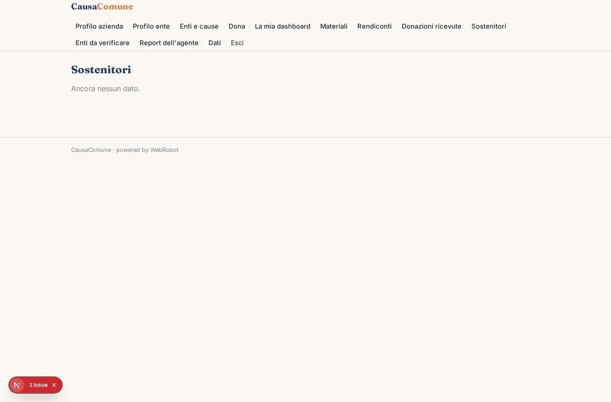

### coda_verifiche
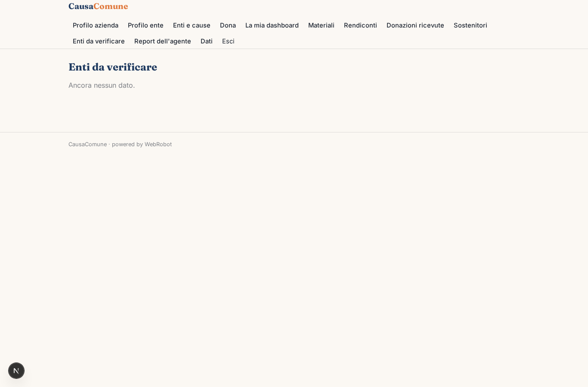

### verifiche
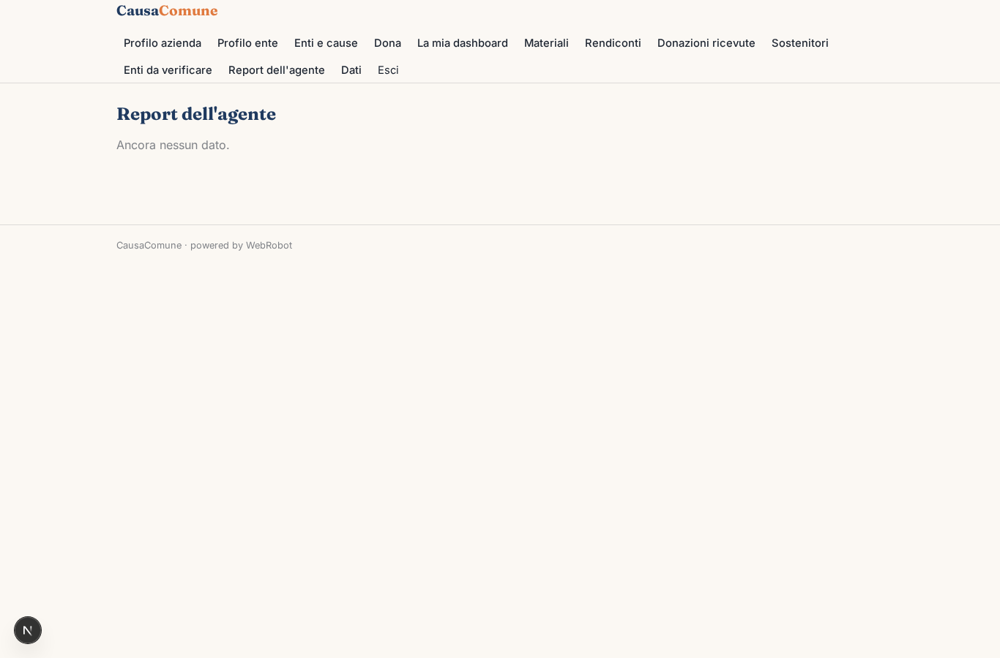

### approva
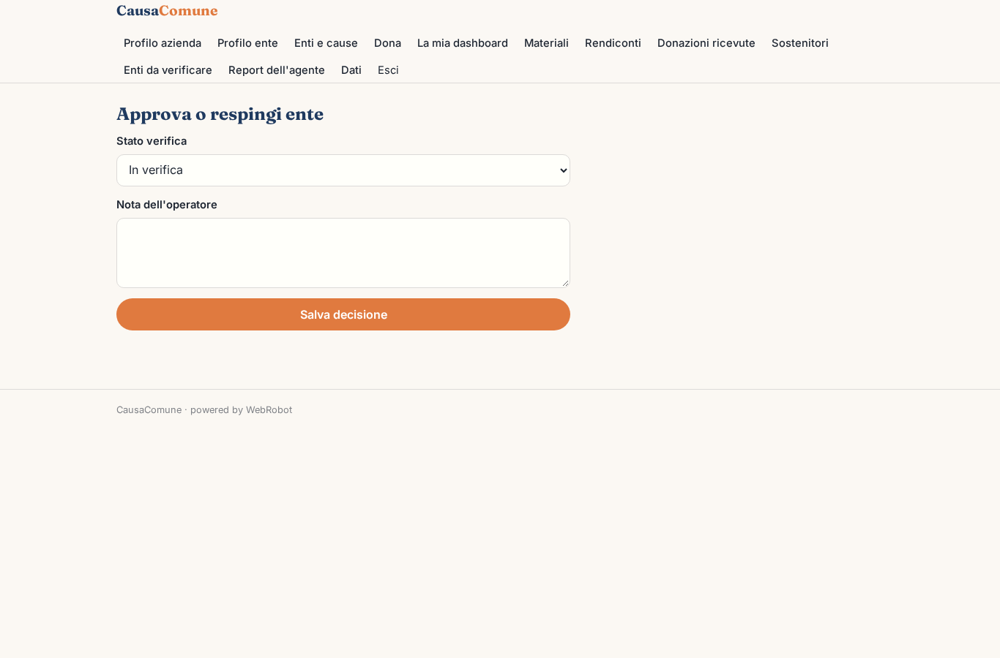
