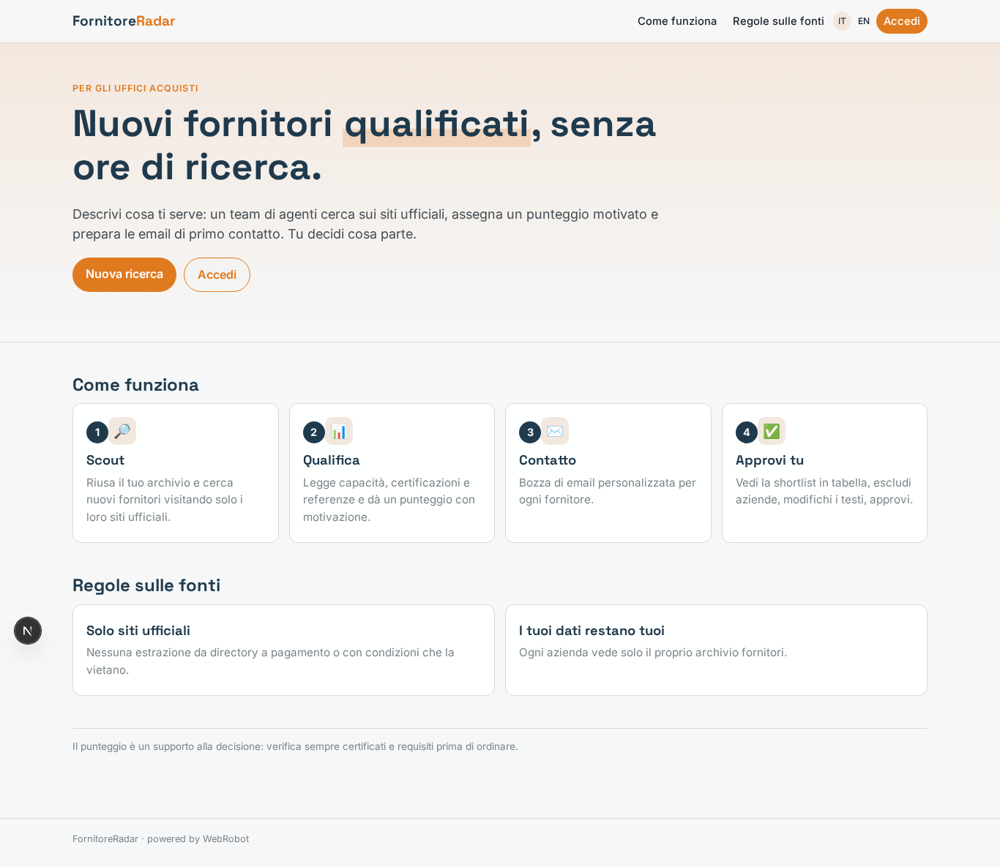
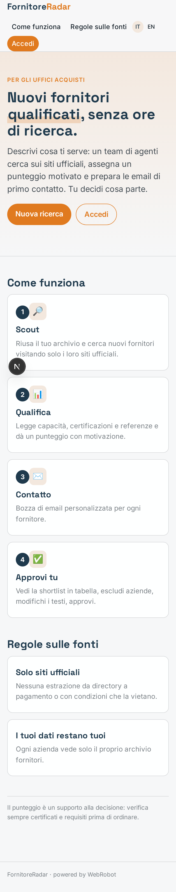
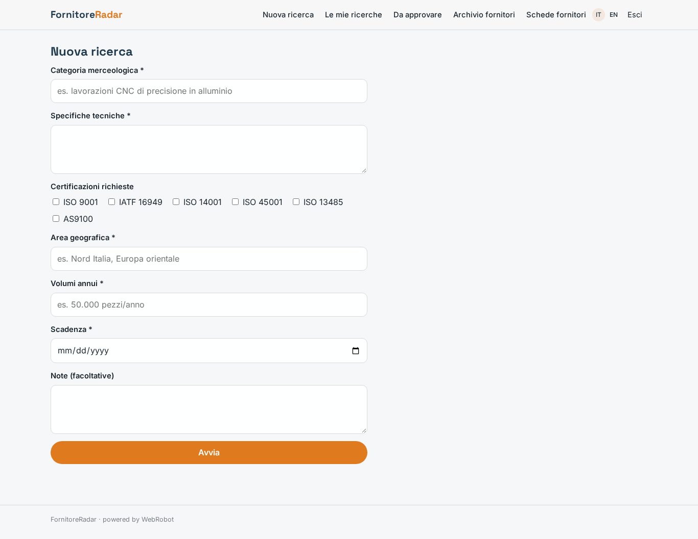
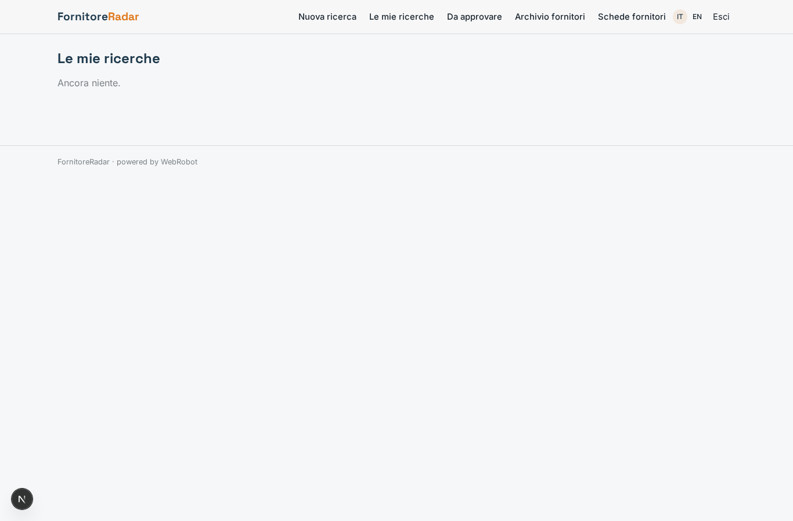
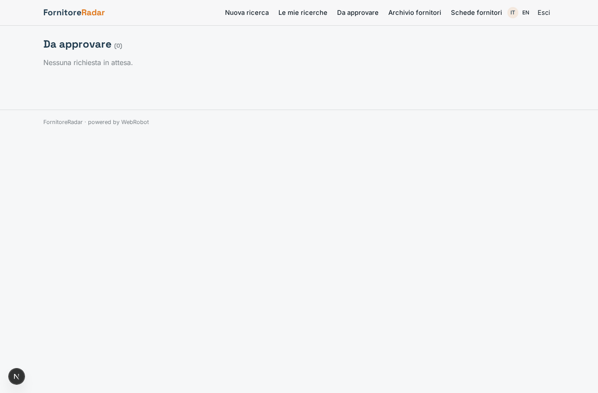
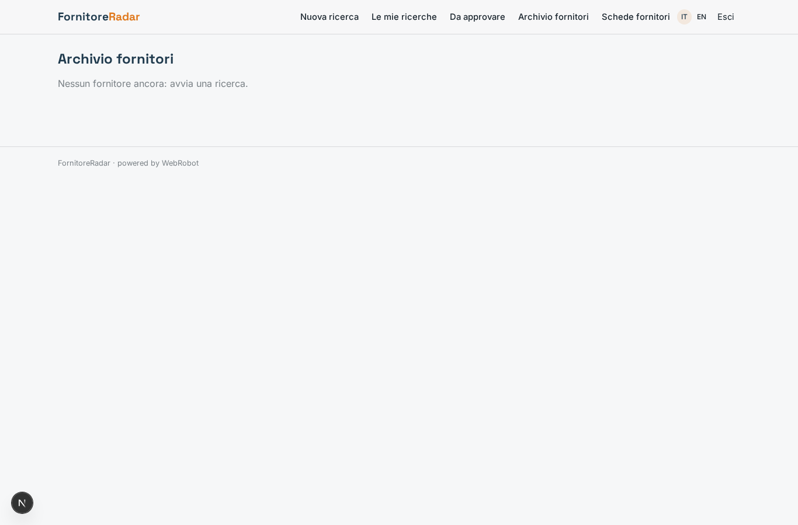
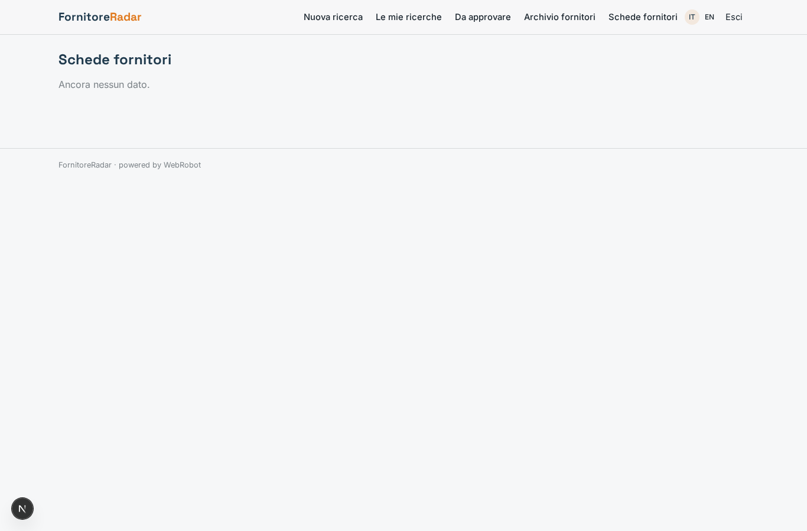
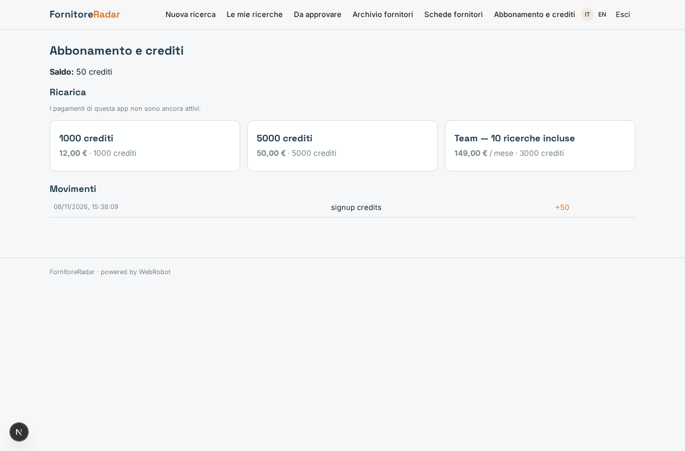

# FornitoreRadar

_Trova, qualifica e contatta nuovi fornitori industriali, con la tua approvazione._

**Stato manifest:** valido (validatore Python + contratto runtime)

## Descrizione data all'app builder

Mi serve FornitoreRadar, uno strumento per gli uffici acquisti di aziende manifatturiere. Il buyer inserisce una richiesta: categoria merceologica, specifiche tecniche, certificazioni richieste (ISO 9001, IATF), area geografica, volumi annui e scadenza. Un team di agenti lavora in sequenza: il primo cerca potenziali fornitori sul web e visita solo i siti aziendali ufficiali (niente directory a pagamento o con condizioni che vietano l'estrazione), il secondo li qualifica leggendo capacità produttive, certificazioni e referenze e assegna un punteggio motivato, il terzo scrive un'email di primo contatto personalizzata. Prima dell'invio il buyer vede la shortlist in tabella, può escludere aziende e modificare il testo, poi approva. Le email partono dalla casella aziendale e le risposte vengono lette automaticamente, riassunte e collegate al fornitore, così la scheda mostra lo storico. Tutti i fornitori trovati finiscono in un archivio ricercabile che cresce nel tempo e viene riusato nelle ricerche successive. Ogni azienda vede solo i propri dati. Abbonamento mensile per azienda con un numero di ricerche incluse, oltre si scalano crediti. Interfaccia in italiano e inglese.

## Funzioni non esprimibili oggi (spec.extensions)

- **email_send**: Invio delle email dalla casella aziendale del buyer: non disponibile (serve connettore con credenziali del cliente). Per ora le bozze approvate si copiano e si inviano a mano.
- **reply_reading**: Lettura automatica delle risposte, riassunto e collegamento al fornitore: non disponibile (richiede accesso alla casella). Il buyer può annotare le risposte nel campo storico contatti della scheda fornitore.
- **notifications**: Avvisi email a ricerca terminata o approvazione in attesa: non disponibili.

## Screenshot (runtime interpretativo)

### home-anon

### home-mobile

### home

### new_search

### searches

### to_approve

### archive

### supplier_cards

### account

