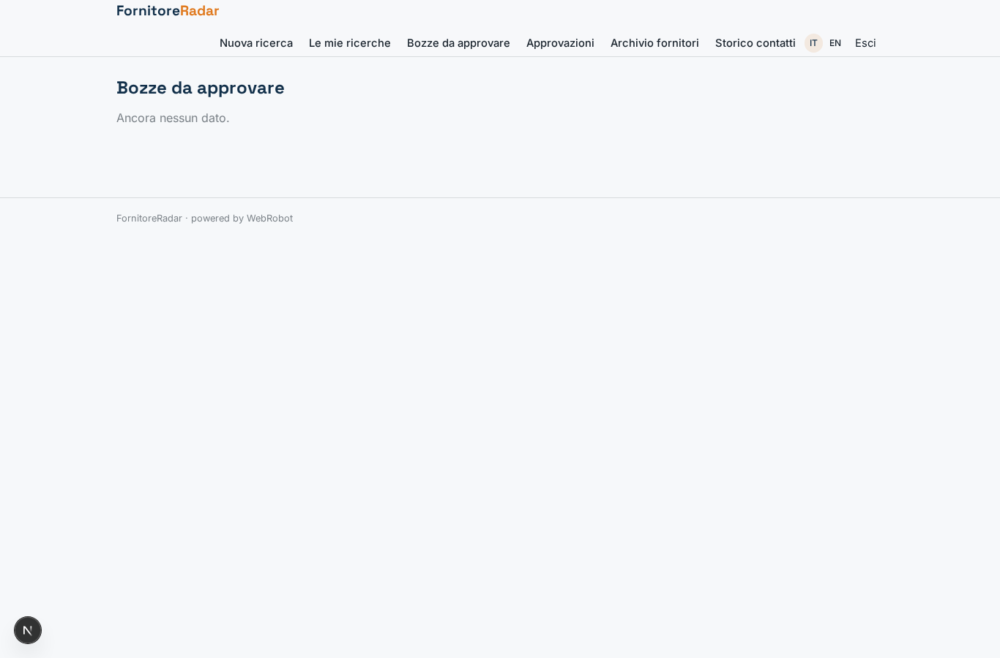
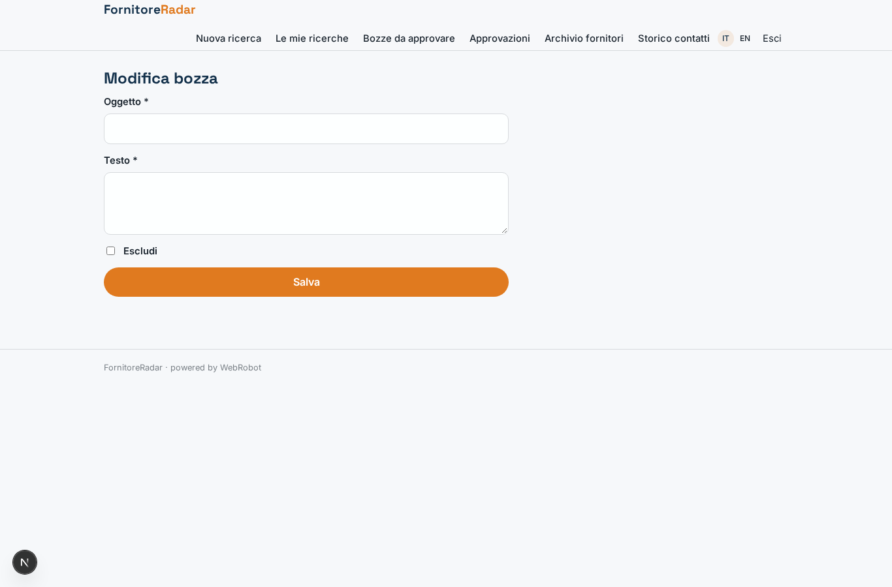
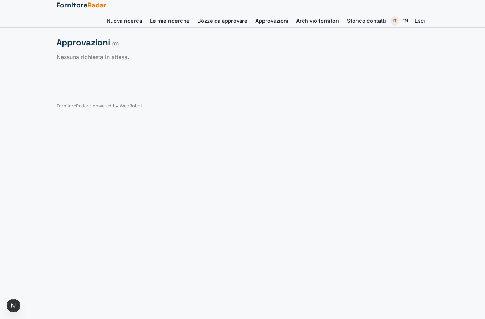
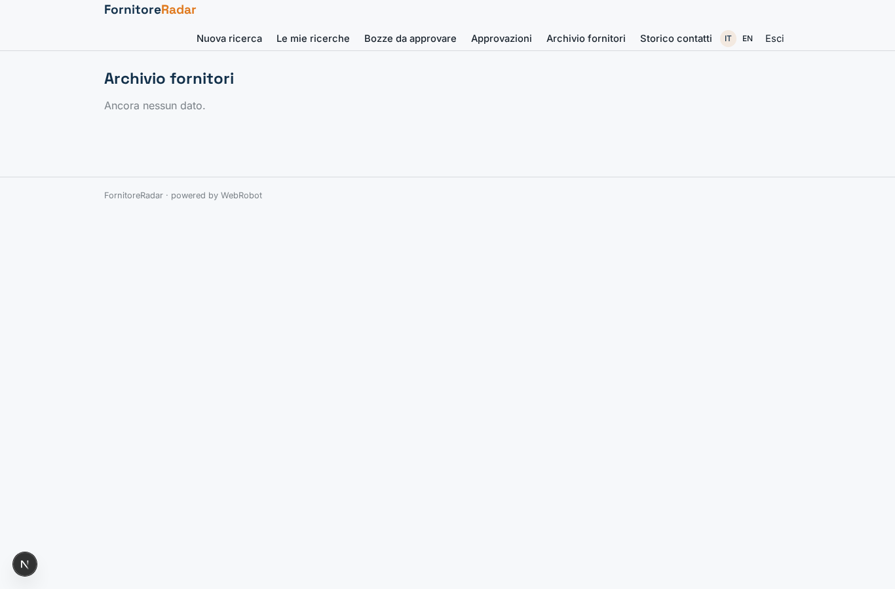
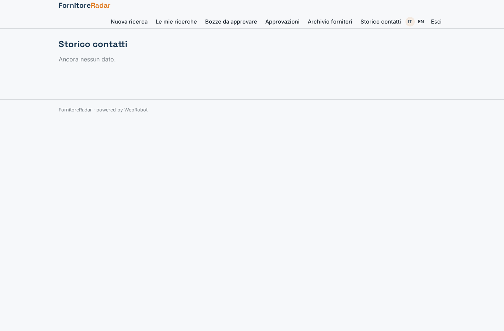
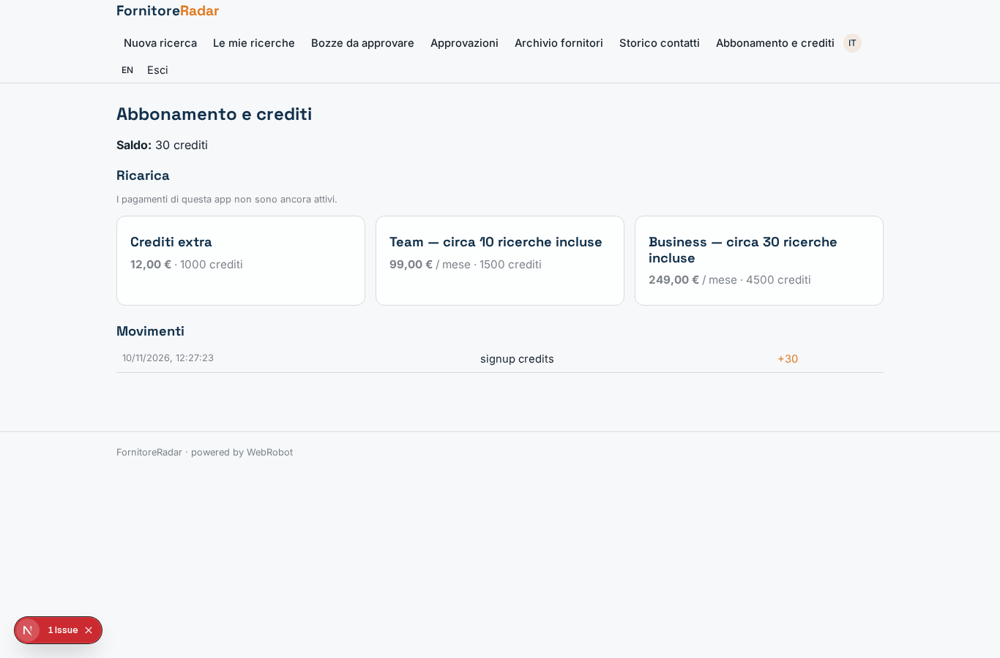

# FornitoreRadar

_Trova, qualifica e contatta nuovi fornitori in un'unica ricerca._

**Manifest:** valid (schema + runtime contract) · **Functional test:** passed (11 checks passed)

## Description given to the app builder (Italian)

Mi serve FornitoreRadar, uno strumento per gli uffici acquisti di aziende manifatturiere. Il buyer inserisce una richiesta: categoria merceologica, specifiche tecniche, certificazioni richieste (ISO 9001, IATF), area geografica, volumi annui e scadenza. Un team di agenti lavora in sequenza: il primo cerca potenziali fornitori sul web e visita solo i siti aziendali ufficiali (niente directory a pagamento o con condizioni che vietano l'estrazione), il secondo li qualifica leggendo capacità produttive, certificazioni e referenze e assegna un punteggio motivato, il terzo scrive un'email di primo contatto personalizzata. Prima dell'invio il buyer vede la shortlist in tabella, può escludere aziende e modificare il testo, poi approva. Le email partono dalla casella aziendale e le risposte vengono lette automaticamente, riassunte e collegate al fornitore, così la scheda mostra lo storico. Tutti i fornitori trovati finiscono in un archivio ricercabile che cresce nel tempo e viene riusato nelle ricerche successive. Ogni azienda vede solo i propri dati. Abbonamento mensile per azienda con un numero di ricerche incluse, oltre si scalano crediti. Interfaccia in italiano e inglese.

## Design checks (who fills each collection)

- collection supplier_events: view history_events reads it, but nothing writes it — add a form view on it (the users fill their own records), an agent tool that writes or appends to it, or a trigger write; or, for a list the admins keep, make it ownedBy shared (admins fill it on the data page)

## Features not expressible today (spec.extensions)

- **company_mailbox**: Invio dalla casella aziendale del buyer e lettura automatica delle risposte (riassunto e collegamento al fornitore in supplier_events) richiedono OAuth/IMAP con Google o Microsoft 365: non disponibile. Ora le email partono dal sistema della piattaforma e lo storico delle risposte va inserito a mano.

## Screenshots (interpretive runtime, no data)

### home-anon

### home-mobile

### home

### new_search

### searches

### drafts

### edit_draft

### approve

### archive

### history_events

### account

