# ChiaroReferto

_Il referto spiegato con parole semplici, dopo la revisione del tuo medico._

**Manifest:** valid (schema + runtime contract) · **Functional test:** passed (15 checks passed)

## Description given to the app builder (Italian)

Per ChiaroReferto descrivo solo lo strato software informativo e gestionale: l'integrazione con i sistemi ospedalieri e la lettura automatica di immagini diagnostiche restano fuori, e l'app non sostituisce il medico. È pensata per strutture sanitarie e medici di base. Ruoli: paziente, medico, admin della struttura. Il medico carica il referto testuale o in PDF del paziente (esami del sangue, ecografie, visite specialistiche) oppure il paziente lo carica dalla propria area dopo aver dato il consenso esplicito. Un agente estrae valori, diagnosi e indicazioni, li confronta con i range di riferimento riportati nel referto e prepara due documenti: una spiegazione in linguaggio semplice per il paziente e una bozza di piano di cura con controlli e scadenze per il medico. Nulla arriva al paziente prima che il medico abbia letto, corretto e approvato la bozza. Il paziente vede poi il proprio fascicolo con la spiegazione, il calendario dei controlli e promemoria via email; può fare domande in chat sul testo approvato, con l'avviso di rivolgersi al medico per ogni decisione. Ogni paziente vede solo i propri referti, il medico solo i suoi pazienti; accessi registrati. Licenza per struttura. Italiano.

## Functional test: what did not pass

- **form saves a record** (form revisione): only role medico may fill it, and the test cannot hold that role _(warning)_
- **page opened by a role allowed to** (view revisione): only role medico may open it, the test cannot hold it _(warning)_
- **saved record shown where its collection is read** (view fascicolo_view): a record was saved in fascicolo (by admin-data, admin-data) but the page does not show it (as paziente) _(warning)_
- **saved record shown where its collection is read** (view calendario): a record was saved in scadenze (by admin-data, admin-data) but the page does not show it (as paziente) _(warning)_

## Features not expressible today (spec.extensions)

- **audit_accessi**: Registro degli accessi ai referti (chi, quando, quale record) consultabile dall'admin della struttura: da attivare a livello di piattaforma, non esprimibile nel manifest.
- **associazione_struttura**: Licenza per struttura con più medici: l'admin invita i medici; la separazione tra strutture diverse richiede un'istanza dell'app per struttura.

## Screenshots (interpretive runtime, no data)

### home-anon
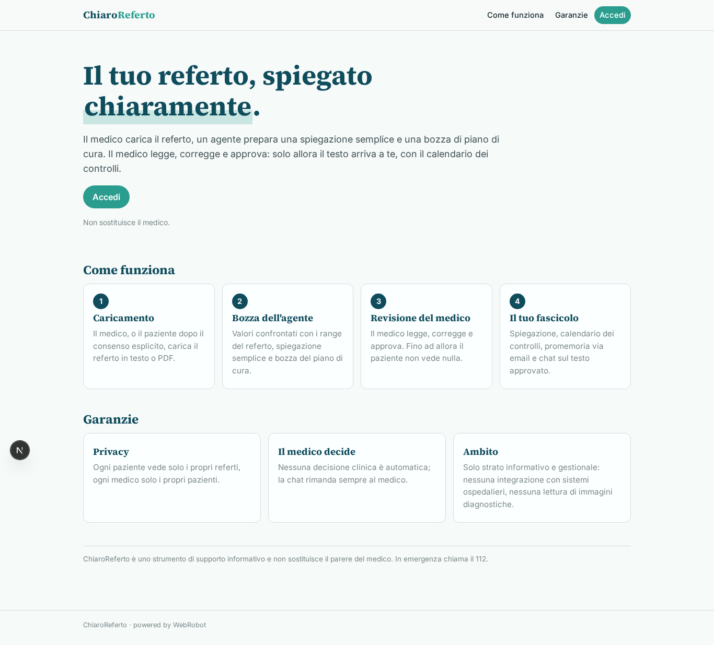

### home-mobile
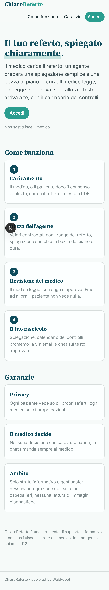

### home
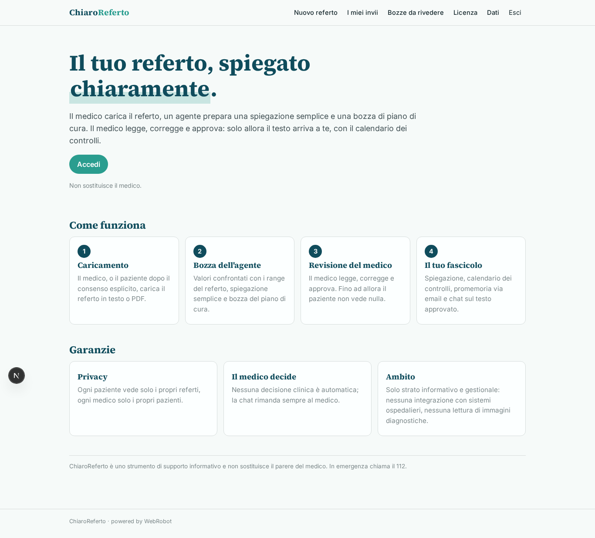

### nuovo_referto
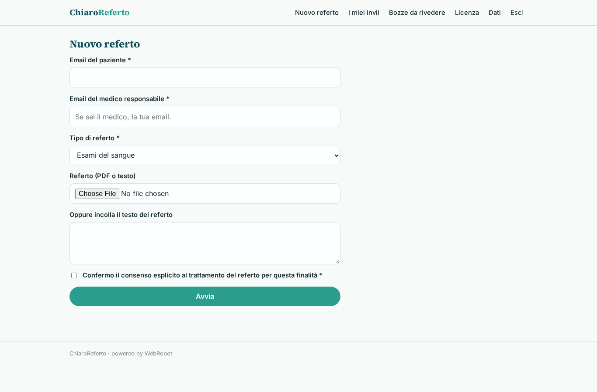

### miei_invii
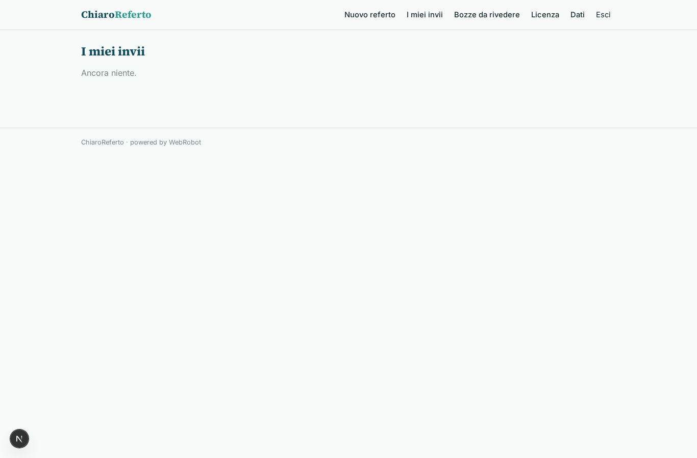

### bozze_da_rivedere
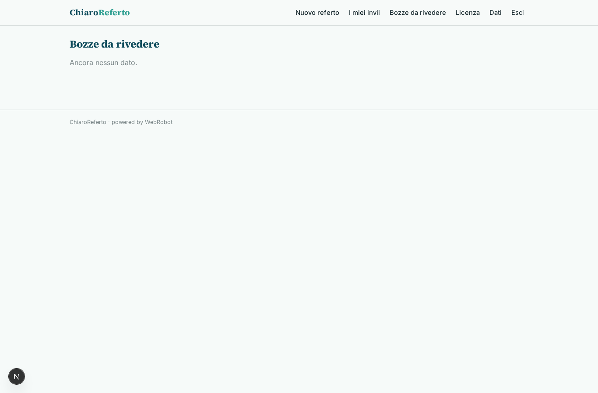

### revisione
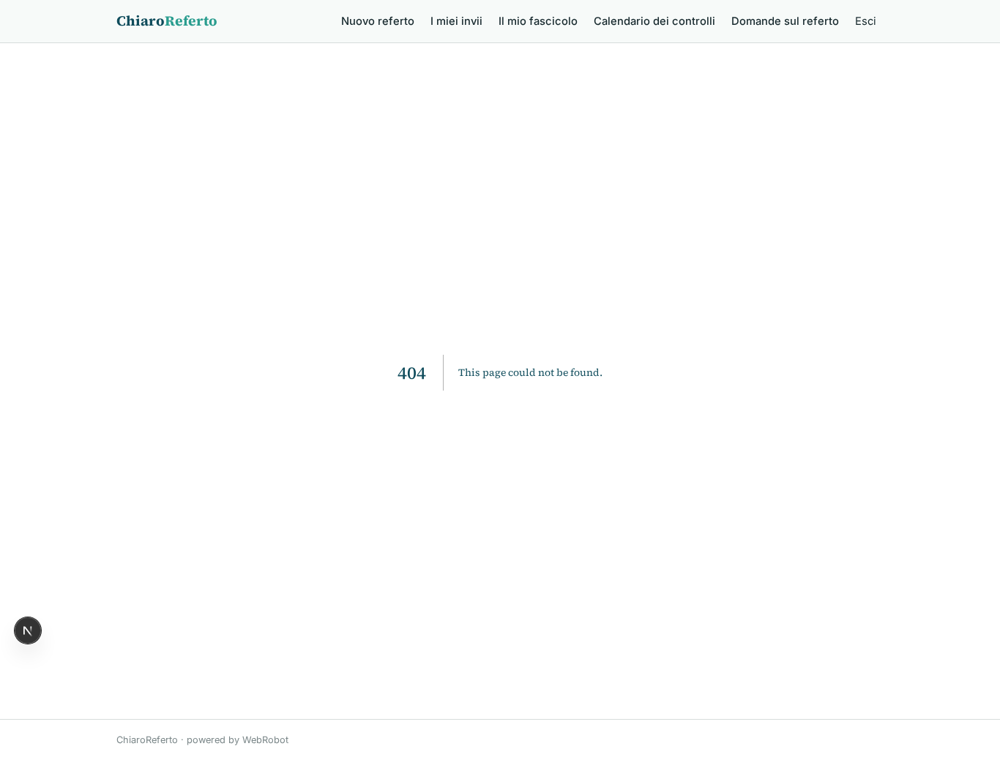

### fascicolo_view
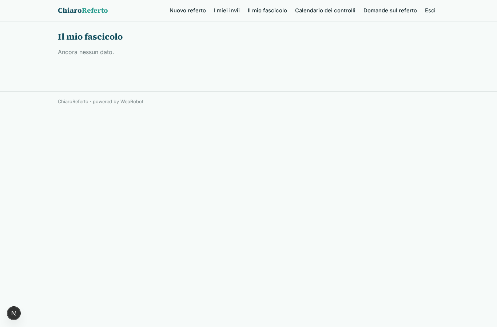

### calendario
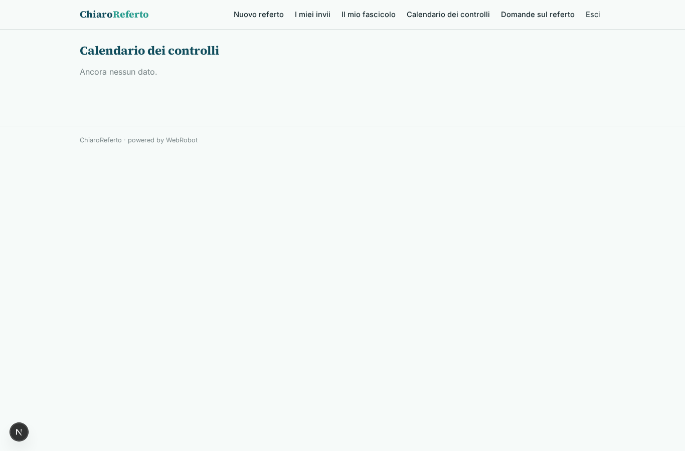

### chat
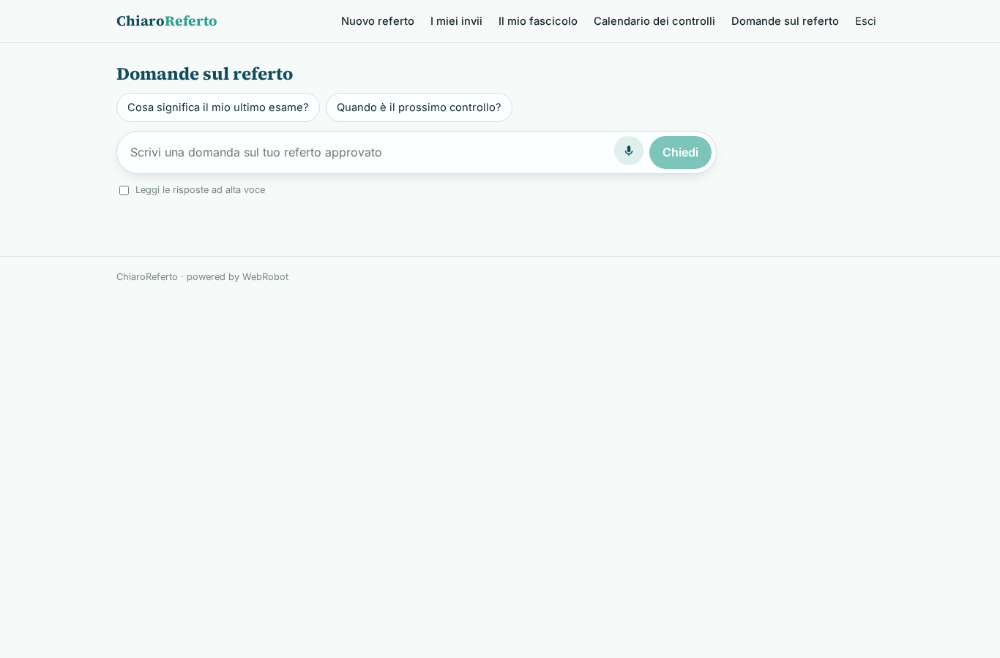

### account
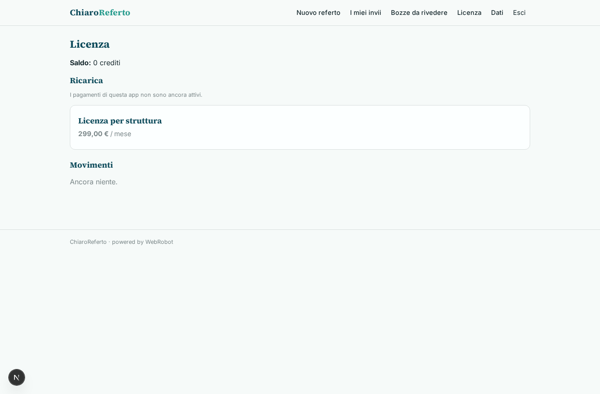
