# CinqueMinuti

_Cinque minuti al giorno per capire i soldi._

**Manifest:** valid (schema + runtime contract) · **Functional test:** passed (21 checks passed)

## Description given to the app builder (Italian)

L'idea è CinqueMinuti, un'app di educazione finanziaria per giovani adulti che non sanno nulla di investimenti. All'iscrizione l'utente compila un breve profilo: età, se lavora, se ha risparmi, obiettivi (fondo emergenze, casa, pensione) e livello di conoscenza. Ogni mattina un agente genera una micro-lezione personalizzata da cinque minuti su un tema del percorso (inflazione, interesse composto, ETF, costi dei fondi, debito), con un esempio pratico e una domanda di verifica a scelta multipla; l'utente risponde e il percorso si adatta. C'è anche una chat dove fare domande libere, con l'avvertenza chiara che non è consulenza personalizzata. La lezione arriva per email e deve arrivare anche come notifica push su telefono, perché la vogliamo come app mobile installabile con una serie di giorni consecutivi da mantenere. L'utente vede i progressi, i badge e lo storico delle lezioni; l'admin vede statistiche aggregate e può modificare il piano dei contenuti. Gratis le prime due settimane, poi abbonamento mensile. In italiano.

## Features not expressible today (spec.extensions)

- **push_notifications**: Notifica push su telefono con la lezione del giorno: non ancora disponibile (solo email). La shell mobile installabile è dichiarata in spec.mobile; il push va aggiunto quando la piattaforma lo supporterà.
- **free_trial_14_days**: Le prime due settimane gratuite prima dell'abbonamento non sono esprimibili nel manifest: da configurare come periodo di prova nel piano Stripe o con crediti di benvenuto.
- **streak_reminder**: Promemoria per non perdere la serie di giorni: richiede push, per ora solo email giornaliera.

## Screenshots (interpretive runtime, no data)

### home-anon
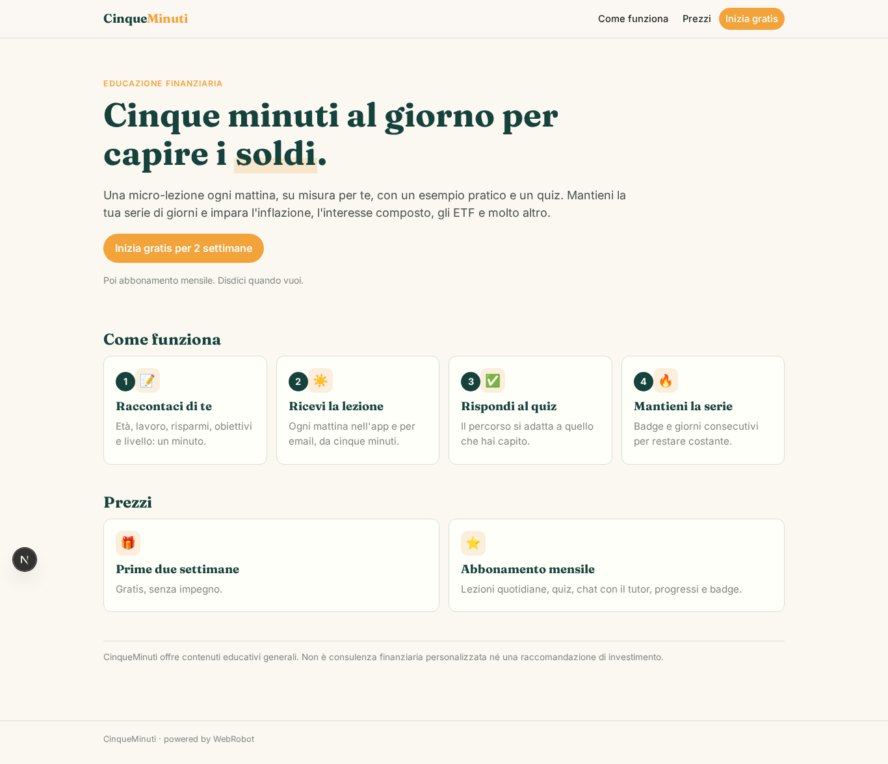

### home-mobile

### home
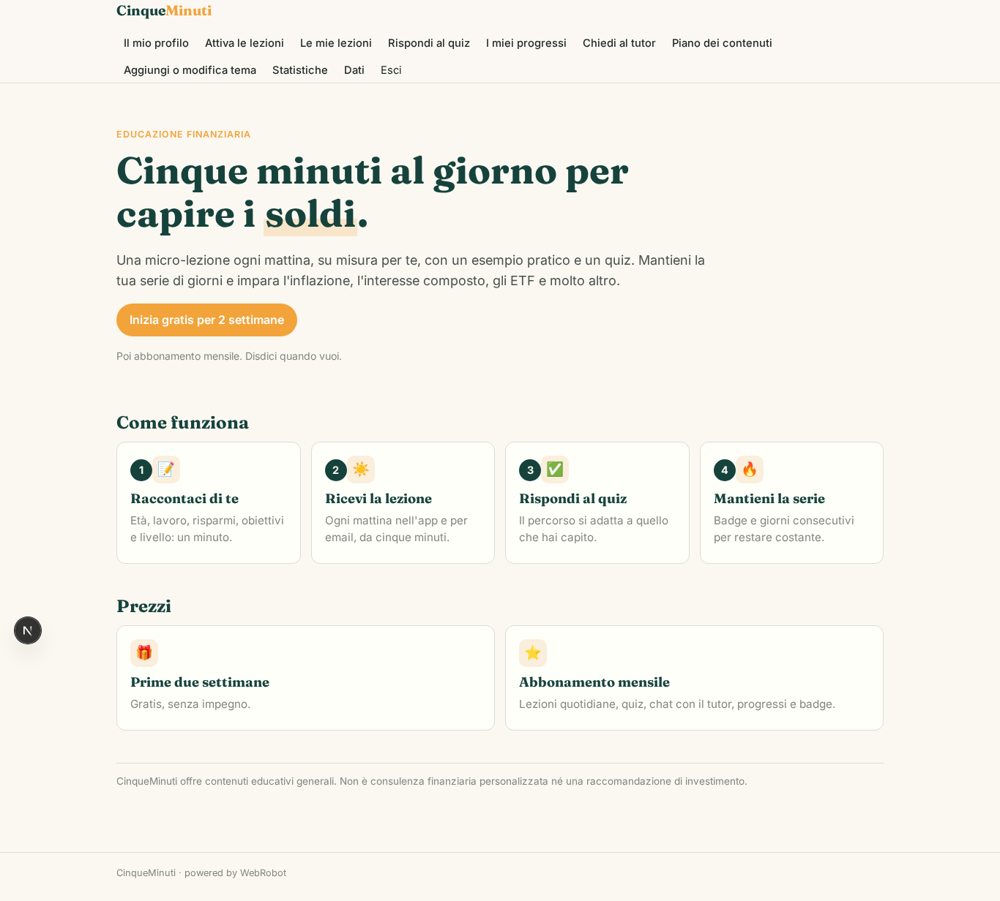

### profile
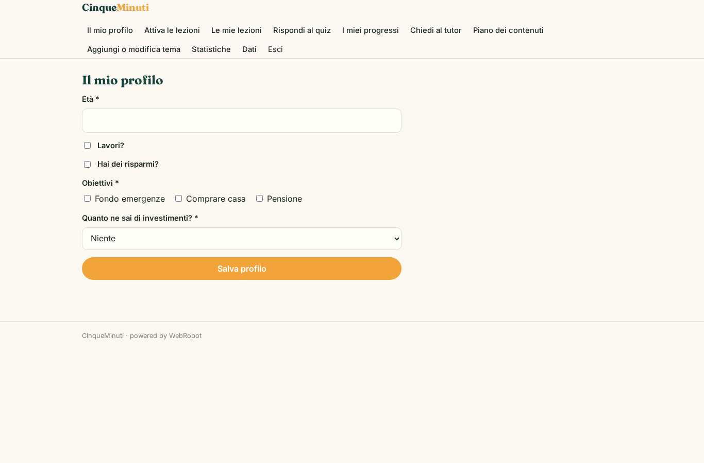

### setup
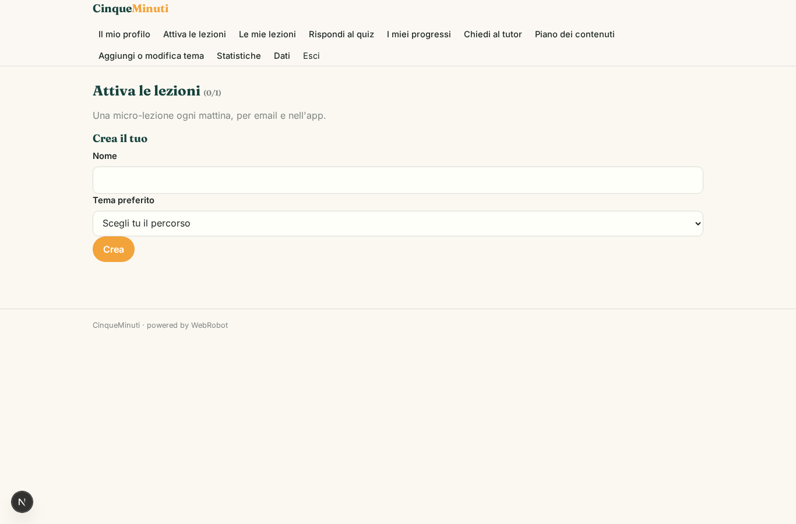

### lessons
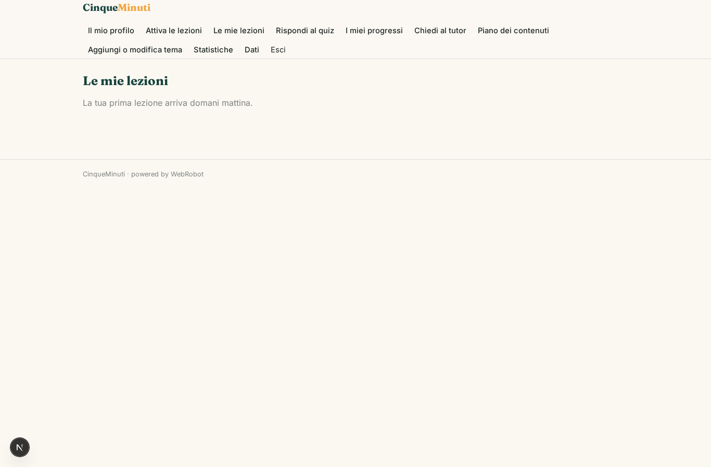

### quiz
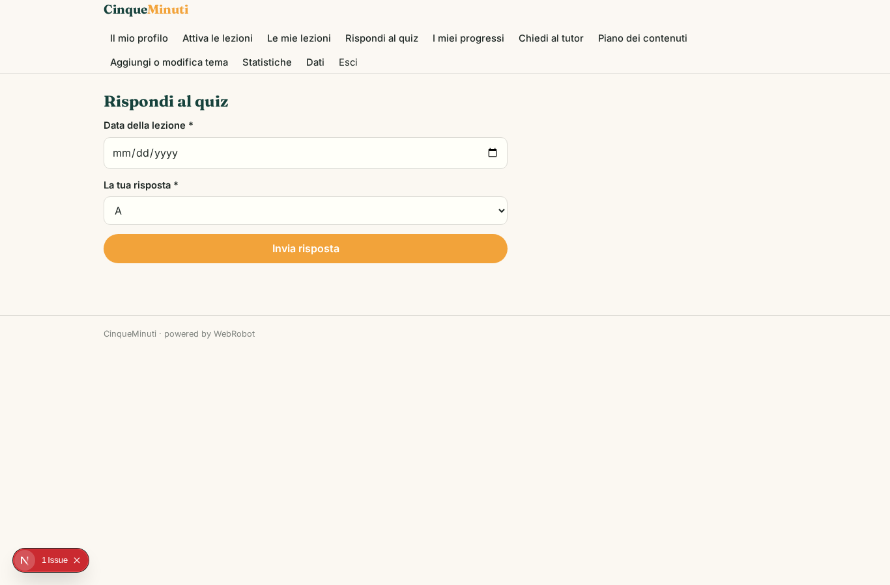

### progress
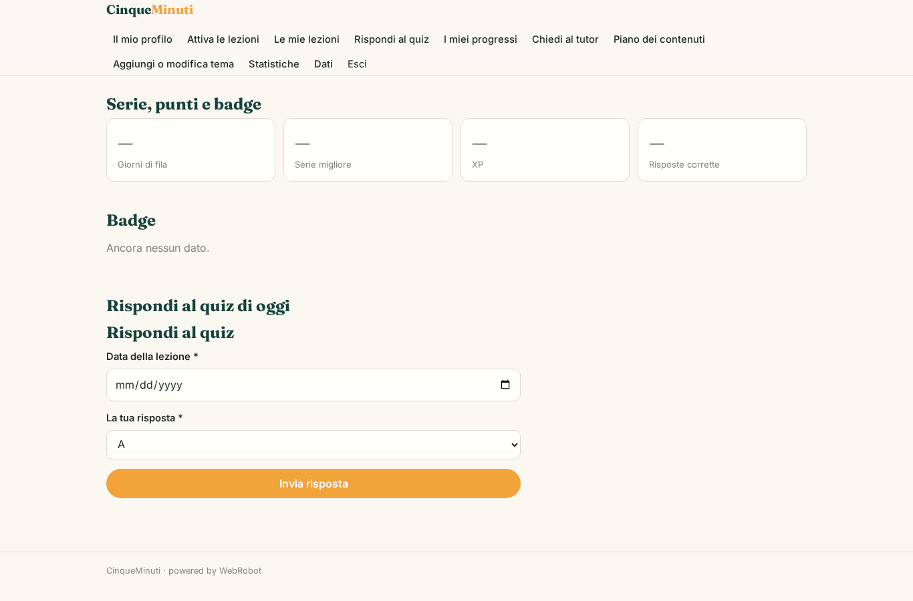

### chat
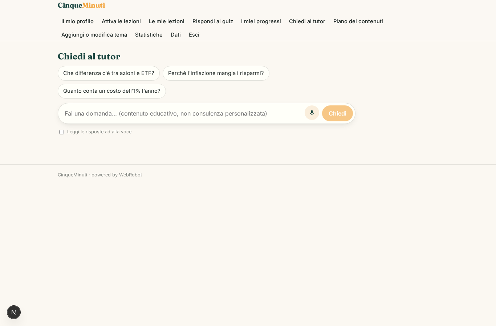

### account
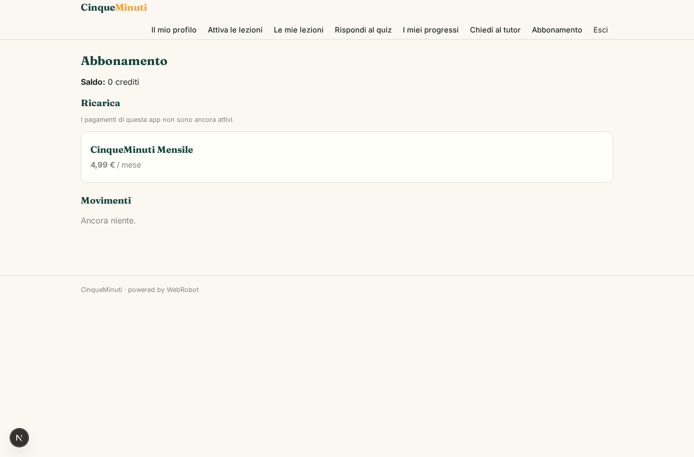

### admin_plan
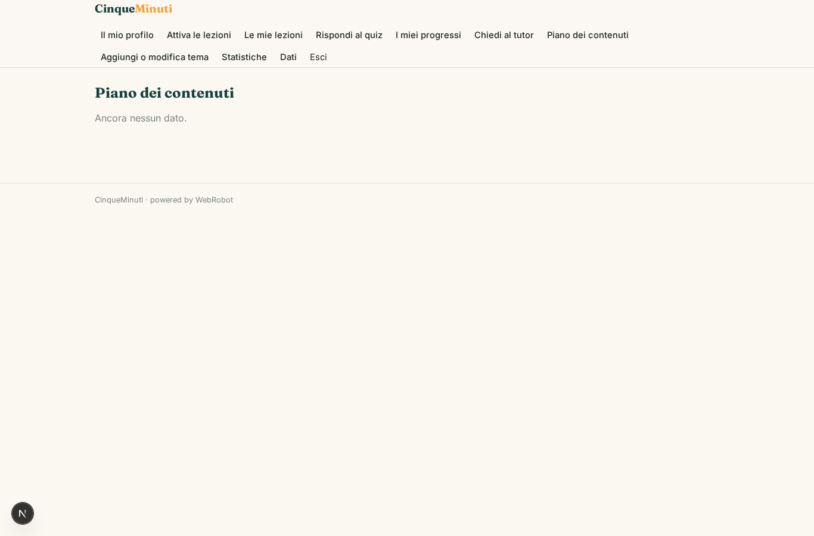

### admin_plan_edit
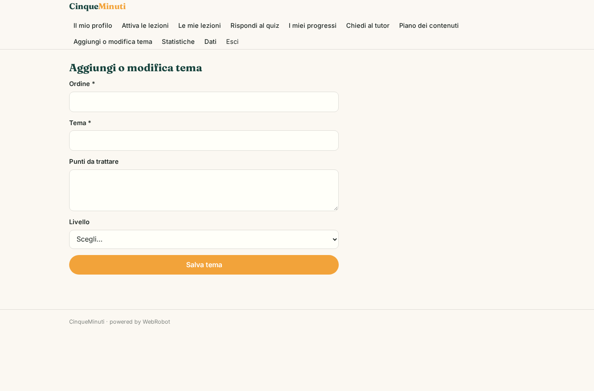

### admin_stats
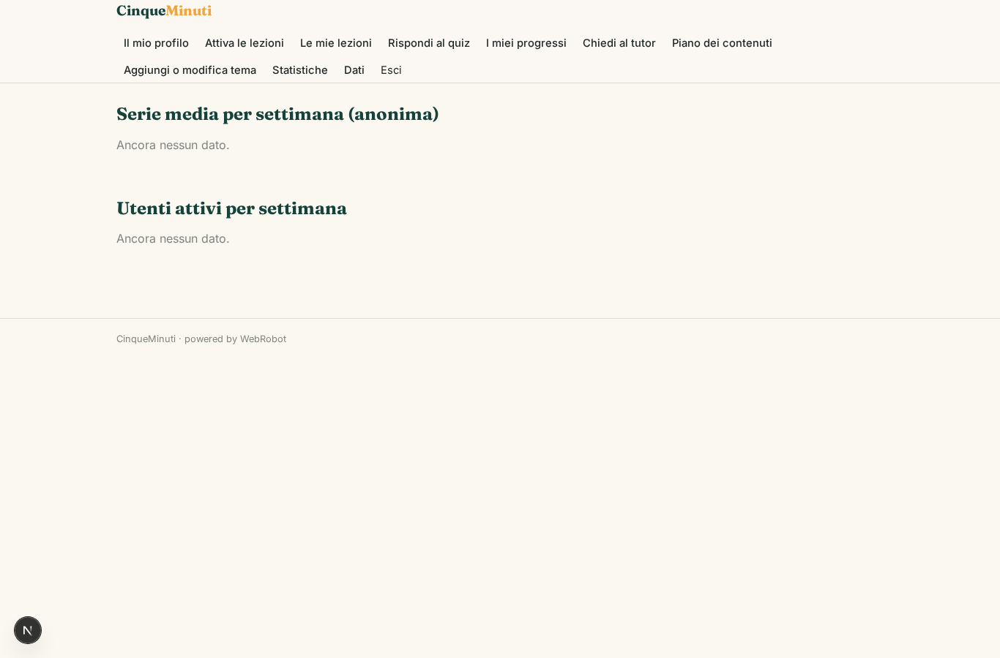
