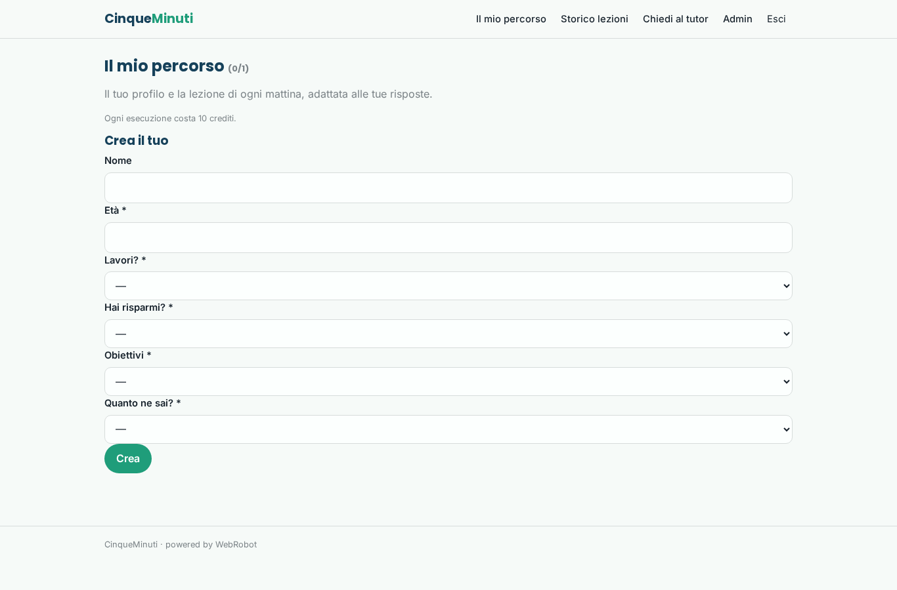
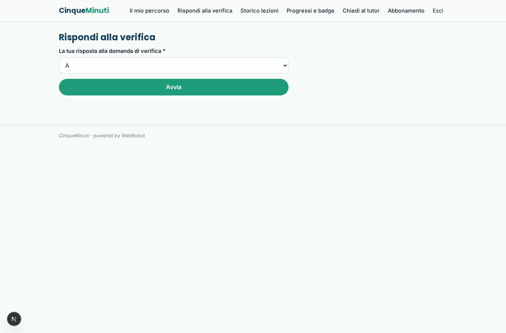
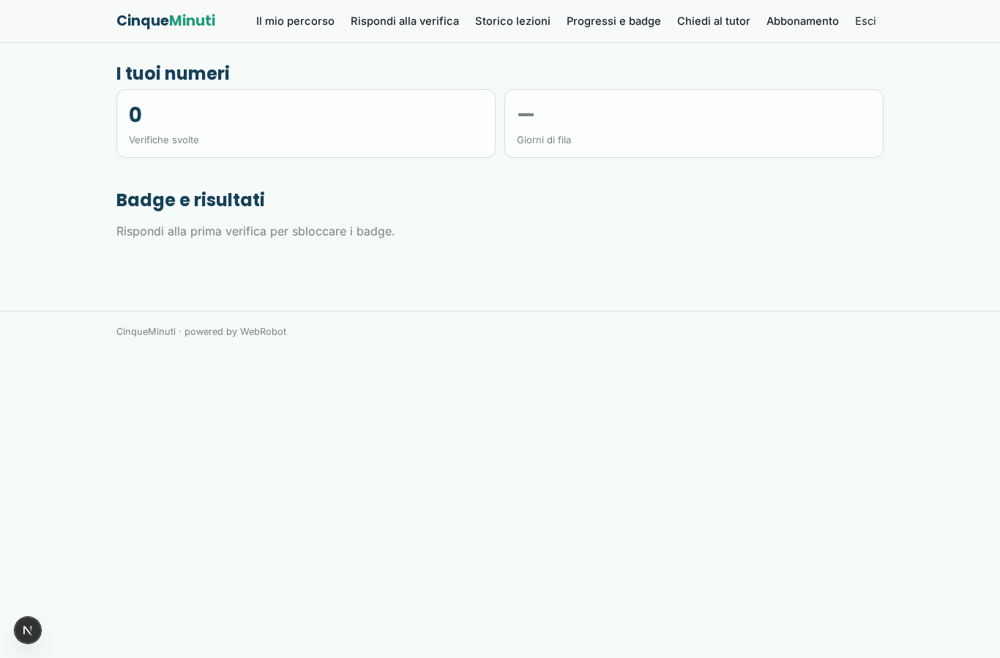
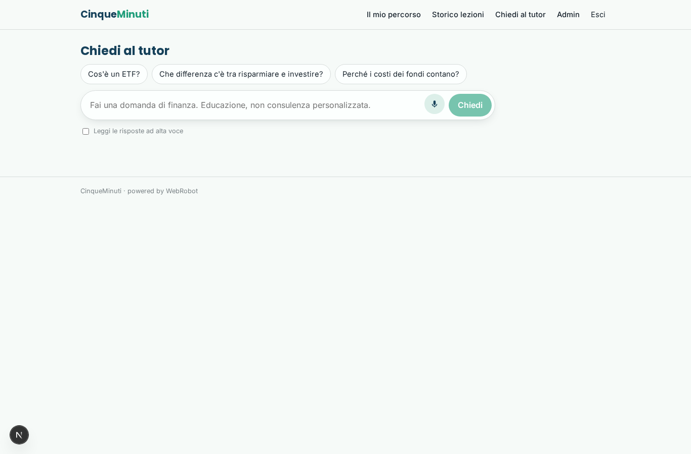
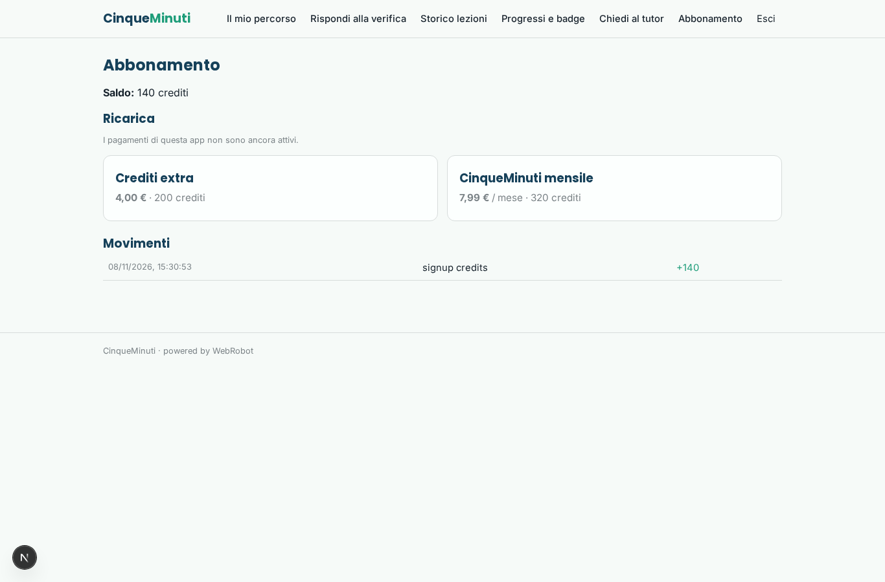
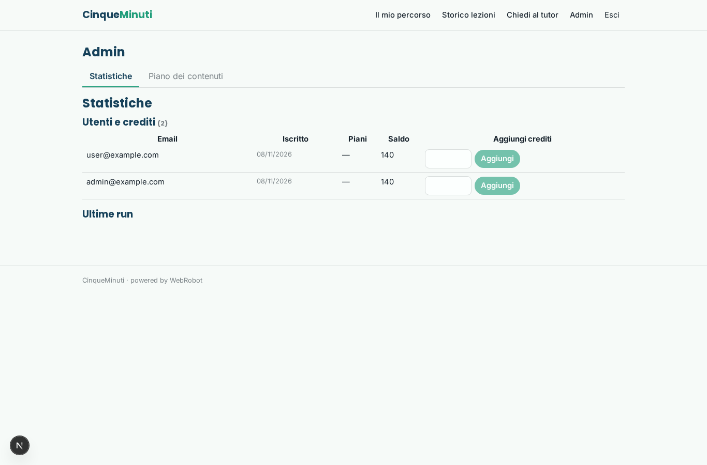
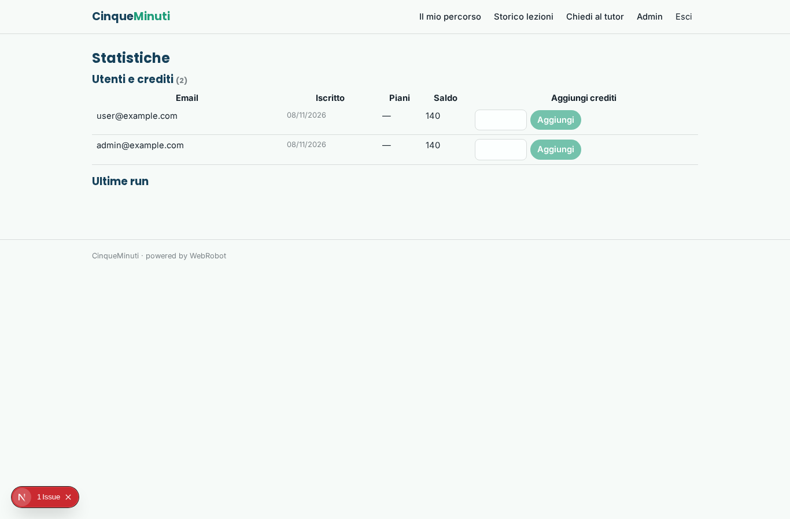
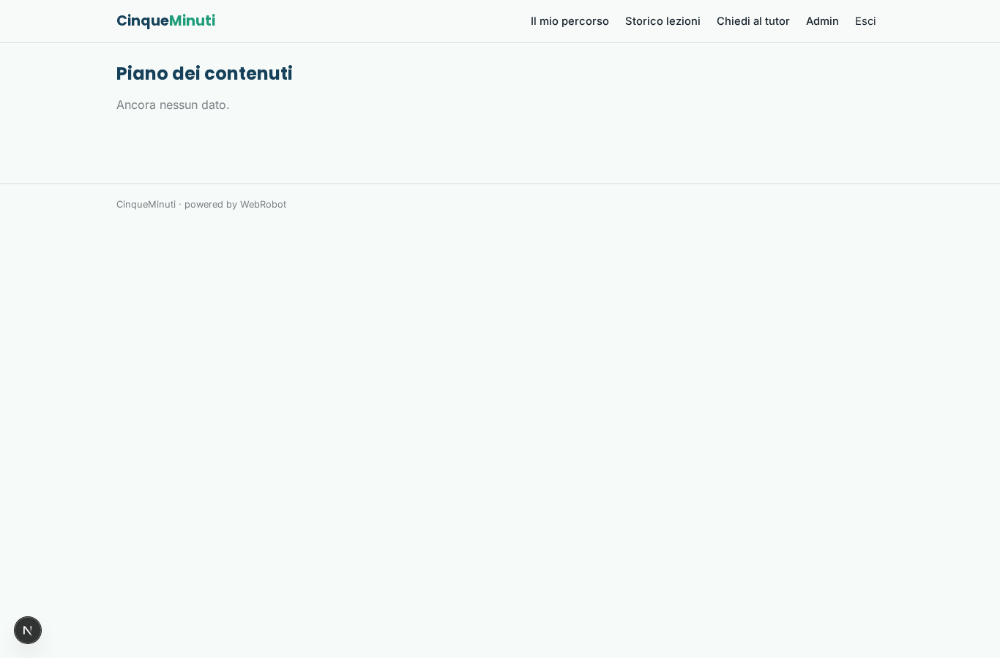

# CinqueMinuti

_Cinque minuti al giorno per capire i soldi e gli investimenti._

**Manifest status:** valid (schema validator + runtime contract)

## Description given to the app builder (Italian)

L'idea è CinqueMinuti, un'app di educazione finanziaria per giovani adulti che non sanno nulla di investimenti. All'iscrizione l'utente compila un breve profilo: età, se lavora, se ha risparmi, obiettivi (fondo emergenze, casa, pensione) e livello di conoscenza. Ogni mattina un agente genera una micro-lezione personalizzata da cinque minuti su un tema del percorso (inflazione, interesse composto, ETF, costi dei fondi, debito), con un esempio pratico e una domanda di verifica a scelta multipla; l'utente risponde e il percorso si adatta. C'è anche una chat dove fare domande libere, con l'avvertenza chiara che non è consulenza personalizzata. La lezione arriva per email e deve arrivare anche come notifica push su telefono, perché la vogliamo come app mobile installabile con una serie di giorni consecutivi da mantenere. L'utente vede i progressi, i badge e lo storico delle lezioni; l'admin vede statistiche aggregate e può modificare il piano dei contenuti. Gratis le prime due settimane, poi abbonamento mensile. In italiano.

## Features not expressible today (spec.extensions)

- **push_notifications**: Notifica push sul telefono quando arriva la lezione del mattino e promemoria per non perdere la serie: non disponibile ancora.
- **email_lesson**: Invio della lezione per email ogni mattina: le notifiche email non sono ancora disponibili; per ora la lezione si legge nell'app.
- **free_trial_14_days**: Le prime due settimane gratis sono approssimate con 140 crediti di benvenuto (14 lezioni da 10 crediti); un vero periodo di prova a tempo richiede codice dedicato.
- **admin_aggregate_stats**: Statistiche aggregate (utenti attivi, tasso di risposte esatte, serie medie) fornite dalla vista admin standard; metriche specifiche dei temi richiedono un'estensione.

## Screenshots (interpretive runtime)

### home-anon

### home-mobile

### home

### percorso

### verifica

### storico

### progressi

### chat

### account

### admin

### admin_stats

### admin_plan

