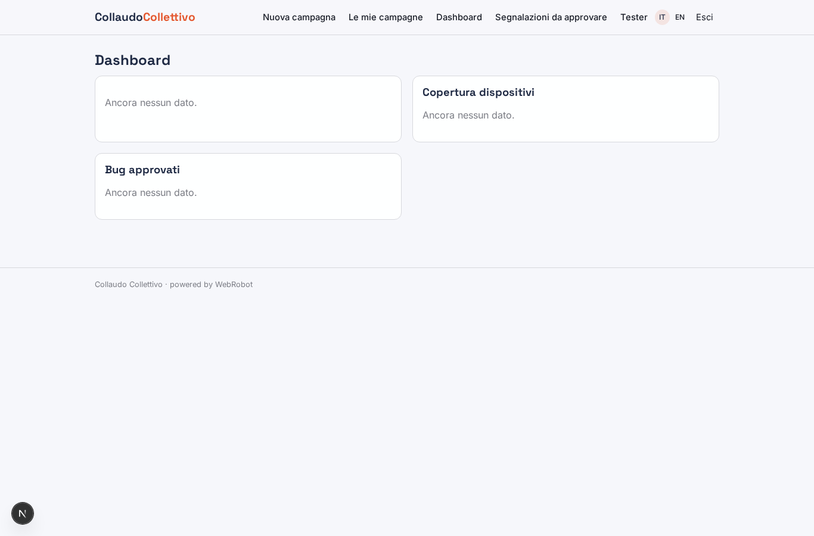
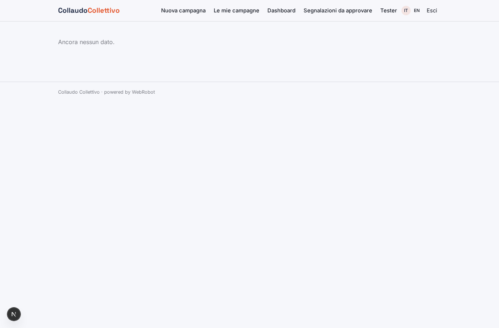
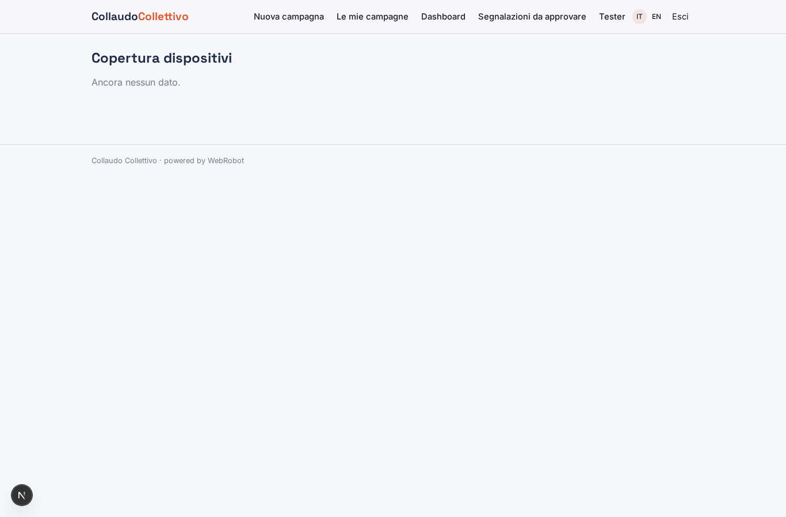
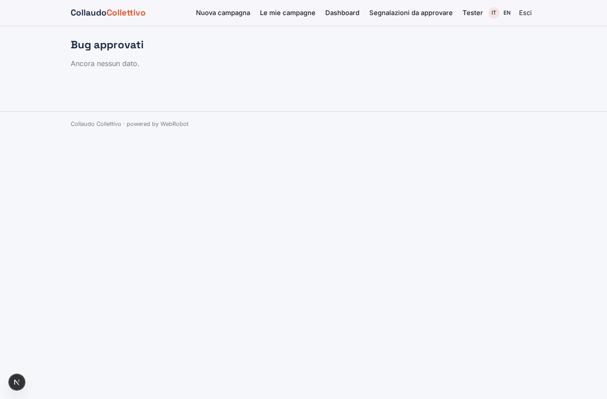
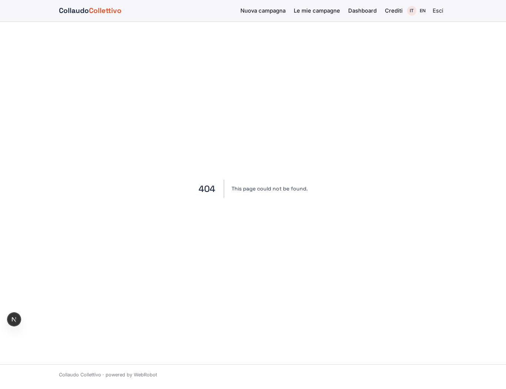
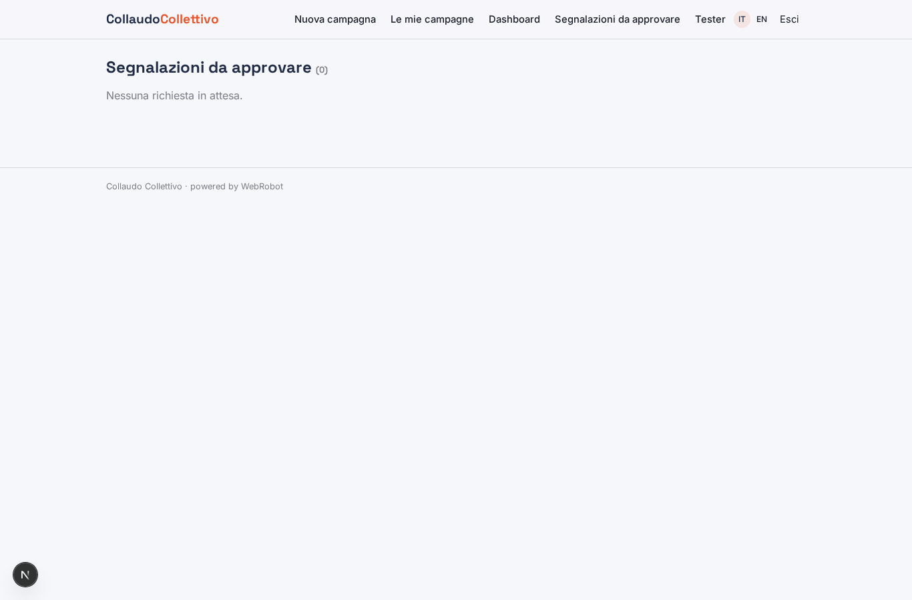
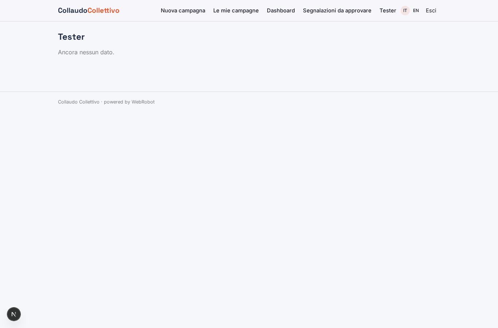
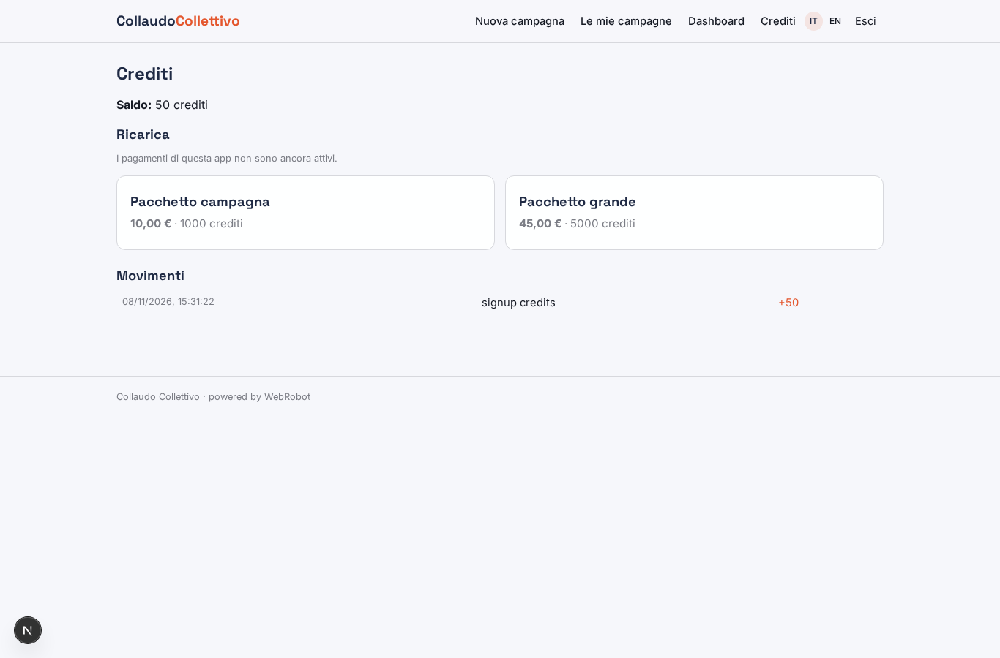

# Collaudo Collettivo

_Crowdtesting gestito: tester giusti, bug verificati, report pronto._

**Manifest status:** valid (schema validator + runtime contract)

## Description given to the app builder (Italian)

Vorrei Collaudo Collettivo, la piattaforma software di un servizio di crowdtesting, in cui tester umani provano app e siti dei clienti. Descrivo solo lo strato di gestione: la community di tester e il loro pagamento sono gestiti a parte. L'azienda cliente crea una campagna di test indicando prodotto, link o build da provare, dispositivi e sistemi operativi richiesti, paesi, scenari da eseguire e scadenza. Un agente seleziona i tester adatti dal database in base a dispositivo, paese ed esperienza, e manda gli inviti. I tester eseguono gli scenari e segnalano bug con titolo, passi per riprodurlo, gravità, screenshot o video dello schermo. Un agente controlla ogni segnalazione, elimina i duplicati, verifica che i passi siano completi, assegna una priorità e prepara il riepilogo. Un project manager rivede e approva le segnalazioni valide, che vengono poi inviate al sistema di ticketing del cliente come Jira. Il cliente vede una dashboard con bug per gravità, copertura dei dispositivi e report finale. Il tester vede solo le sue campagne. Il cliente paga a campagna, i tester sono pagati per bug approvato.

## Features not expressible today (spec.extensions)

- **bug_submission_form**: Testers file bugs through a form that writes to bug_reports with the tester's email and status 'submitted'; uploading screenshots or videos is not available yet, so testers paste a link to the file.
- **jira_export**: Pushing approved bugs to the client's Jira needs each client's own credentials, which are not available yet. For now approved bugs are shown in the dashboard and can be copied into the ticketing system.
- **tester_invitation_email**: Email notifications are not available: testers see invitations in the app after signing in.
- **per_tester_scoping**: Showing each tester only their own campaigns and each client only their own bugs needs per-user filtering on app-owned records, which the manifest cannot express yet.
- **tester_payout**: Per-approved-bug tester payouts are handled outside this app, by the community platform.

## Screenshots (interpretive runtime)

### home-anon

### home-mobile

### home

### new_campaign

### campaigns

### dashboard

### bugs_by_severity

### device_coverage

### bug_list

### my_campaigns

### report_bug

### reviews

### testers_db

### account

