# Collaudo Collettivo

_Crowdtesting gestito: campagne, tester giusti, bug già filtrati._

**Manifest:** valid (schema + runtime contract) · **Functional test:** passed (22 checks passed)

## Description given to the app builder (Italian)

Vorrei Collaudo Collettivo, la piattaforma software di un servizio di crowdtesting, in cui tester umani provano app e siti dei clienti. Descrivo solo lo strato di gestione: la community di tester e il loro pagamento sono gestiti a parte. L'azienda cliente crea una campagna di test indicando prodotto, link o build da provare, dispositivi e sistemi operativi richiesti, paesi, scenari da eseguire e scadenza. Un agente seleziona i tester adatti dal database in base a dispositivo, paese ed esperienza, e manda gli inviti. I tester eseguono gli scenari e segnalano bug con titolo, passi per riprodurlo, gravità, screenshot o video dello schermo. Un agente controlla ogni segnalazione, elimina i duplicati, verifica che i passi siano completi, assegna una priorità e prepara il riepilogo. Un project manager rivede e approva le segnalazioni valide, che vengono poi inviate al sistema di ticketing del cliente come Jira. Il cliente vede una dashboard con bug per gravità, copertura dei dispositivi e report finale. Il tester vede solo le sue campagne. Il cliente paga a campagna, i tester sono pagati per bug approvato.

## Features not expressible today (spec.extensions)

- **tester_payout**: Payment of testers per approved bug is handled outside the app. Approved bugs (status approved/sent) can be exported by the PM as CSV from the bug review view.
- **jira_per_customer**: The Jira ticket is created with the Jira key of the user the event belongs to; per-customer routing of the ticket to the campaign owner's Jira, and the Jira project key, need a field on the campaign (to be added) and review.

## Screenshots (interpretive runtime, no data)

### home-anon
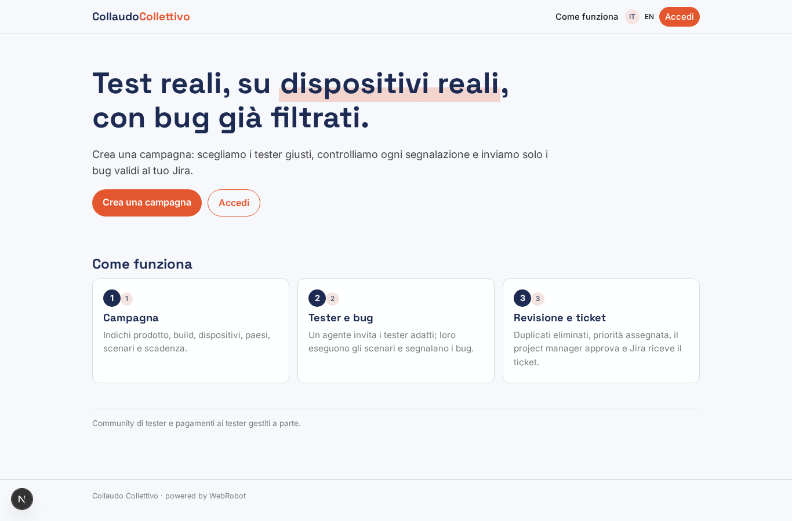

### home-mobile
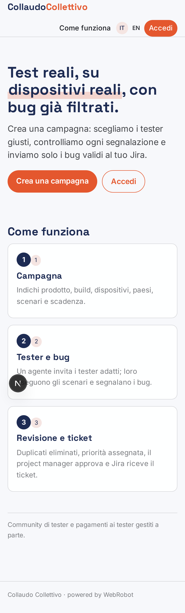

### home
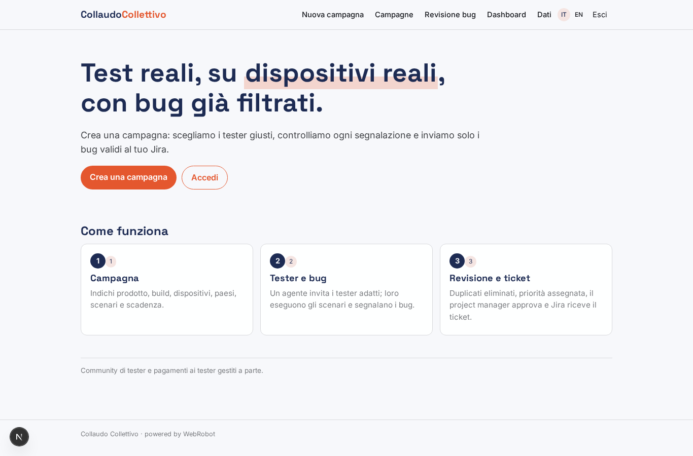

### new_campaign
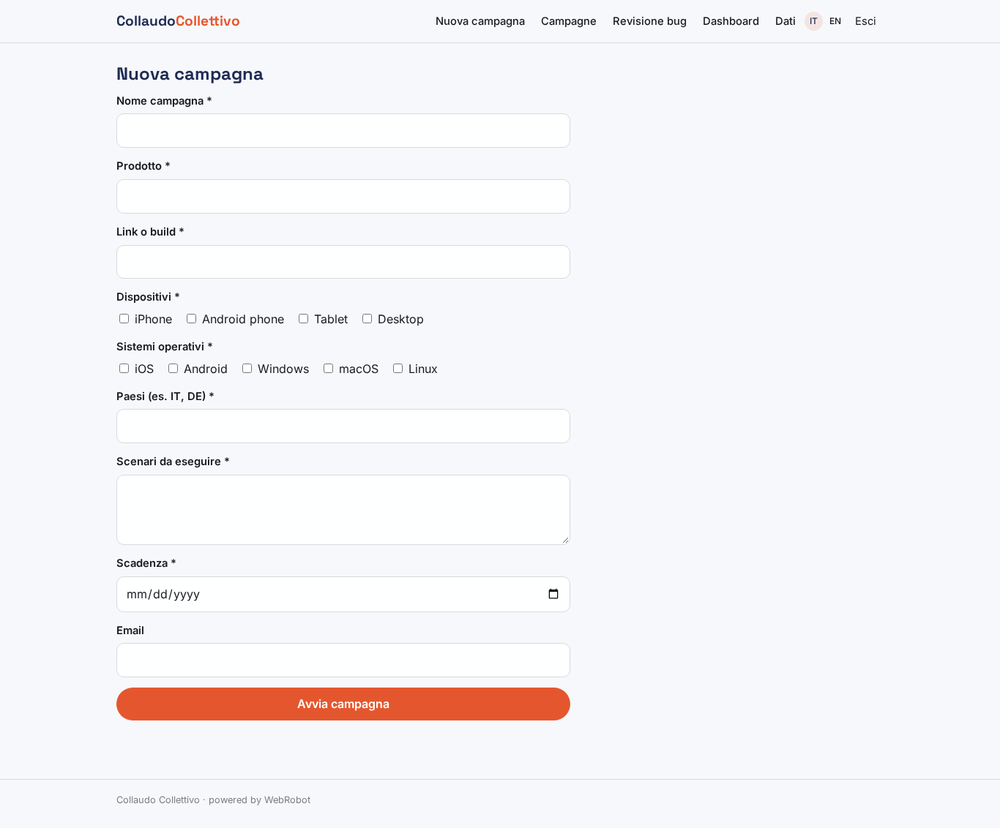

### campaigns
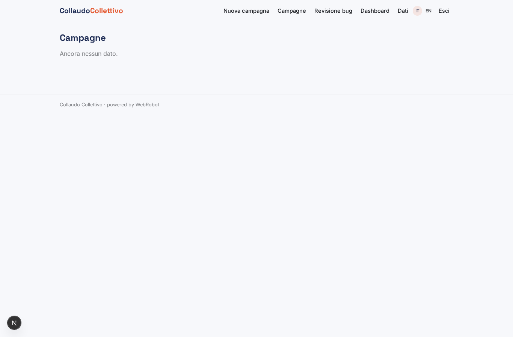

### my_campaigns
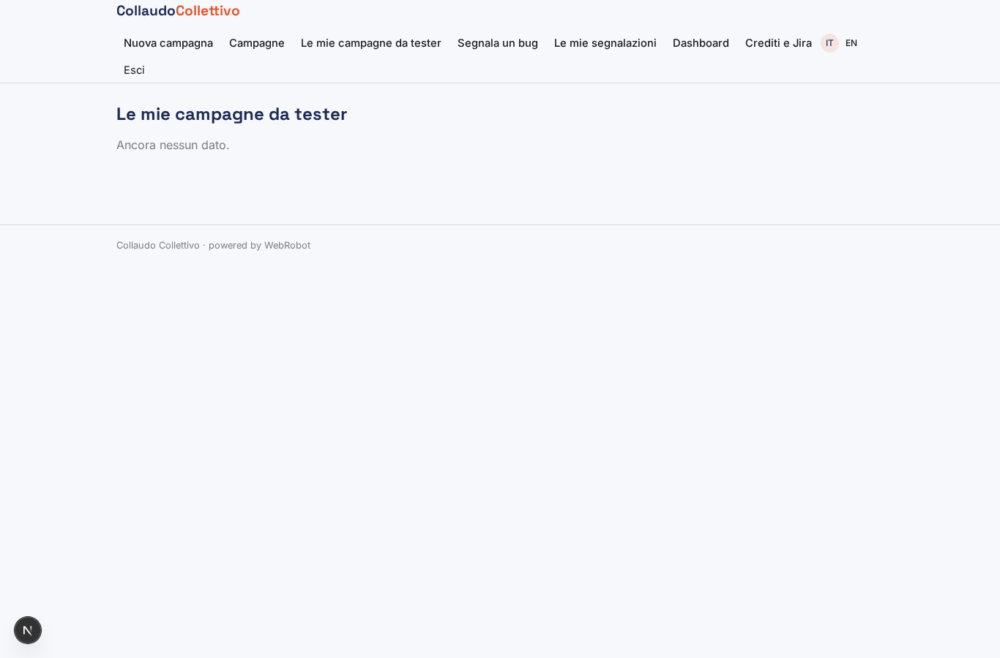

### report_bug
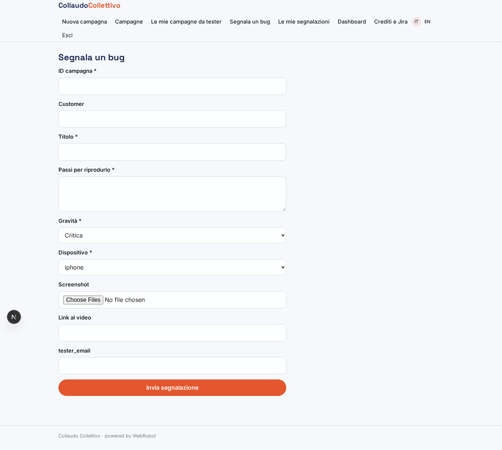

### my_bugs
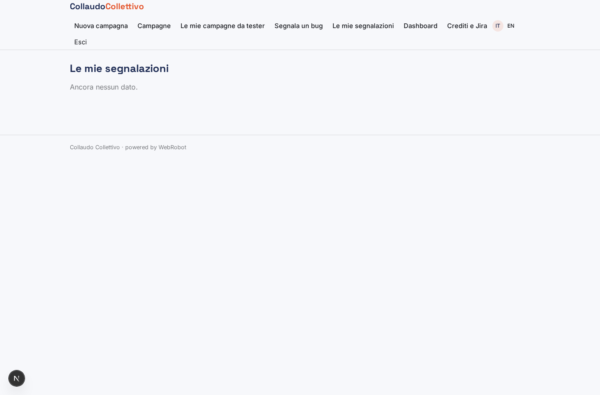

### pm_review
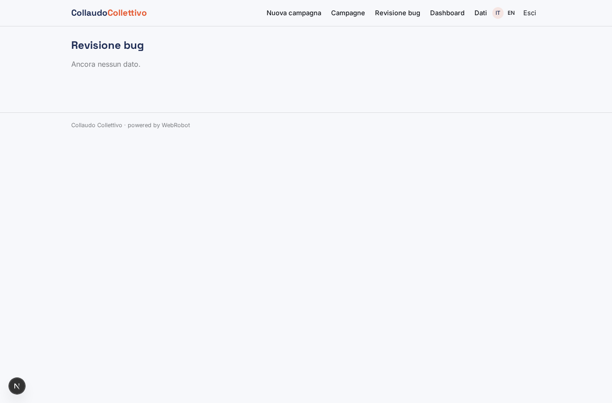

### decide_bug
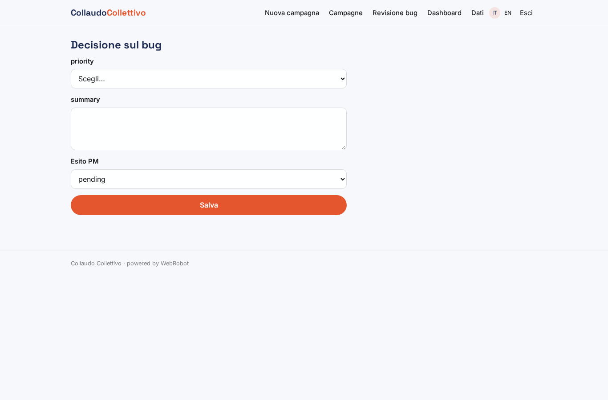

### severity_chart
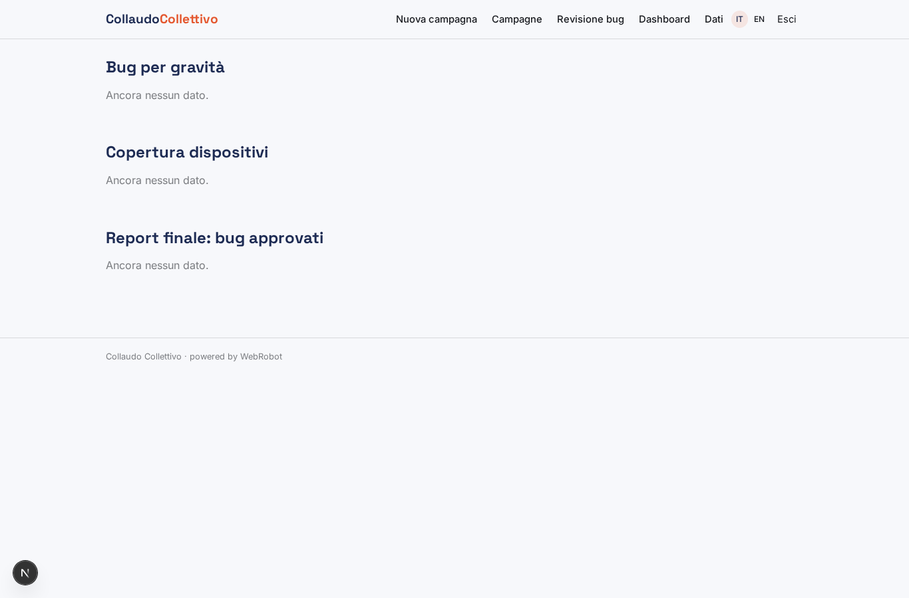

### dashboard
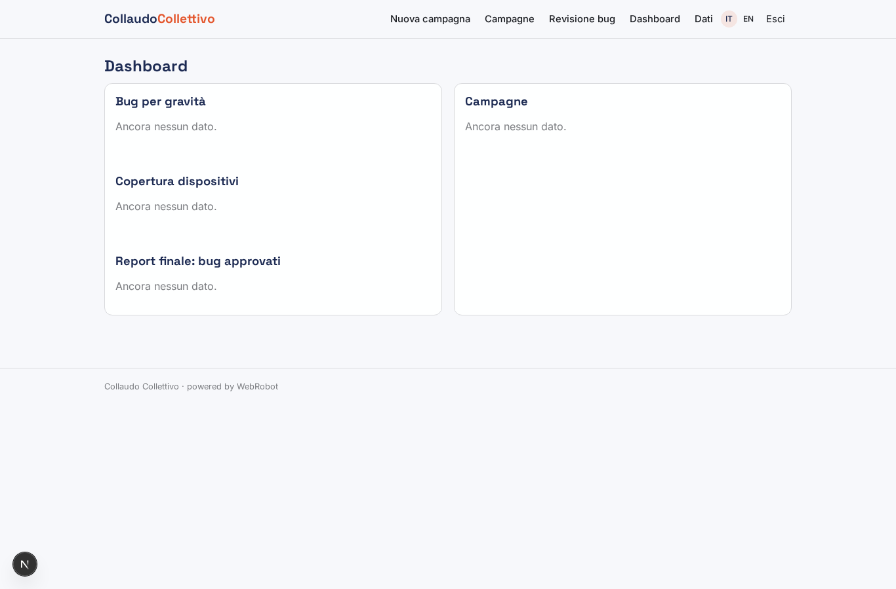

### account
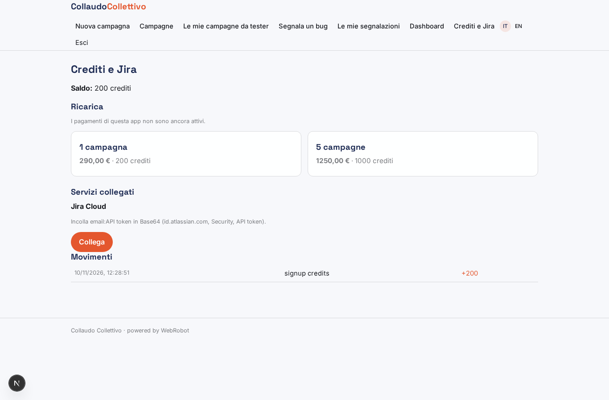
