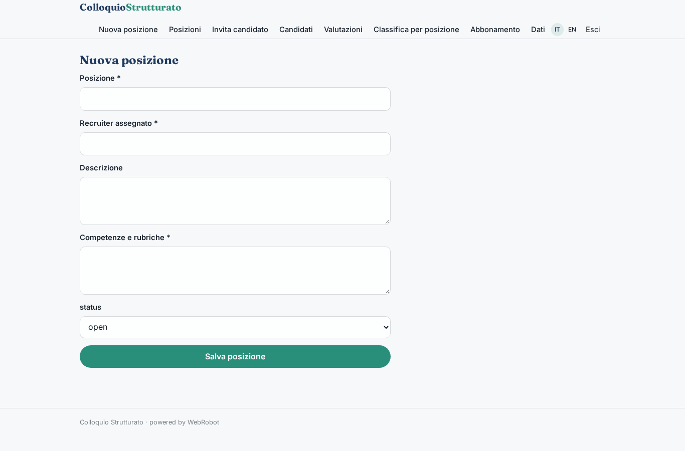
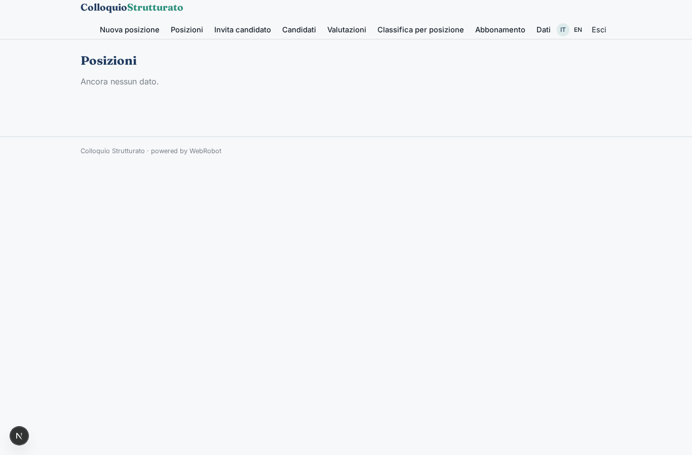
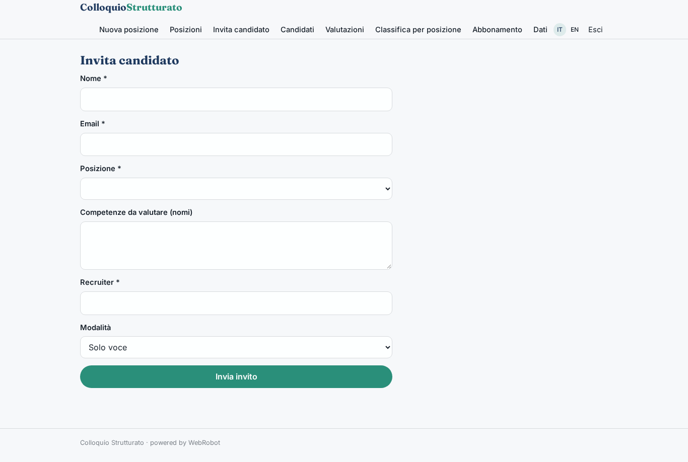
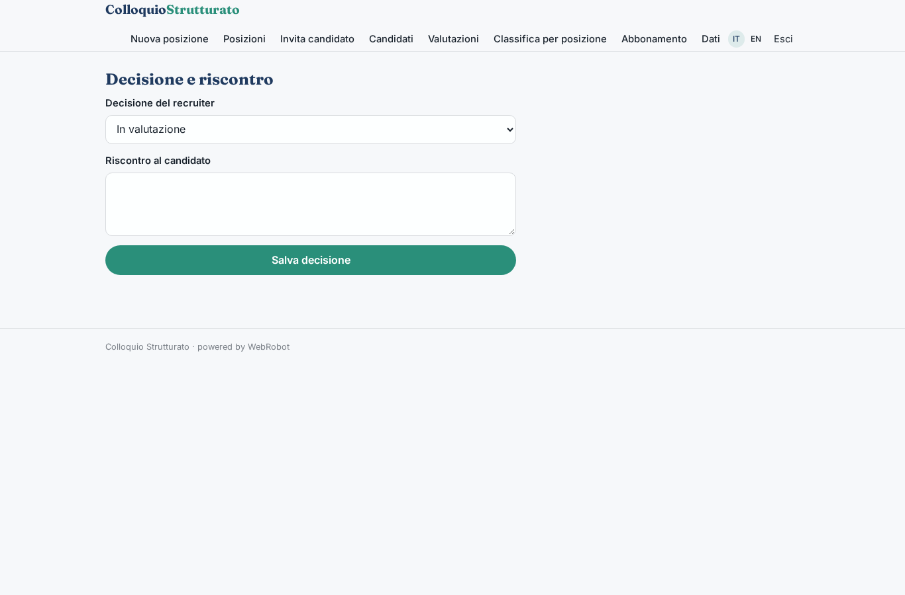
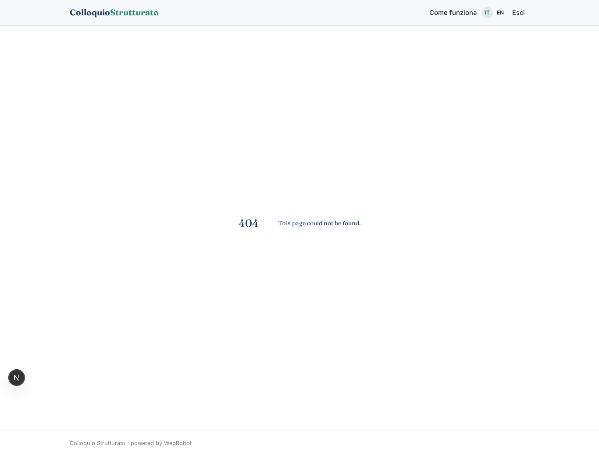
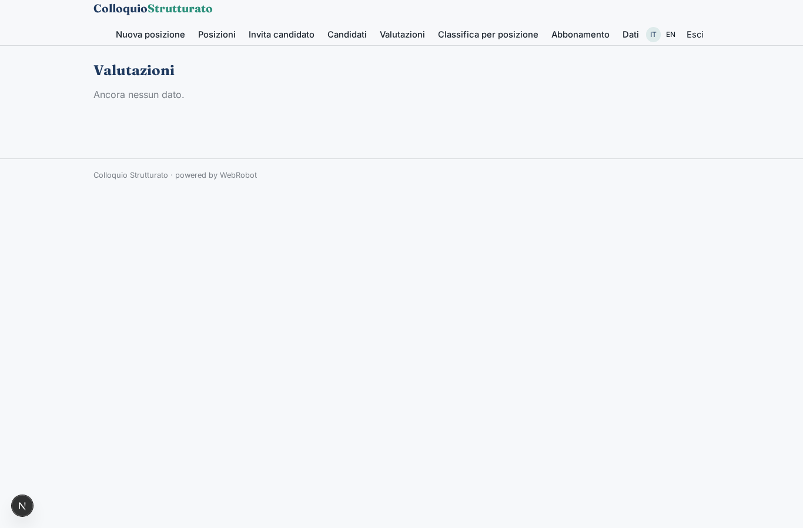
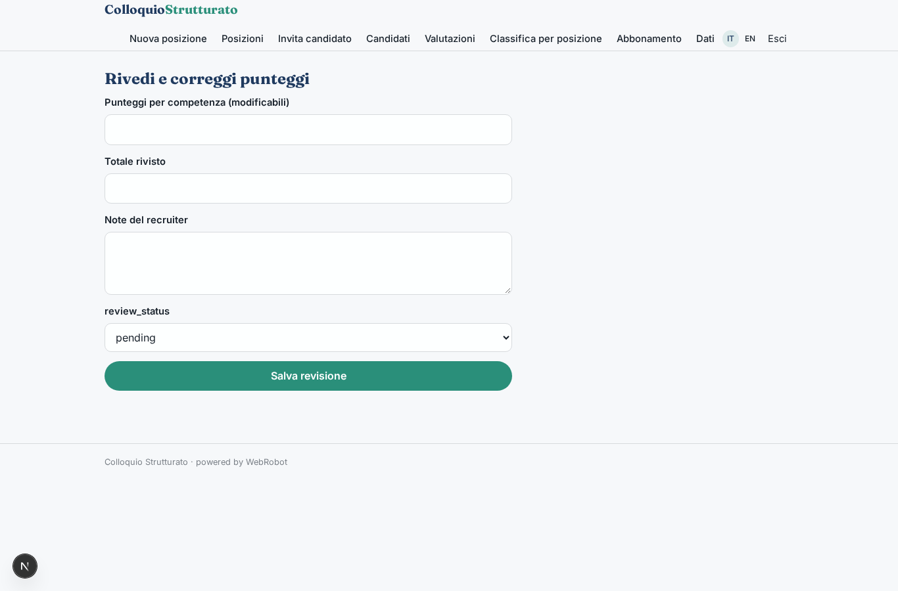
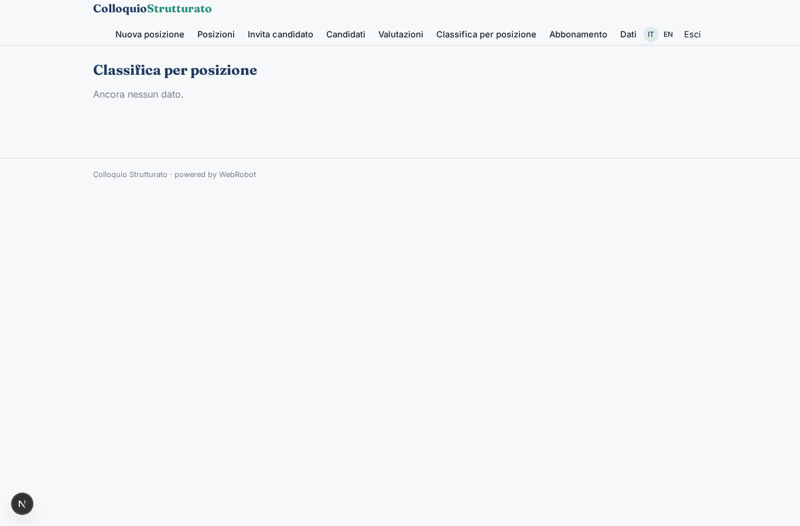
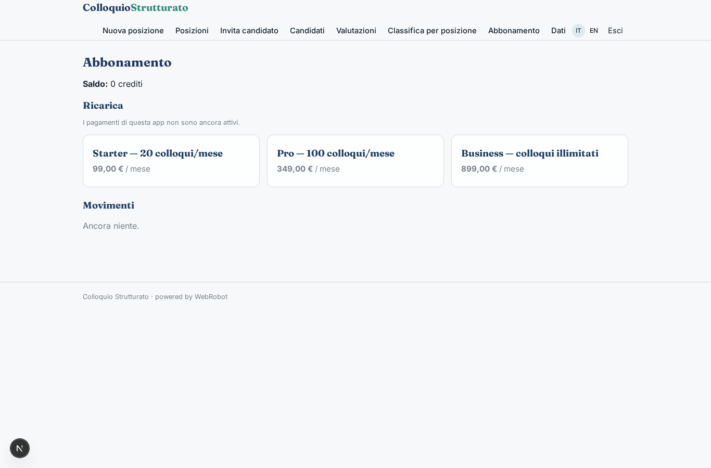

# Colloquio Strutturato

_Colloqui oggettivi, valutati con rubriche, decisi da persone._

**Manifest:** valid (schema + runtime contract) · **Functional test:** passed (36 checks passed)

## Description given to the app builder (Italian)

Mi serve Colloquio Strutturato, uno strumento per i recruiter che vogliono valutare candidati in modo oggettivo. L'admin HR crea una posizione, definisce le competenze da valutare (comunicazione, problem solving, competenze tecniche) e per ciascuna una rubrica con livelli da 1 a 5 ed esempi di risposta. Il recruiter invita i candidati via email con un link. Il candidato apre il link nel browser e sostiene un colloquio vocale con un agente che fa domande comportamentali e situazionali, ascolta, chiede approfondimenti e chiude in circa venti minuti; vogliamo anche l'opzione con video registrato. L'agente trascrive, valuta ogni risposta rispetto alla rubrica con una motivazione e produce un report per candidato e una classifica comparativa per posizione. Il recruiter rivede i punteggi, può correggerli e decide chi passa al colloquio successivo; nessuna decisione è automatica. I risultati vanno sincronizzati con l'ATS aziendale. Il candidato vede solo il proprio colloquio e un riscontro finale, il recruiter le posizioni a lui assegnate. Consenso esplicito del candidato prima di iniziare. Abbonamento mensile per numero di colloqui, in italiano e inglese.

## Functional test: what did not pass

- **form saves a record** (form consent): only role candidate may fill it, and the test cannot hold that role _(warning)_

## Features not expressible today (spec.extensions)

- **browser_voice_video**: Voice conversation and recorded video in the candidate's browser (microphone/camera capture, speech-to-text and text-to-speech) are not available yet: the interview currently runs as a text chat in the candidate view; the voice/video choice is saved in candidates.mode for when it is.
- **ats_sync**: Sync of scores, reports and decisions with the company ATS needs the ATS to be named (API key or OAuth); for now results are exportable as CSV from the ranking and evaluations views. An org-scoped credential and an http tool can be added once the ATS and its API host are known.

## Screenshots (interpretive runtime, no data)

### home-anon

### home-mobile

### home

### new_position

### positions

### invite

### candidates

### decide

### consent

### interview

### my_interview

### evaluations

### review

### ranking

### account

