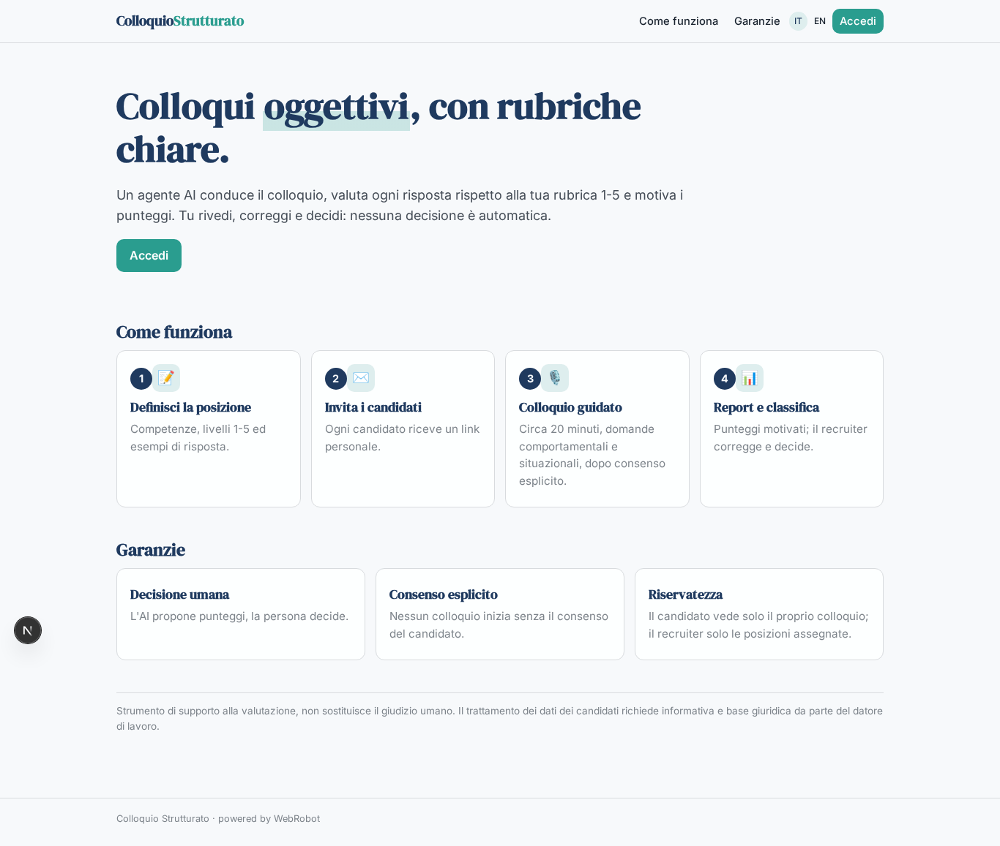
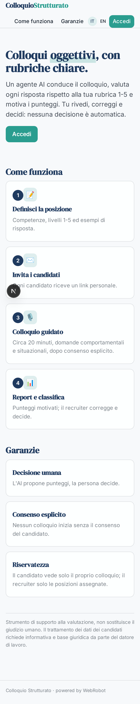
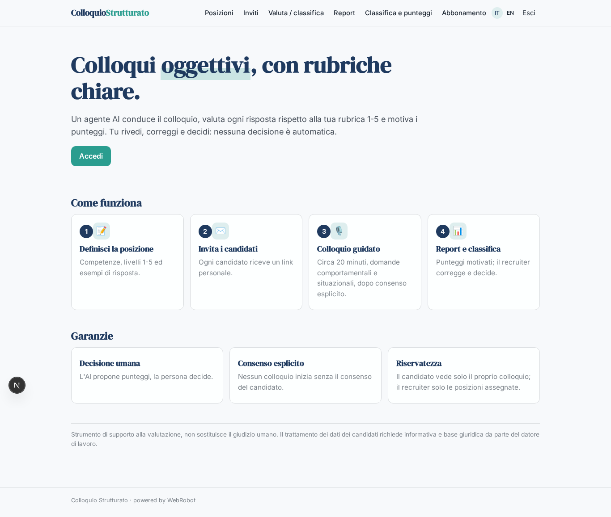
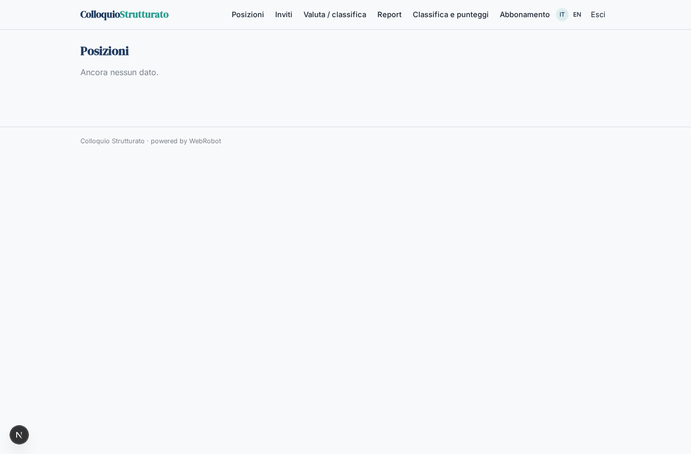
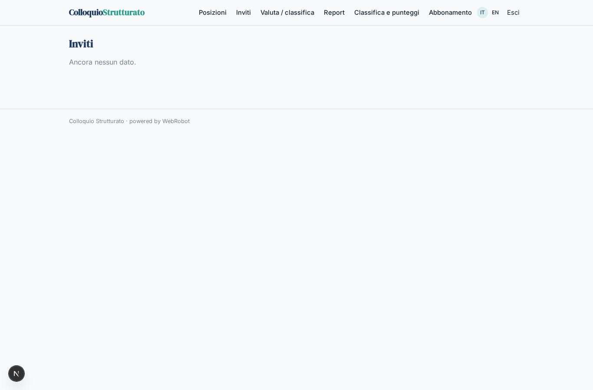
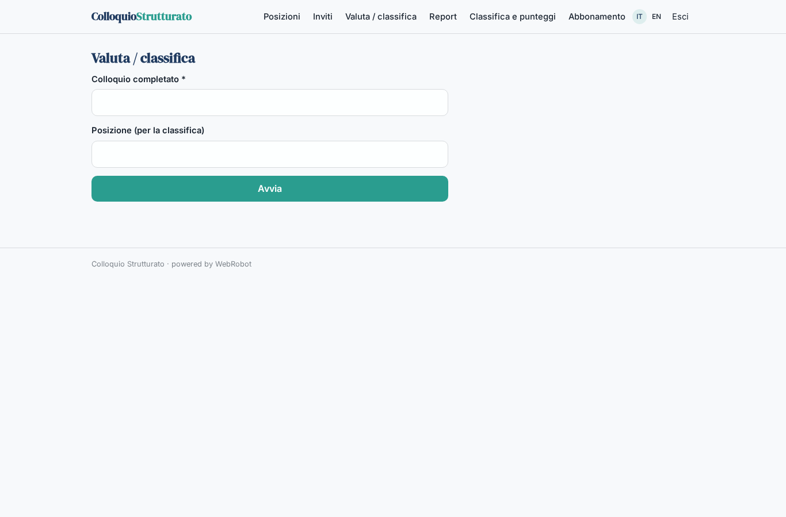
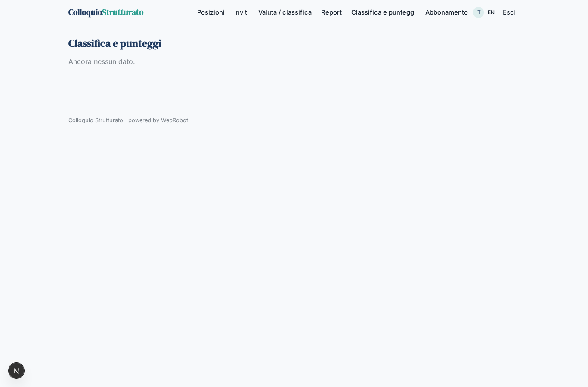
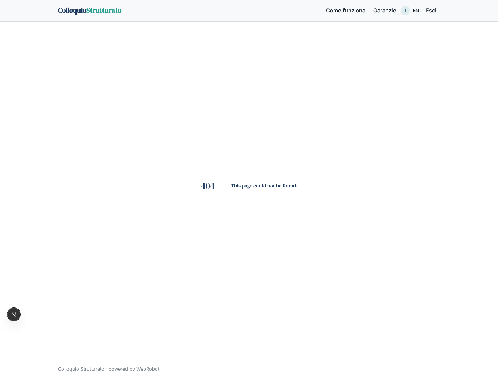
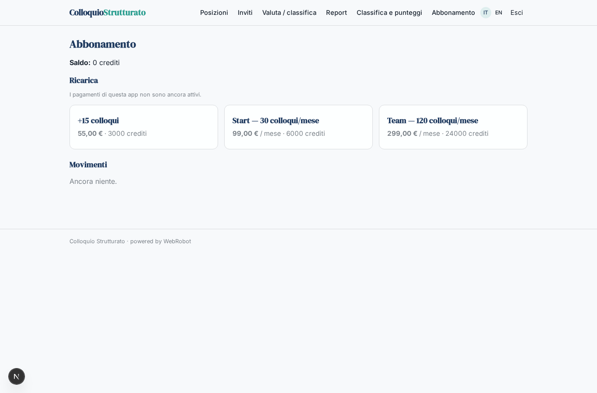

# Colloquio Strutturato

_Colloqui oggettivi, valutati con rubriche chiare. La decisione resta a te._

**Stato manifest:** valido (validatore Python + contratto runtime)

## Descrizione data all'app builder

Mi serve Colloquio Strutturato, uno strumento per i recruiter che vogliono valutare candidati in modo oggettivo. L'admin HR crea una posizione, definisce le competenze da valutare (comunicazione, problem solving, competenze tecniche) e per ciascuna una rubrica con livelli da 1 a 5 ed esempi di risposta. Il recruiter invita i candidati via email con un link. Il candidato apre il link nel browser e sostiene un colloquio vocale con un agente che fa domande comportamentali e situazionali, ascolta, chiede approfondimenti e chiude in circa venti minuti; vogliamo anche l'opzione con video registrato. L'agente trascrive, valuta ogni risposta rispetto alla rubrica con una motivazione e produce un report per candidato e una classifica comparativa per posizione. Il recruiter rivede i punteggi, può correggerli e decide chi passa al colloquio successivo; nessuna decisione è automatica. I risultati vanno sincronizzati con l'ATS aziendale. Il candidato vede solo il proprio colloquio e un riscontro finale, il recruiter le posizioni a lui assegnate. Consenso esplicito del candidato prima di iniziare. Abbonamento mensile per numero di colloqui, in italiano e inglese.

## Funzioni non esprimibili oggi (spec.extensions)

- **ats_sync**: Sincronizzazione dei risultati con l'ATS aziendale: richiede credenziali per cliente (connettore non ancora disponibile). Per ora i risultati sono esportabili dal report stampabile.
- **email_invites**: Invio automatico degli inviti via email non disponibile: il recruiter copia il link personale e lo invia; il candidato accede con magic link all'email invitata.
- **voice_video**: Colloquio vocale in browser e registrazione video (con upload) non disponibili: oggi il colloquio è in chat testuale e la trascrizione è salvata dall'agente. Il campo video_option della posizione è predisposto.
- **candidate_feedback_release**: Il riscontro finale al candidato è scritto dal recruiter nel campo feedback_to_candidate dopo la decisione umana.

## Screenshot (runtime interpretativo)

### home-anon

### home-mobile

### home

### positions_list

### invites

### interview

### my_feedback

### new_eval

### reports

### ranking

### decisions

### account

