# PartitaSerena

_Il tuo commercialista online per il regime forfettario._

**Manifest:** valid (schema + runtime contract) · **Functional test:** passed (25 checks passed)

## Description given to the app builder (Italian)

Vorrei realizzare PartitaSerena, un servizio di commercialista online per liberi professionisti in regime forfettario. Il cliente si iscrive indicando codice ATECO, anno di apertura, cassa previdenziale e fatturato previsto; ogni volta che emette una fattura la registra con importo, cliente e data. L'app calcola in tempo reale tasse e contributi dovuti, mostra quanto accantonare e la soglia di ricavi rimanente prima di uscire dal regime. Un agente prepara il calendario delle scadenze personali (acconti, saldi, contributi INPS) e manda email di promemoria con l'importo dieci giorni prima. In chat il cliente fa domande fiscali e riceve risposte basate sulla documentazione dell'Agenzia delle Entrate; se la domanda è complessa la chat passa la richiesta al commercialista assegnato, che risponde entro 24 ore. La dichiarazione dei redditi viene preparata in bozza dall'app ma l'invio telematico lo fa sempre il professionista abilitato. Il cliente vede solo la sua posizione, il commercialista i suoi clienti. Abbonamento annuale. Italiano.

## Functional test: what did not pass

- **form saves a record** (form answer): only role consultant may fill it, and the test cannot hold that role _(warning)_
- **saved record shown where its collection is read** (view clients_list): a record was saved in clients (by user, admin) but the page does not show it (as consultant) _(warning)_

## Features not expressible today (spec.extensions)

- **consultant_assignment**: L'assegnazione del commercialista a ogni cliente è fatta da un amministratore (vista 'Assegna commercialista'); non è ancora automatica o per carico di lavoro.
- **telematic_filing**: L'invio telematico della dichiarazione non è fatto dall'app: la bozza approvata viene trasmessa dal professionista abilitato con i propri strumenti.
- **response_sla_24h**: Il termine di 24 ore per la risposta del commercialista è un impegno di servizio, non applicato dal sistema; il promemoria al professionista è una email alla creazione della richiesta.

## Screenshots (interpretive runtime, no data)

### home-anon
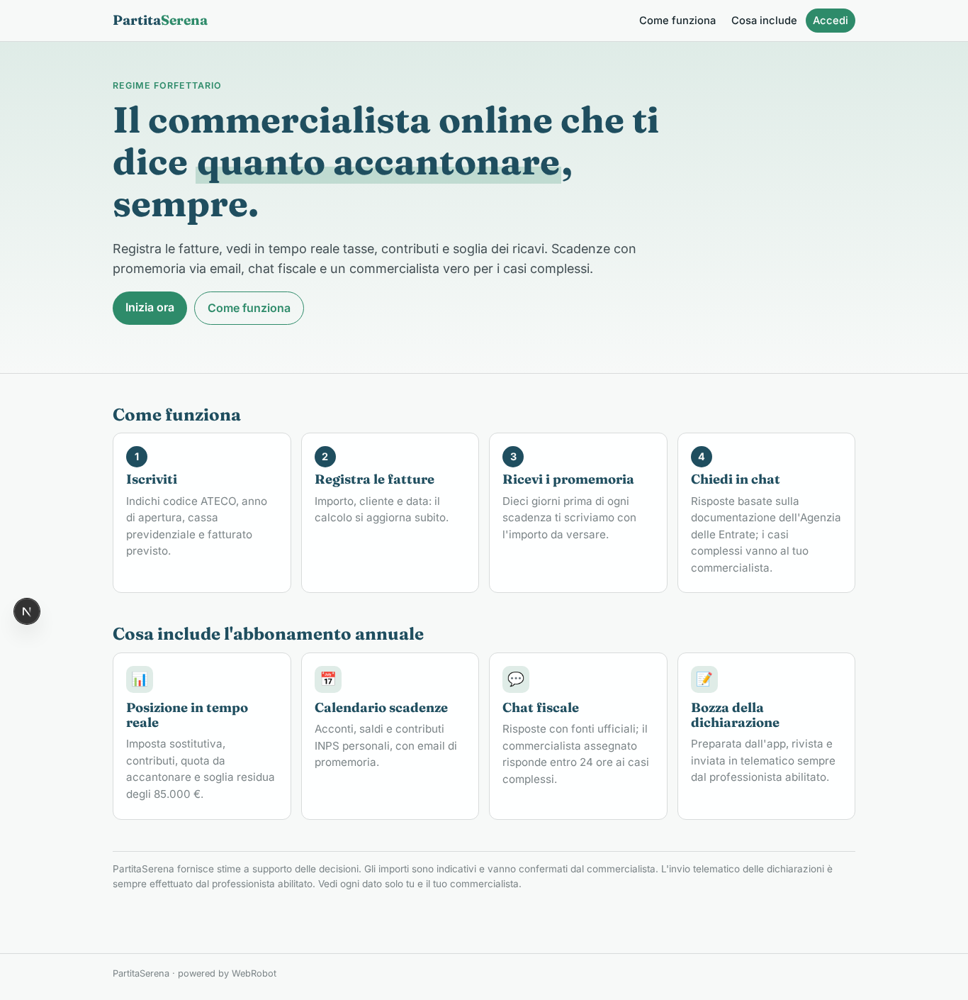

### home-mobile
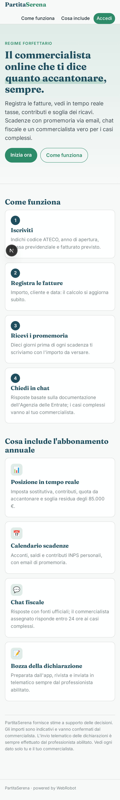

### home
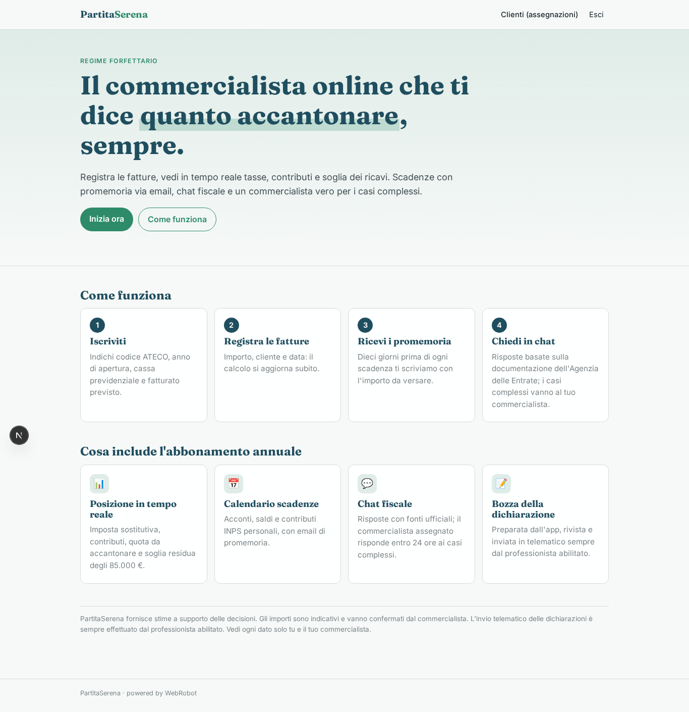

### onboarding
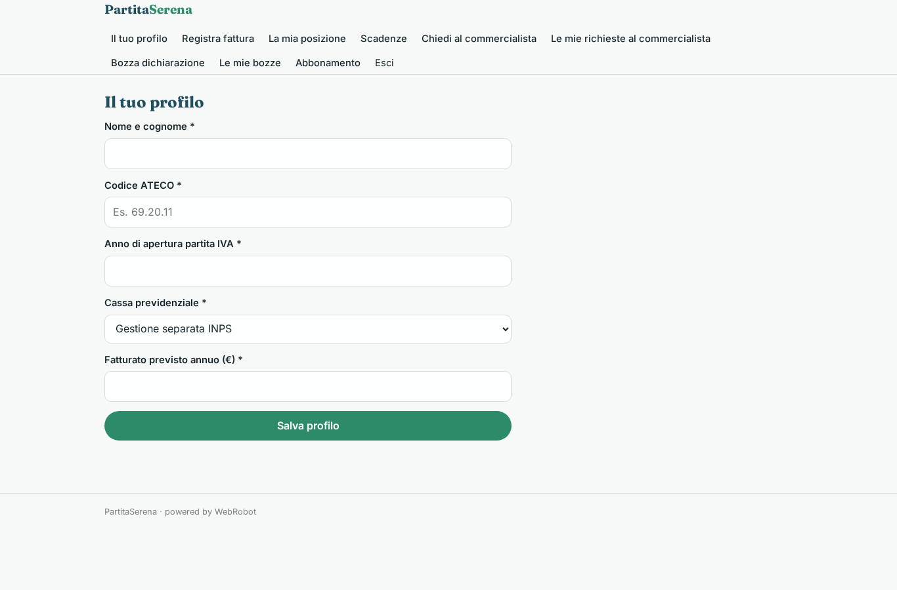

### new_invoice
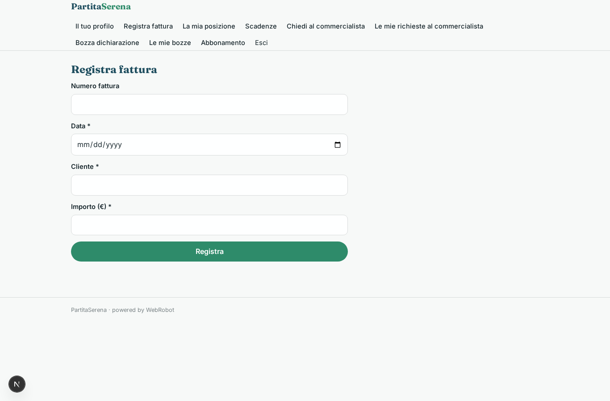

### position
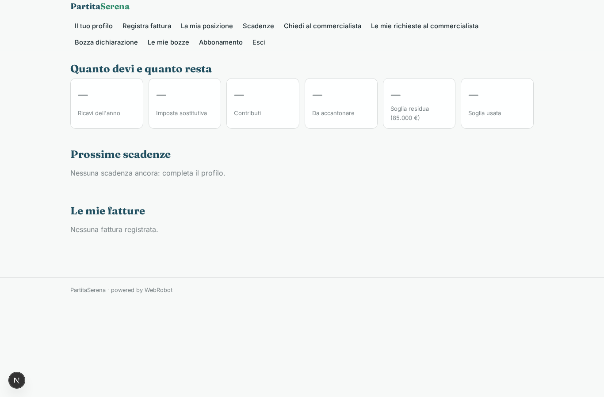

### deadlines_list
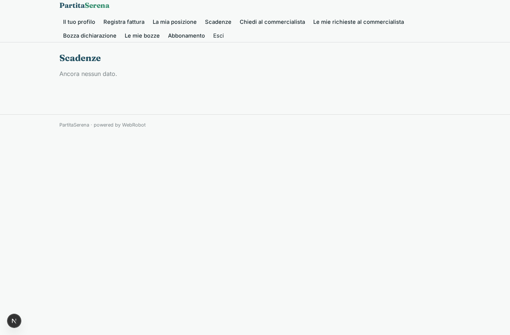

### chat
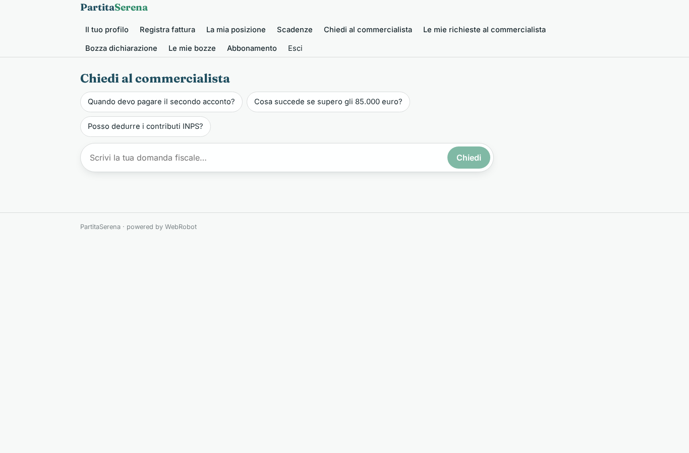

### my_questions
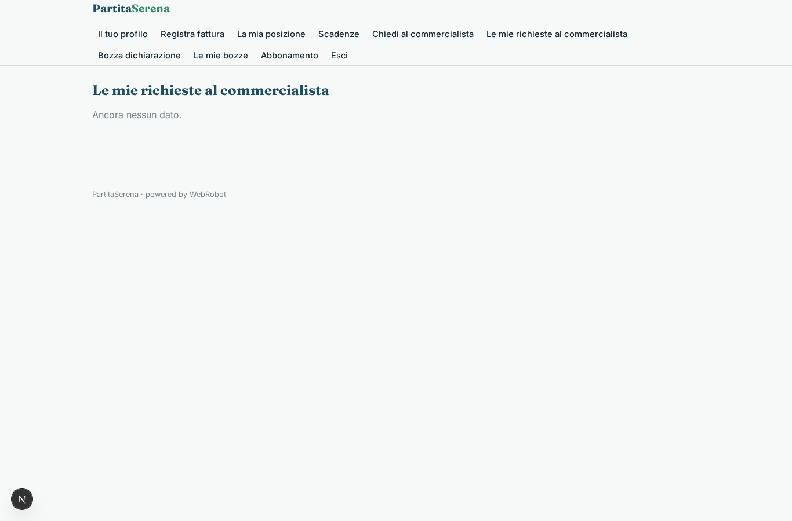

### new_draft
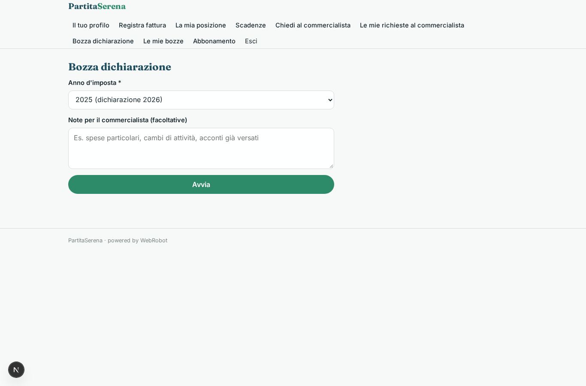

### drafts_history

### account
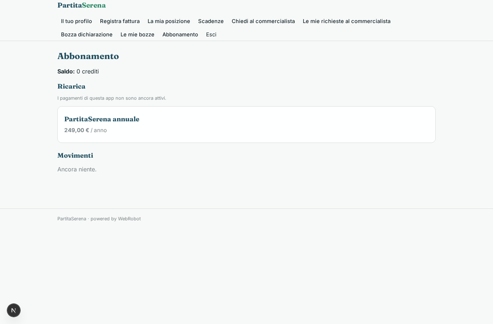

### clients_list
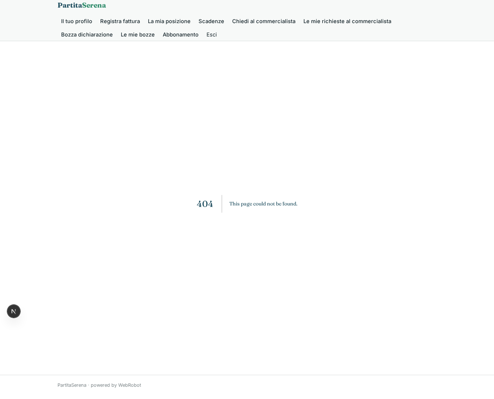

### clients_positions

### escalations_inbox

### answer
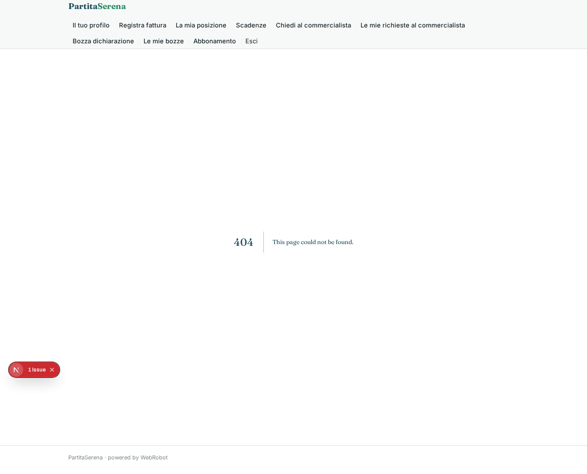

### approvals

### admin_clients
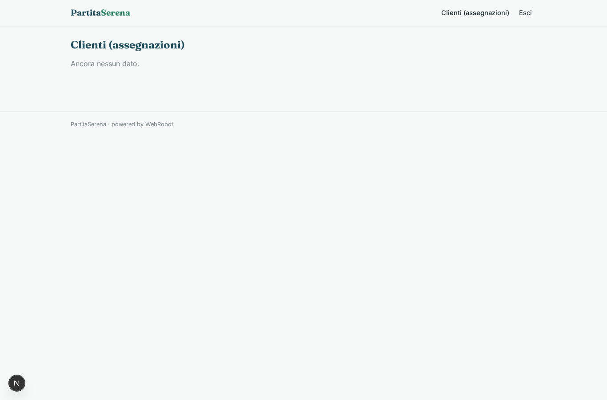

### assign
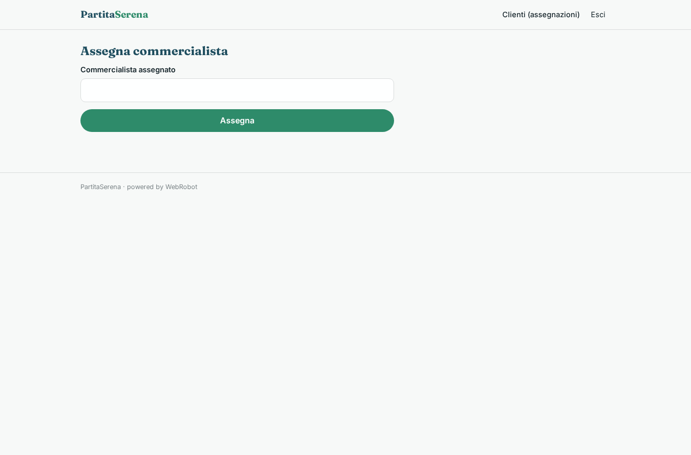
