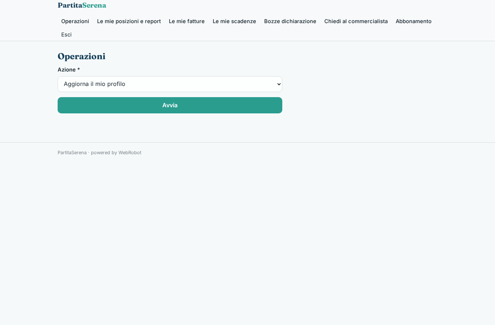
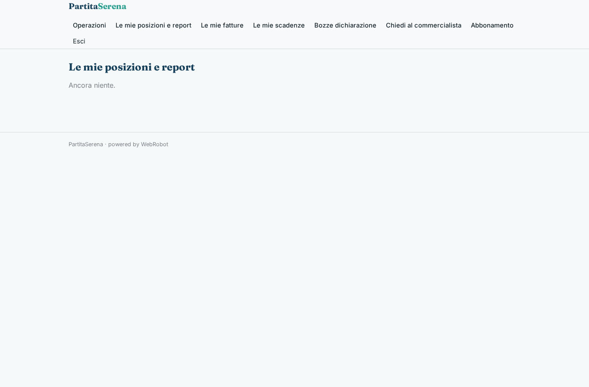
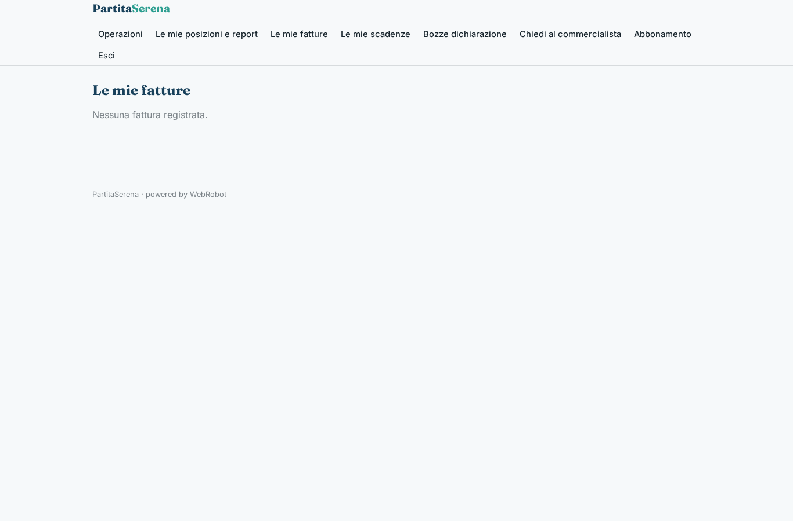
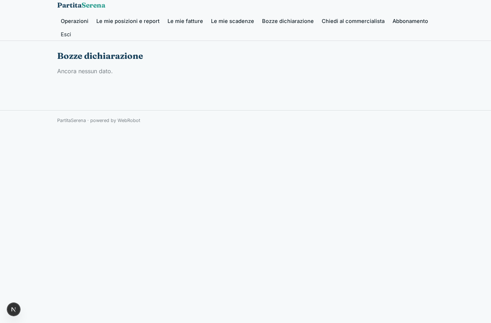
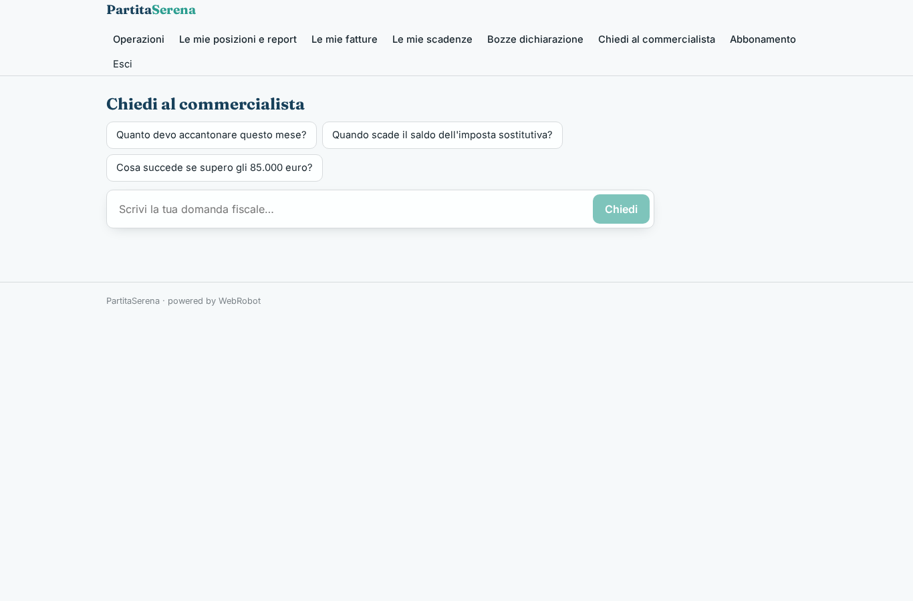
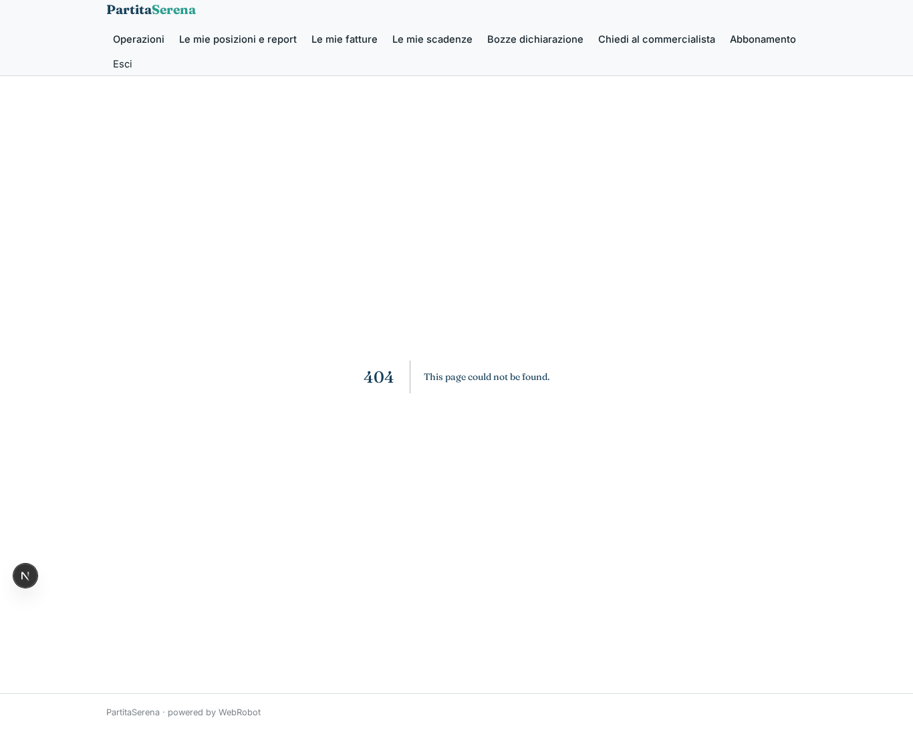
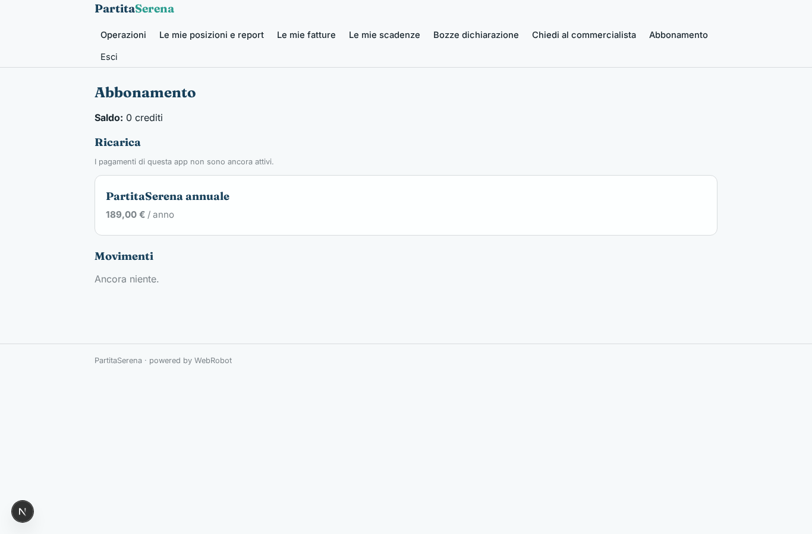

# PartitaSerena

_Il commercialista online per chi è in regime forfettario._

**Manifest status:** valid (schema validator + runtime contract)

## Description given to the app builder (Italian)

Vorrei realizzare PartitaSerena, un servizio di commercialista online per liberi professionisti in regime forfettario. Il cliente si iscrive indicando codice ATECO, anno di apertura, cassa previdenziale e fatturato previsto; ogni volta che emette una fattura la registra con importo, cliente e data. L'app calcola in tempo reale tasse e contributi dovuti, mostra quanto accantonare e la soglia di ricavi rimanente prima di uscire dal regime. Un agente prepara il calendario delle scadenze personali (acconti, saldi, contributi INPS) e manda email di promemoria con l'importo dieci giorni prima. In chat il cliente fa domande fiscali e riceve risposte basate sulla documentazione dell'Agenzia delle Entrate; se la domanda è complessa la chat passa la richiesta al commercialista assegnato, che risponde entro 24 ore. La dichiarazione dei redditi viene preparata in bozza dall'app ma l'invio telematico lo fa sempre il professionista abilitato. Il cliente vede solo la sua posizione, il commercialista i suoi clienti. Abbonamento annuale. Italiano.

## Features not expressible today (spec.extensions)

- **promemoria_email**: Le email di promemoria con l'importo dieci giorni prima di ogni scadenza non sono ancora disponibili (notifiche non supportate): per ora il cliente vede le scadenze nella pagina 'Le mie scadenze'.
- **vista_commercialista**: L'assegnazione di ciascun cliente a un commercialista e la vista del commercialista sui dati (profilo, fatture, scadenze) dei soli suoi clienti richiedono un accesso per assegnazione non esprimibile con i ruoli attuali; per ora il commercialista riceve nella vista 'Richieste dei clienti' la sintesi del caso.
- **risposta_commercialista**: La risposta scritta del commercialista alla richiesta della chat passa dalla decisione/nota dell'approvazione; un canale di risposta testuale nella conversazione è da sviluppare.
- **invio_telematico**: L'invio telematico della dichiarazione è sempre svolto fuori dall'app dal professionista abilitato; l'app prepara solo la bozza e la sua revisione.
- **caricamento_file**: Il caricamento di fatture o documenti (file) non è disponibile: le fatture si registrano con importo, cliente e data.

## Screenshots (interpretive runtime)

### home-anon

### home-mobile

### home

### nuova

### posizioni

### fatture_lista

### scadenze_lista

### bozze_lista

### chat

### richieste

### account

