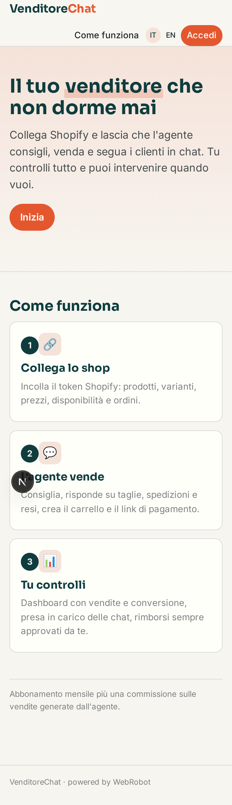
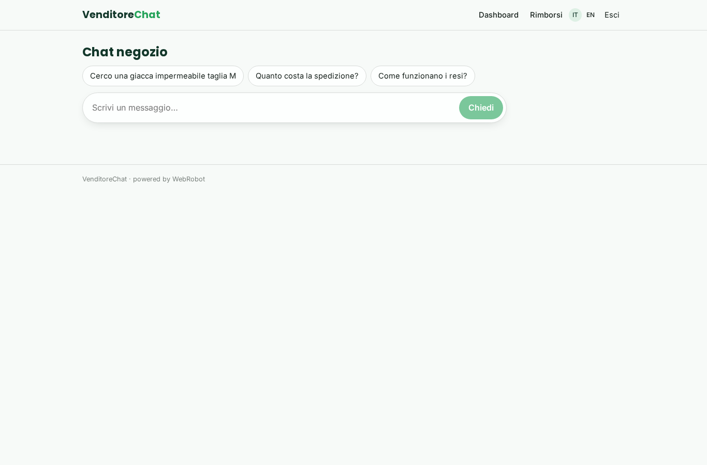
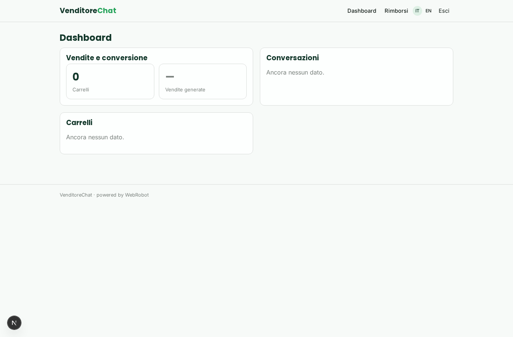
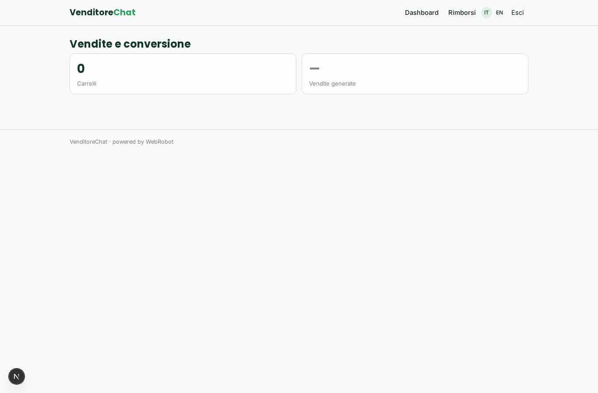
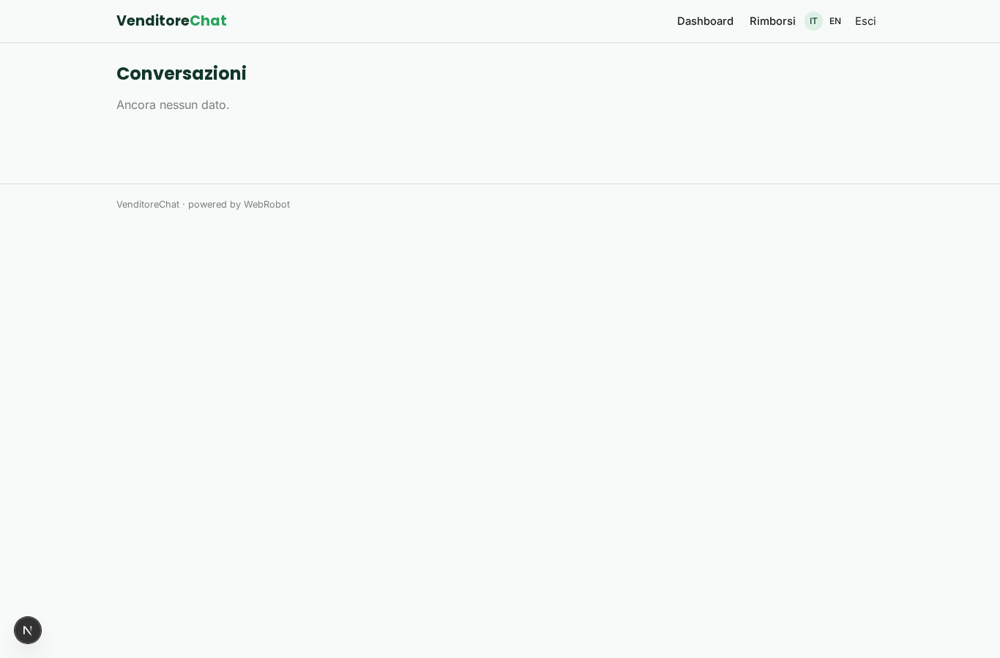
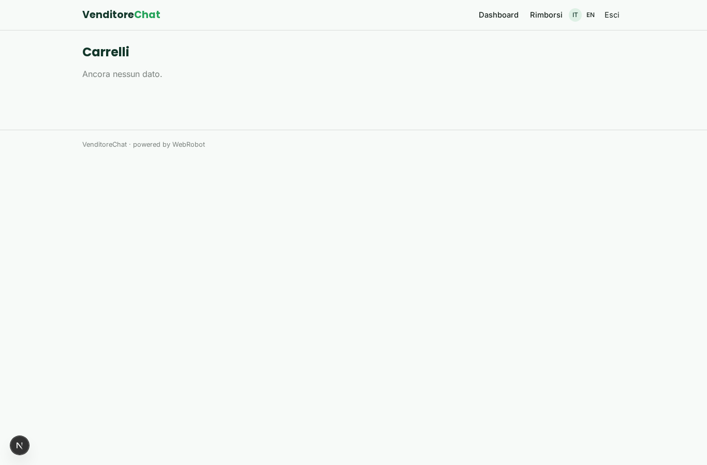
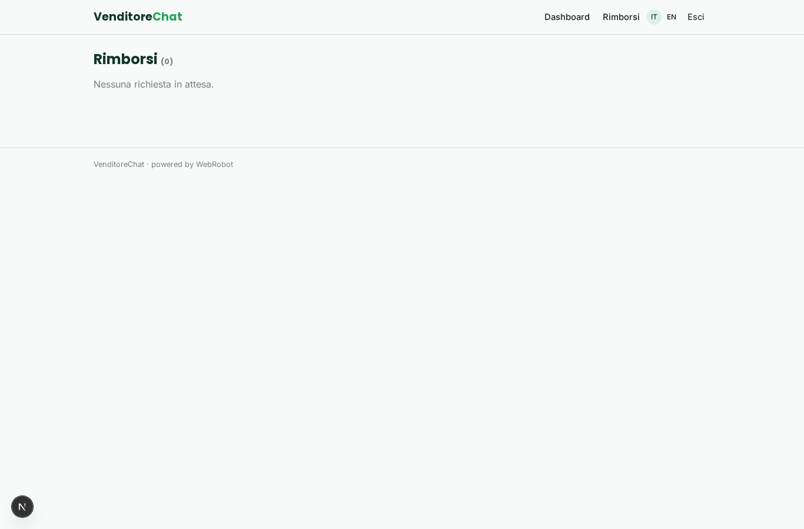
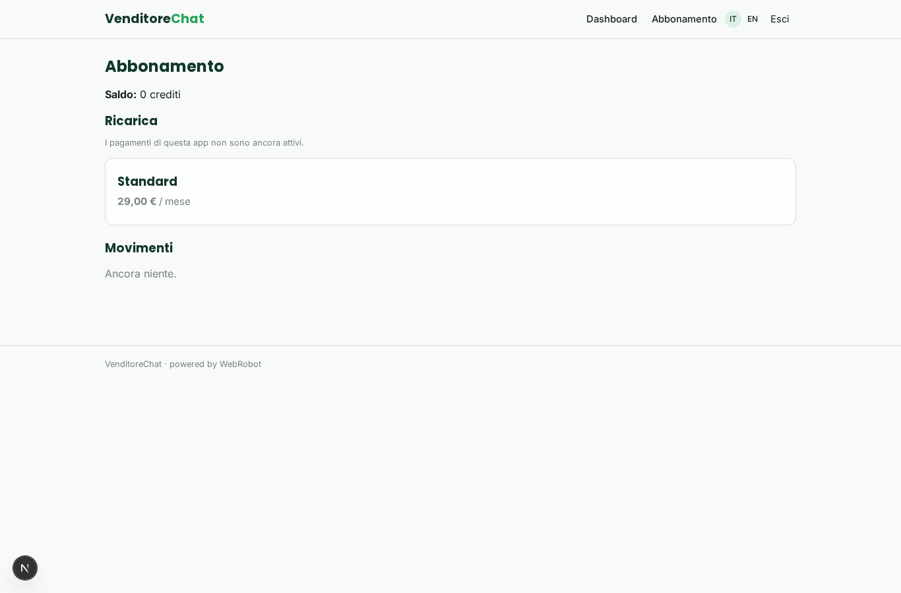

# VenditoreChat

_Un agente di vendita per il tuo negozio online, sempre in chat._

**Manifest status:** valid (schema validator + runtime contract)

## Description given to the app builder (Italian)

Vogliamo VenditoreChat, un agente di vendita per negozi online che parla con i clienti su WhatsApp. Il negoziante collega il suo shop Shopify con un accesso autorizzato e l'app importa il catalogo con prodotti, varianti, prezzi, disponibilità e ordini. Il cliente scrive su WhatsApp o sulla chat del sito: l'agente consiglia prodotti in base alle richieste, risponde su taglie, spedizioni e resi, crea un carrello e manda il link di pagamento, e se il carrello resta abbandonato lo ricontatta dopo qualche ora. Quando un ordine viene spedito invia aggiornamenti sullo stato; quando arriva un nuovo prodotto può mandare campagne ai clienti che hanno dato consenso. Il gestore vede una dashboard con conversazioni, vendite generate dall'agente, tasso di conversione e può prendere in mano una chat in qualsiasi momento. Le richieste di rimborso passano sempre per l'approvazione dell'operatore. Abbonamento mensile più una commissione percentuale sulle vendite generate. Italiano e inglese.

## Features not expressible today (spec.extensions)

- **shopify_connector**: Not available yet: importing catalog, variants, stock and orders from Shopify needs each merchant's credentials. For now the catalog is filled in manually or by pasted data.
- **whatsapp_channel**: Not available yet: WhatsApp channel. Only the web chat works for now.
- **notifications**: Not available yet: order shipping updates, new-product campaigns and abandoned-cart messages sent to customers.
- **abandoned_cart_followup**: Not available yet: the scheduled abandoned-cart follow-up was removed, because carts and conversations are now private records of the user (needed for the public chat) and one app-wide scheduled agent cannot read them. Open carts are listed in the dashboard.
- **human_takeover**: Operator taking over a live chat is not available yet; conversations flagged 'handoff' are listed in the dashboard.
- **multi_merchant**: One merchant per app instance. The sales commission is applied through per_transaction billing.

## Screenshots (interpretive runtime)

### home-anon

### home-mobile

### home

### shop_chat

### dashboard

### kpis

### conversations_list

### carts_list

### refunds

### account

