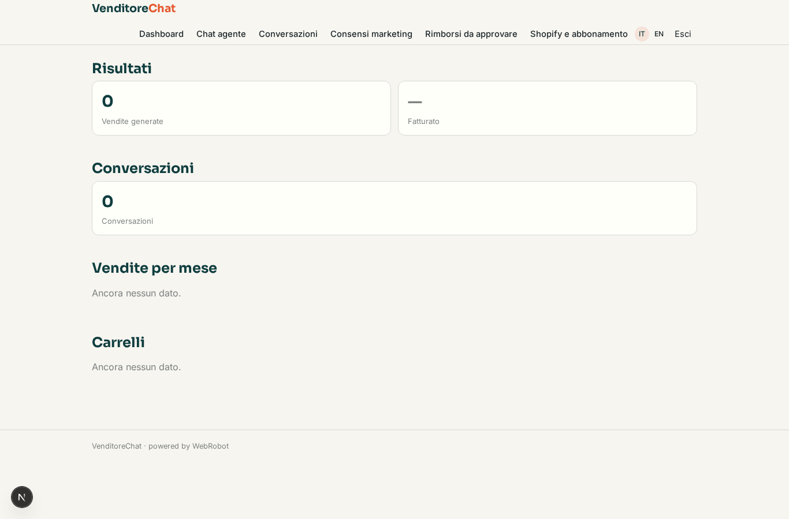
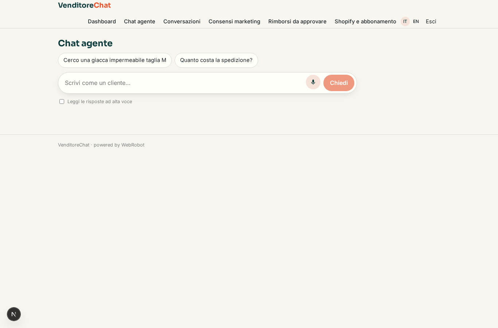
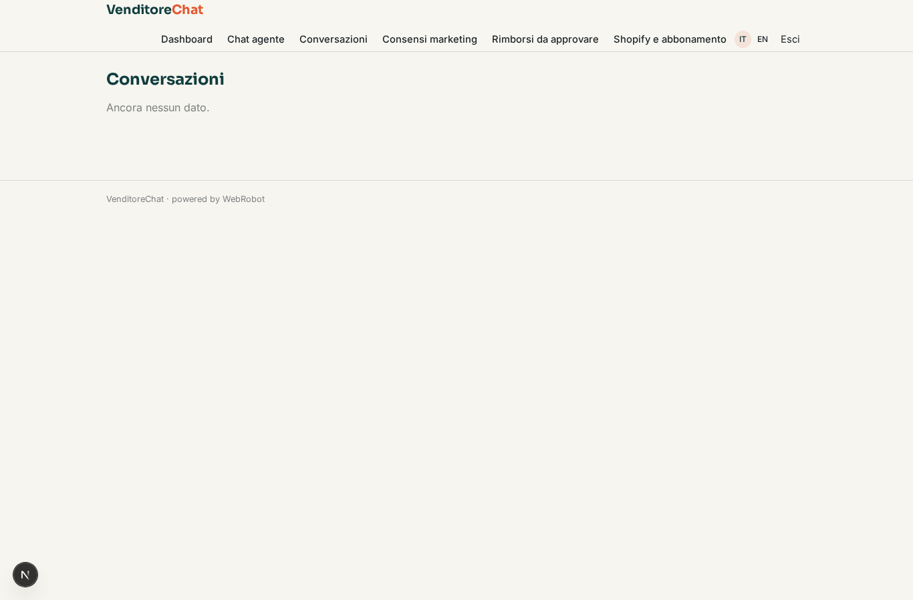
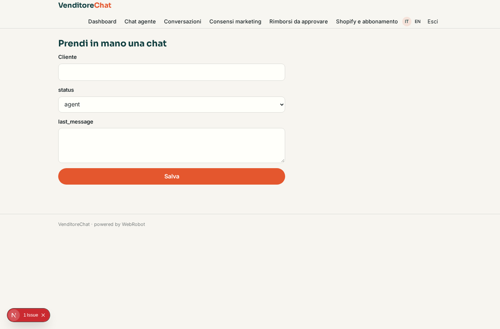
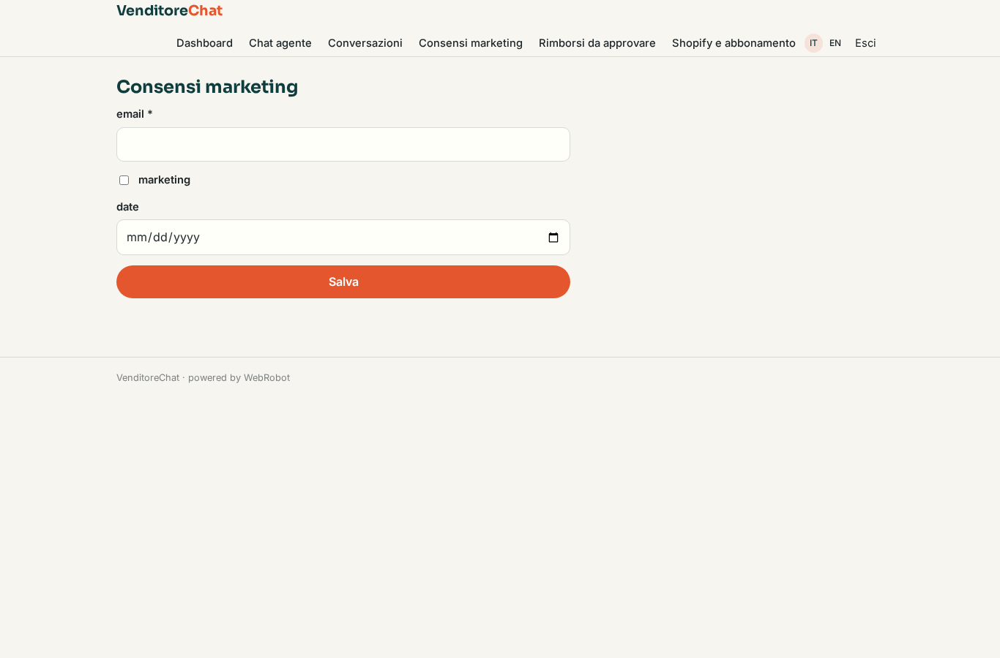
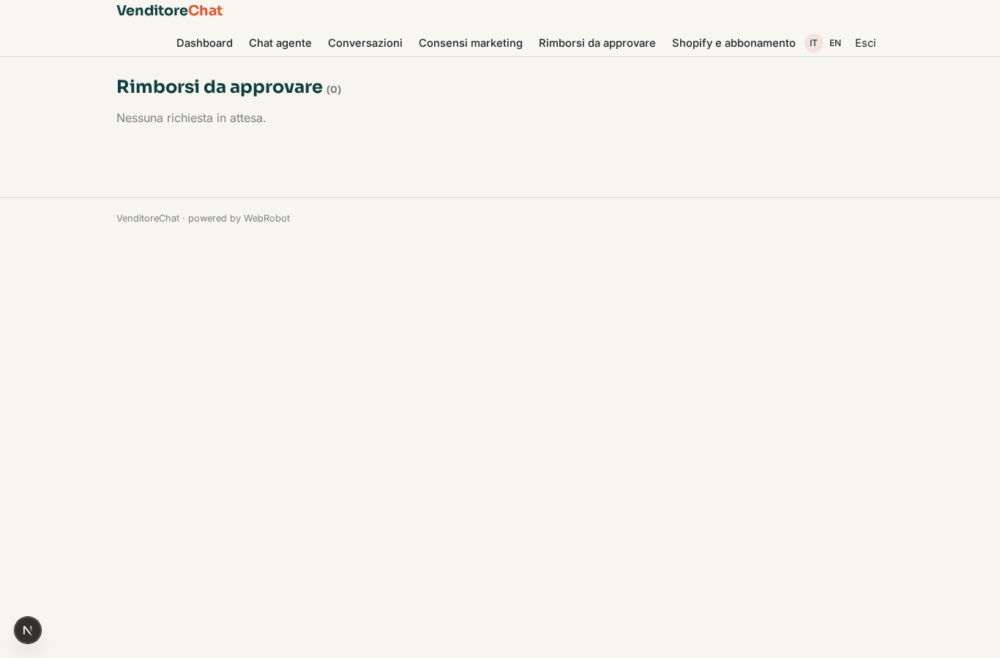

# VenditoreChat

_Un agente di vendita per il tuo shop Shopify, sempre in chat._

**Manifest:** valid (schema + runtime contract) · **Functional test:** passed (12 checks passed)

## Description given to the app builder (Italian)

Vogliamo VenditoreChat, un agente di vendita per negozi online che parla con i clienti su WhatsApp. Il negoziante collega il suo shop Shopify con un accesso autorizzato e l'app importa il catalogo con prodotti, varianti, prezzi, disponibilità e ordini. Il cliente scrive su WhatsApp o sulla chat del sito: l'agente consiglia prodotti in base alle richieste, risponde su taglie, spedizioni e resi, crea un carrello e manda il link di pagamento, e se il carrello resta abbandonato lo ricontatta dopo qualche ora. Quando un ordine viene spedito invia aggiornamenti sullo stato; quando arriva un nuovo prodotto può mandare campagne ai clienti che hanno dato consenso. Il gestore vede una dashboard con conversazioni, vendite generate dall'agente, tasso di conversione e può prendere in mano una chat in qualsiasi momento. Le richieste di rimborso passano sempre per l'approvazione dell'operatore. Abbonamento mensile più una commissione percentuale sulle vendite generate. Italiano e inglese.

## Features not expressible today (spec.extensions)

- **whatsapp_channel**: WhatsApp conversations are not available yet: only the in-app/web chat works. Customer-facing public chat widget on the merchant's site (using the merchant's Shopify key for anonymous visitors) also needs a custom integration.
- **marketing_campaigns**: New-product campaigns to consented customers (WhatsApp/email lists) are not available yet; consents are recorded for future use.
- **percentage_commission**: The sales commission is approximated by a fixed credit fee per agent sale; a true percentage of sale value is not expressible yet.
- **hourly_cart_reminder**: Abandoned-cart reminders fire on a date (09:00 the day set in remind_on), not a few hours after abandonment.
- **shopify_oauth**: Shopify connects through an Admin API access token pasted by the merchant, not OAuth install.

## Screenshots (interpretive runtime, no data)

### home-anon

### home-mobile

### home

### dashboard

### assistant

### conversations

### takeover

### consents

### approvals

### account

