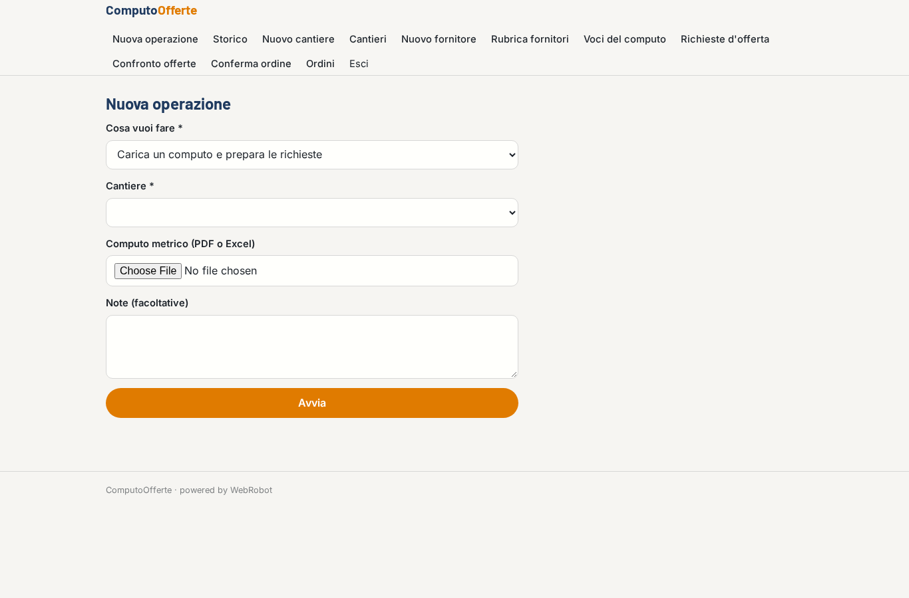
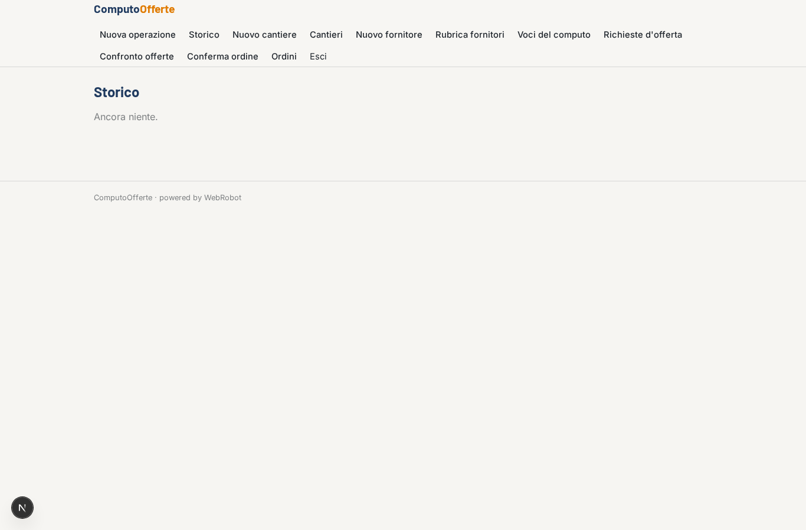
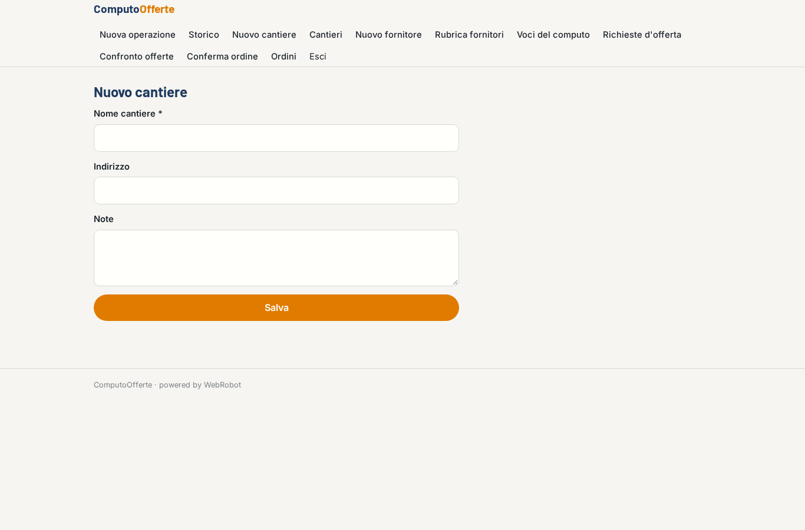
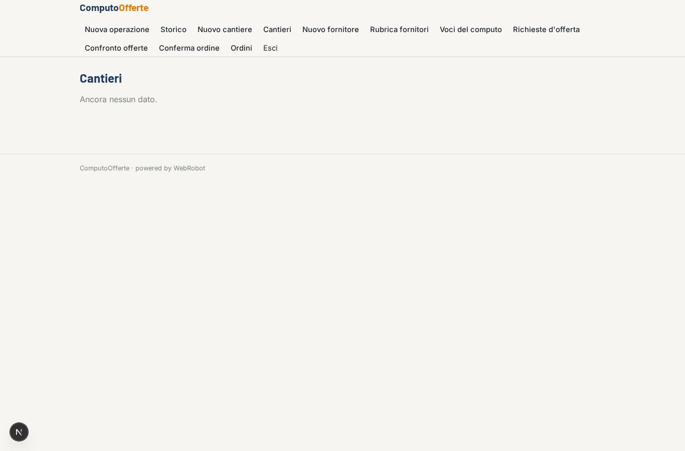
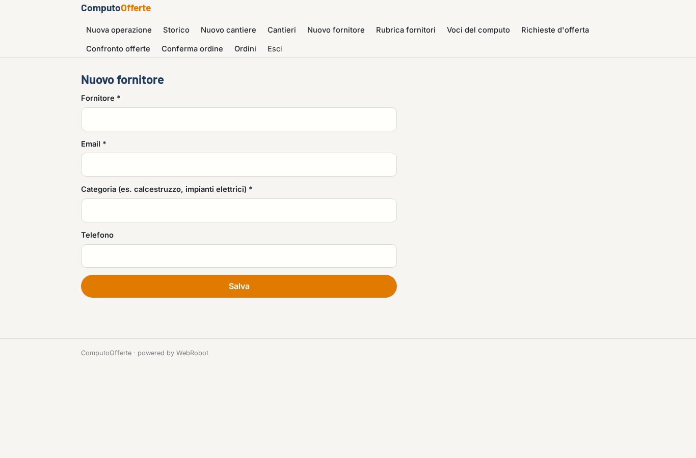
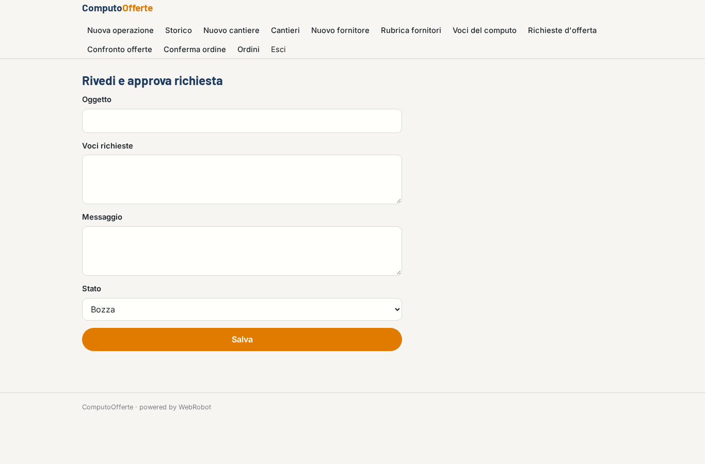
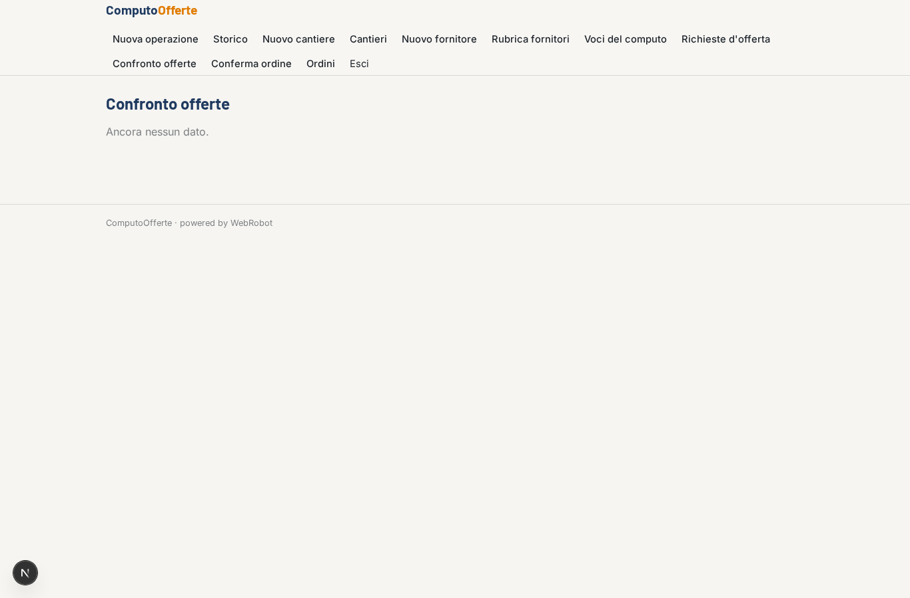
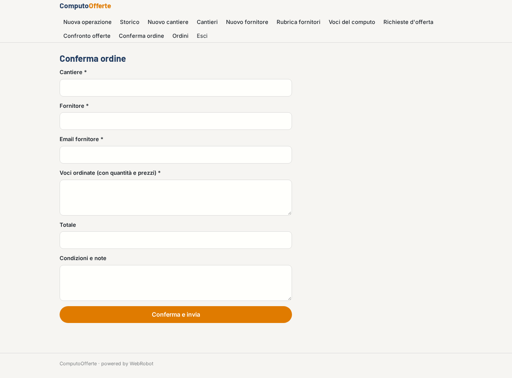
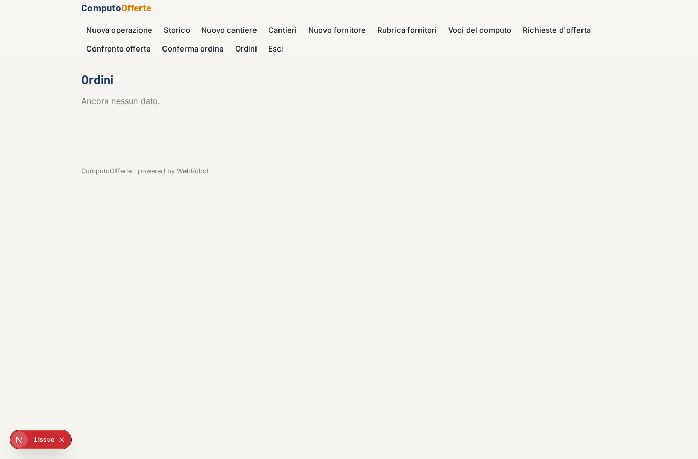
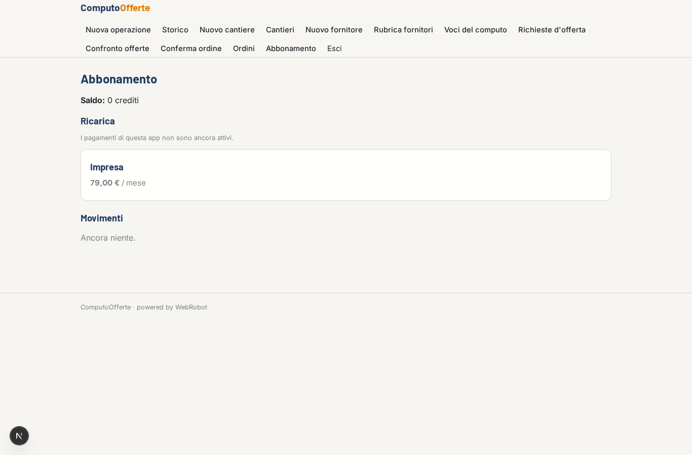

# ComputoOfferte

_Dal computo metrico all'ordine al fornitore più conveniente._

**Manifest:** valid (schema + runtime contract) · **Functional test:** passed (22 checks passed)

## Description given to the app builder (Italian)

Ci serve ComputoOfferte per imprese edili. Il tecnico carica il computo metrico del cantiere in PDF o Excel. Un agente estrae le voci (materiali, quantità, unità di misura), le raggruppa per categoria di fornitore e prepara le richieste d'offerta. Il tecnico rivede e approva le richieste, che partono via email ai fornitori della sua rubrica per quella categoria. Le risposte dei fornitori arrivano in una casella dedicata: l'agente legge le offerte, estrae prezzi, tempi di consegna e condizioni e compila una tabella di confronto per voce, evidenziando il fornitore più conveniente. Il tecnico sceglie e conferma l'ordine. Ogni impresa vede solo i propri cantieri e fornitori. Abbonamento mensile per impresa.

## Functional test: what did not pass

- **saved record shown where its collection is read** (view rfqs_list): a record was saved in rfqs (by user) but the page does not show it (as user) _(warning)_

## Screenshots (interpretive runtime, no data)

### home-anon

### home-mobile

### home

### new

### runs

### site_new

### sites_list

### supplier_new

### suppliers_list

### items_list

### rfqs_list

### rfq_review

### offers_list

### order_new

### orders_list

### account

