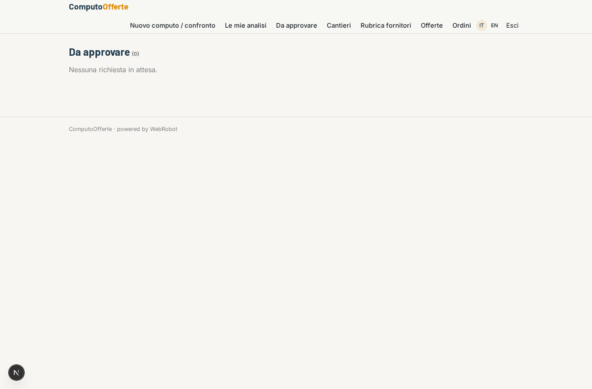
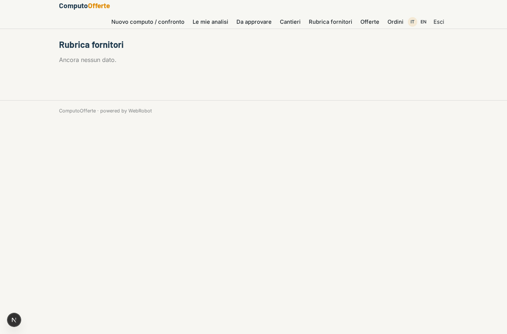
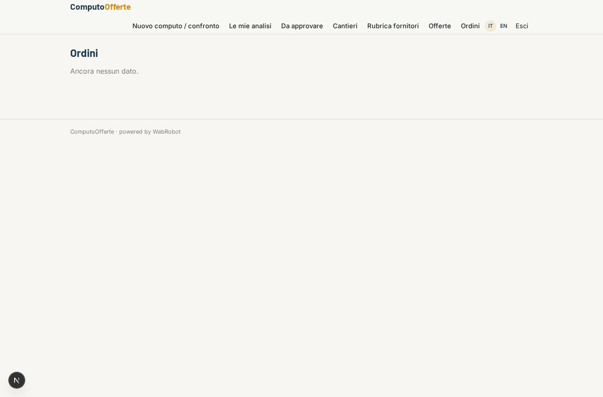
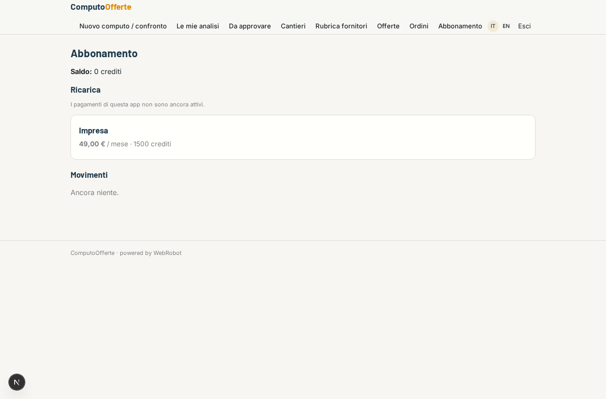

# ComputoOfferte

_Dal computo metrico all'ordine, con il confronto offerte già fatto._

**Manifest status:** valid (schema validator + runtime contract)

## Description given to the app builder (Italian)

Ci serve ComputoOfferte per imprese edili. Il tecnico carica il computo metrico del cantiere in PDF o Excel. Un agente estrae le voci (materiali, quantità, unità di misura), le raggruppa per categoria di fornitore e prepara le richieste d'offerta. Il tecnico rivede e approva le richieste, che partono via email ai fornitori della sua rubrica per quella categoria. Le risposte dei fornitori arrivano in una casella dedicata: l'agente legge le offerte, estrae prezzi, tempi di consegna e condizioni e compila una tabella di confronto per voce, evidenziando il fornitore più conveniente. Il tecnico sceglie e conferma l'ordine. Ogni impresa vede solo i propri cantieri e fornitori. Abbonamento mensile per impresa.

## Features not expressible today (spec.extensions)

- **file_upload**: Upload of PDF/Excel bills of quantities is not available yet: the technician pastes the text or gives a link.
- **email_out**: Sending approved RFQs by email to suppliers is not available yet: after approval the RFQ texts are shown and stored with status approvata, to be sent by the technician.
- **inbound_mailbox**: A dedicated mailbox receiving supplier replies is not available yet: the technician pastes the replies into the comparison form.

## Screenshots (interpretive runtime)

### home-anon

### home-mobile

### home

### new

### runs

### approvals

### sites_list

### suppliers_list

### offers_list

### orders_list

### account

