# ComunitaEnergia

_Gestisci la tua comunità energetica rinnovabile: ripartizione, incentivi e rendiconti._

**Manifest:** valid (schema + runtime contract) · **Functional test:** passed (17 checks passed)

## Description given to the app builder (Italian)

ComunitaEnergia e una piattaforma per gestire le comunita energetiche rinnovabili (CER). L'amministratore della comunita registra i membri (produttori con pannelli, consumatori, prosumer) con i loro punti di prelievo e gli impianti, e carica o collega i dati di produzione e consumo. Un agente ripartisce l'energia condivisa nei vari intervalli, calcola la quota di autoconsumo collettivo che da diritto agli incentivi e stima il beneficio economico per la comunita e per ogni membro. Ogni mese produce il rendiconto di ripartizione e la bozza di come distribuire gli incentivi tra i membri secondo le regole decise dalla comunita, che l'amministratore approva prima di comunicarla. Ogni membro vede nella propria area la quota di energia condivisa, i risparmi e i pagamenti previsti; l'amministratore vede la comunita intera. Previsioni meteo da Open-Meteo aiutano a stimare la produzione futura. Report via email e avvisi sugli andamenti anomali. Abbonamento annuale per comunita in base al numero di membri. In italiano.

## Features not expressible today (spec.extensions)

- **data_link**: Collegamento automatico ai dati di misura (portale distributore/GSE) non disponibile: i dati si caricano come file.

## Screenshots (interpretive runtime, no data)

### home-anon
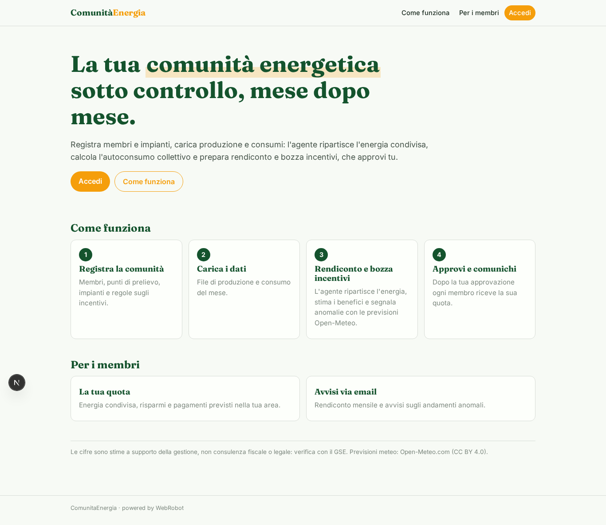

### home-mobile

### home
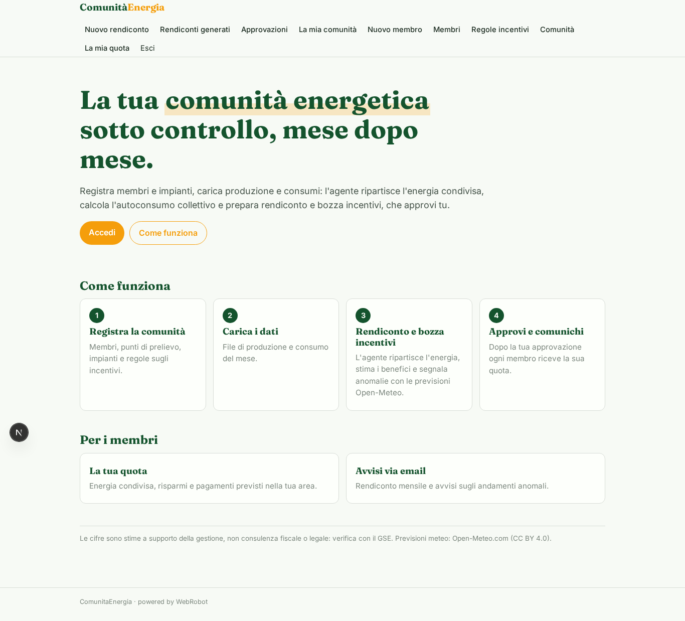

### new_run
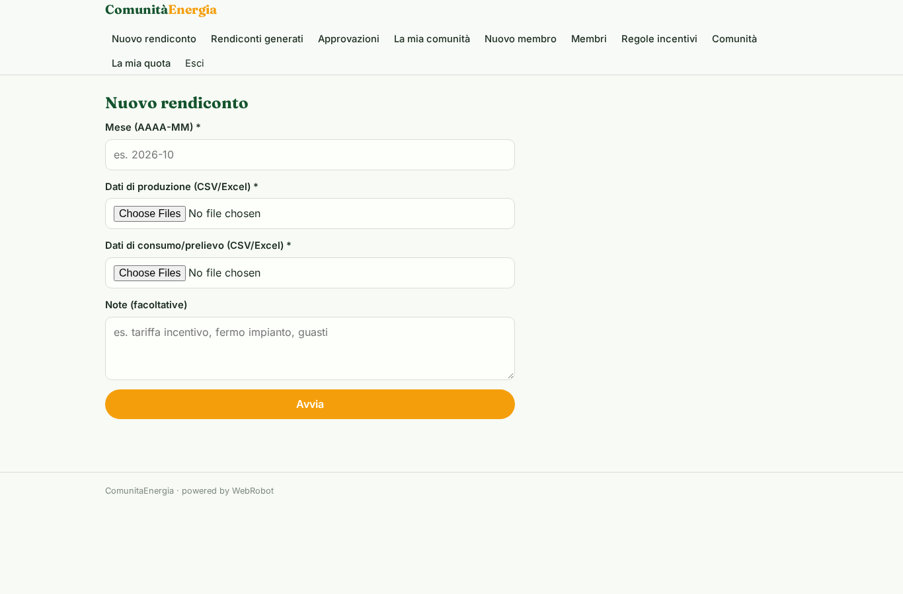

### runs
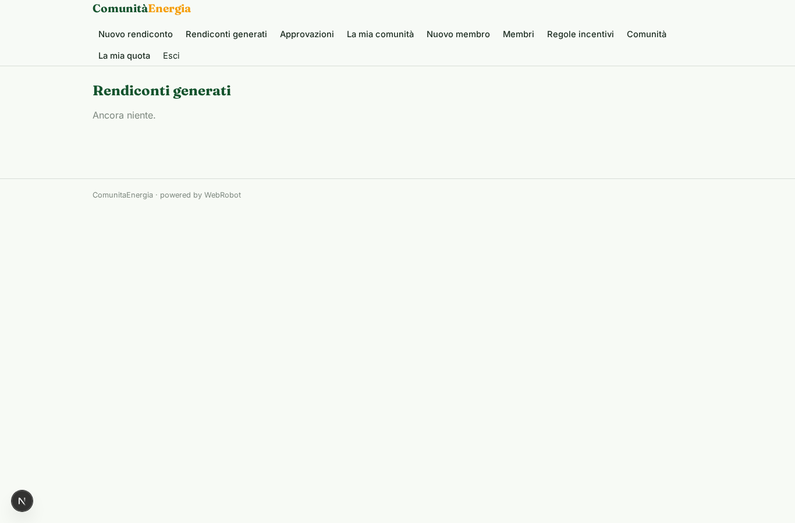

### approvals

### community_form
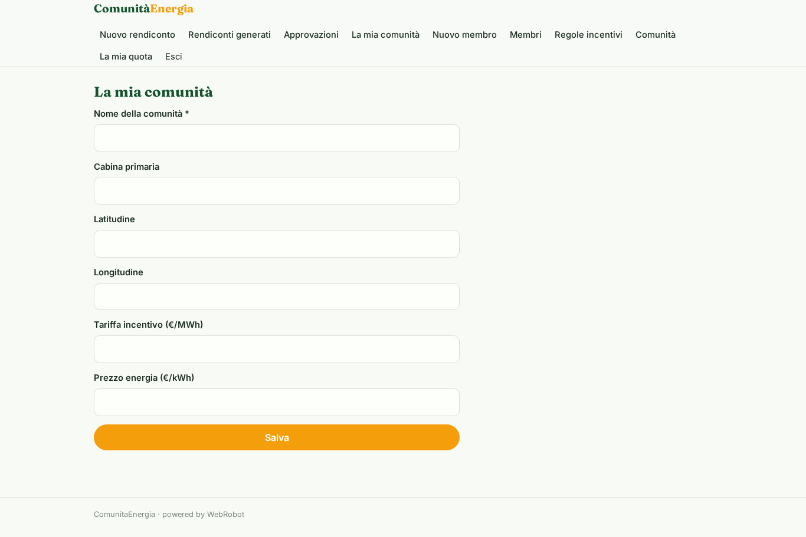

### member_form
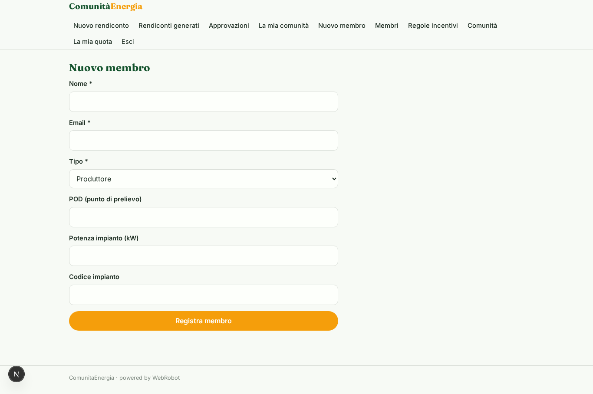

### members_list
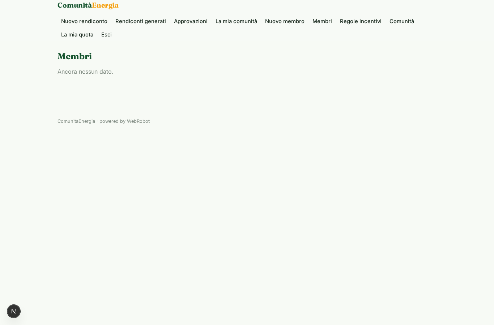

### rules_form
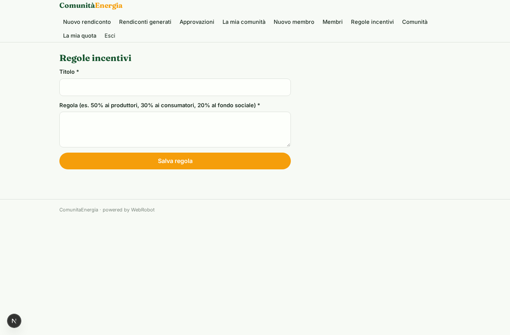

### overview
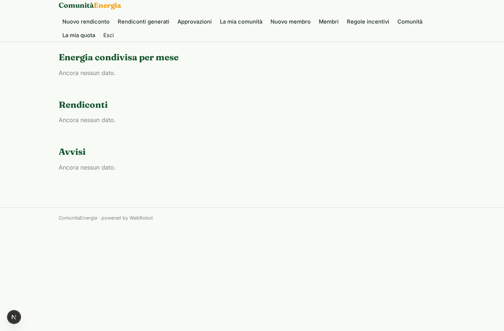

### my_share
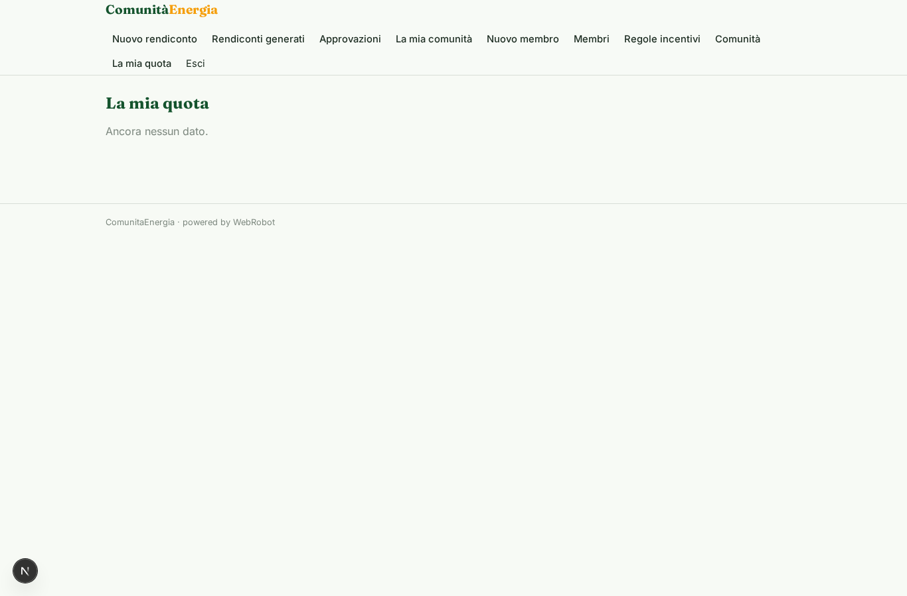

### account
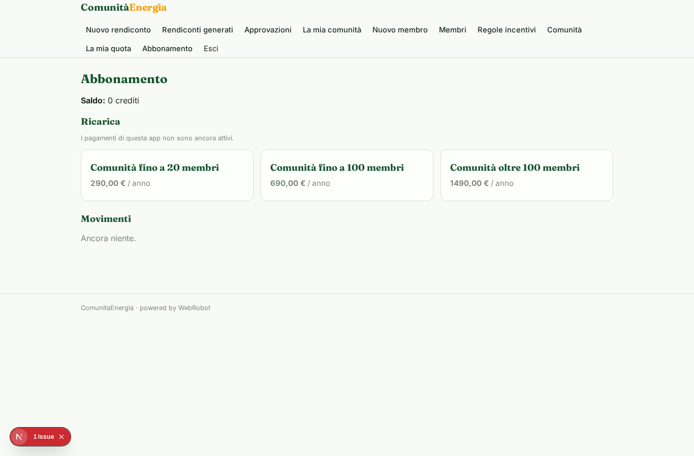
