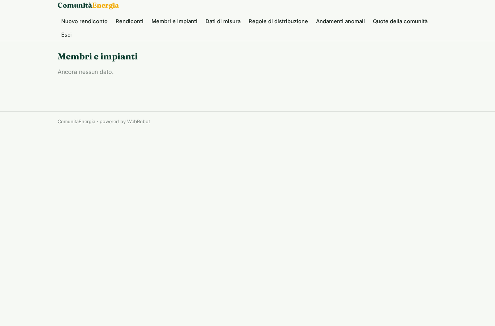
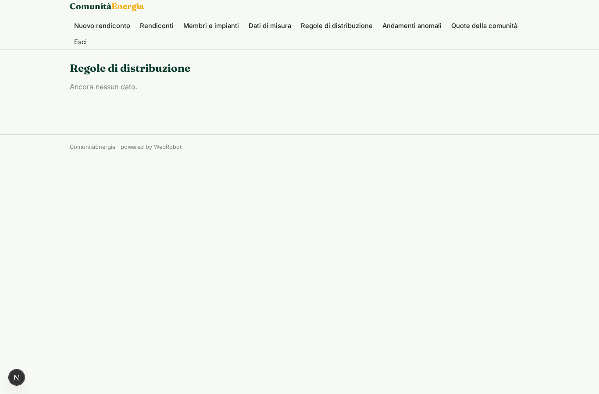
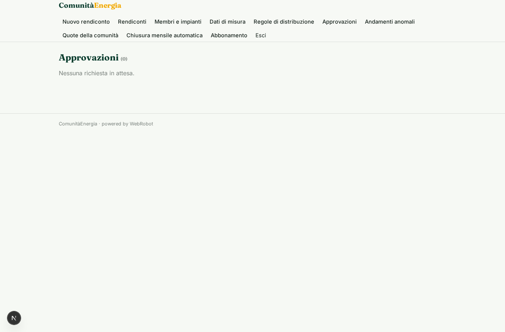
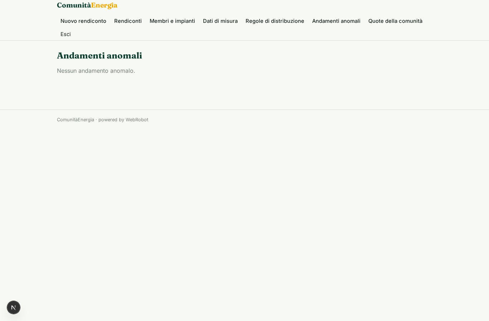
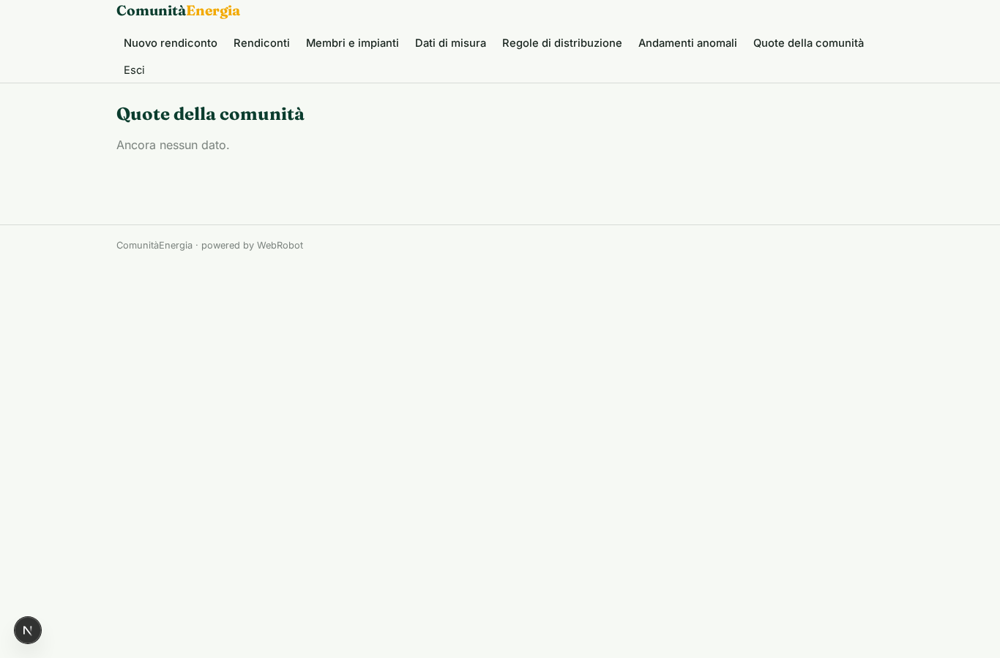
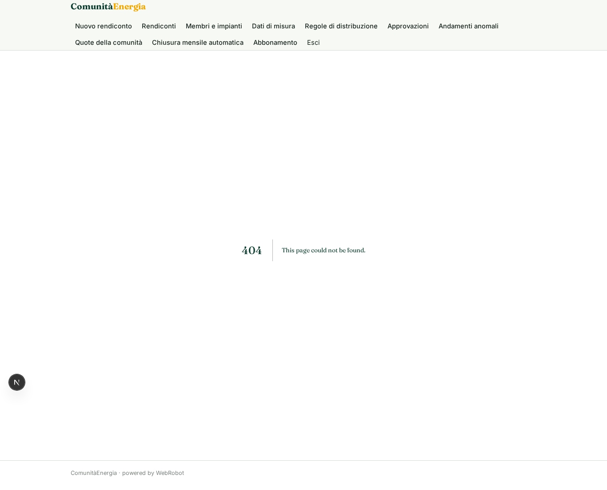
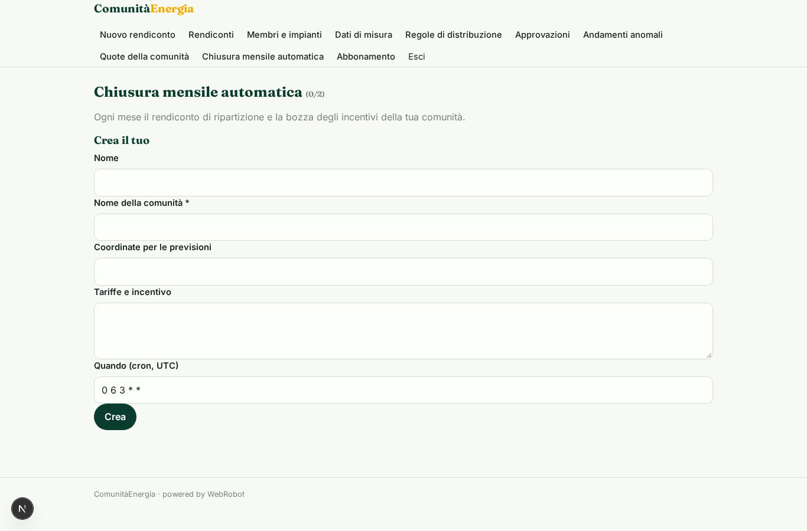
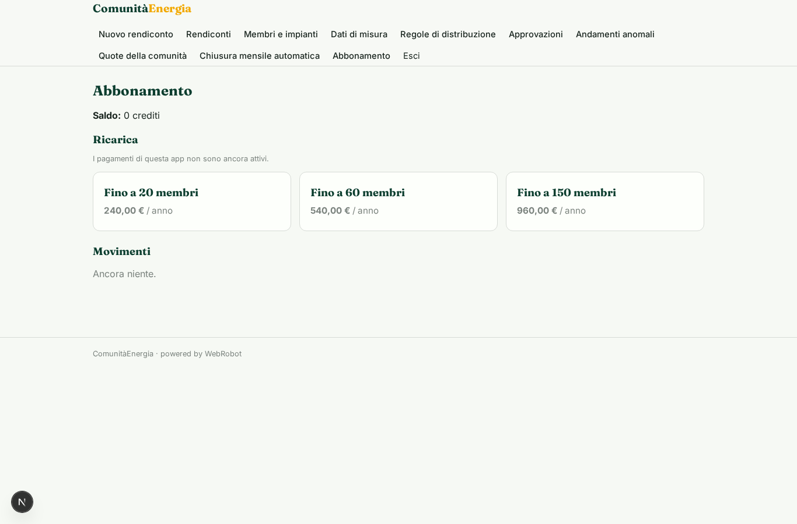

# ComunitàEnergia

_Gestisci la tua comunità energetica rinnovabile: ripartizione, incentivi e rendiconti mensili._

**Manifest status:** valid (schema validator + runtime contract)

## Description given to the app builder (Italian)

ComunitaEnergia e una piattaforma per gestire le comunita energetiche rinnovabili (CER). L'amministratore della comunita registra i membri (produttori con pannelli, consumatori, prosumer) con i loro punti di prelievo e gli impianti, e carica o collega i dati di produzione e consumo. Un agente ripartisce l'energia condivisa nei vari intervalli, calcola la quota di autoconsumo collettivo che da diritto agli incentivi e stima il beneficio economico per la comunita e per ogni membro. Ogni mese produce il rendiconto di ripartizione e la bozza di come distribuire gli incentivi tra i membri secondo le regole decise dalla comunita, che l'amministratore approva prima di comunicarla. Ogni membro vede nella propria area la quota di energia condivisa, i risparmi e i pagamenti previsti; l'amministratore vede la comunita intera. Previsioni meteo da Open-Meteo aiutano a stimare la produzione futura. Report via email e avvisi sugli andamenti anomali. Abbonamento annuale per comunita in base al numero di membri. In italiano.

## Features not expressible today (spec.extensions)

- **email_reports**: Invio via email dei rendiconti e degli avvisi sugli andamenti anomali: le notifiche non sono ancora disponibili. Gli avvisi compaiono nella vista 'Andamenti anomali' e il rendiconto nell'area dei membri.
- **file_upload**: Caricamento di file di misure (CSV, export del distributore) non ancora disponibile: i dati si incollano come testo o si registrano nella vista 'Dati di misura'. Il collegamento automatico ai portali dei distributori (credenziali per comunità) non è disponibile.
- **member_visibility**: I membri vedono solo le proprie righe grazie alla condivisione per record (viewer): l'amministratore deve invitarli dalla scheda del membro.

## Screenshots (interpretive runtime)

### home-anon

### home-mobile

### home

### new_run

### history

### members_list

### readings_list

### rules_list

### approvals

### alerts_list

### community_shares

### my_area

### watches

### account

