# Comunità Solare

_Promuovi e gestisci la tua comunità energetica rinnovabile._

**Stato manifest:** valido (validatore Python + contratto runtime)

## Descrizione data all'app builder

Voglio Comunità Solare, una piattaforma per promuovere e gestire comunità energetiche rinnovabili. Il promotore, per esempio un comune o una cooperativa, è admin e crea la comunità indicando la zona. Un simulatore pubblico permette a chiunque di inserire indirizzo, consumi annui e, se ha un impianto, la potenza: l'app individua la cabina primaria di riferimento dalle mappe del GSE, stima la produzione con PVGIS e calcola l'energia condivisa e gli incentivi attesi secondo le regole GSE. Chi è interessato compila il modulo di adesione con dati anagrafici, POD e ruolo (consumatore, produttore o prosumer); l'admin approva l'ingresso. Ogni mese un agente calcola la ripartizione degli incentivi tra i membri e produce un report per membro e uno per l'assemblea. Oggi i dati di consumo arrivano da stime e da letture inserite a mano, ma vorremmo leggere le misure reali con la delega del membro attraverso GSE e Terna. Ogni membro vede solo i propri dati e il totale aggregato della comunità. L'adesione è gratuita, il promotore paga un canone annuale per numero di membri.

## Funzioni non esprimibili oggi (spec.extensions)

- **gse_primary_substation_map**: The GSE primary substation map has no open API usable by the app: the simulator asks for the substation code and otherwise tells the user to verify it on the official GSE map.
- **delegated_metering**: Reading real measures through GSE and Terna with each member's delegation needs per-customer credentials/connectors, not available yet. Today: estimates and manual readings.
- **fee_by_member_count**: Annual fee tiers are plans chosen by the promoter; automatic tier upgrade when the roster exceeds the plan's member limit is not enforced.
- **notifications**: No emails to members or promoters (application received, approval, monthly statement ready): they find them in the app.
- **file_upload**: No document upload (ID, bills): data is typed in the form.

## Screenshot (runtime interpretativo)

### home-anon
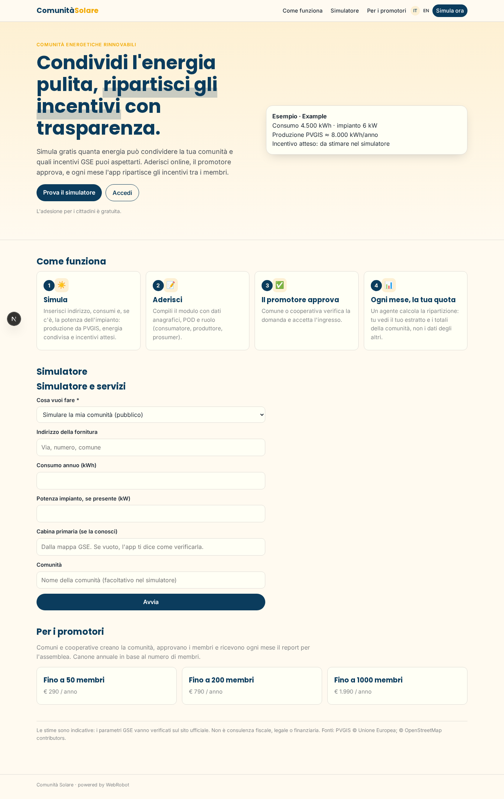

### home-mobile
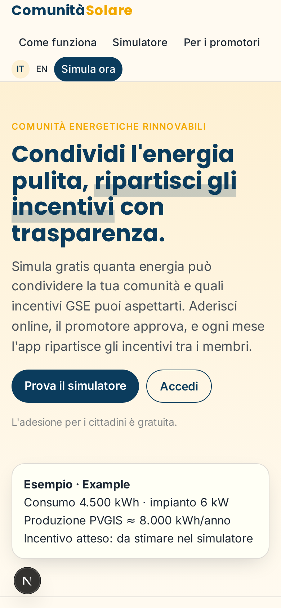

### home
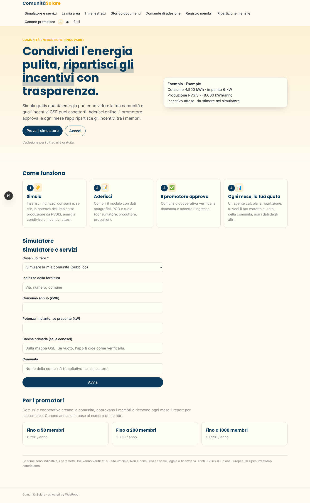

### new
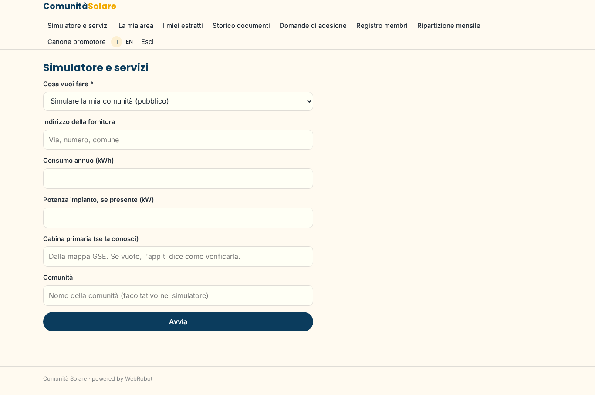

### my_area
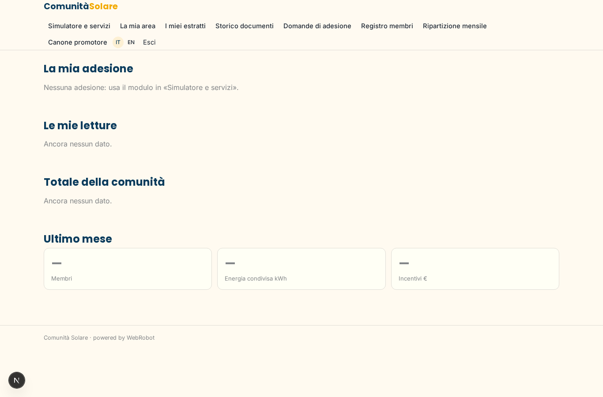

### statements
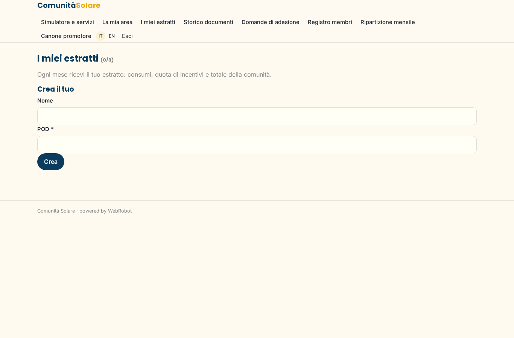

### history
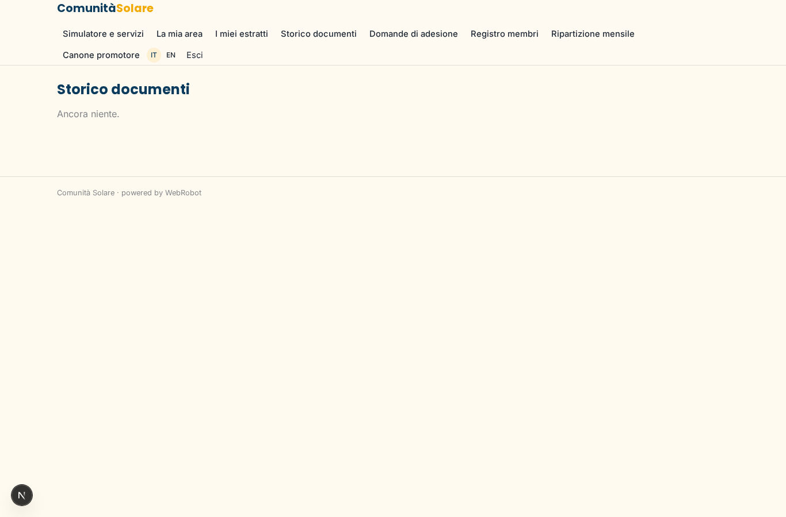

### requests
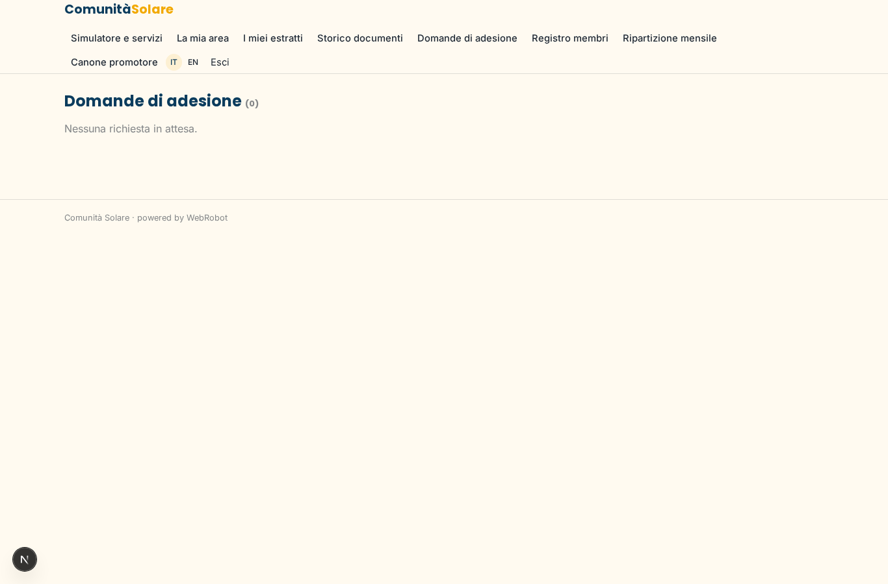

### roster
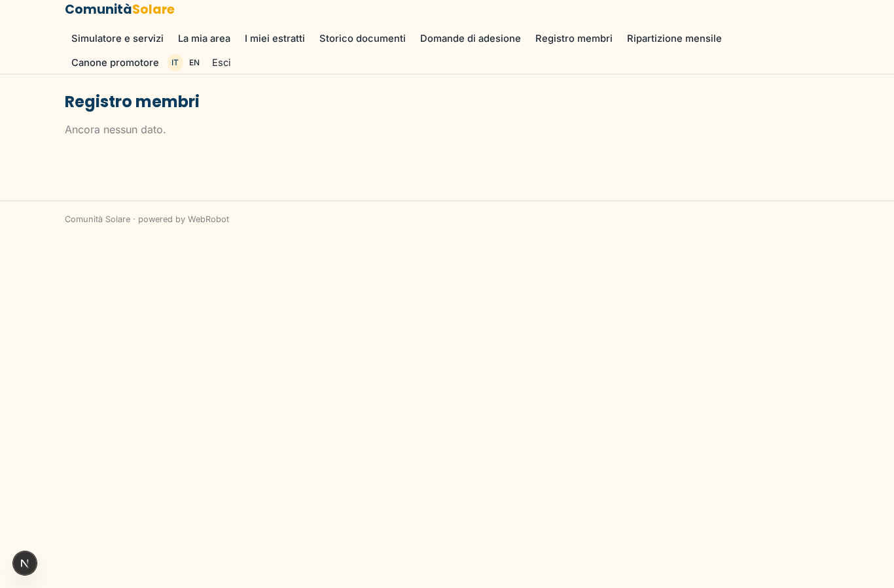

### allocations
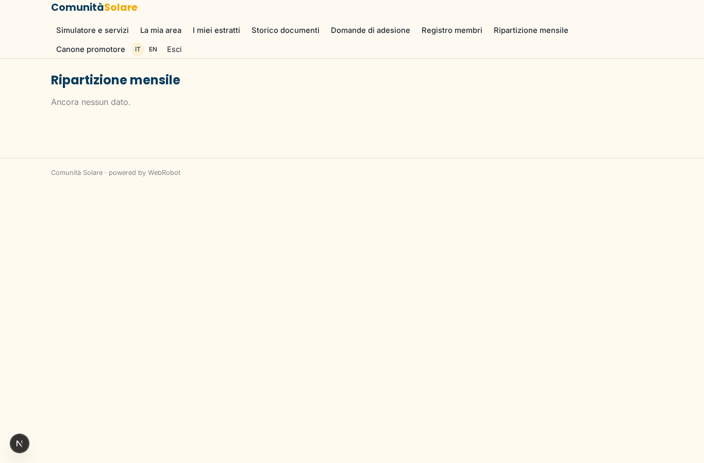

### account
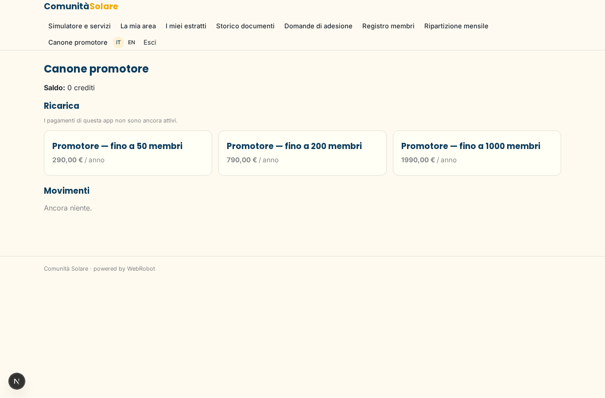

