# Comunità Solare

_Promuovi e gestisci la tua comunità energetica rinnovabile._

**Manifest:** valid (schema + runtime contract) · **Functional test:** passed (32 checks passed)

## Description given to the app builder (Italian)

Voglio Comunità Solare, una piattaforma per promuovere e gestire comunità energetiche rinnovabili. Il promotore, per esempio un comune o una cooperativa, è admin e crea la comunità indicando la zona. Un simulatore pubblico permette a chiunque di inserire indirizzo, consumi annui e, se ha un impianto, la potenza: l'app individua la cabina primaria di riferimento dalle mappe del GSE, stima la produzione con PVGIS e calcola l'energia condivisa e gli incentivi attesi secondo le regole GSE. Chi è interessato compila il modulo di adesione con dati anagrafici, POD e ruolo (consumatore, produttore o prosumer); l'admin approva l'ingresso. Ogni mese un agente calcola la ripartizione degli incentivi tra i membri e produce un report per membro e uno per l'assemblea. Oggi i dati di consumo arrivano da stime e da letture inserite a mano, ma vorremmo leggere le misure reali con la delega del membro attraverso GSE e Terna. Ogni membro vede solo i propri dati e il totale aggregato della comunità. L'adesione è gratuita, il promotore paga un canone annuale per numero di membri.

## Functional test: what did not pass

- **saved record shown where its collection is read** (view my_allocations): a record was saved in allocations (by admin-data, admin-data) but the page does not show it (as user) _(warning)_
- **saved record shown where its collection is read** (view my_reports): a record was saved in member_reports (by admin-data, admin-data) but the page does not show it (as user) _(warning)_

## Features not expressible today (spec.extensions)

- **gse_terna_delegated_metering**: Reading real measures with the member's delegation through GSE and Terna (OAuth/delegation) is not available yet: for now consumption comes from estimates and manual readings.
- **gse_cabine_map_import**: There is no public GSE API for the primary substation maps: the promoter loads the substations of the zone in the 'cabine_primarie' collection, and the simulator searches them.
- **member_cap_by_plan**: The cap on members per annual plan (100/500/2000) is described in the plans but not enforced automatically.

## Screenshots (interpretive runtime, no data)

### home-anon

### home-mobile

### home

### simulator
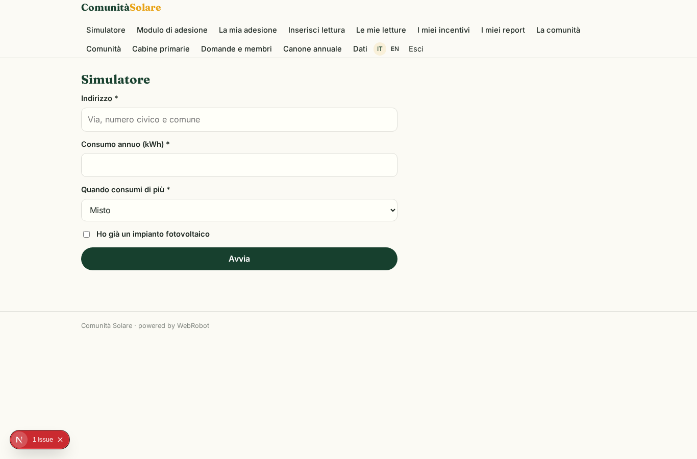

### join
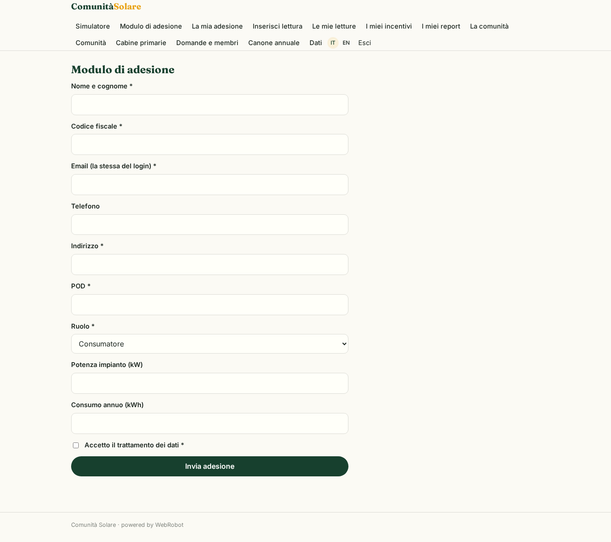

### my_membership
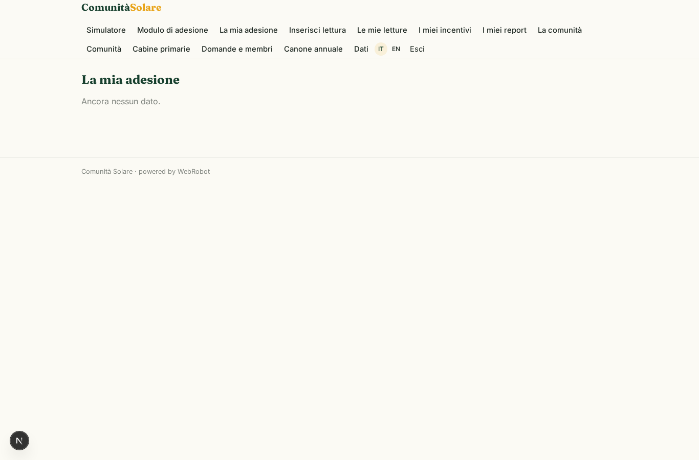

### add_reading
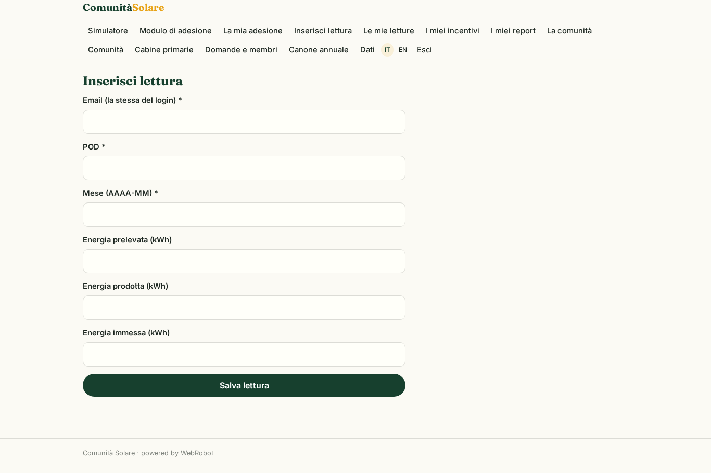

### my_readings
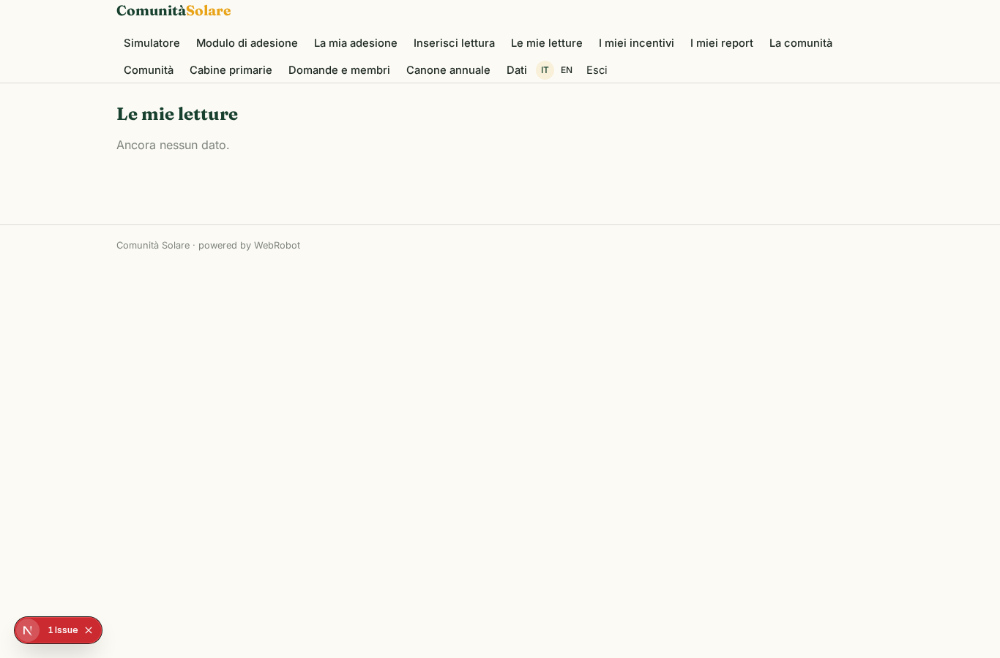

### my_allocations

### my_reports

### community
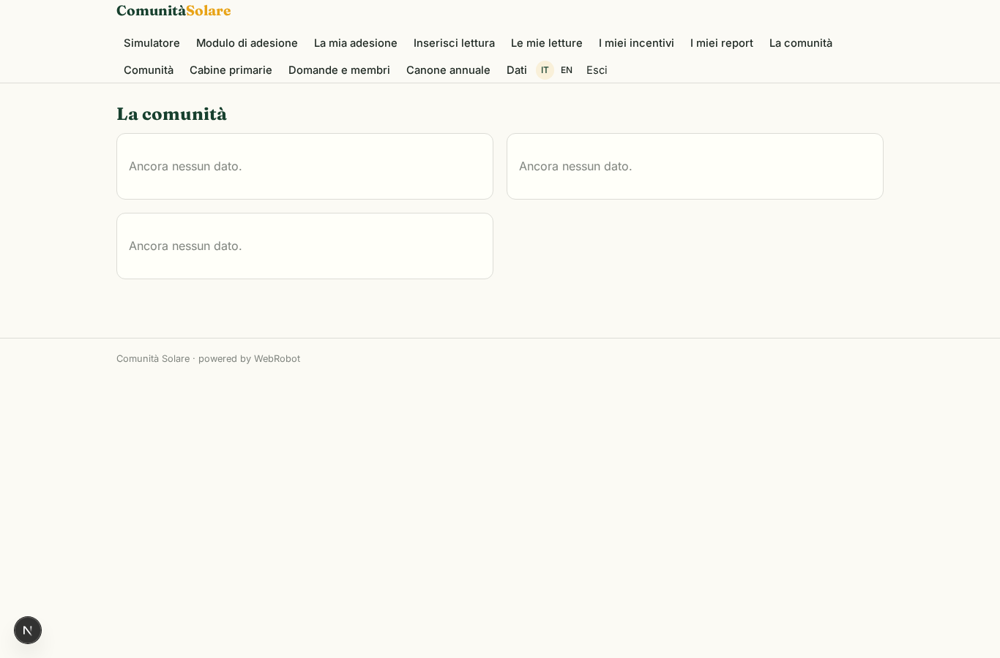

### totals_chart
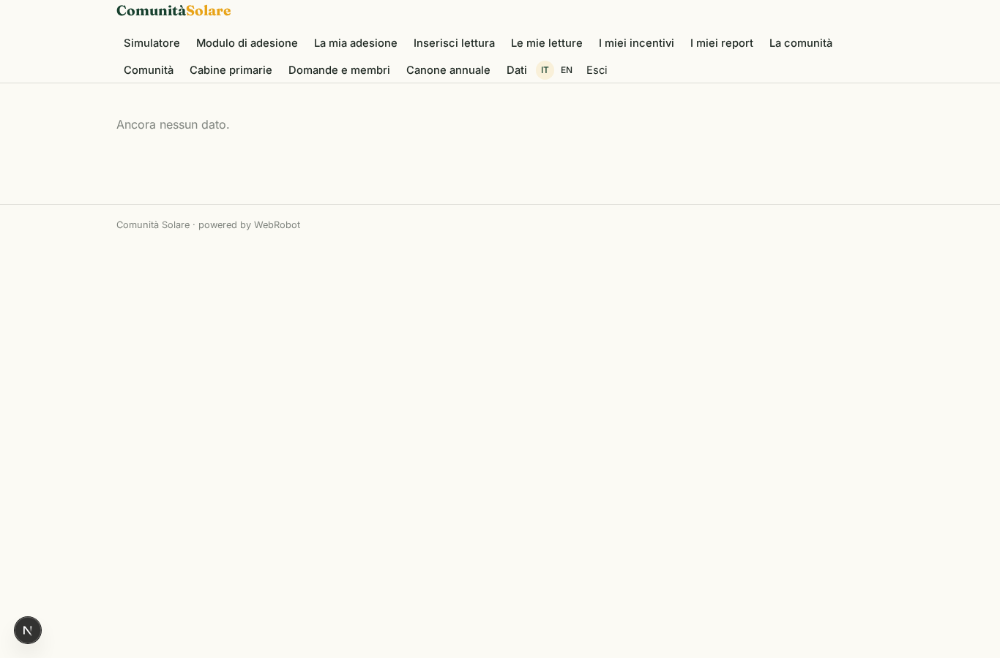

### totals_table

### assembly_list

### community_setup
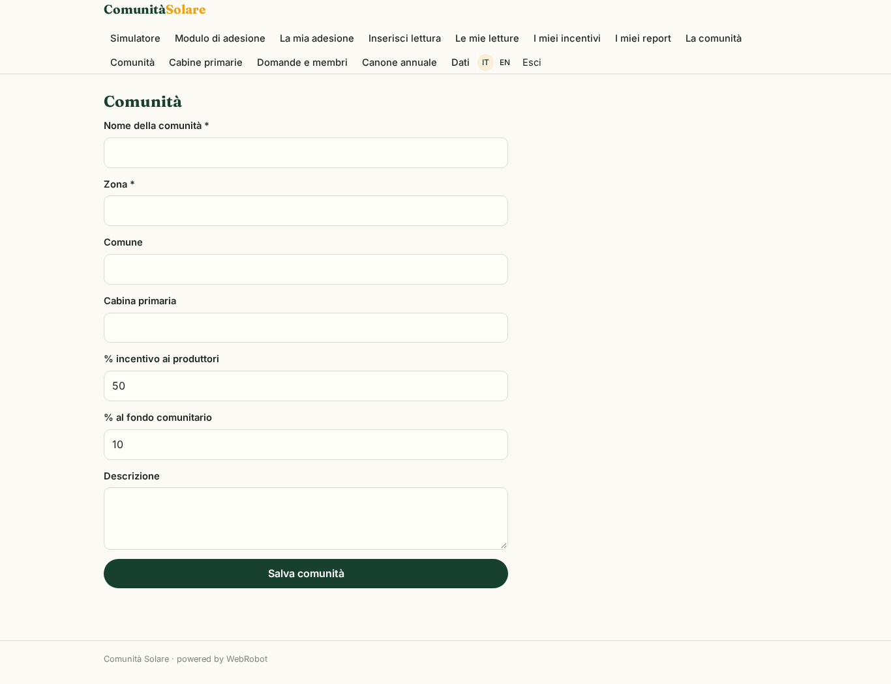

### cabine_setup
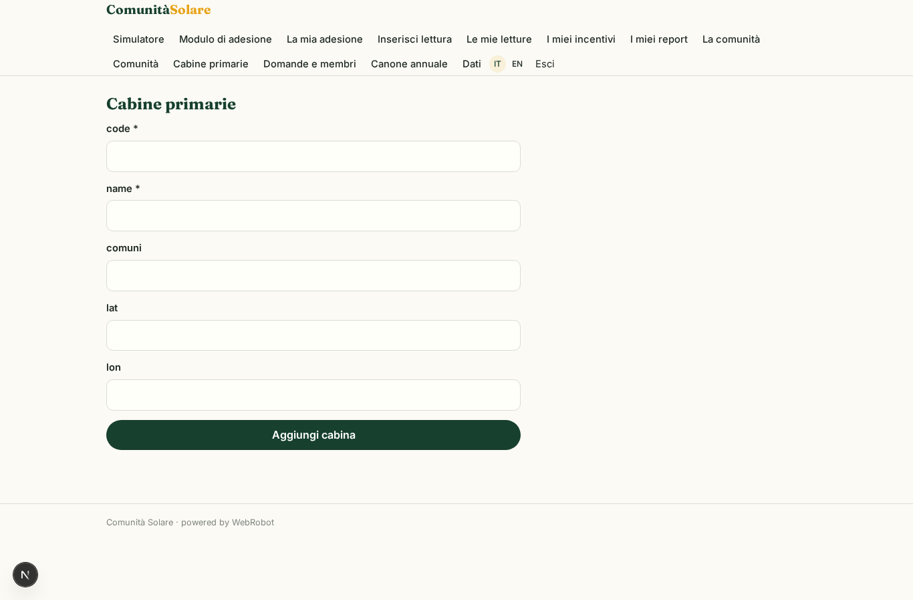

### members_admin
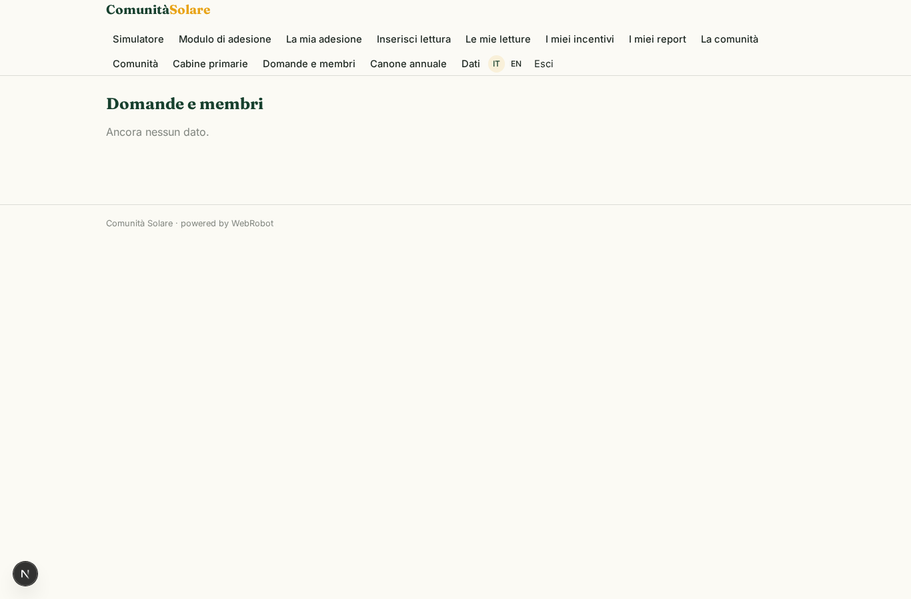

### review_member
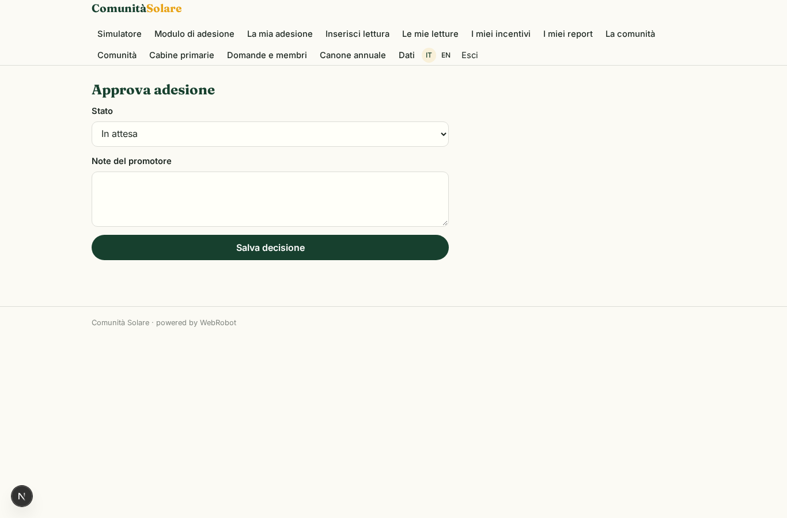

### account
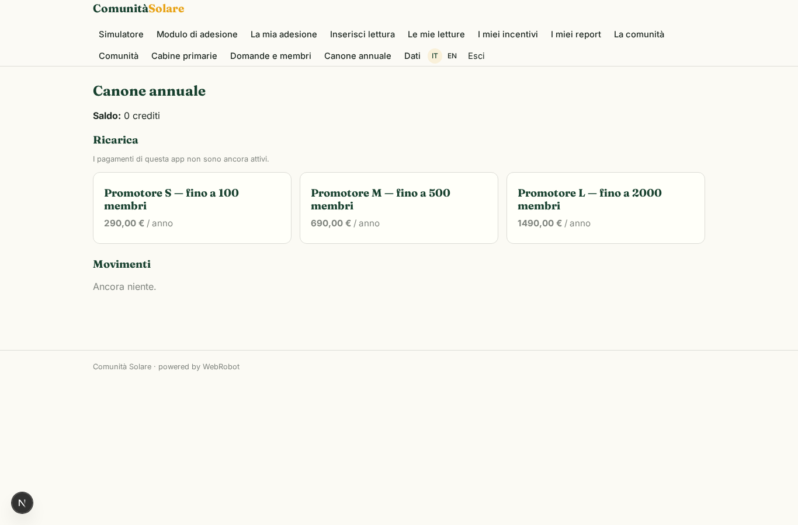
