# Concierge del Tavolo

_Il menu digitale che parla con i tuoi clienti, in ogni lingua._

**Manifest:** valid (schema + runtime contract) · **Functional test:** 2 failure(s) (17 checks passed)

## Description given to the app builder (Italian)

Ci serve Concierge del Tavolo, un'app per ristoranti con menu digitale e assistente vocale. Il ristoratore carica menu, ingredienti, allergeni, abbinamenti vini, storia del locale e piatti del giorno. Su ogni tavolo c'è un QR code e un tag NFC: il cliente lo avvicina con il telefono e apre il menu senza installare nulla. Può parlare con un concierge vocale in più lingue, chiedere cosa c'è senza glutine, quale vino si abbina al piatto, cosa consiglia lo chef, e ricevere risposte basate solo sui dati del ristorante. A fine pasto l'app invita il cliente a lasciare una recensione; le recensioni pubbliche su Google vanno lette e gestite collegando via OAuth il profilo dell'attività, e un agente prepara risposte in bozza che il titolare approva. Ogni settimana il titolare riceve un report con domande più frequenti dei clienti, piatti più richiesti, lingue usate, andamento delle recensioni e temi ricorrenti nelle critiche. Ogni ristorante vede solo i suoi dati; un gruppo può gestire più locali. Abbonamento mensile per locale, con crediti a consumo per i minuti di voce.

## Functional test: what did not pass

- **form saves a record** (form venue_form): 403 only the app's admins add to this collection (as user)
- **form saves a record** (form dish_form): 403 only the app's admins add to this collection (as user)

## Features not expressible today (spec.extensions)

- **google_oauth_reviews**: Collegare via OAuth il profilo Google dell'attività per leggere le recensioni e pubblicare le risposte non è ancora disponibile. Per ora il titolare inserisce le recensioni a mano o le incolla, e copia sulla scheda Google le risposte approvate.
- **voice_minutes**: Voce in tempo reale nel browser (parlato/ascolto) con addebito per minuto non è ancora disponibile: il concierge funziona in chat, con risposte brevi leggibili ad alta voce; il consumo è addebitato a crediti per uso AI. Canali telefonici sono un'alternativa.
- **nfc_qr_tags**: QR e tag NFC puntano a /v/concierge?page=<chiave-locale>&table=<n>: la generazione dei QR da stampare va fatta fuori dall'app.
- **venue_isolation**: Il menu e i profili sono in raccolte condivise (leggibili dal concierge senza login) con un campo 'venue': l'isolamento in scrittura tra ristoranti e la gestione di gruppi multi-locale (ruolo di gruppo con più locali) richiedono una revisione dedicata; le recensioni sono invece private al titolare e ai gestori elencati in 'members'.
- **conversation_stats**: Statistiche sulle domande dei clienti, piatti più richiesti e lingue usate richiedono il salvataggio dei log delle conversazioni, non disponibile per le chat anonime: il report settimanale lo dichiara se mancano i dati.

## Screenshots (interpretive runtime, no data)

### home-anon
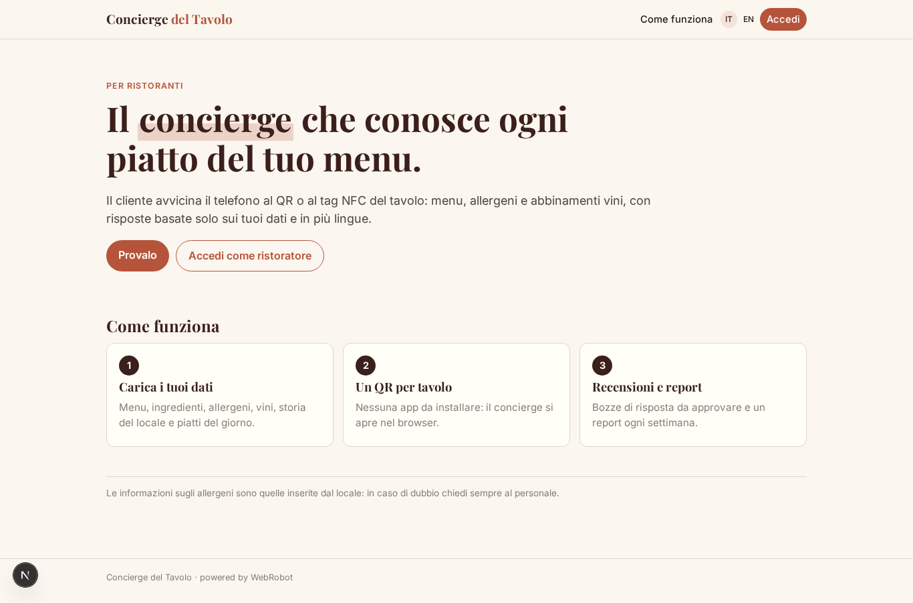

### home-mobile
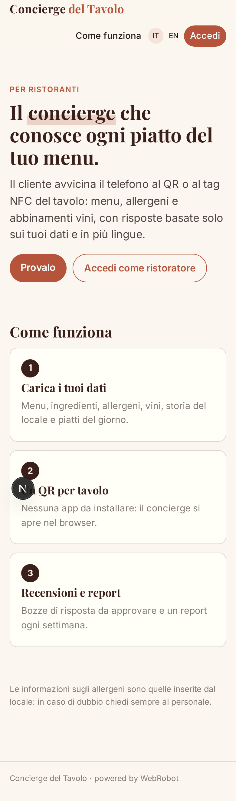

### home
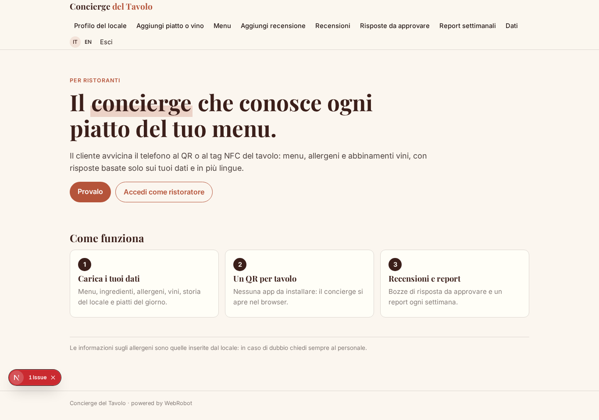

### concierge
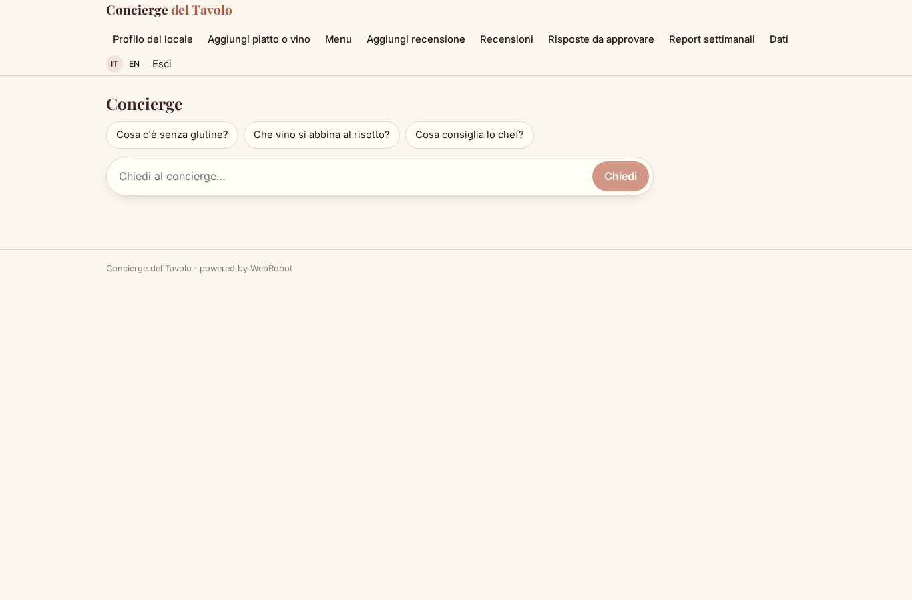

### venue_form
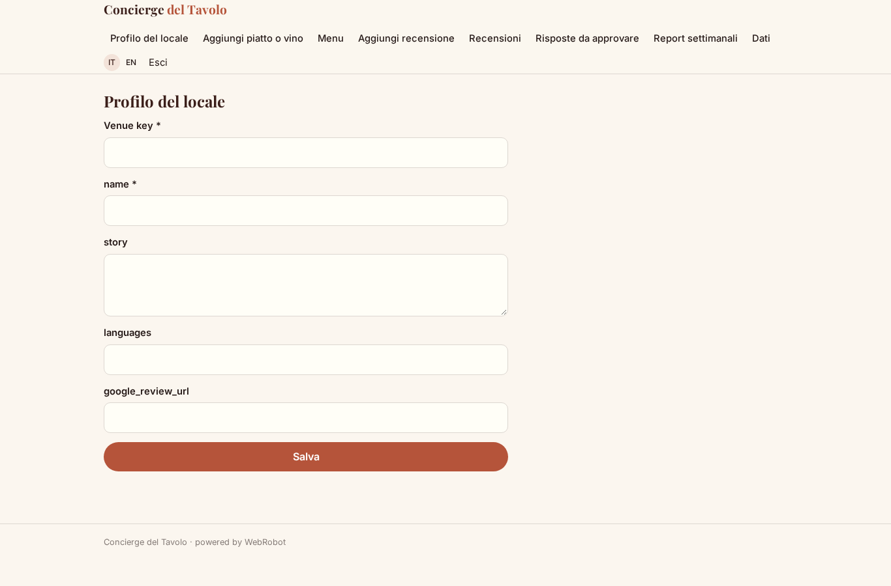

### dish_form
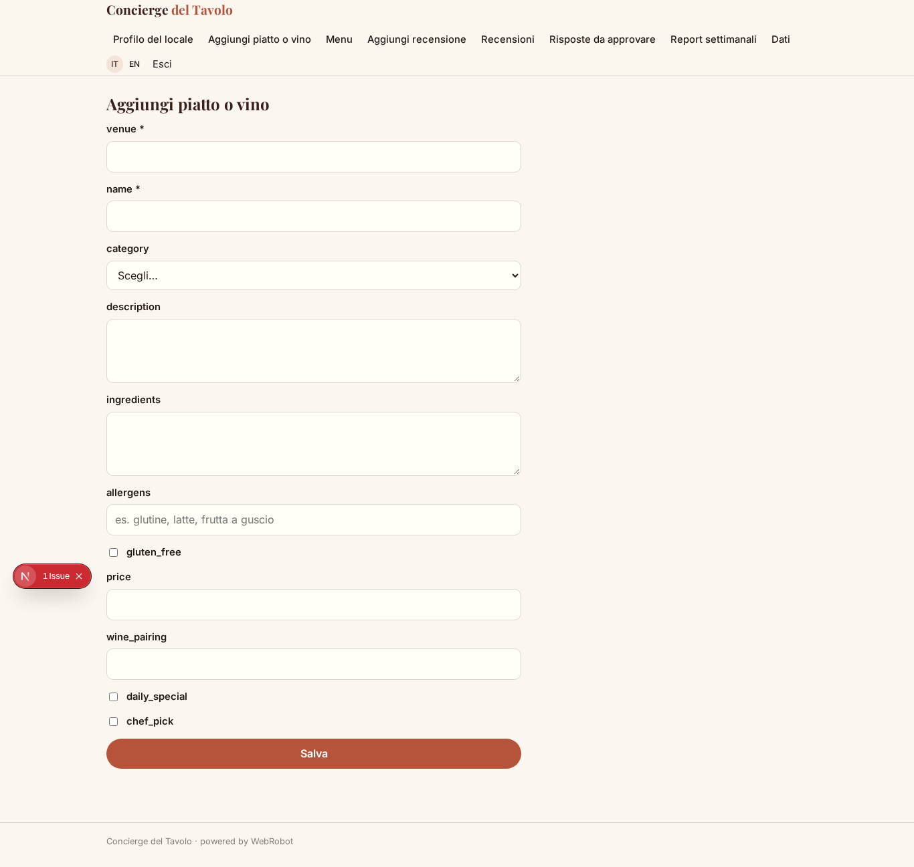

### menu_list

### review_form
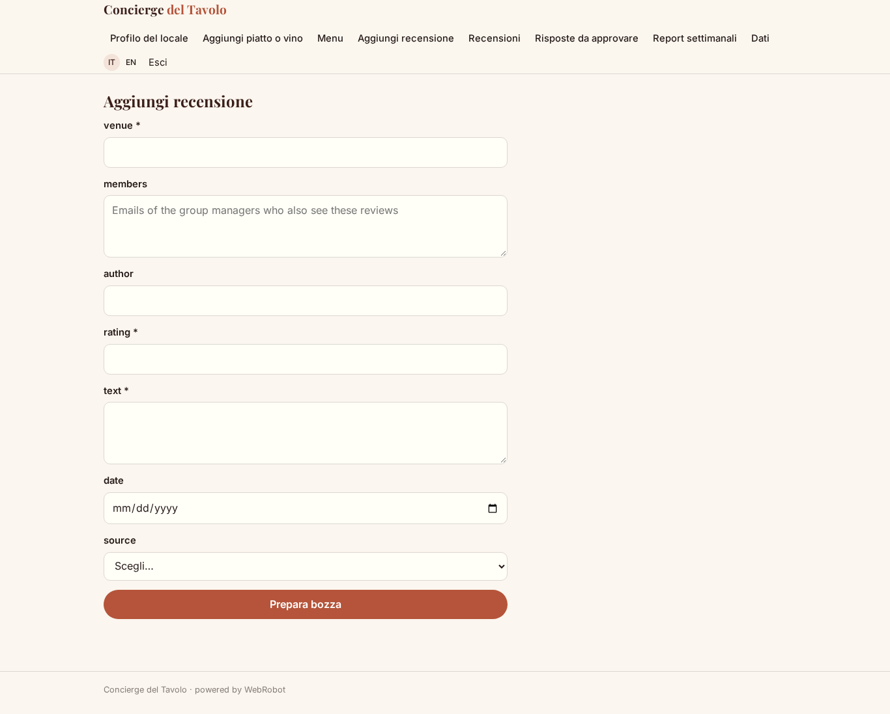

### reviews_list
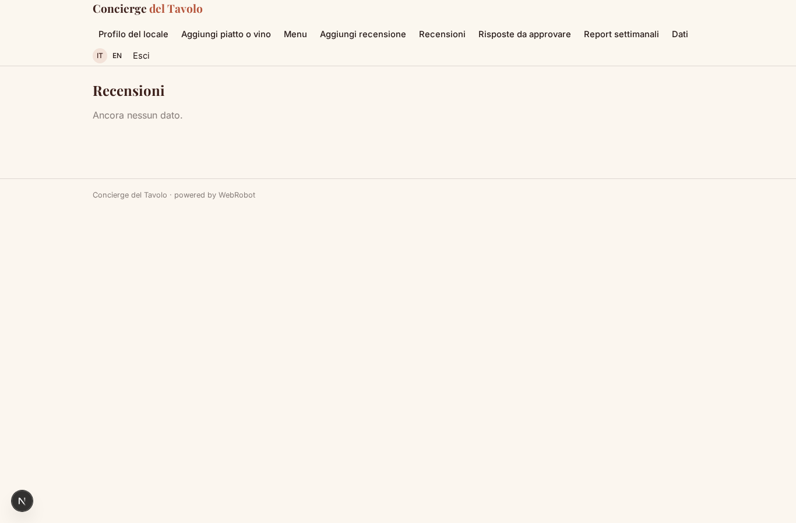

### approvals
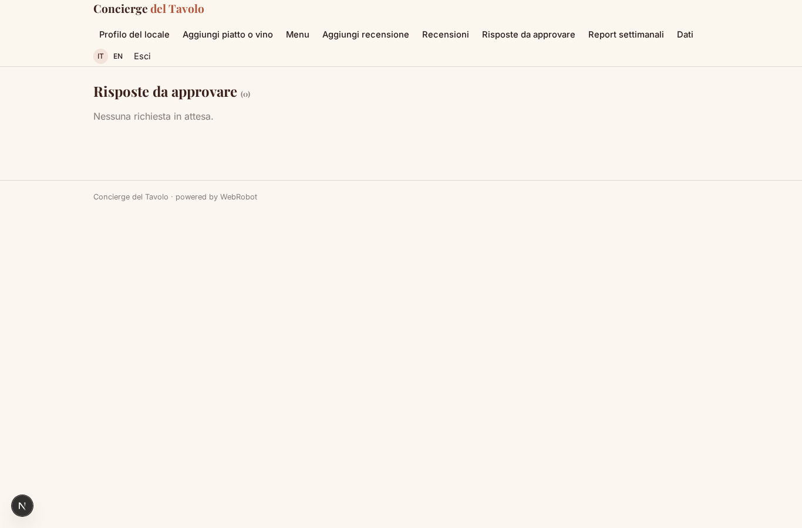

### reports
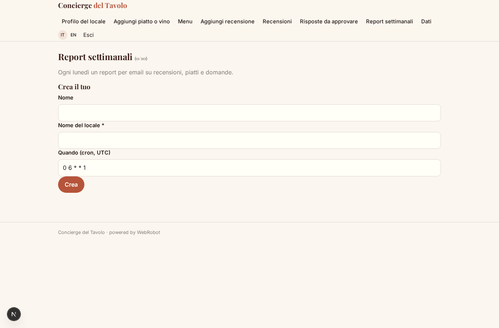

### account
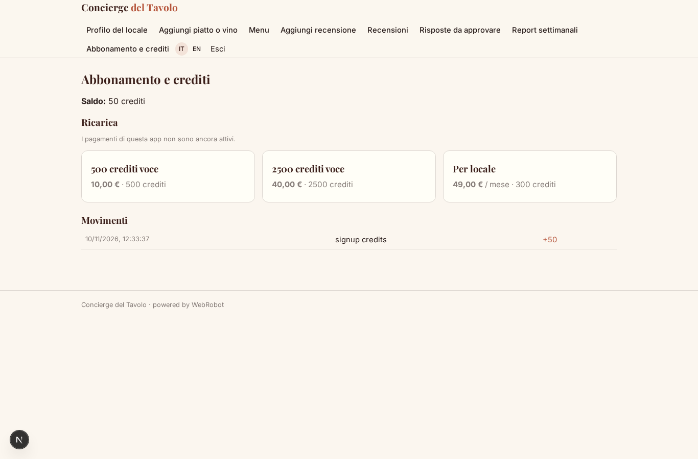
