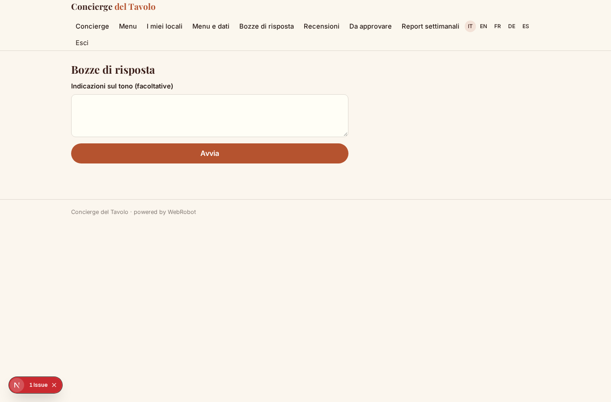

# Concierge del Tavolo

_Il menu digitale che parla con i tuoi clienti, in tutte le lingue._

**Stato manifest:** valido (validatore Python + contratto runtime)

## Descrizione data all'app builder

Ci serve Concierge del Tavolo, un'app per ristoranti con menu digitale e assistente vocale. Il ristoratore carica menu, ingredienti, allergeni, abbinamenti vini, storia del locale e piatti del giorno. Su ogni tavolo c'è un QR code e un tag NFC: il cliente lo avvicina con il telefono e apre il menu senza installare nulla. Può parlare con un concierge vocale in più lingue, chiedere cosa c'è senza glutine, quale vino si abbina al piatto, cosa consiglia lo chef, e ricevere risposte basate solo sui dati del ristorante. A fine pasto l'app invita il cliente a lasciare una recensione; le recensioni pubbliche su Google vanno lette e gestite collegando via OAuth il profilo dell'attività, e un agente prepara risposte in bozza che il titolare approva. Ogni settimana il titolare riceve un report con domande più frequenti dei clienti, piatti più richiesti, lingue usate, andamento delle recensioni e temi ricorrenti nelle critiche. Ogni ristorante vede solo i suoi dati; un gruppo può gestire più locali. Abbonamento mensile per locale, con crediti a consumo per i minuti di voce.

## Funzioni non esprimibili oggi (spec.extensions)

- **voice_concierge**: Browser voice (speech in and out, multilingual) with per-minute metering is not expressible in the manifest yet; the concierge works as text chat. A phone/voice channel can be added later.
- **qr_nfc_tables**: Generation of QR codes and NFC URLs per table (link /v/concierge?venue=<slug>&table=<n>) and per-venue scoping of the public menu by URL parameter need custom support.
- **google_reviews_oauth**: Linking the business Google profile via OAuth to read and publish replies needs per-customer credentials, not available yet. For now reviews are added in the Reviews table (paste or link) and approved drafts are copied by the owner.
- **guest_question_logging**: Logging each anonymous guest question into guest_questions (for the weekly report) and the end-of-meal review invitation flow need a runtime hook; until then the report relies on reviews and what is logged.
- **file_upload**: Uploading menu files (PDF/images) is not available: menu data is entered in the table or pasted as text.
- **email_weekly_digest**: Emailing the weekly report is not available: the owner reads it in the Weekly reports view.
- **group_dashboard**: A consolidated multi-venue view for groups: each venue is a record in venues under the same user; cross-venue aggregates need a custom view.

## Screenshot (runtime interpretativo)

### home-anon

### home-mobile

### home

### concierge

### menu

### my_venues

### my_menu

### new_replies

### my_reviews

### approve

### reports

### account

