# ConciergeDesk

_Il receptionist virtuale per hotel indipendenti, in 5 lingue._

**Manifest:** valid (schema + runtime contract) · **Functional test:** passed (16 checks passed)

## Description given to the app builder (Italian)

Mi serve ConciergeDesk, un receptionist virtuale per hotel indipendenti e piccole catene. Il direttore dell'hotel configura struttura, tipologie di camera, tariffe stagionali, servizi extra, politiche di cancellazione e FAQ (parcheggio, animali, orari colazione). L'ospite scrive in chat sul sito, oppure chiama il numero dell'hotel o scrive su WhatsApp, e parla con un agente vocale e testuale che risponde nella sua lingua. Se chiede un preventivo, l'agente raccoglie date, numero di ospiti, tipo di camera e richieste speciali, verifica la disponibilità sul channel manager dell'hotel, calcola il prezzo con le tariffe del tenant e propone l'offerta. Le richieste fuori standard (gruppi, sconti, late check-out) vanno in coda al receptionist umano, che approva o modifica prima che l'ospite riceva risposta. Con l'accettazione l'ospite paga la caparra con carta e la prenotazione viene registrata nella collezione prenotazioni e sincronizzata col channel manager; arrivano email di conferma e promemoria il giorno prima. Lo staff vede una dashboard con conversazioni, preventivi aperti, tasso di conversione e prenotazioni del giorno; l'ospite vede solo la propria prenotazione. Abbonamento mensile per struttura più commissione sulle prenotazioni dirette. Italiano, inglese, tedesco, francese, spagnolo.

## Features not expressible today (spec.extensions)

- **channel_manager_sync**: Live availability check and booking sync with the hotel's channel manager need a vendor-specific API (host and credentials). For now availability is read from the availability collection, which the channel manager can fill through the cm_availability webhook or the admins by CSV; pushing confirmed bookings back to the channel manager is not available yet.
- **whatsapp**: WhatsApp conversations are not available yet. The phone channel (voice) is declared on the FAQ agent; a phone caller who wants a quote is invited to sign in or continue on the website chat.
- **deposit_checkout**: Card payment of a per-quote deposit amount (dynamic Stripe Connect checkout) is not expressible yet: the quote moves to status 'paid' (which creates the booking) when the payment is confirmed; this status change must be driven by the payment confirmation. The 2.5% direct-booking commission is declared as transactionFeePct.
- **conversion_rate**: The dashboard shows quotes by status and booking counts; a computed conversion-rate percentage and a 'today's arrivals' filter on the current date are not available as aggregates yet.

## Screenshots (interpretive runtime, no data)

### home-anon
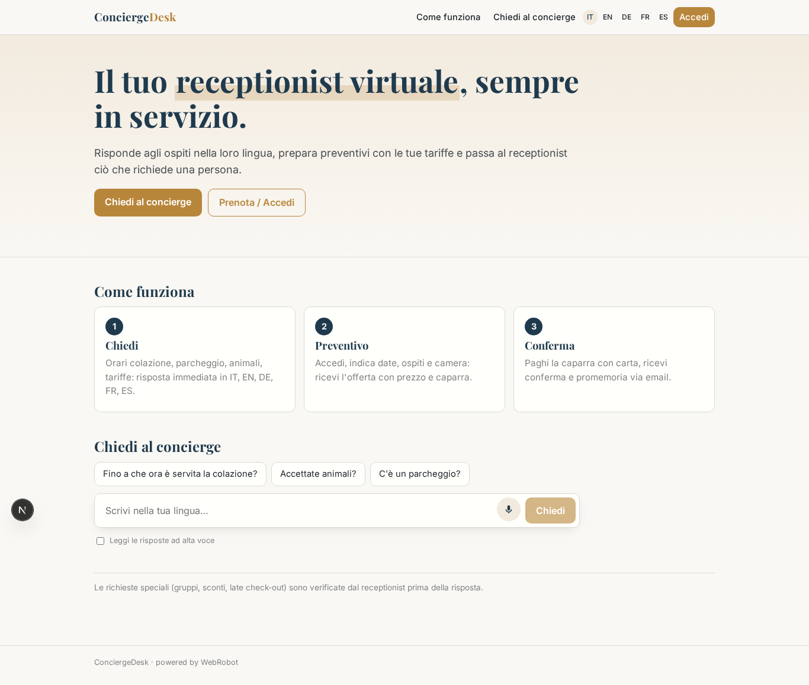

### home-mobile
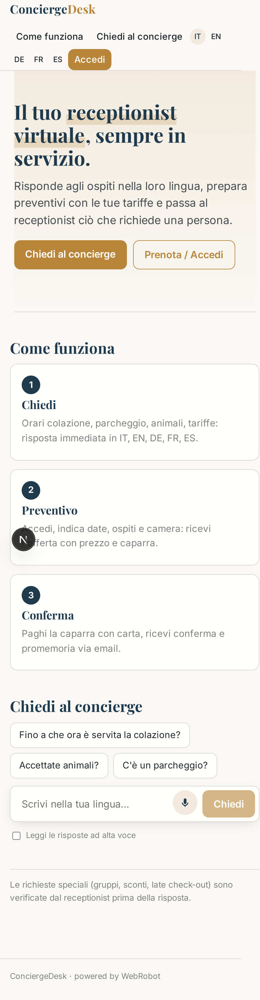

### home
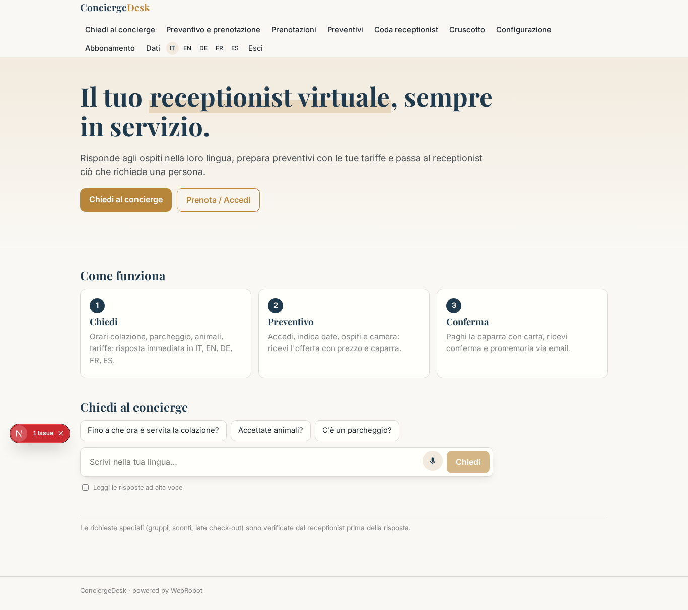

### ask
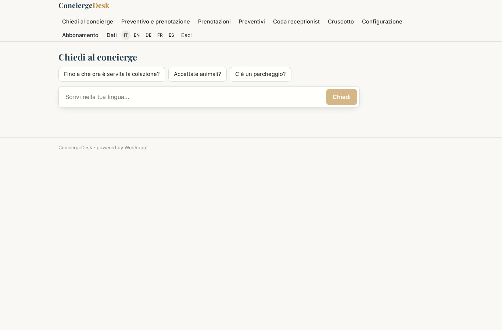

### concierge
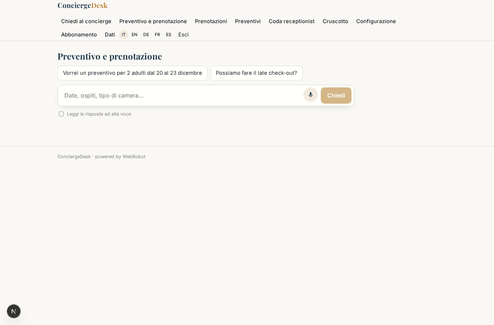

### bookings
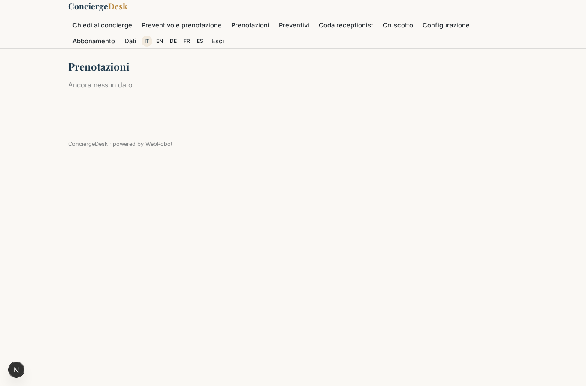

### my_quotes
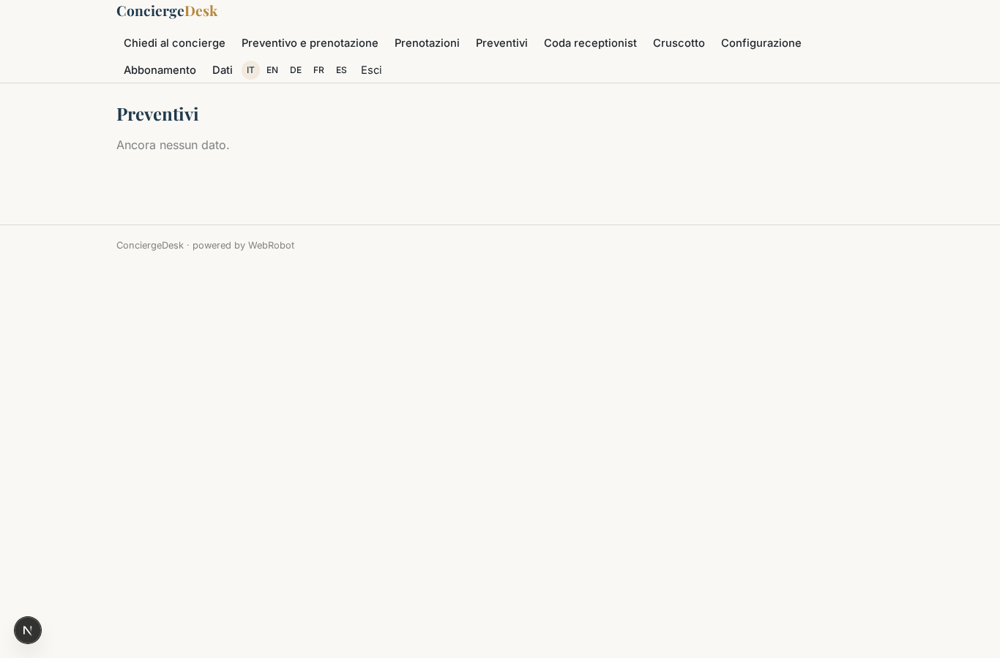

### approvals
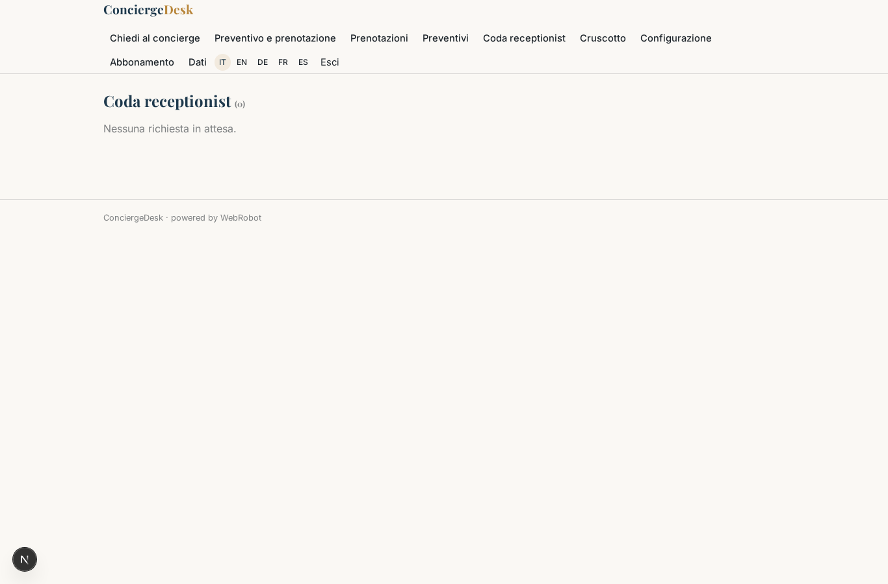

### dashboard
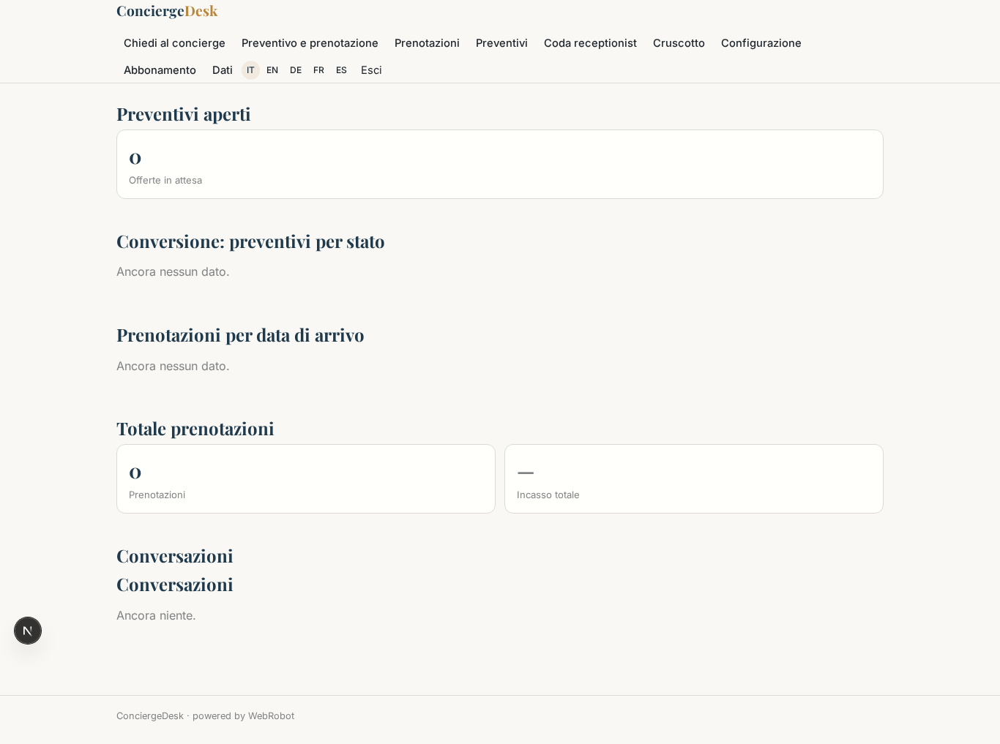

### conversations
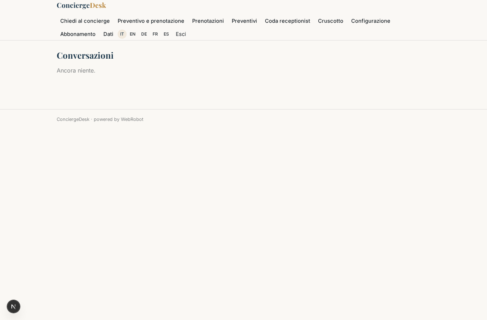

### admin
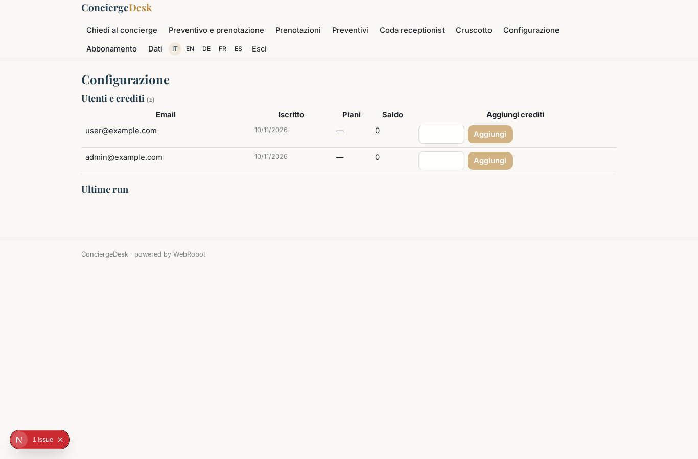

### account
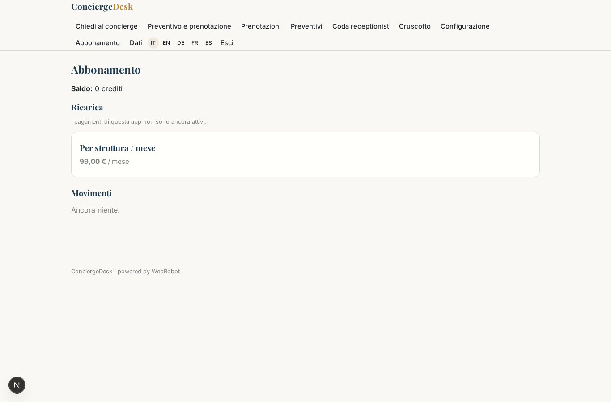
