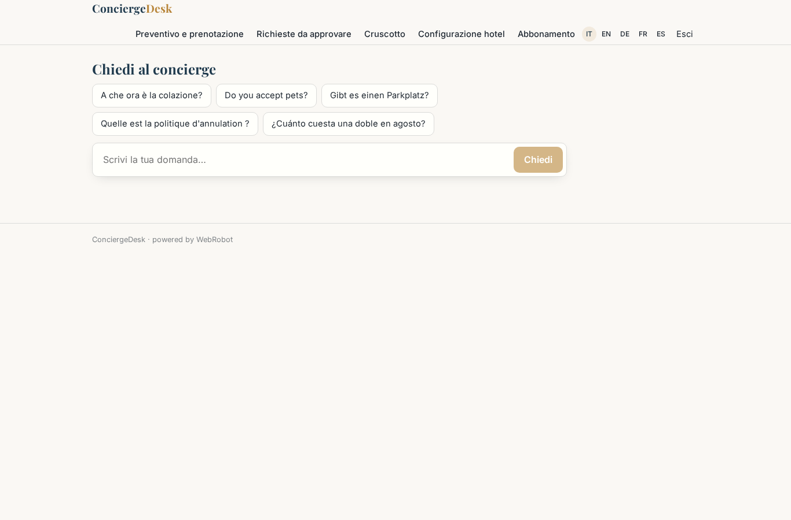
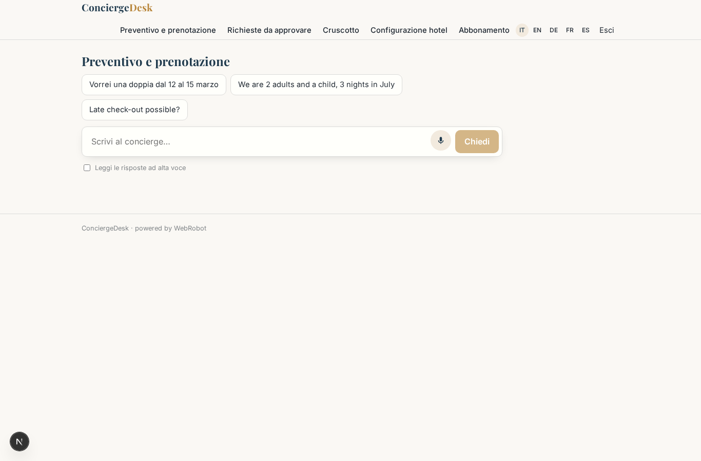
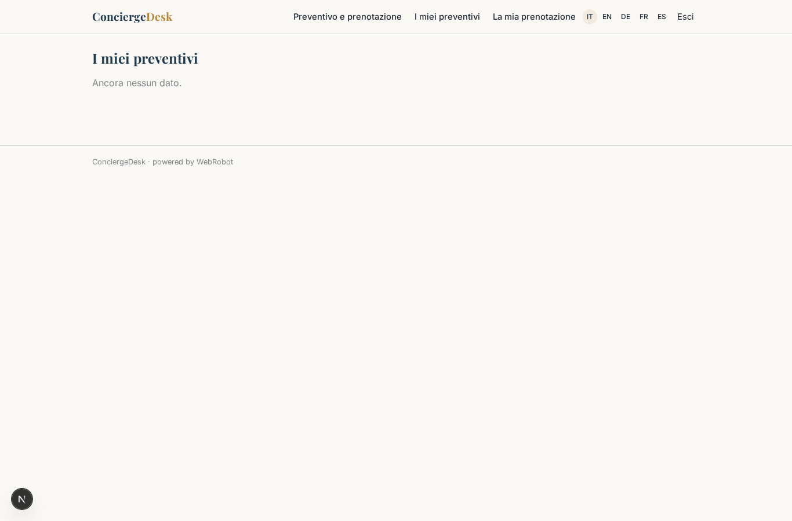
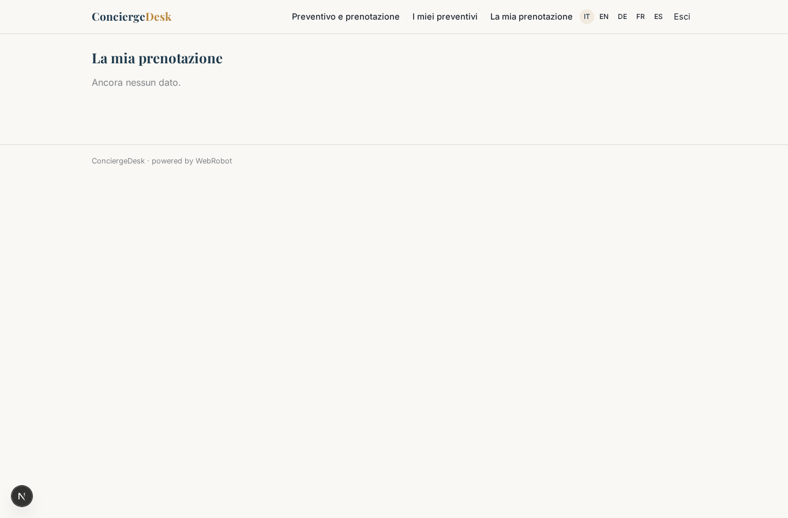
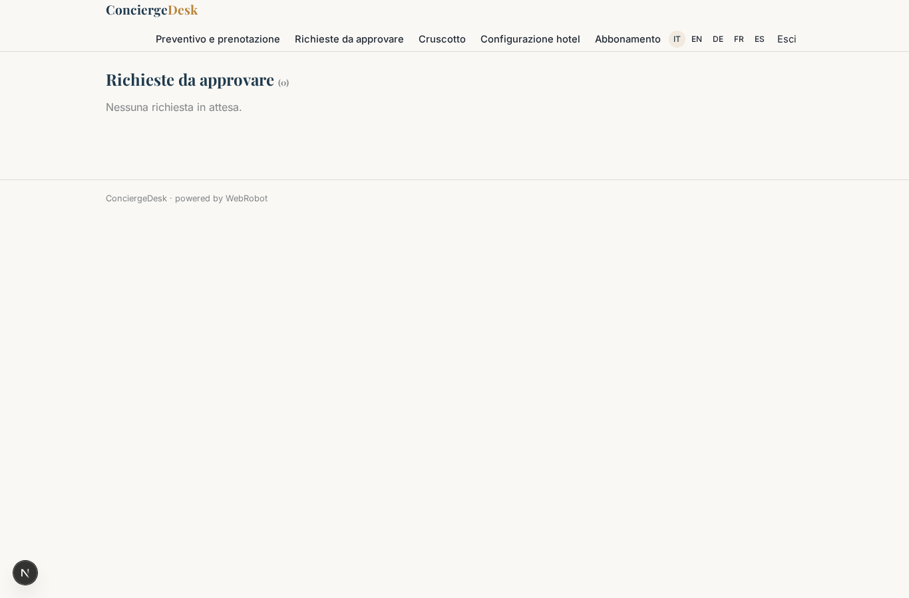
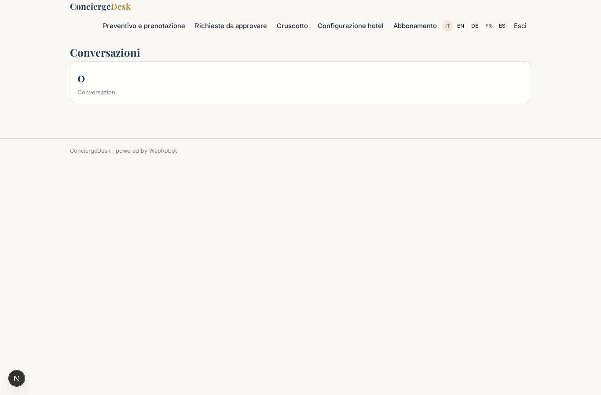
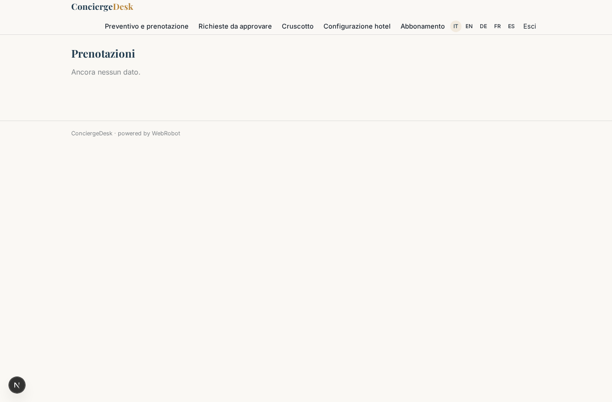
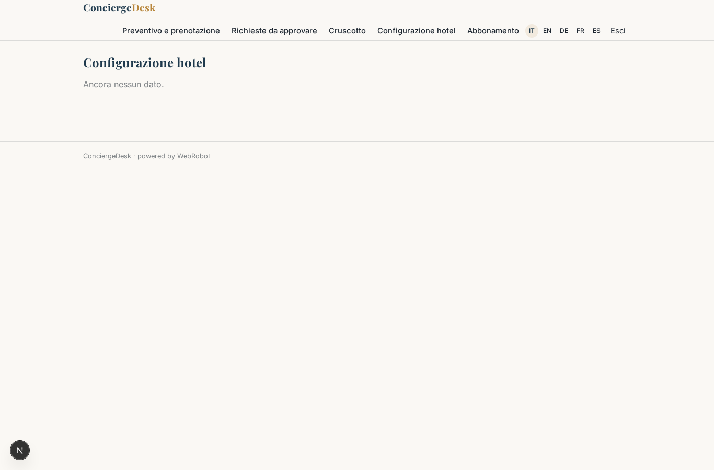
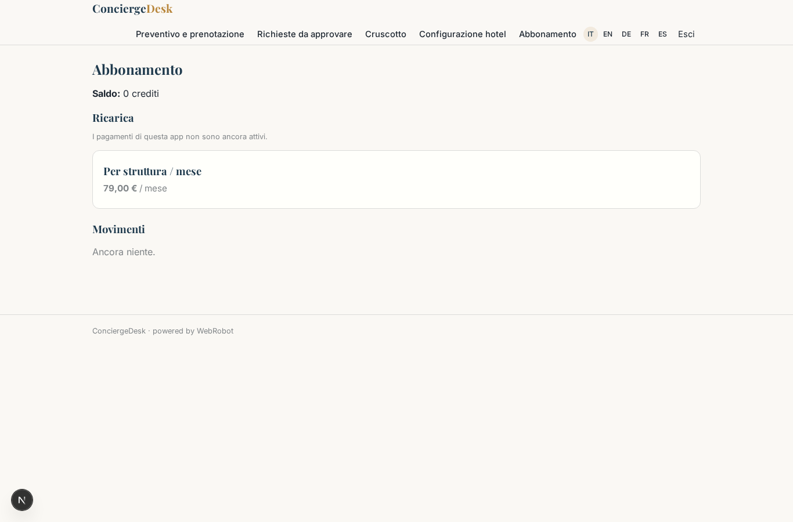

# ConciergeDesk

_Il receptionist virtuale per hotel indipendenti._

**Stato manifest:** valido (validatore Python + contratto runtime)

## Descrizione data all'app builder

Mi serve ConciergeDesk, un receptionist virtuale per hotel indipendenti e piccole catene. Il direttore dell'hotel configura struttura, tipologie di camera, tariffe stagionali, servizi extra, politiche di cancellazione e FAQ (parcheggio, animali, orari colazione). L'ospite scrive in chat sul sito, oppure chiama il numero dell'hotel o scrive su WhatsApp, e parla con un agente vocale e testuale che risponde nella sua lingua. Se chiede un preventivo, l'agente raccoglie date, numero di ospiti, tipo di camera e richieste speciali, verifica la disponibilità sul channel manager dell'hotel, calcola il prezzo con le tariffe del tenant e propone l'offerta. Le richieste fuori standard (gruppi, sconti, late check-out) vanno in coda al receptionist umano, che approva o modifica prima che l'ospite riceva risposta. Con l'accettazione l'ospite paga la caparra con carta e la prenotazione viene registrata nella collezione prenotazioni e sincronizzata col channel manager; arrivano email di conferma e promemoria il giorno prima. Lo staff vede una dashboard con conversazioni, preventivi aperti, tasso di conversione e prenotazioni del giorno; l'ospite vede solo la propria prenotazione. Abbonamento mensile per struttura più commissione sulle prenotazioni dirette. Italiano, inglese, tedesco, francese, spagnolo.

## Funzioni non esprimibili oggi (spec.extensions)

- **channel_manager_sync**: Live availability check and booking sync with the hotel's channel manager need the hotel's own credentials/API: not available yet. For now availability is a collection kept by the manager; bookings must be forwarded manually.
- **voice_and_whatsapp**: Phone number voice agent and WhatsApp channel are not set up by this manifest (WhatsApp connector unavailable; the phone channel is activated in the studio). Web chat is active.
- **deposit_card_payment**: Per-booking card deposit via Stripe Connect with the registration of the booking into 'bookings' after payment, and the platform commission on direct bookings, need a payment-to-record flow not expressible here.
- **email_notifications**: Confirmation email and day-before reminder: notifications are not available yet.
- **staff_cross_guest_view**: Quotes and bookings are owned by each guest; the staff dashboard listing every guest's records and the conversion rate (accepted/proposed quotes) need a back-office view across users.

## Screenshot (runtime interpretativo)

### home-anon

### home-mobile

### home

### chat_public

### chat

### my_quotes

### my_bookings

### review_queue

### dashboard

### staff_kpis

### staff_quotes

### staff_bookings

### hotel_setup

### account

