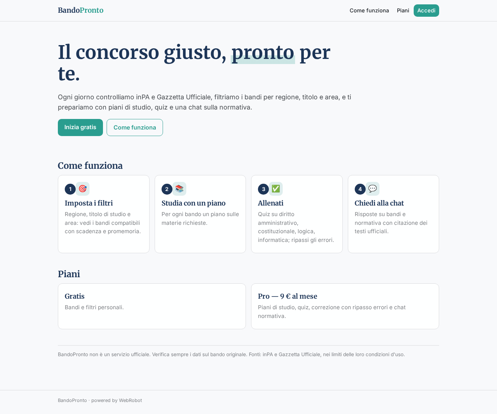
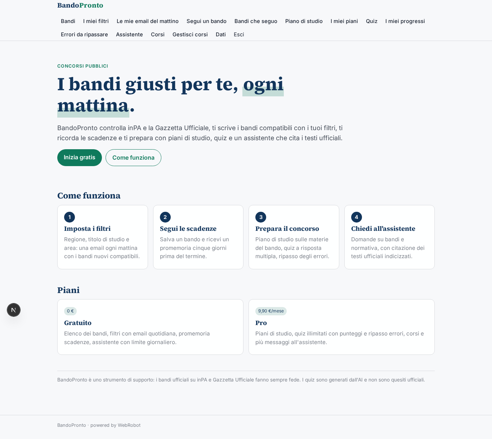
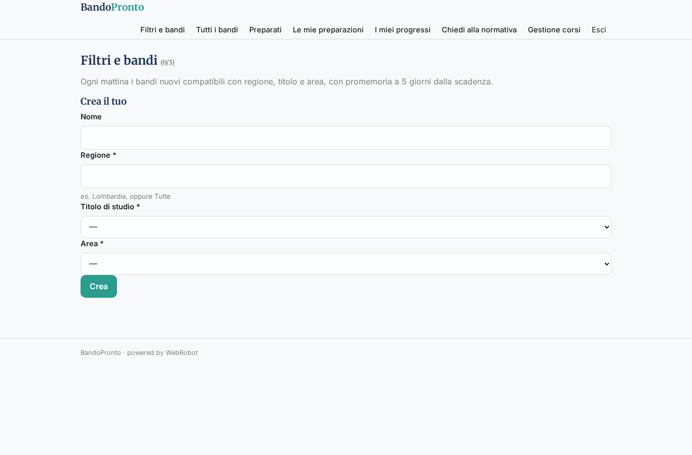
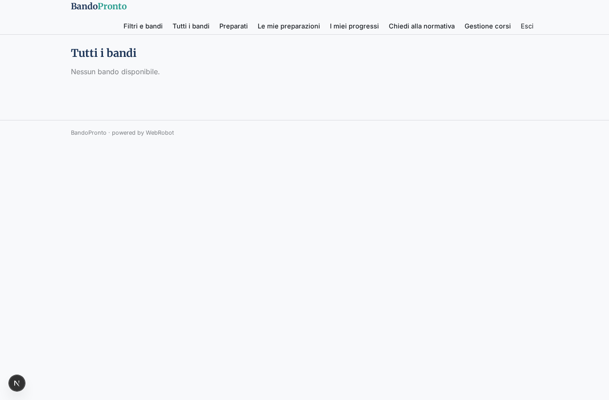
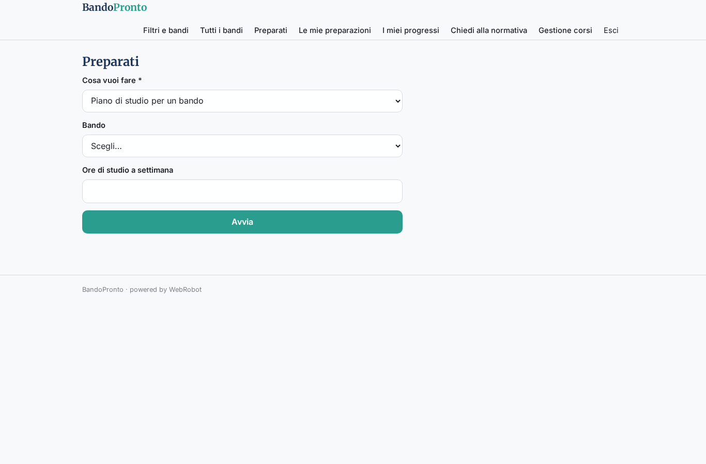
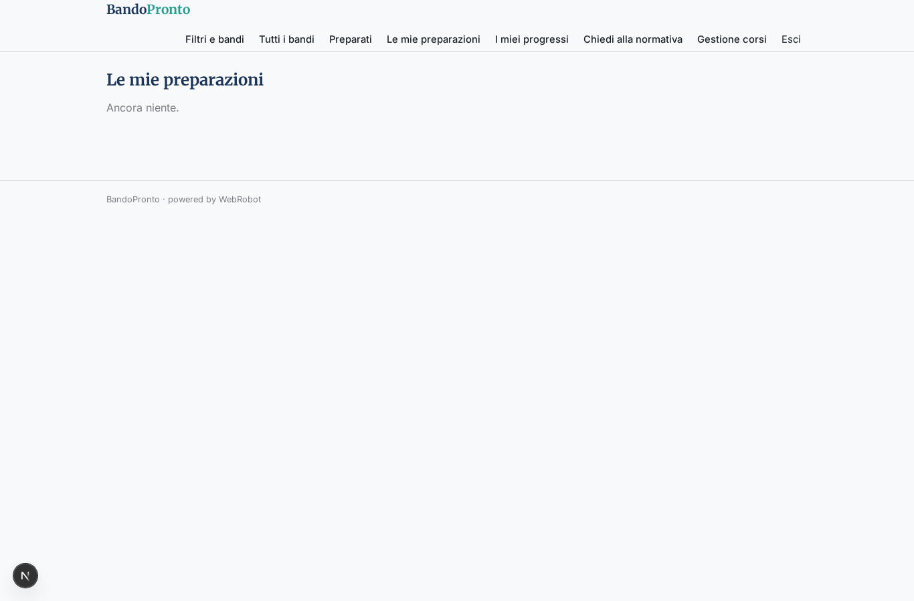
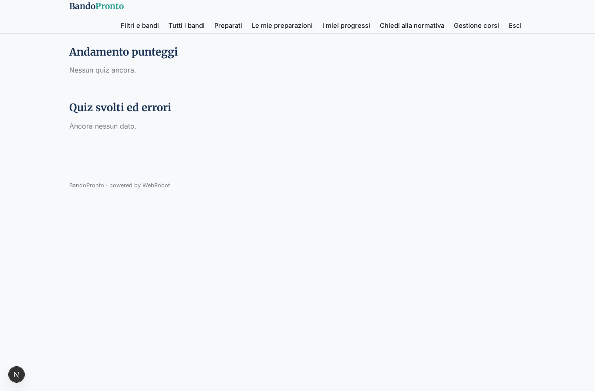
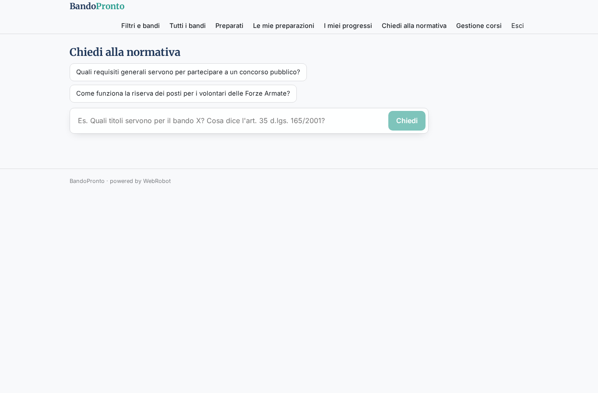
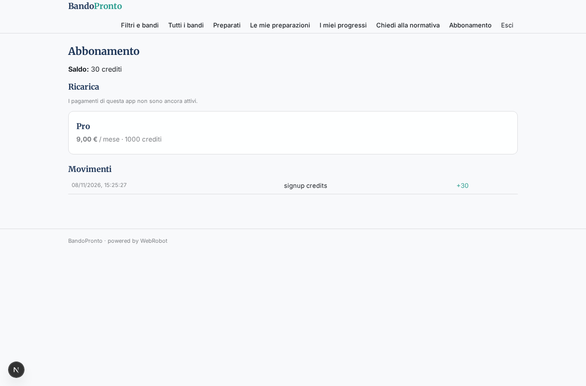

# BandoPronto

_Trova il concorso giusto, preparati meglio._

**Manifest status:** valid (schema validator + runtime contract)

## Description given to the app builder (Italian)

Voglio creare BandoPronto per chi prepara i concorsi pubblici. Un agente controlla ogni giorno il portale inPA e la Gazzetta Ufficiale serie concorsi (dopo aver verificato che le condizioni d'uso lo consentano) ed estrae i nuovi bandi con ente, profilo, numero di posti, requisiti, scadenza e materie d'esame. L'utente imposta i suoi filtri (regione, titolo di studio, area) e riceve un'email ogni mattina con i bandi nuovi compatibili e un promemoria cinque giorni prima della scadenza. Per ogni bando l'app genera un piano di studio sulle materie richieste, e l'utente può allenarsi con quiz a risposta multipla generati sulle materie (diritto amministrativo, costituzionale, logica, informatica), vedere i punteggi e ripassare gli errori. C'è anche una chat che risponde a domande su bandi e normativa citando i testi ufficiali indicizzati. L'utente vede solo i propri progressi; l'admin gestisce i corsi. Piano gratuito con i bandi, abbonamento mensile per quiz e corsi. Italiano.

## Features not expressible today (spec.extensions)

- **email_digest**: Le email quotidiane con i bandi nuovi e il promemoria a 5 giorni dalla scadenza non sono ancora disponibili: per ora i bandi compatibili e le date di promemoria si vedono nell'app, nella vista Filtri e bandi.
- **quiz_interattivo**: Il quiz è generato come report e corretto incollando le risposte; un quiz interattivo con punteggio automatico richiede codice dedicato.
- **indice_normativa**: Un indice dei testi ufficiali (Normattiva, Gazzetta Ufficiale) per la chat non è dichiarabile qui: la chat li consulta tramite il MCP WebRobot, citando la fonte.

## Screenshots (interpretive runtime)

### home-anon

### home-mobile

### home

### filtri

### bandi_aperti

### prepara

### storico

### progressi

### chat

### corsi_admin

### account

