# BandoPronto

_Trova i bandi giusti, prepara il concorso, allenati ogni giorno._

**Manifest:** valid (schema + runtime contract) · **Functional test:** passed (19 checks passed)

## Description given to the app builder (Italian)

Voglio creare BandoPronto per chi prepara i concorsi pubblici. Un agente controlla ogni giorno il portale inPA e la Gazzetta Ufficiale serie concorsi (dopo aver verificato che le condizioni d'uso lo consentano) ed estrae i nuovi bandi con ente, profilo, numero di posti, requisiti, scadenza e materie d'esame. L'utente imposta i suoi filtri (regione, titolo di studio, area) e riceve un'email ogni mattina con i bandi nuovi compatibili e un promemoria cinque giorni prima della scadenza. Per ogni bando l'app genera un piano di studio sulle materie richieste, e l'utente può allenarsi con quiz a risposta multipla generati sulle materie (diritto amministrativo, costituzionale, logica, informatica), vedere i punteggi e ripassare gli errori. C'è anche una chat che risponde a domande su bandi e normativa citando i testi ufficiali indicizzati. L'utente vede solo i propri progressi; l'admin gestisce i corsi. Piano gratuito con i bandi, abbonamento mensile per quiz e corsi. Italiano.

## Screenshots (interpretive runtime, no data)

### home-anon

### home-mobile

### home

### bandi_elenco

### watches
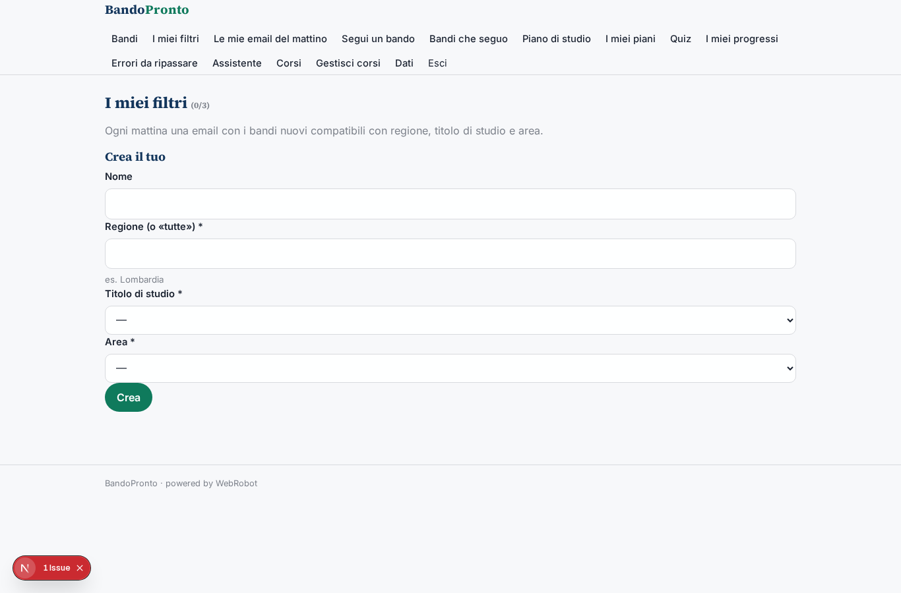

### mail
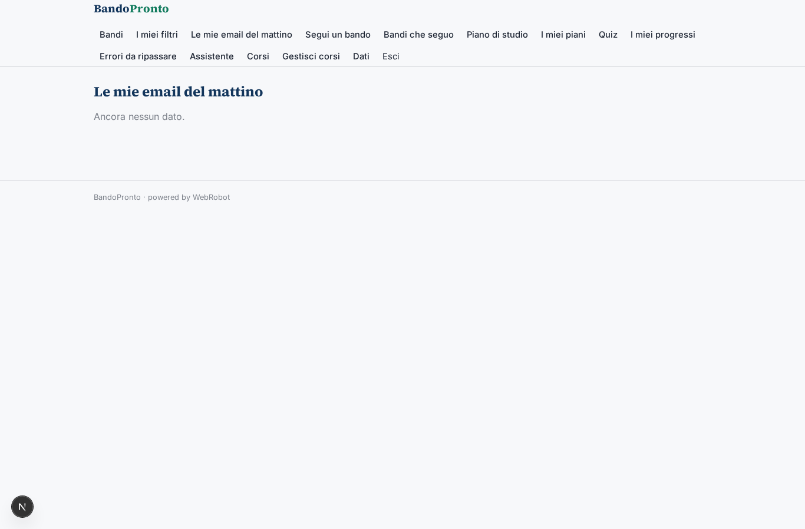

### salva
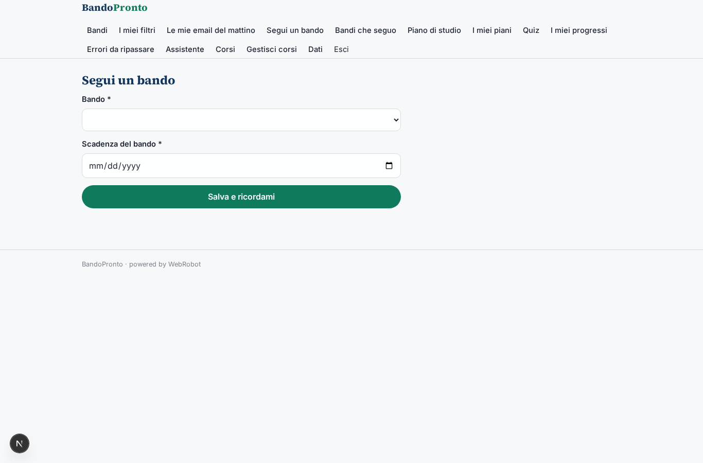

### salvati
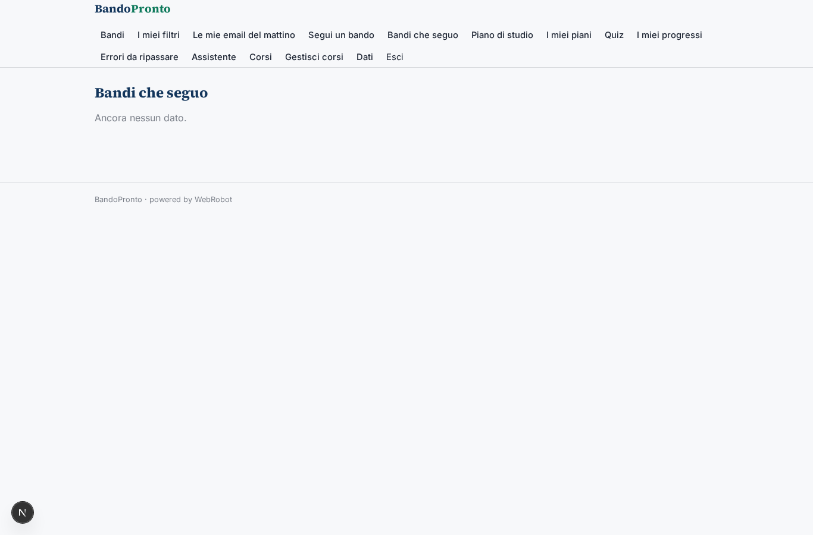

### new_plan
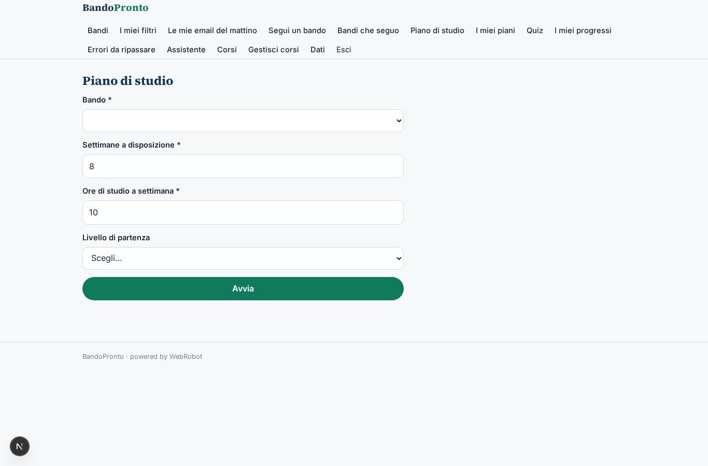

### piani
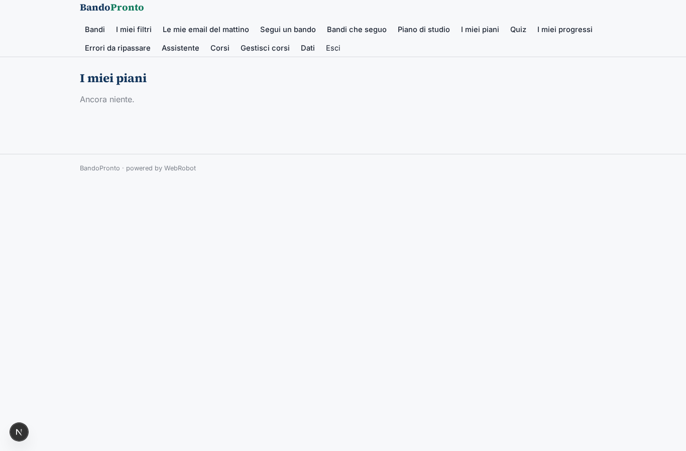

### quiz
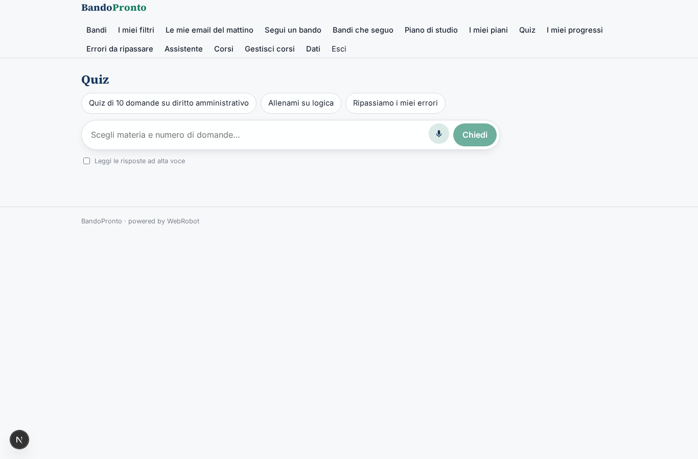

### progressi
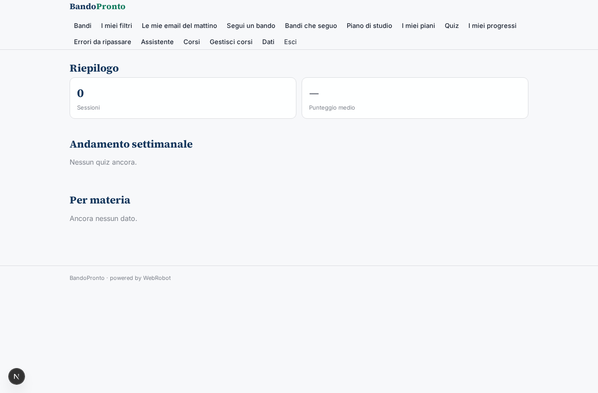

### errori_view
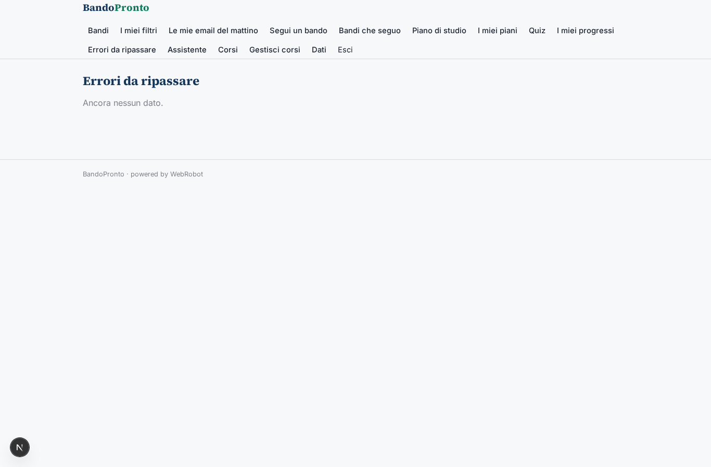

### assistente
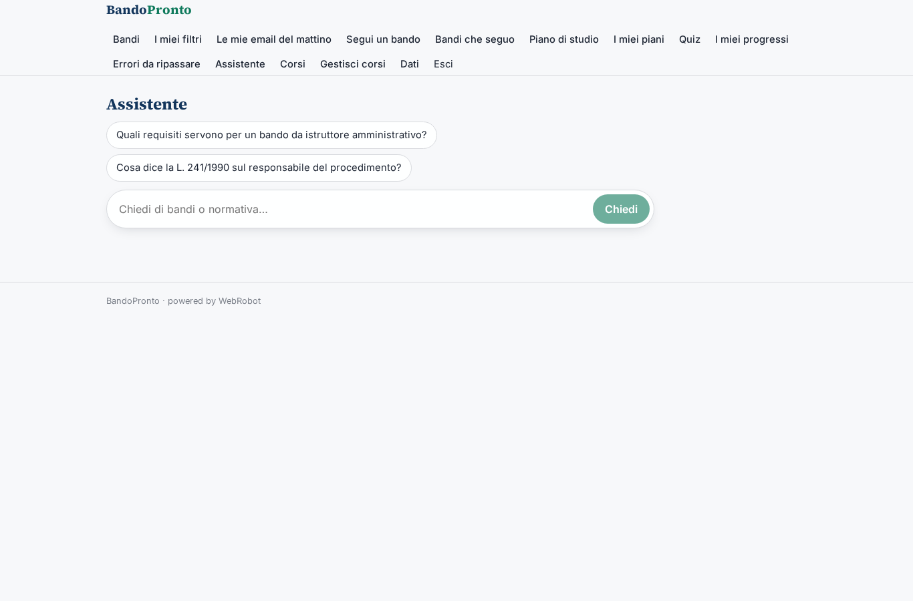

### corsi_view
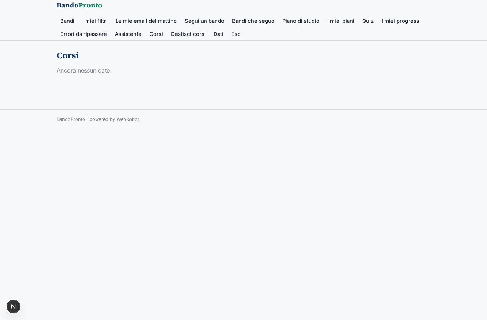

### corsi_admin
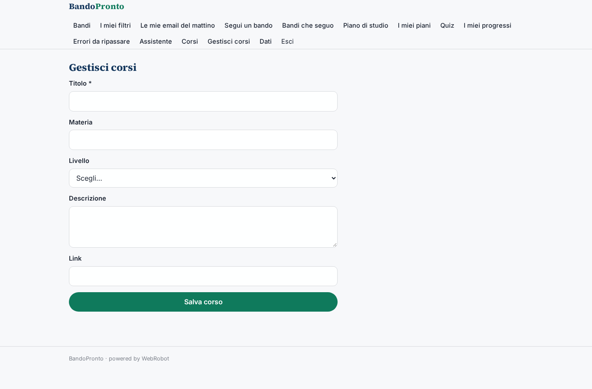

### account
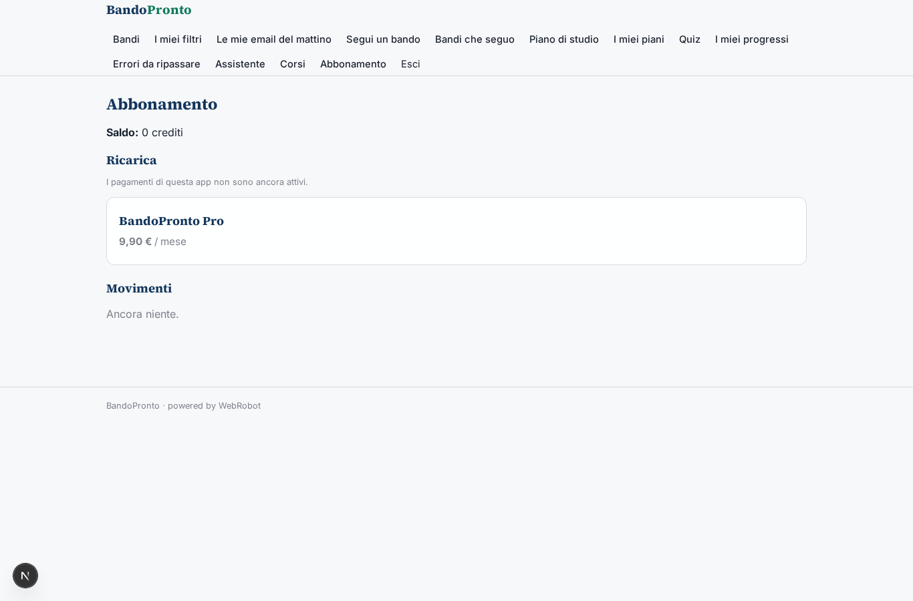
