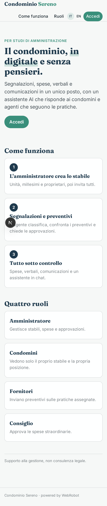
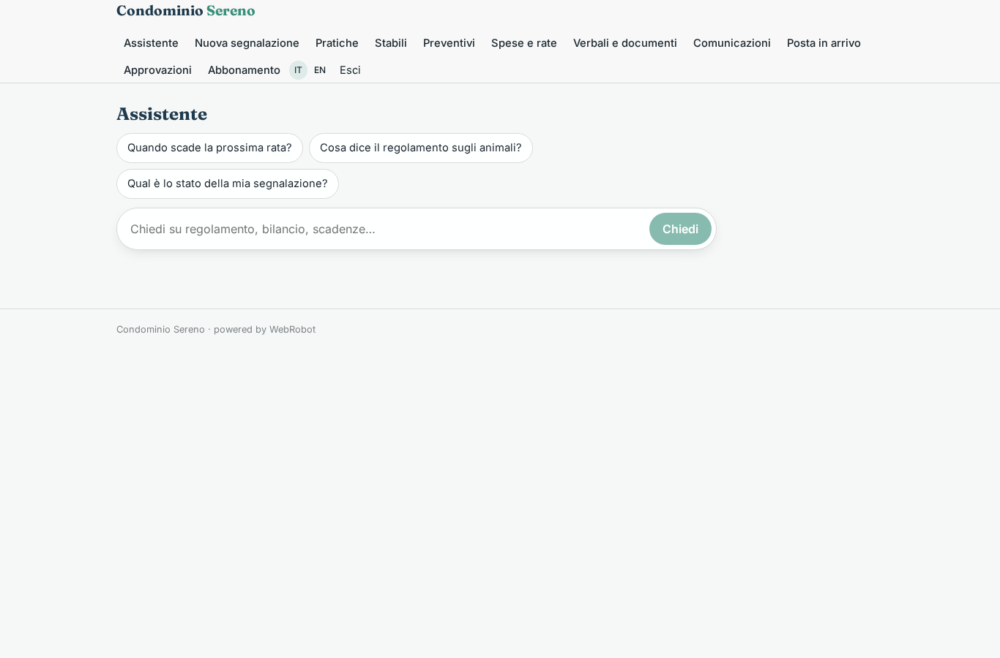
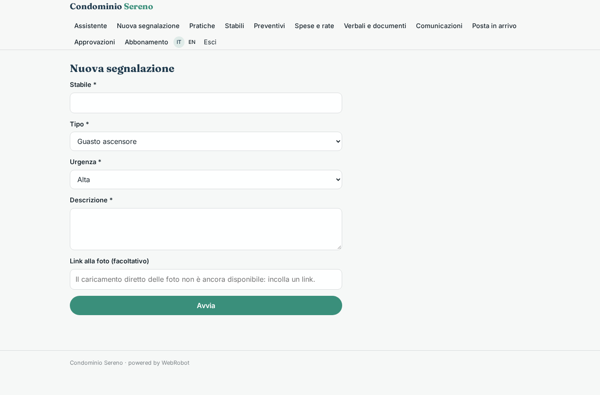
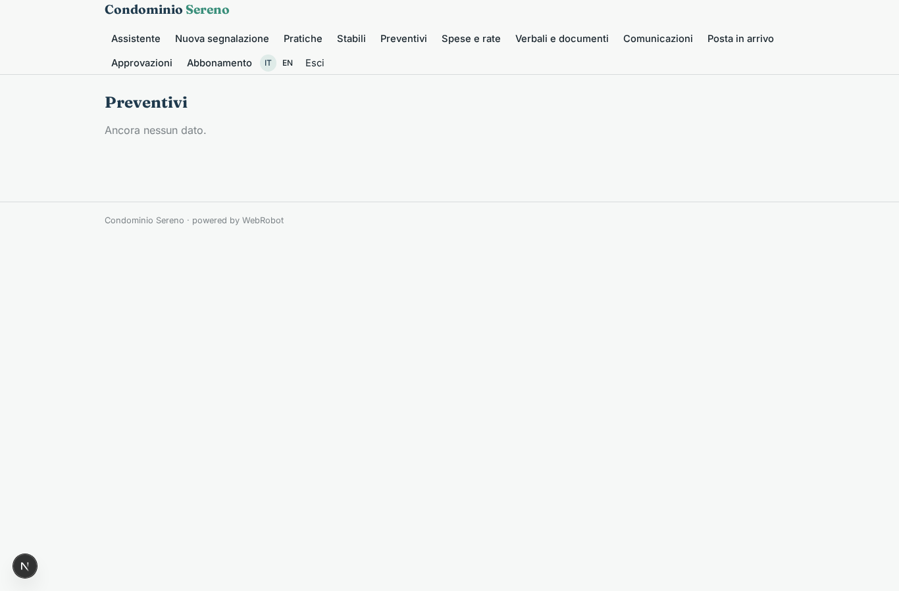
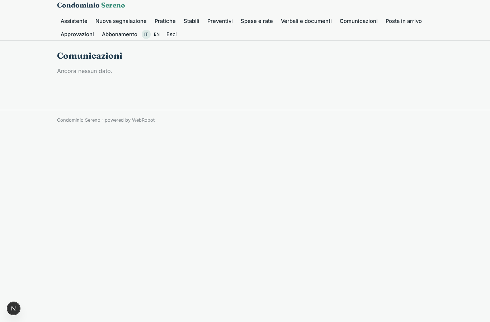
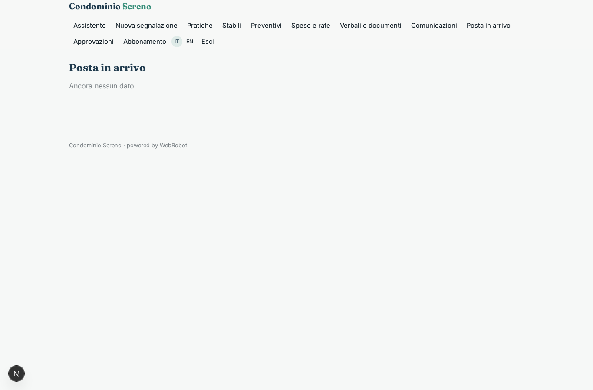
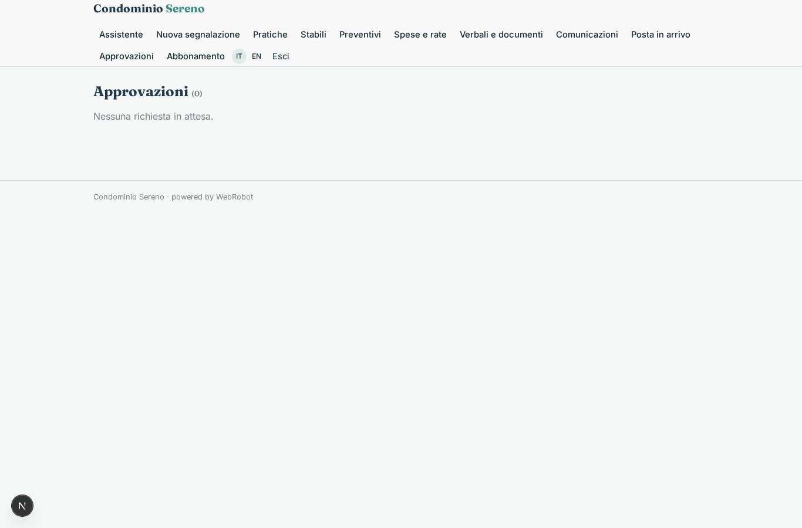
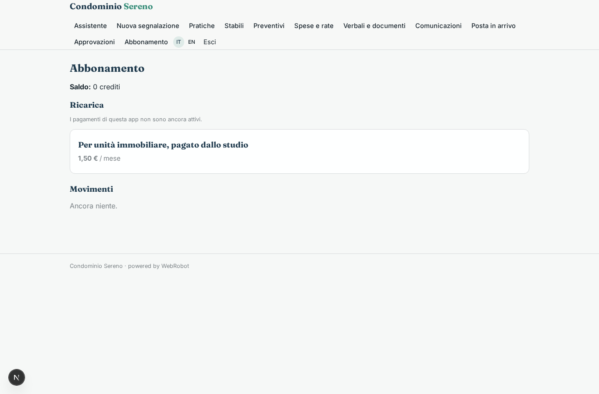

# Condominio Sereno

_Il condominio, in digitale e senza pensieri._

**Stato manifest:** valido (validatore Python + contratto runtime)

## Descrizione data all'app builder

Ci serve Condominio Sereno, un'app per gestire i condomini in modo digitale. Ci sono quattro ruoli: l'amministratore, i condomini, i fornitori e il consiglio di condominio. L'amministratore crea lo stabile con unità, millesimi e proprietari, e invita tutti. I condomini aprono segnalazioni con foto (guasto ascensore, infiltrazione), vedono le spese, i verbali e le comunicazioni, e possono chiedere informazioni a un assistente in chat che risponde su regolamento, bilancio e scadenze. Le email e PEC in arrivo all'indirizzo del condominio vengono lette da un agente che le classifica e collega a una pratica. Per una segnalazione l'agente chiede preventivi ai fornitori via email e li confronta; ogni spesa sopra una soglia deve essere approvata dall'amministratore e, se straordinaria, dal consiglio. A ogni evento, come un guasto o una scadenza, partono notifiche ai condomini interessati. Vogliamo che i condomini paghino le rate direttamente dall'app e che i documenti si carichino in archivio. Il condomino vede solo il suo stabile e la sua posizione. Abbonamento per unità immobiliare pagato dallo studio.

## Funzioni non esprimibili oggi (spec.extensions)

- **file_upload**: Foto delle segnalazioni e documenti d'archivio: il caricamento file non è ancora disponibile; per ora si incolla un link o il testo.
- **notifiche**: Notifiche automatiche (email/push) ai condomini a ogni guasto o scadenza non disponibili: per ora l'agente pubblica una comunicazione visibile nell'app.
- **pagamento_rate**: Pagamento delle rate dei condomini direttamente dall'app (verso il conto del condominio) non disponibile: i pagamenti Stripe vanno al titolare dell'app. Per ora le rate si registrano come 'pagata' dall'amministratore.
- **preventivi_via_email**: L'invio di email ai fornitori non è disponibile: la richiesta di preventivo è pubblicata nell'app e i fornitori rispondono dal loro accesso. La lettura di email/PEC dipende dal canale email.
- **isolamento_stabile**: Il condomino vede solo il suo stabile e la sua posizione tramite condivisione per record (sharing viewer) dell'amministratore; l'abbonamento per unità richiede il conteggio delle unità dello studio.

## Screenshot (runtime interpretativo)

### home-anon

### home-mobile

### home

### assistente

### nuova_segnalazione

### pratiche

### stabili

### preventivi

### spese

### archivio

### comunicazioni

### posta_view

### approvazioni

### account

