# Conformità Guidata

_Dalla PMI alla certificazione: ISO 27001, NIS2 e AI Act, passo dopo passo._

**Manifest:** valid (schema + runtime contract) · **Functional test:** passed (20 checks passed)

## Description given to the app builder (Italian)

Vorrei Conformità Guidata, un'app che accompagna le PMI verso certificazioni e adempimenti come ISO 27001, NIS2 e AI Act. Il responsabile aziendale si registra e risponde a un questionario guidato su settore, dimensioni, servizi erogati, fornitori critici, sistemi informatici, uso di intelligenza artificiale e misure già in essere. Un agente stabilisce quali norme si applicano partendo dai testi pubblici della normativa europea, calcola il gap per ogni requisito e genera un piano di lavoro con priorità, policy da redigere in bozza e responsabili. Le evidenze (log di accesso, configurazioni, elenco utenti, backup) vanno raccolte automaticamente collegando via OAuth gli strumenti dell'azienda come la suite cloud, il provider di identità e il repository del codice. Dove serve il testo integrale delle norme ISO, protetto da copyright, l'azienda carica la propria copia licenziata. Ogni mese un agente ricontrolla le evidenze e segnala scostamenti via email. Un auditor esterno invitato ha un ruolo dedicato: rivede le evidenze, approva o respinge ogni controllo e firma lo stato finale. L'azienda vede tutto il suo progetto, l'auditor solo i clienti assegnati. Abbonamento annuale per framework.

## Features not expressible today (spec.extensions)

- **oauth_evidence_connectors**: Raccolta automatica delle evidenze collegando via OAuth suite cloud (Google Workspace / Microsoft 365), provider di identità e repository del codice: l'OAuth verso altri servizi non è ancora disponibile. Per ora le evidenze si caricano dal modulo 'Carica evidenza'; appena disponibile si aggiungerà un connettore per servizio con le credenziali dell'utente.
- **auditor_signature**: La firma dell'auditor è registrata come decisione di approvazione (final_signoff) con data e utente; una firma qualificata (eIDAS) non è disponibile.

## Screenshots (interpretive runtime, no data)

### home-anon

### home-mobile

### home

### profile
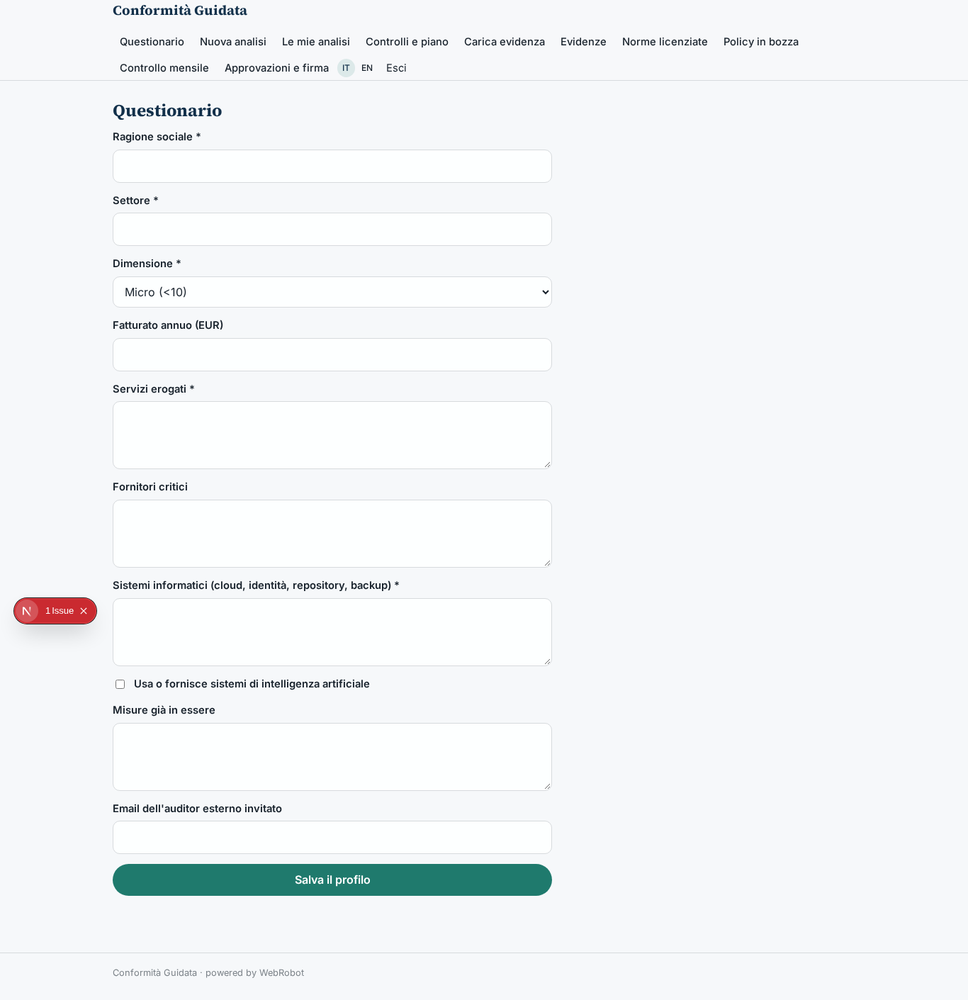

### new_assessment
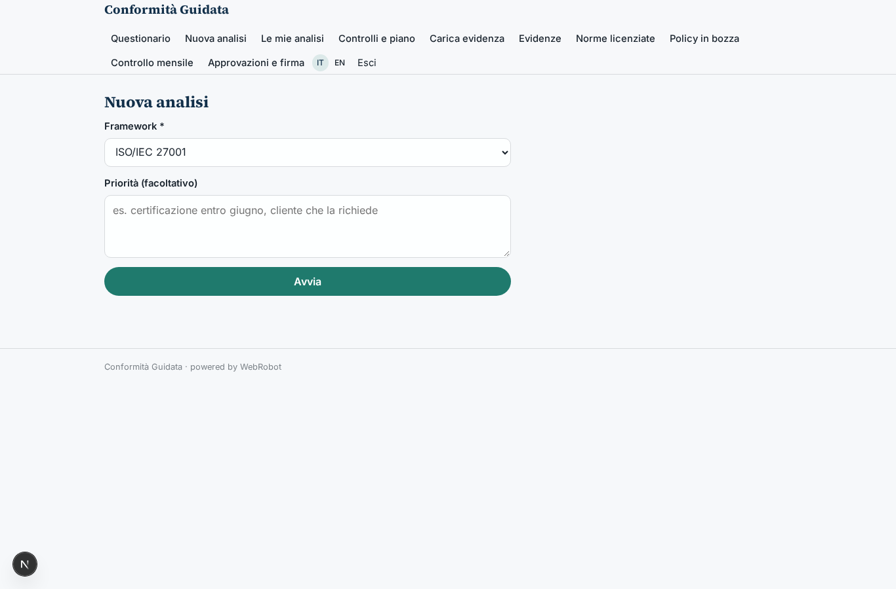

### assessments

### controls_table
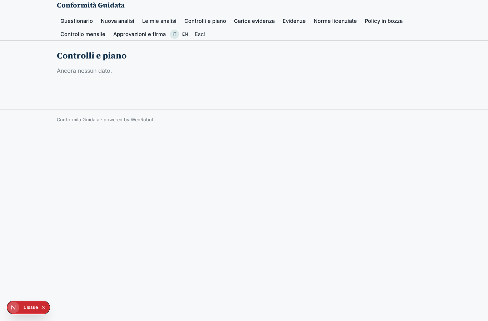

### evidence_upload
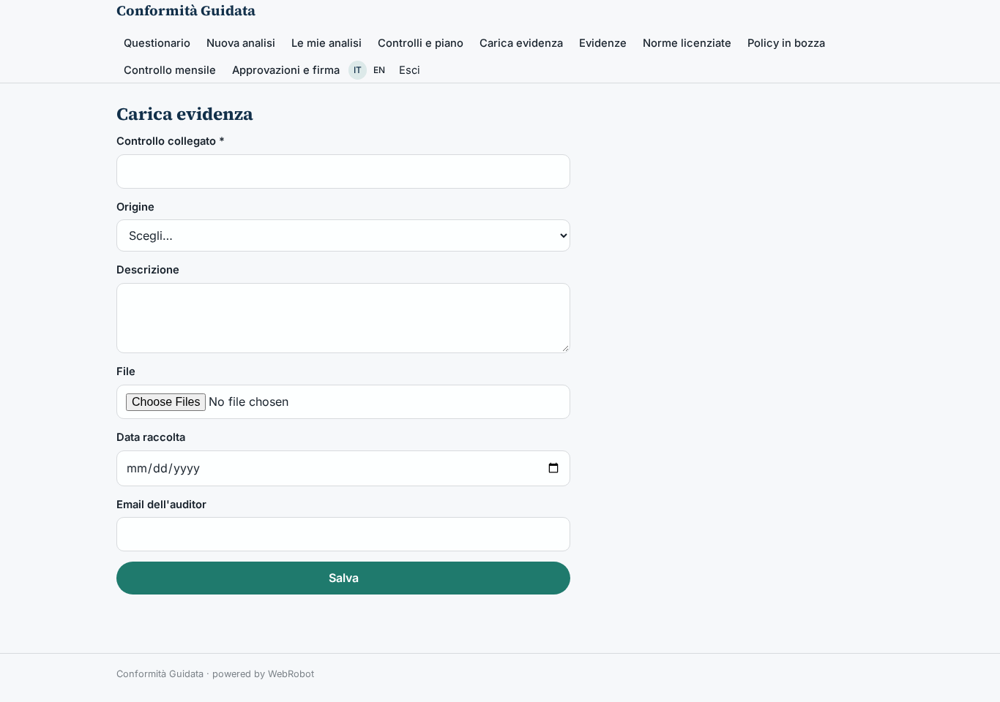

### evidence_table
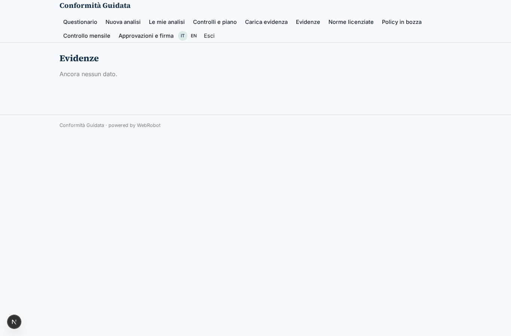

### licensed_upload
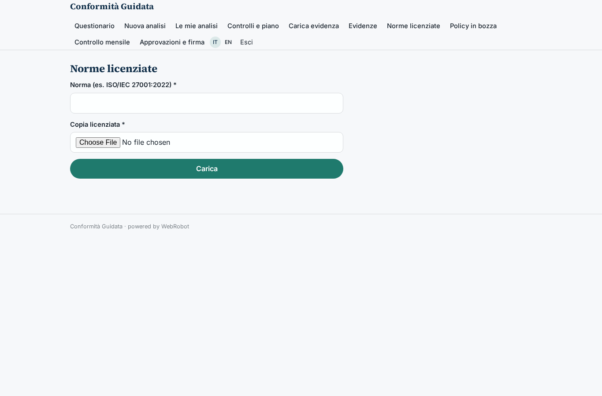

### policies_table
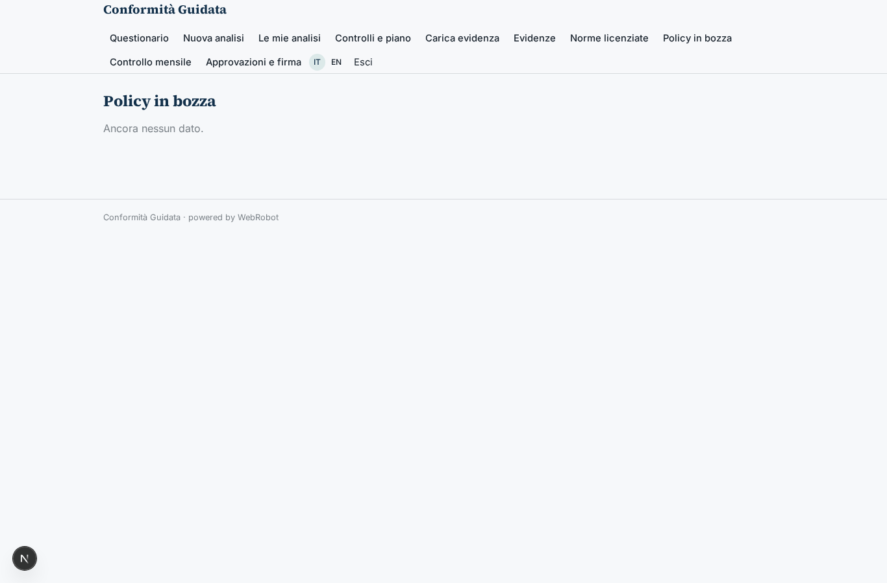

### watches
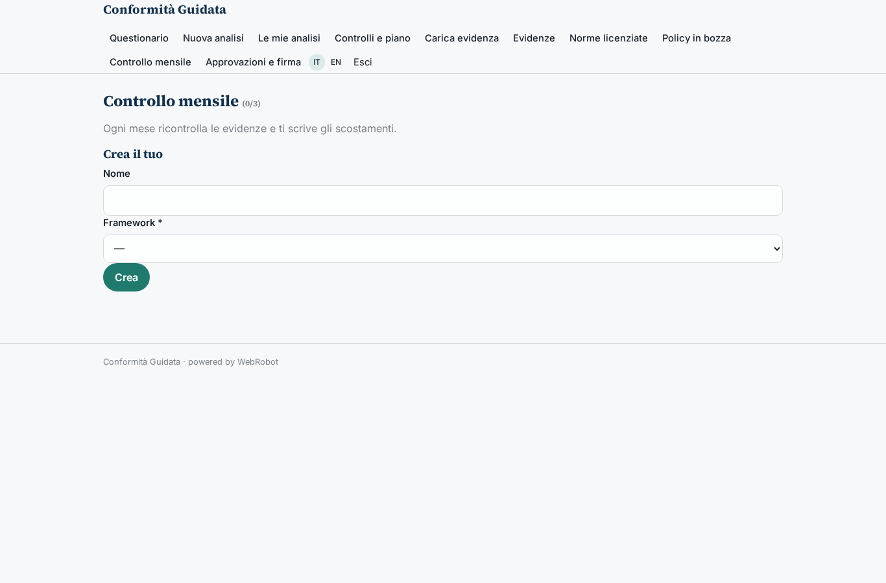

### audit_clients
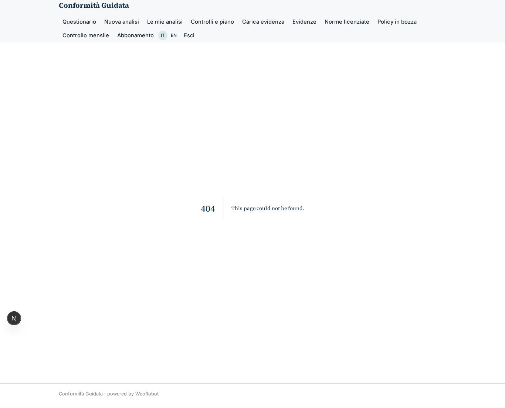

### audit_evidence

### audit_approvals
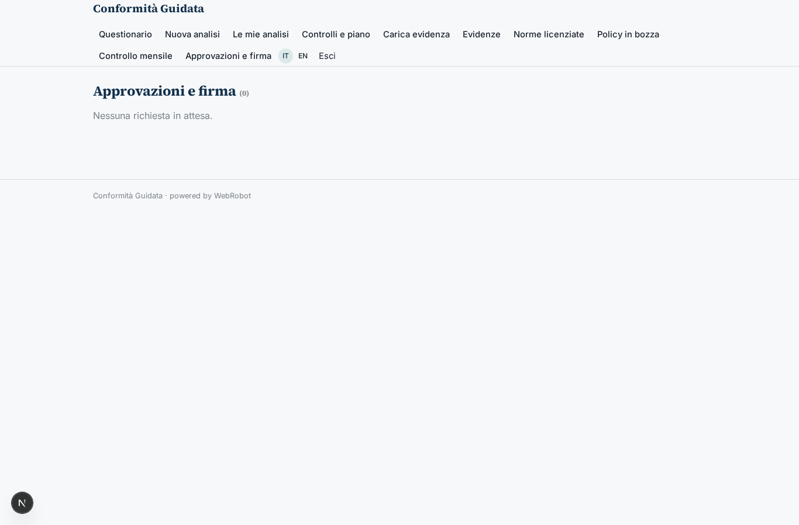

### account
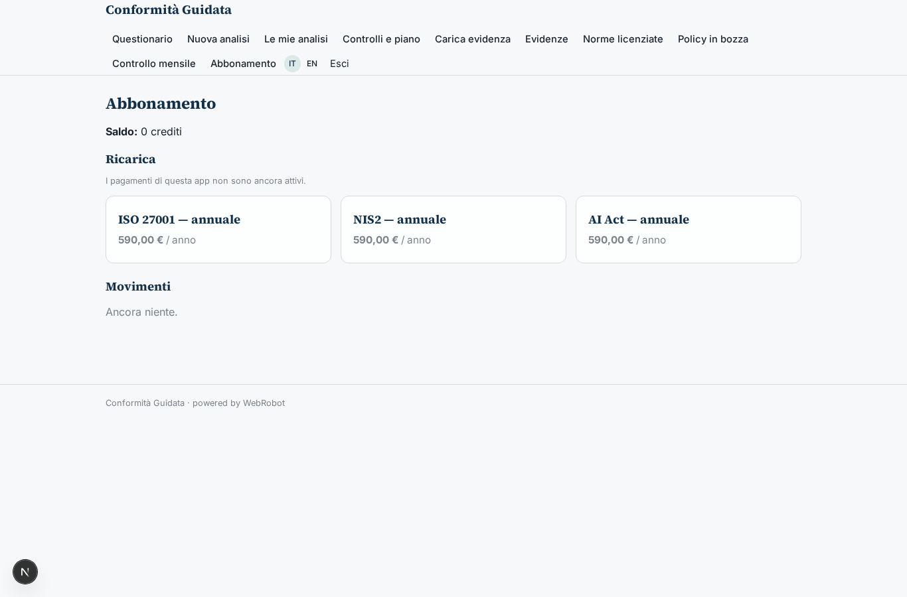
