# Conformità Guidata

_ISO 27001, NIS2 e AI Act: dal questionario al piano di lavoro._

**Stato manifest:** valido (validatore Python + contratto runtime)

## Descrizione data all'app builder

Vorrei Conformità Guidata, un'app che accompagna le PMI verso certificazioni e adempimenti come ISO 27001, NIS2 e AI Act. Il responsabile aziendale si registra e risponde a un questionario guidato su settore, dimensioni, servizi erogati, fornitori critici, sistemi informatici, uso di intelligenza artificiale e misure già in essere. Un agente stabilisce quali norme si applicano partendo dai testi pubblici della normativa europea, calcola il gap per ogni requisito e genera un piano di lavoro con priorità, policy da redigere in bozza e responsabili. Le evidenze (log di accesso, configurazioni, elenco utenti, backup) vanno raccolte automaticamente collegando via OAuth gli strumenti dell'azienda come la suite cloud, il provider di identità e il repository del codice. Dove serve il testo integrale delle norme ISO, protetto da copyright, l'azienda carica la propria copia licenziata. Ogni mese un agente ricontrolla le evidenze e segnala scostamenti via email. Un auditor esterno invitato ha un ruolo dedicato: rivede le evidenze, approva o respinge ogni controllo e firma lo stato finale. L'azienda vede tutto il suo progetto, l'auditor solo i clienti assegnati. Abbonamento annuale per framework.

## Funzioni non esprimibili oggi (spec.extensions)

- **oauth_evidence**: Non ancora disponibile: raccolta automatica delle evidenze via OAuth (suite cloud, provider di identità, repository). Per ora l'azienda incolla estratti o link nella raccolta Evidenze.
- **file_upload**: Non ancora disponibile: caricamento di file. Il testo ISO licenziato va incollato nella raccolta Testi ISO licenziati.
- **email_alerts**: Non ancora disponibile: invio email degli scostamenti mensili. Per ora il controllo mensile appare in Controlli mensili.
- **auditor_scope**: Il ruolo auditor è derivato da audit_assignments (gestita dall'admin). Il filtro per cui l'auditor vede solo i dati dei clienti assegnati e la firma finale per cliente richiedono logica dedicata; oggi l'auditor decide dalle richieste di approvazione ricevute.

## Screenshot (runtime interpretativo)

### home-anon
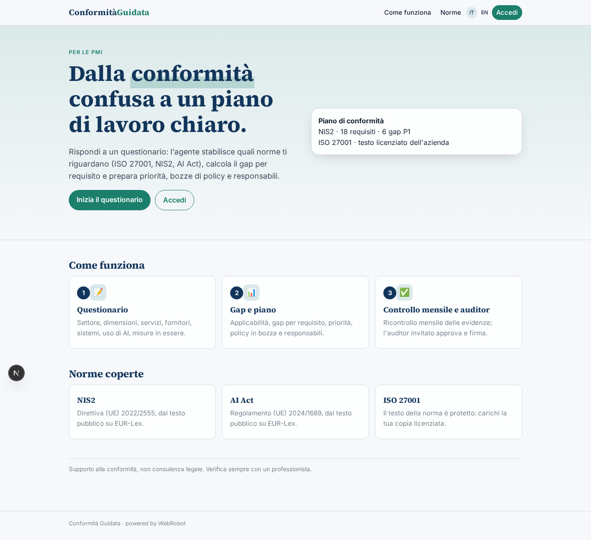

### home-mobile
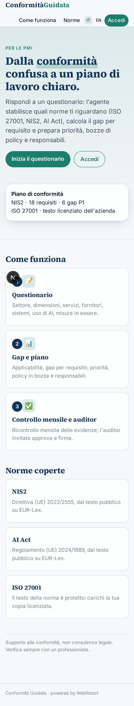

### home
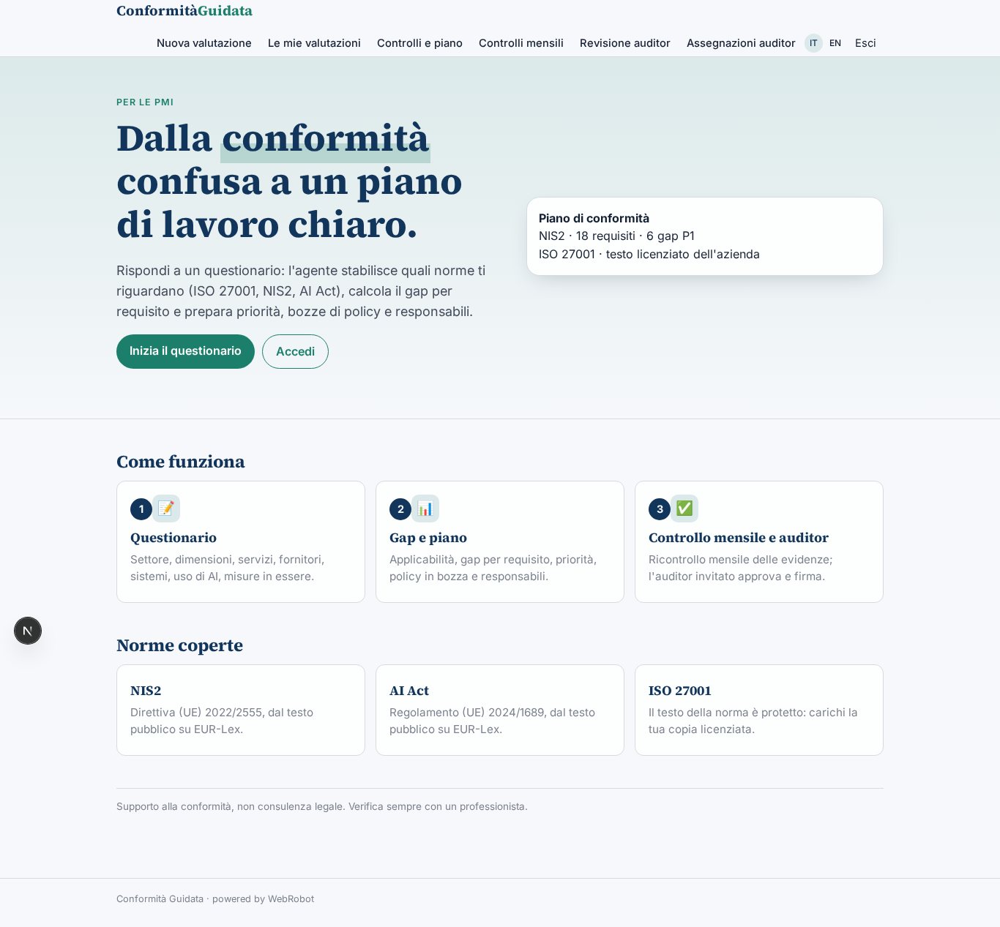

### new_assessment
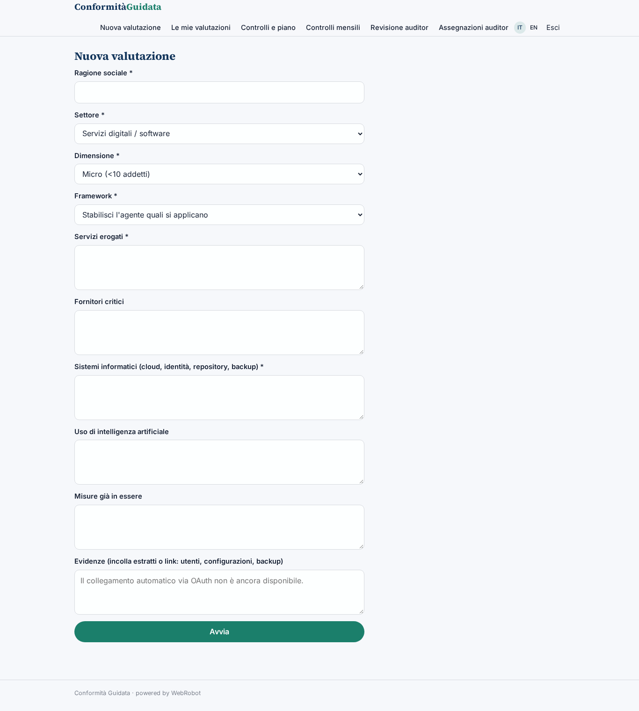

### assessments
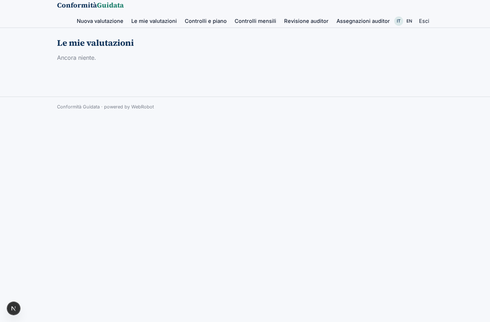

### licensed
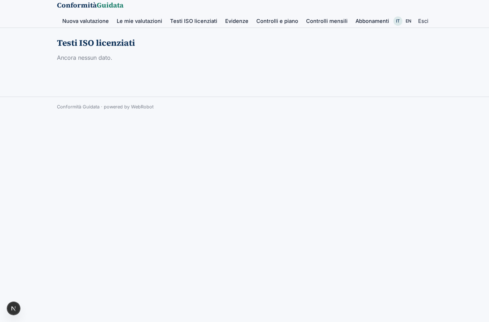

### evidence
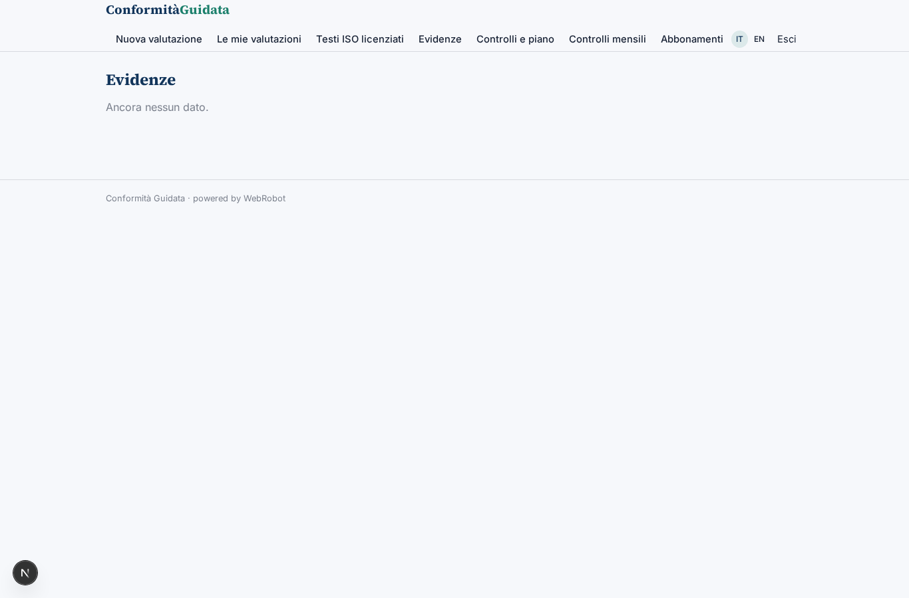

### controls_view
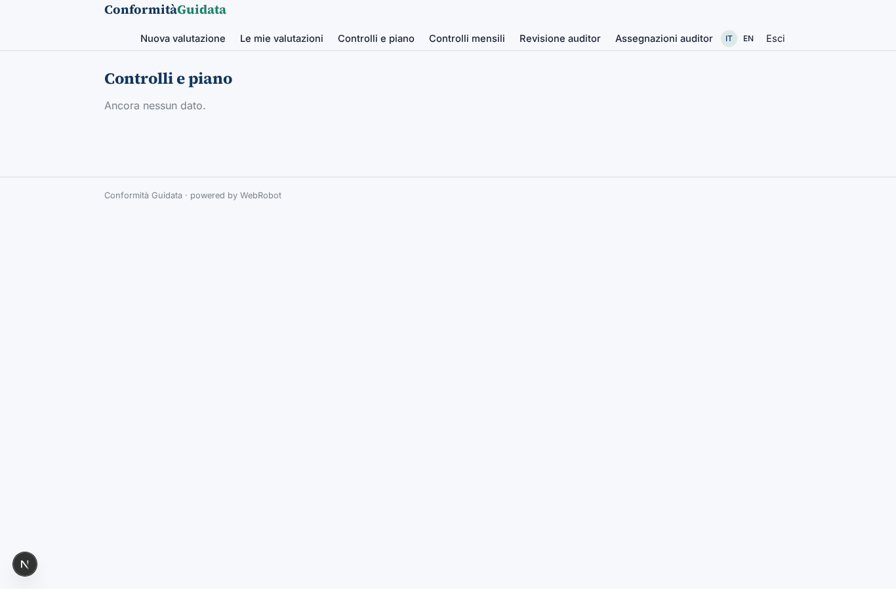

### checks
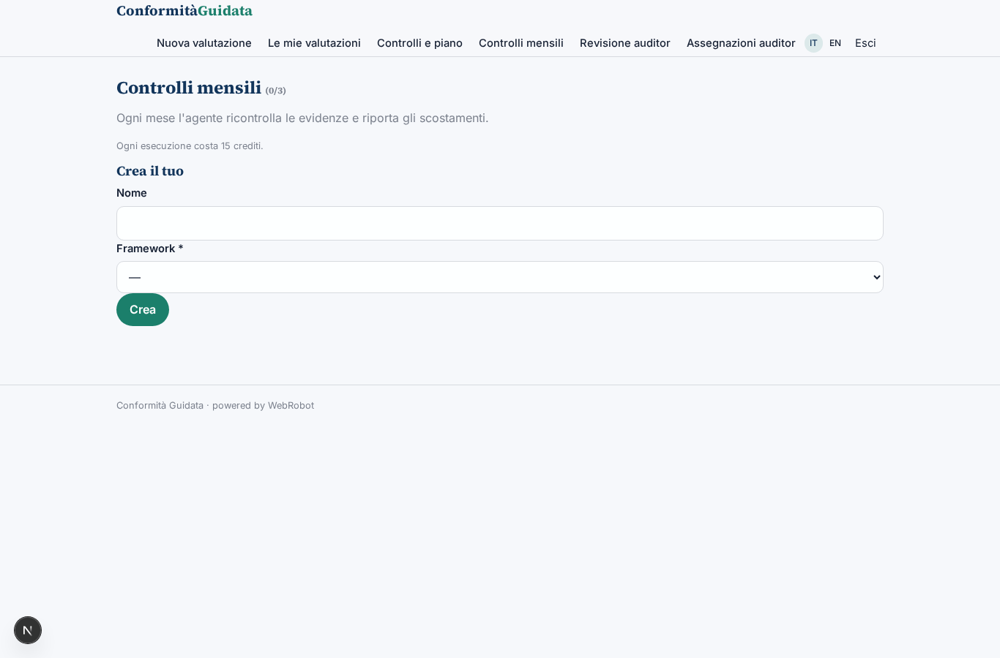

### signoffs
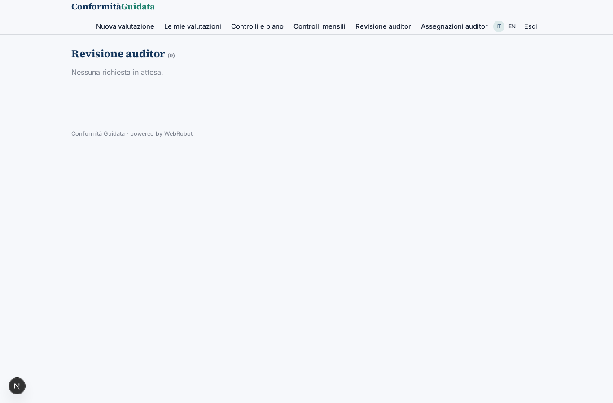

### assignments

### account
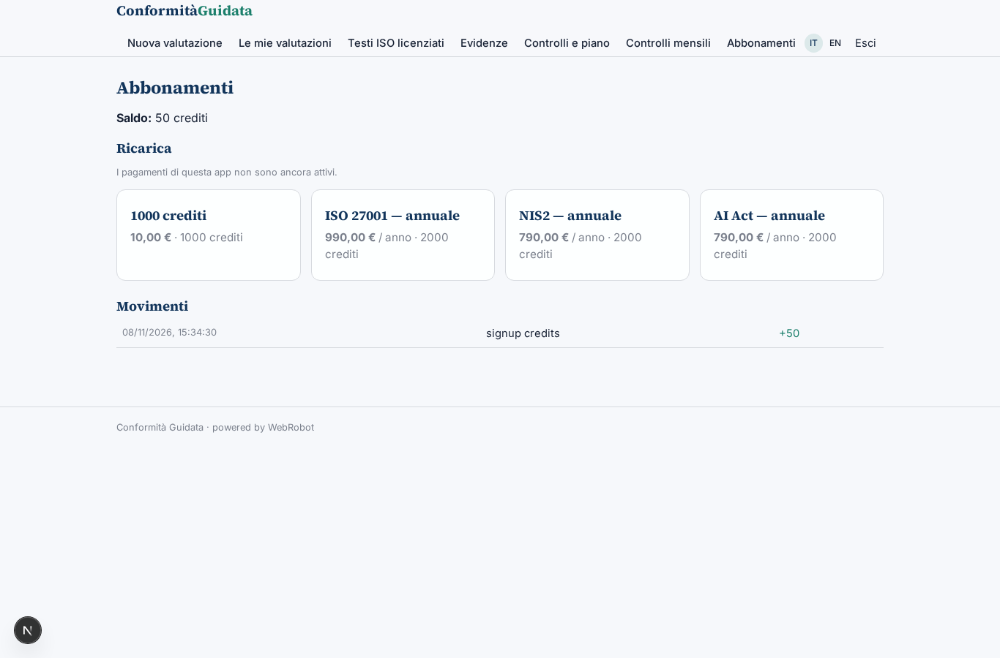

