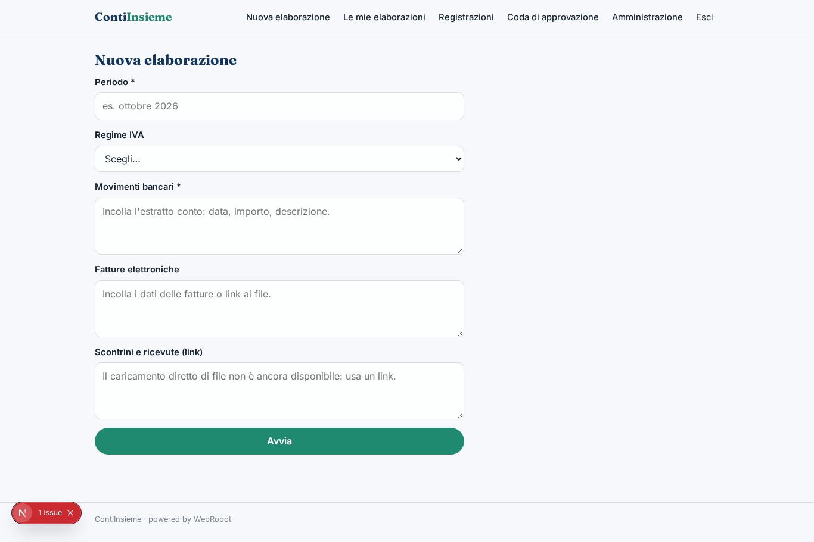
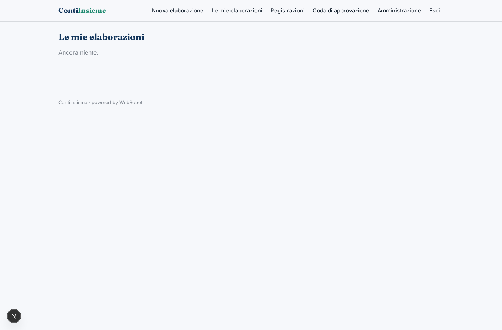
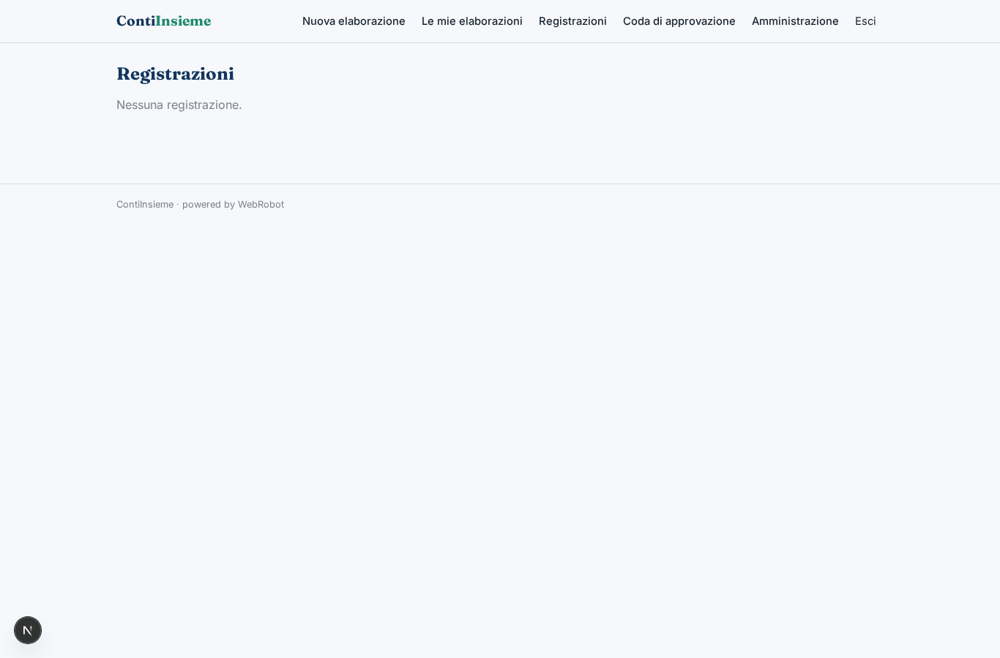
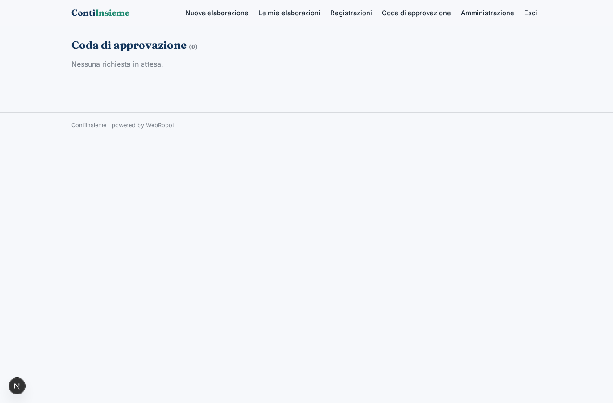
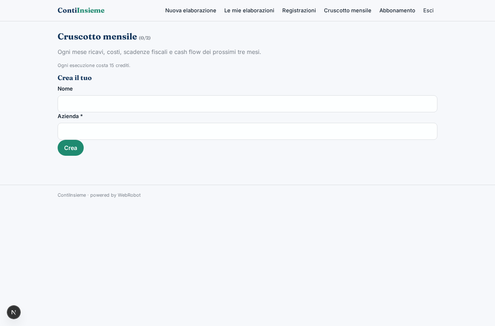
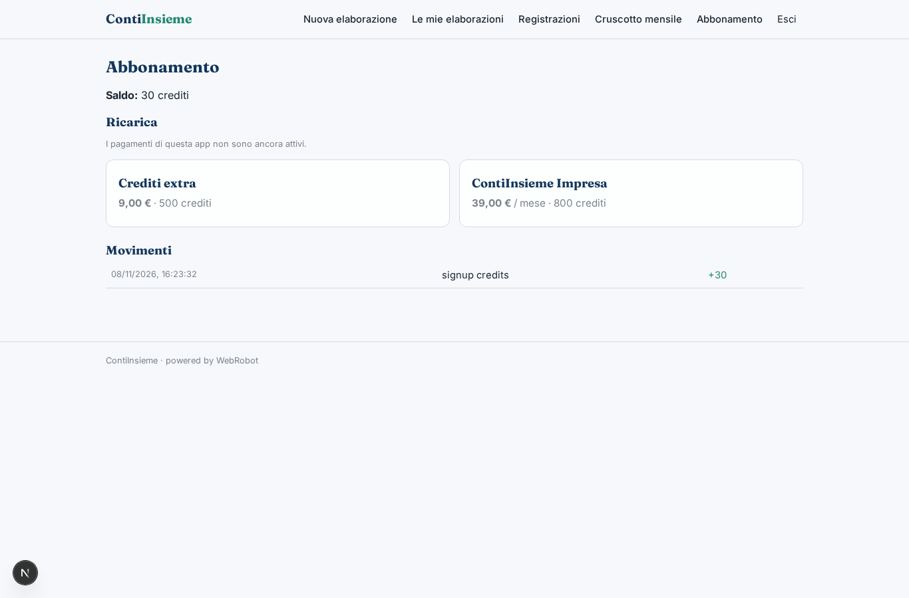
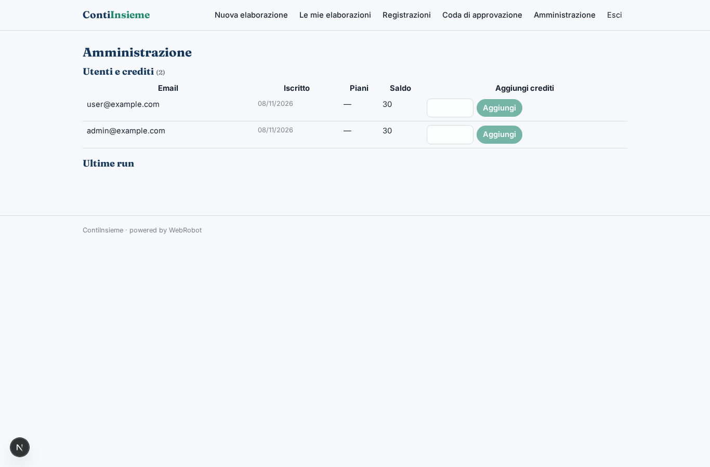

# ContiInsieme

_La contabilità della tua PMI, insieme al tuo commercialista._

**Stato manifest:** valido (validatore Python + contratto runtime)

## Descrizione data all'app builder

ContiInsieme è un software di contabilità per PMI che lavora insieme al commercialista. L'imprenditore collega il proprio conto corrente bancario tramite open banking e il cassetto fiscale per ricevere le fatture elettroniche dal Sistema di Interscambio; può anche caricare scontrini, ricevute e documenti in foto o PDF. Un agente abbina ogni movimento bancario alla fattura corrispondente, propone la registrazione contabile con il piano dei conti e calcola in tempo reale IVA da versare, liquidità prevista e margini. Le registrazioni incerte finiscono in una coda di approvazione dove il commercialista dello studio le conferma o corregge. Ogni mese l'imprenditore riceve via email un cruscotto con ricavi, costi, scadenze fiscali e cash flow previsto per i tre mesi successivi. Il commercialista vede tutti i clienti dello studio, l'imprenditore solo la propria azienda, i collaboratori dello studio solo i clienti assegnati. Abbonamento mensile pagato dall'impresa, con quota allo studio partner. In italiano.

## Funzioni non esprimibili oggi (spec.extensions)

- **open_banking**: Collegamento del conto corrente via open banking: richiede le credenziali di ogni cliente, non ancora disponibile. Per ora i movimenti si incollano.
- **cassetto_fiscale_sdi**: Ricezione automatica delle fatture dal Sistema di Interscambio e dal cassetto fiscale: non disponibile. Per ora si incollano i dati delle fatture.
- **upload_documenti**: Caricamento di foto e PDF di scontrini e ricevute: non disponibile, si usano link o testo.
- **email_mensile**: Invio via email del cruscotto mensile: le notifiche non sono disponibili. Il cruscotto è consultabile nell'app.
- **visibilita_studio**: Il commercialista vede tutti i clienti dello studio e i collaboratori solo i clienti assegnati (collection assegnazioni): richiede una regola di accesso dello studio ai record dei clienti, non esprimibile oggi nel manifest.

## Screenshot (runtime interpretativo)

### home-anon

### home-mobile

### home

### nuova

### storico

### registrazioni

### coda

### cruscotti

### account

### admin

