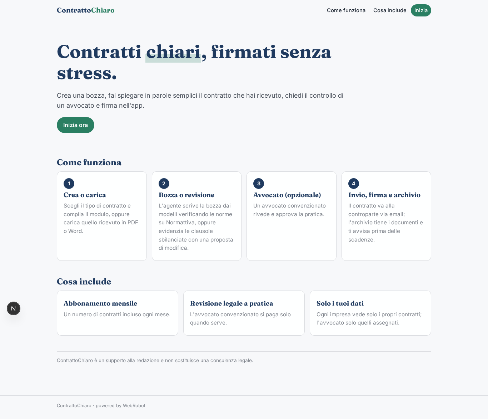
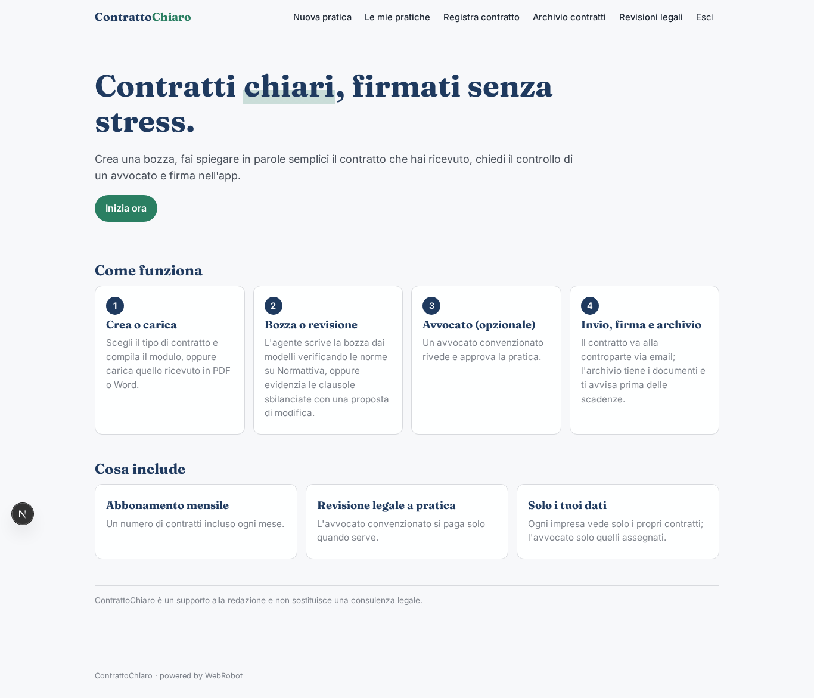
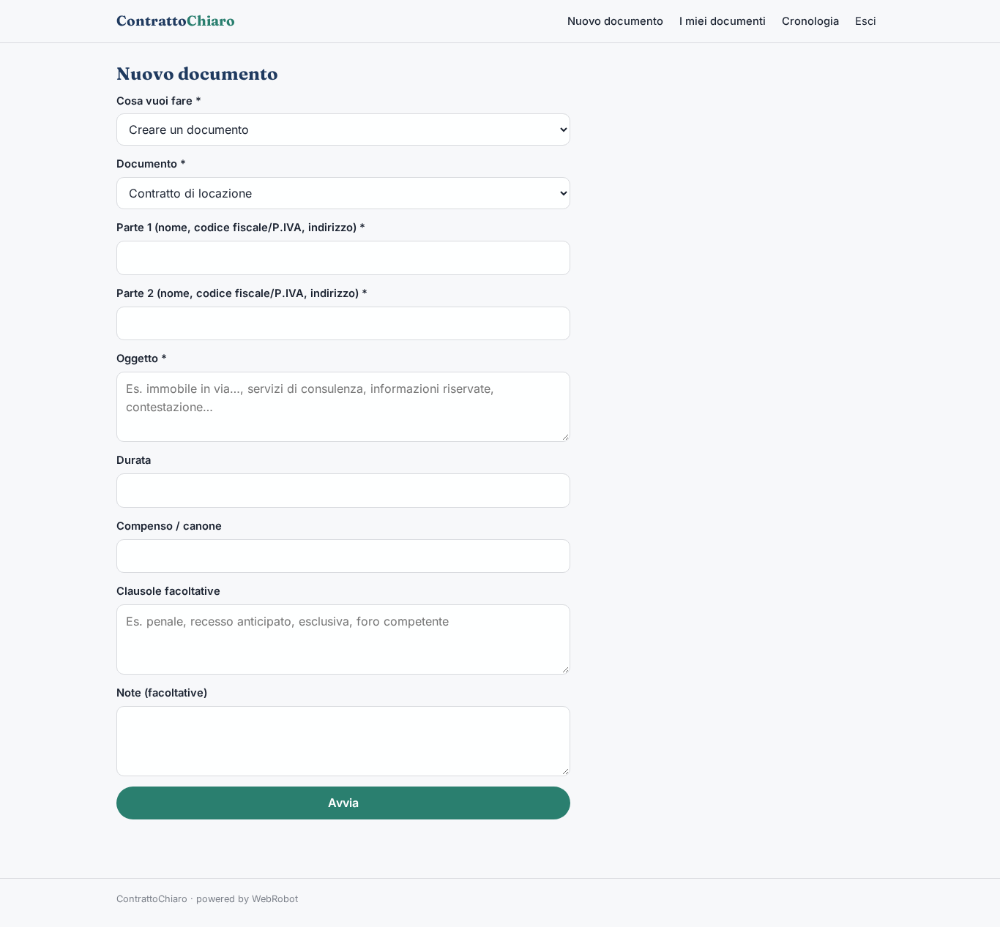
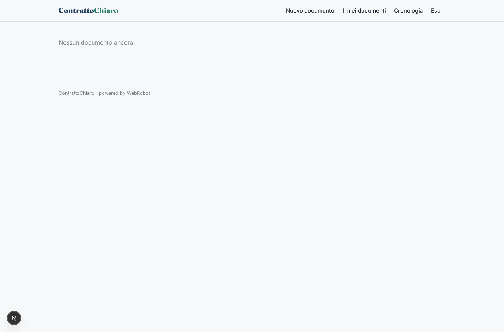
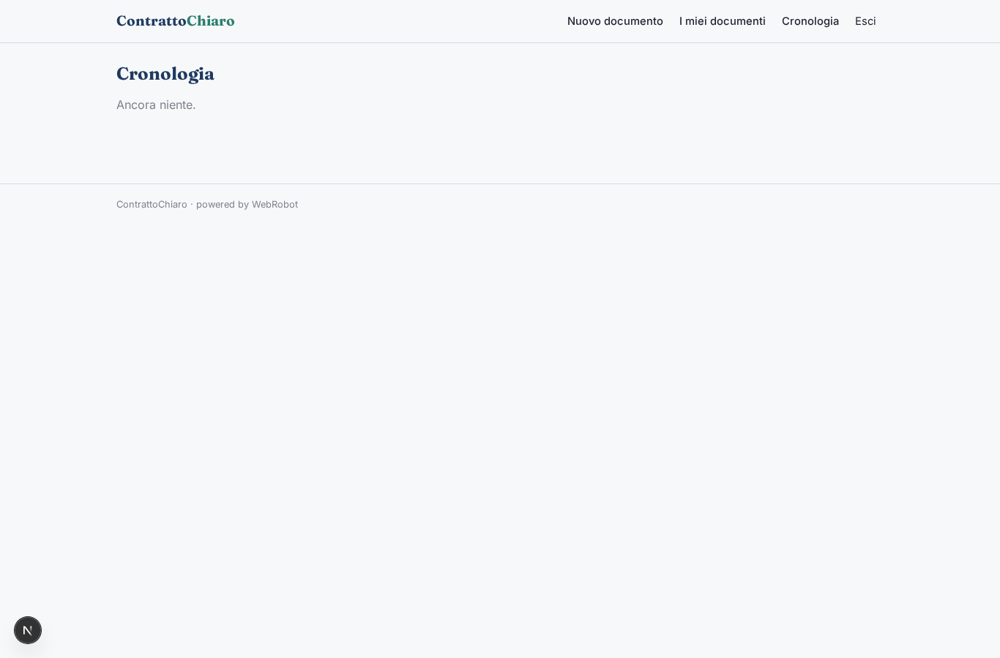
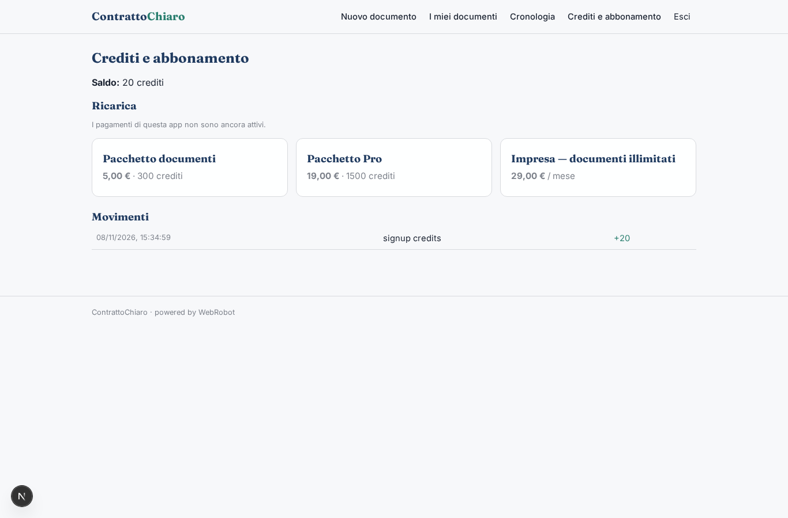

# ContrattoChiaro

_Crea e rivedi i tuoi contratti in parole semplici._

**Manifest status:** valid (schema validator + runtime contract)

## Description given to the app builder (Italian)

ContrattoChiaro aiuta le piccole imprese a creare, revisionare e firmare contratti. Per creare un contratto l'utente sceglie il tipo (NDA, fornitura, agenzia, consulenza, locazione commerciale) e compila un modulo con parti, oggetto, durata, corrispettivo, penali e foro competente; un agente genera la bozza partendo dai modelli della piattaforma e verificando i riferimenti normativi su Normattiva. Per la revisione l'utente carica il contratto ricevuto dalla controparte in PDF o Word, e l'agente evidenzia clausole sbilanciate o mancanti con una spiegazione in parole semplici e una proposta di modifica. Se l'utente lo richiede, un avvocato convenzionato rivede la bozza e la approva. Una volta pronto, il contratto viene inviato via email alla controparte e firmato con firma elettronica avanzata direttamente nell'app, con archivio dei documenti firmati e promemoria sulle scadenze contrattuali. Ogni impresa vede solo i propri contratti, l'avvocato quelli assegnati. Abbonamento mensile con un numero di contratti incluso, revisione legale umana a pagamento per pratica. In italiano.

## Features not expressible today (spec.extensions)

- **firma_elettronica_avanzata**: Firma elettronica avanzata (FEA) nell'app e archivio dei documenti firmati: richiede un provider di firma e non è ancora disponibile.
- **invio_email_controparte**: Invio del contratto via email alla controparte e promemoria via email: le notifiche non sono ancora disponibili. Le scadenze compaiono nella vista Scadenze.
- **upload_file**: Caricamento di PDF/Word non disponibile: l'utente incolla il testo o un link.
- **assegnazione_avvocato**: Assegnazione di una pratica a uno specifico avvocato e visibilità limitata alle pratiche assegnate: oggi tutti gli avvocati invitati vedono le richieste di revisione.

## Screenshots (interpretive runtime)

### home-anon

### home-mobile

### home

### new_doc

### my_docs

### history

### account

