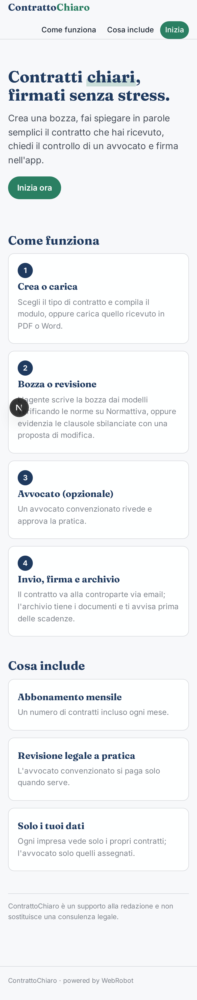
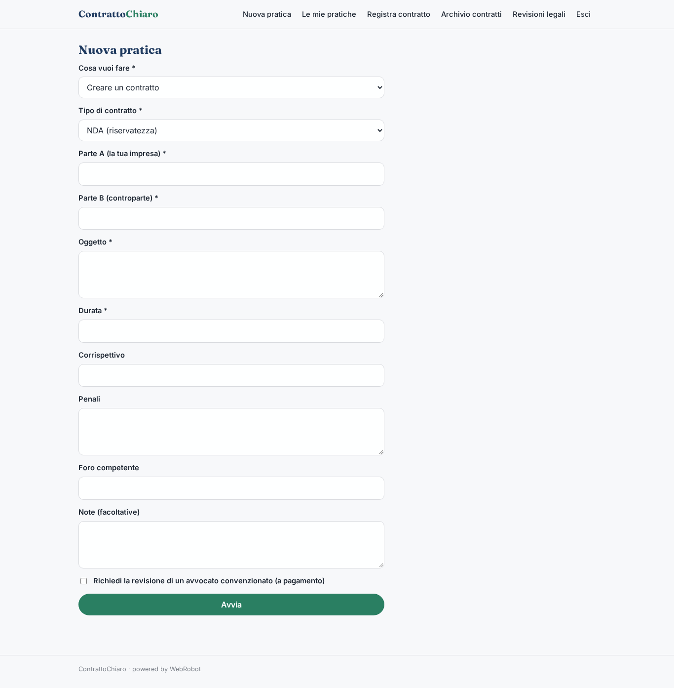
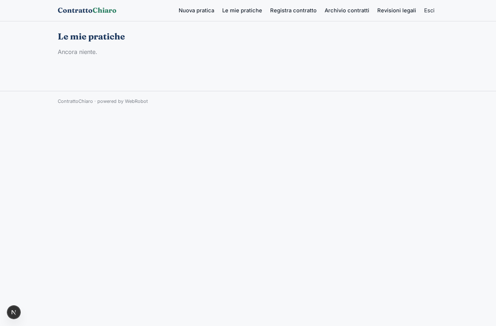
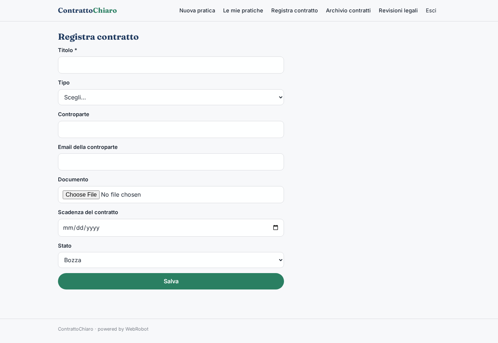
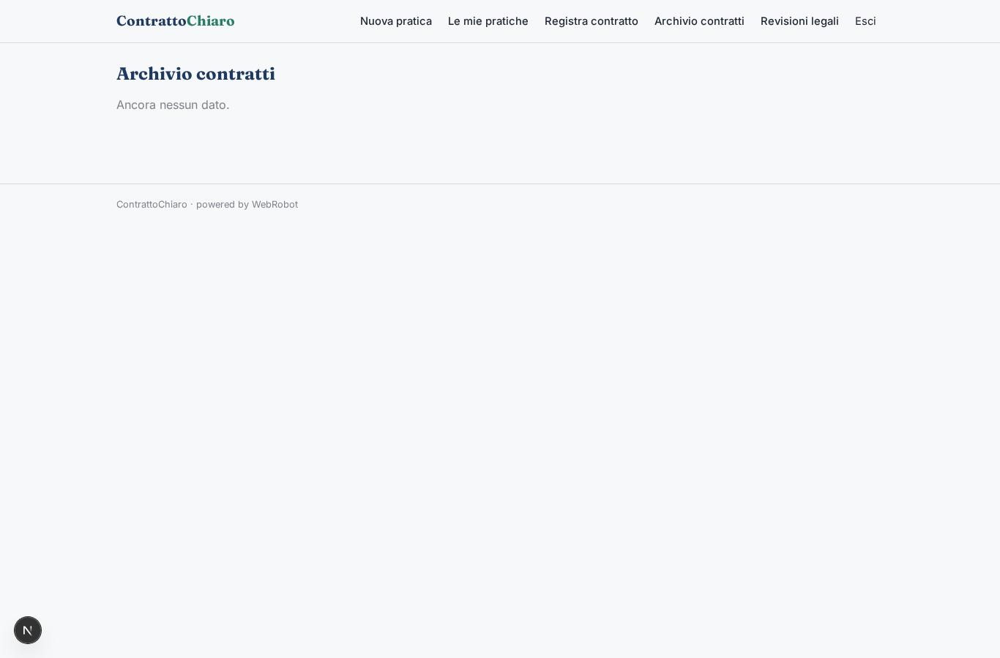
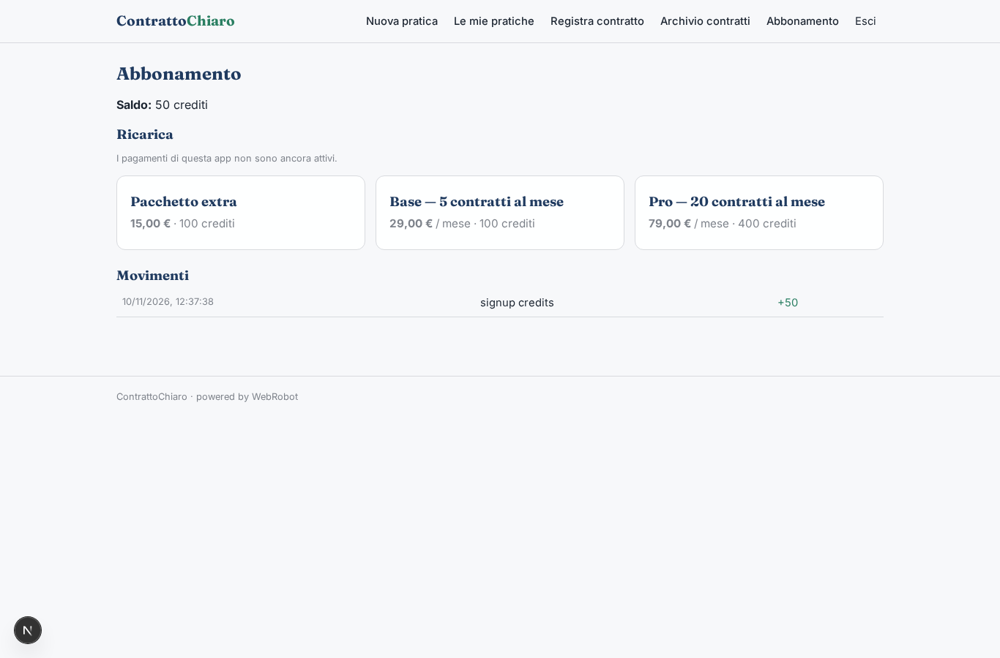

# ContrattoChiaro

_Crea, revisiona e firma i tuoi contratti, in parole semplici._

**Manifest:** valid (schema + runtime contract) · **Functional test:** passed (11 checks passed)

## Description given to the app builder (Italian)

ContrattoChiaro aiuta le piccole imprese a creare, revisionare e firmare contratti. Per creare un contratto l'utente sceglie il tipo (NDA, fornitura, agenzia, consulenza, locazione commerciale) e compila un modulo con parti, oggetto, durata, corrispettivo, penali e foro competente; un agente genera la bozza partendo dai modelli della piattaforma e verificando i riferimenti normativi su Normattiva. Per la revisione l'utente carica il contratto ricevuto dalla controparte in PDF o Word, e l'agente evidenzia clausole sbilanciate o mancanti con una spiegazione in parole semplici e una proposta di modifica. Se l'utente lo richiede, un avvocato convenzionato rivede la bozza e la approva. Una volta pronto, il contratto viene inviato via email alla controparte e firmato con firma elettronica avanzata direttamente nell'app, con archivio dei documenti firmati e promemoria sulle scadenze contrattuali. Ogni impresa vede solo i propri contratti, l'avvocato quelli assegnati. Abbonamento mensile con un numero di contratti incluso, revisione legale umana a pagamento per pratica. In italiano.

## Features not expressible today (spec.extensions)

- **advanced_signature**: Firma elettronica avanzata (FEA) direttamente nell'app con identificazione della controparte non ancora disponibile: la controparte riceve il contratto via email, ma la raccolta della firma FEA, la marcatura temporale e la certificazione del documento firmato richiedono un provider esterno. Lo stato 'Firmato' va per ora impostato nell'archivio.
- **lawyer_assignment**: L'assegnazione dell'avvocato convenzionato (campo lawyer_email) è fatta da un amministratore nell'archivio.

## Screenshots (interpretive runtime, no data)

### home-anon

### home-mobile

### home

### new

### history

### contract_form

### contracts

### approvals_queue

### account

