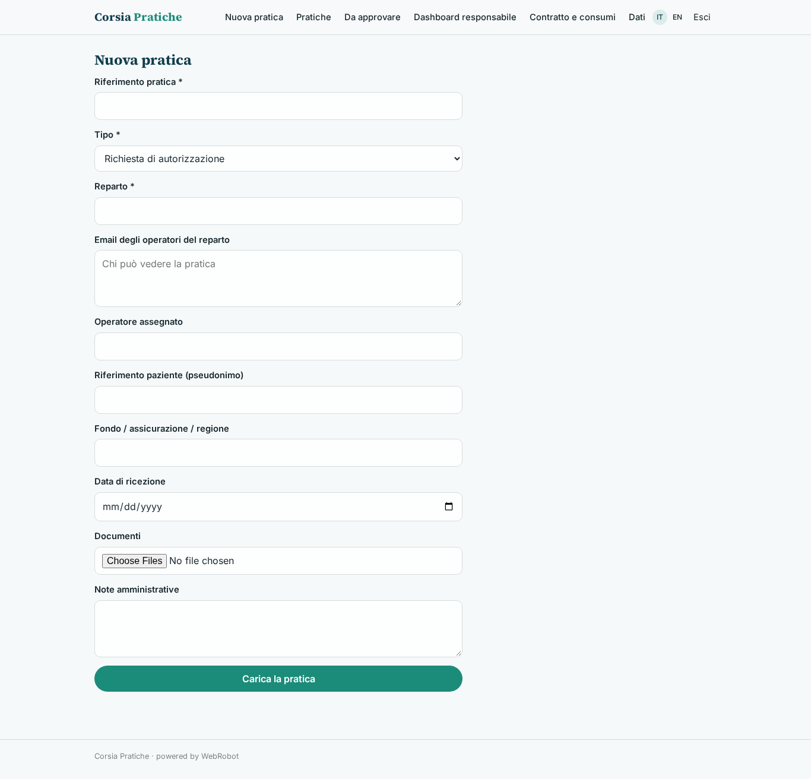
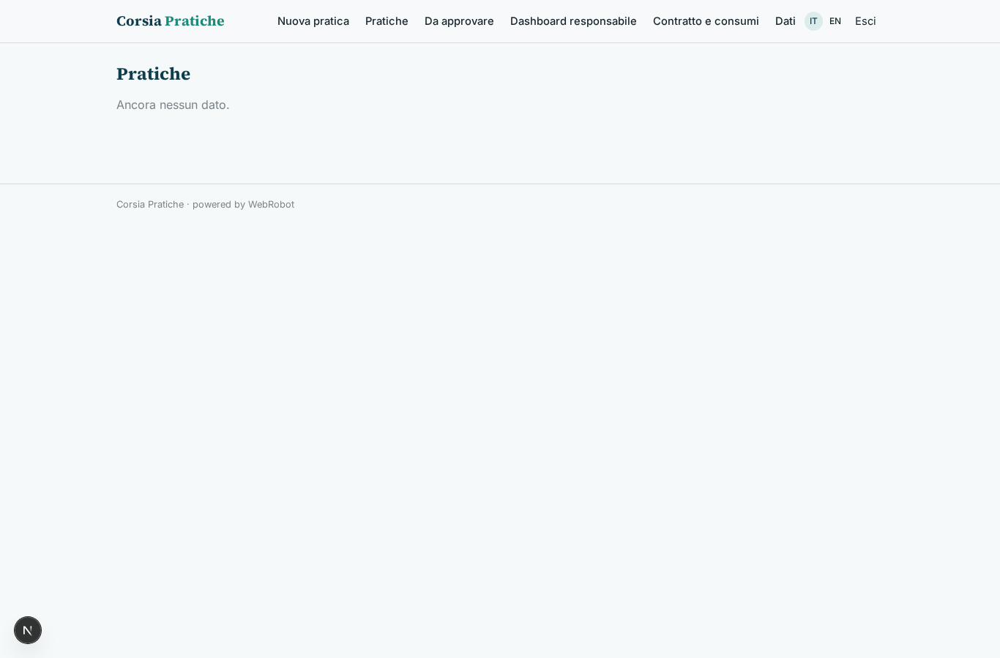
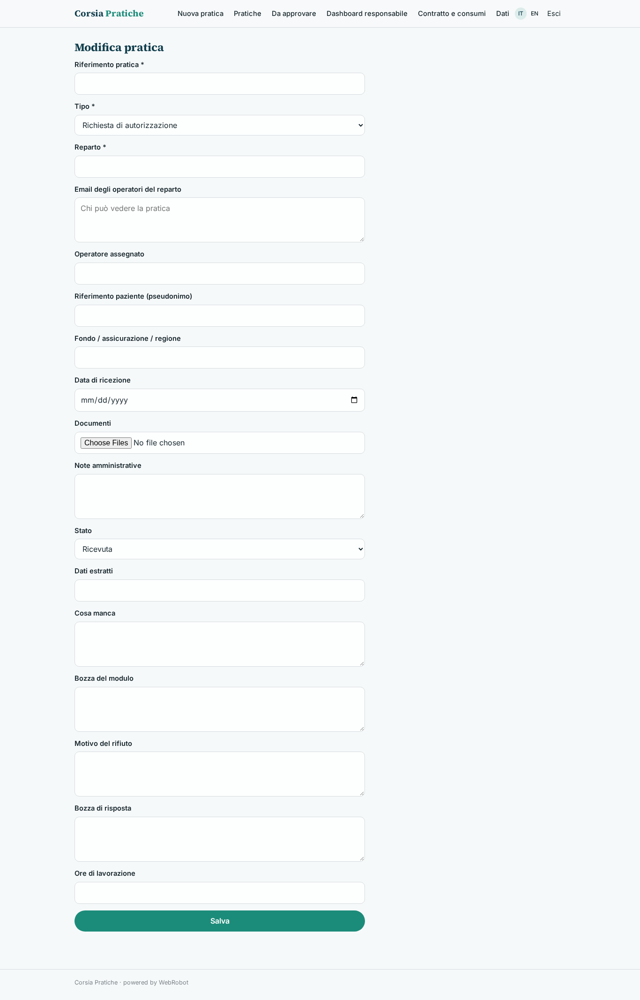
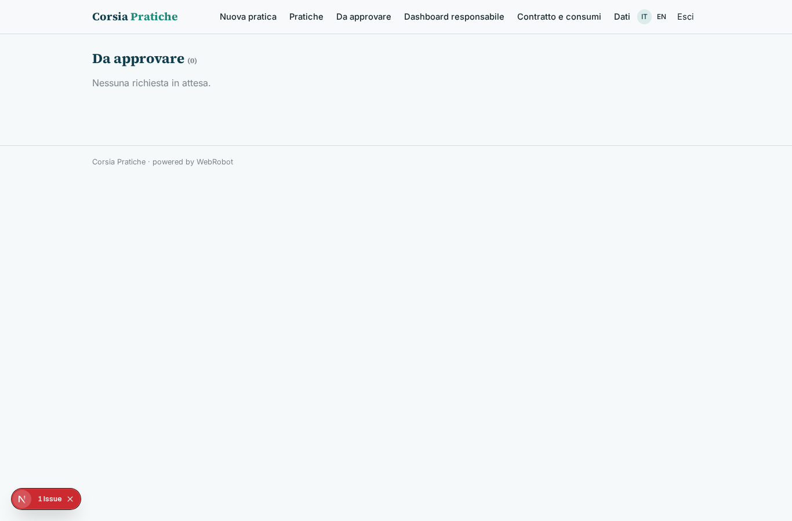
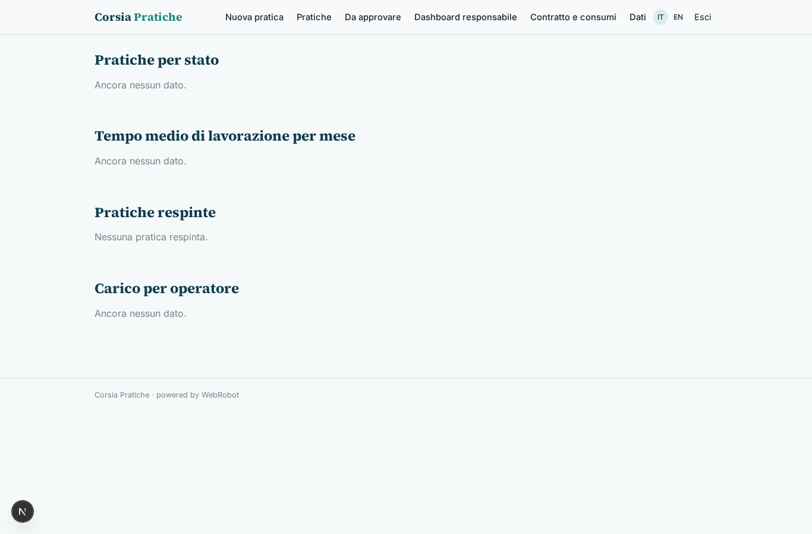

# Corsia Pratiche

_Le pratiche amministrative della struttura sanitaria, istruite da agenti e approvate da te._

**Manifest:** valid (schema + runtime contract) · **Functional test:** passed (19 checks passed)

## Description given to the app builder (Italian)

Vorrei Corsia Pratiche, uno strumento di agenti per gli uffici amministrativi delle strutture sanitarie. Descrivo solo lo strato software amministrativo: niente decisioni cliniche, e i dati sanitari sono trattati con base giuridica e misure adeguate. Il personale dell'ufficio carica o riceve le pratiche: richieste di autorizzazione, prescrizioni, documentazione per rimborsi dalle assicurazioni sanitarie, codifica delle schede di dimissione. Un agente legge i documenti, estrae i dati necessari, controlla la completezza rispetto alle regole del fondo o della regione, compila i moduli e segnala ciò che manca. Le pratiche dovrebbero arrivare direttamente dai sistemi informativi dell'ospedale e i moduli compilati inviati ai portali delle assicurazioni. Ogni pratica deve essere verificata e approvata da un operatore prima dell'invio. Un agente segue lo stato delle pratiche inviate e avvisa quando un rimborso viene respinto, preparando la risposta. Il responsabile vede una dashboard con tempi medi, pratiche respinte e carico per operatore. Ogni operatore vede solo le pratiche del suo reparto. Contratto annuale per struttura con costo a pratica elaborata.

## Features not expressible today (spec.extensions)

- **his_connector**: Le pratiche arrivano dal sistema informativo ospedaliero via webhook (his_intake); il connettore lato ospedale (HL7/FHIR o altro) va configurato dal fornitore del sistema.
- **portal_submission**: Invio automatico dei moduli ai portali delle assicurazioni non disponibile: l'operatore invia la pratica approvata; gli esiti rientrano via webhook (insurer_status). Un'integrazione con i portali richiede API o credenziali per ciascun portale.
- **department_scoping**: La visibilità per reparto si basa sull'elenco email 'members' di ogni pratica, compilato all'arrivo (dal sistema ospedaliero o dal modulo).

## Screenshots (interpretive runtime, no data)

### home-anon

### home-mobile

### home

### new_case

### cases

### edit_case

### reviews

### dashboard

### account

