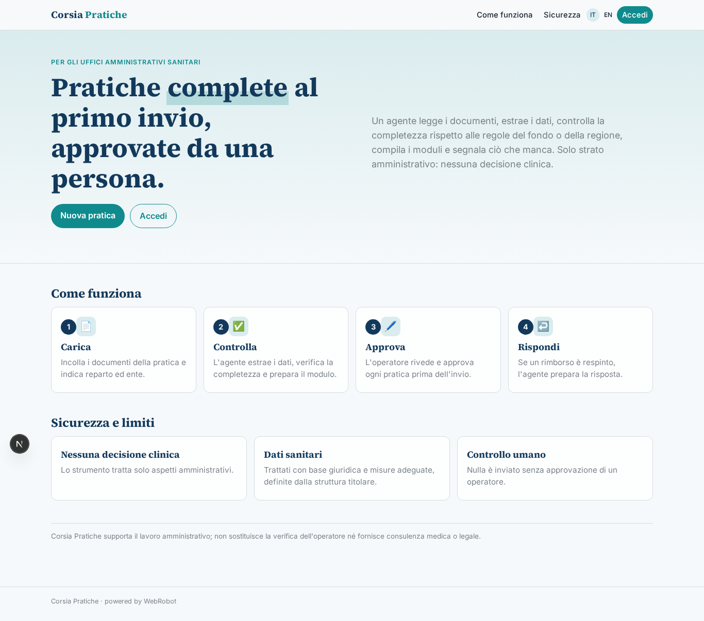
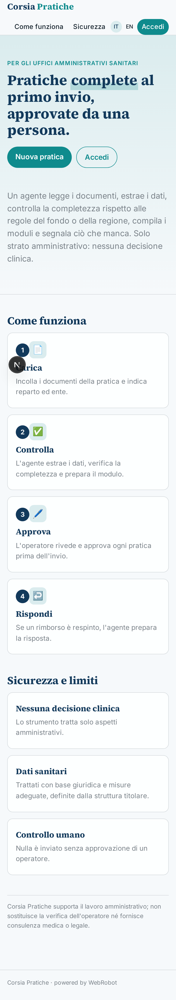
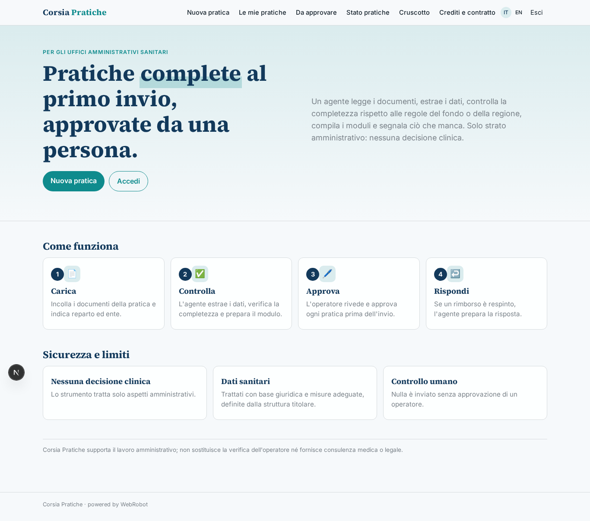
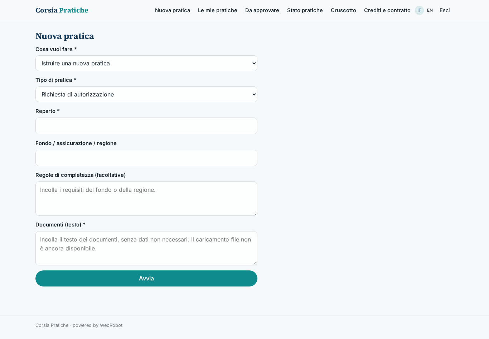
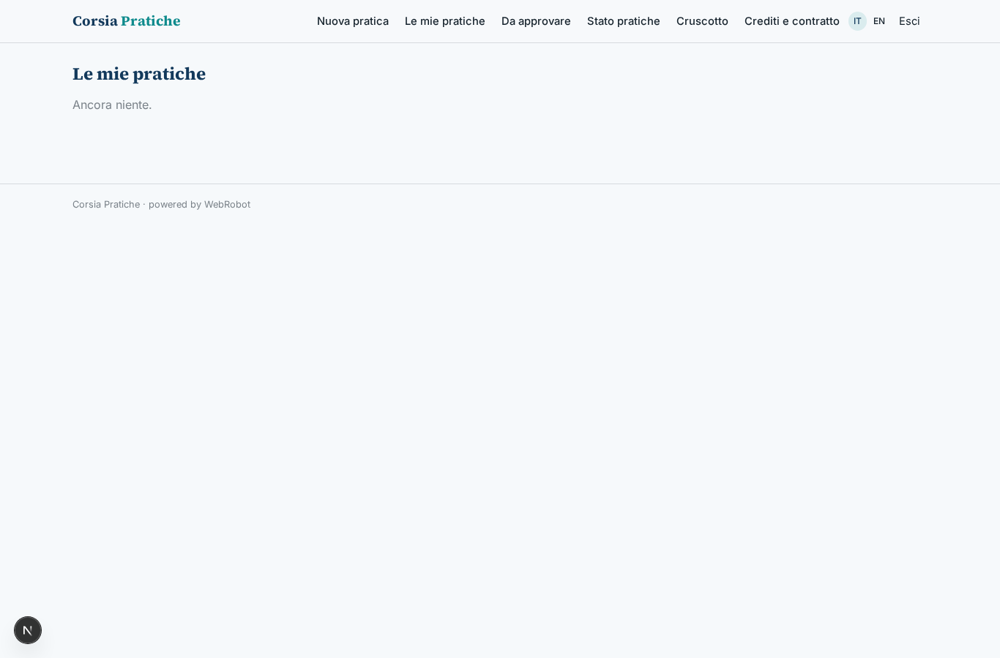
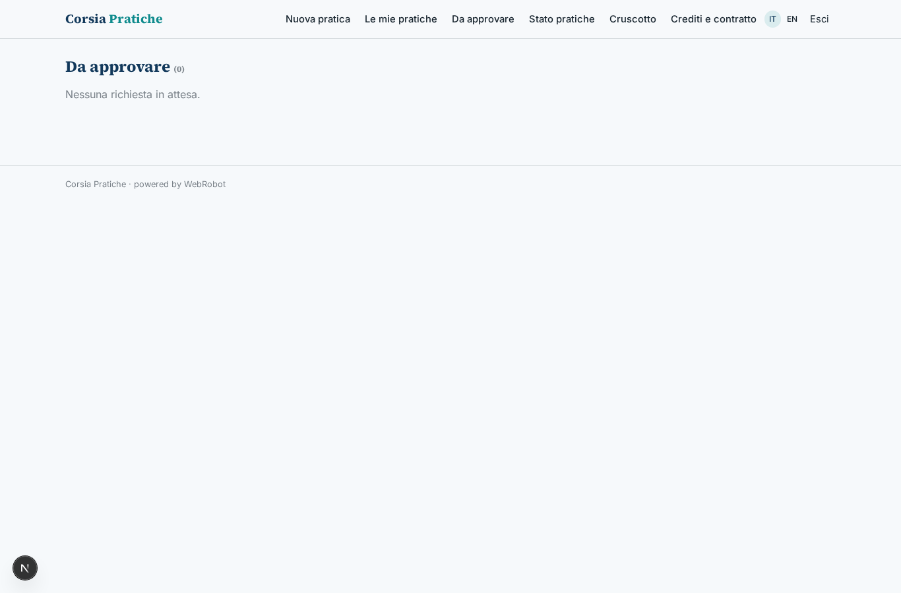
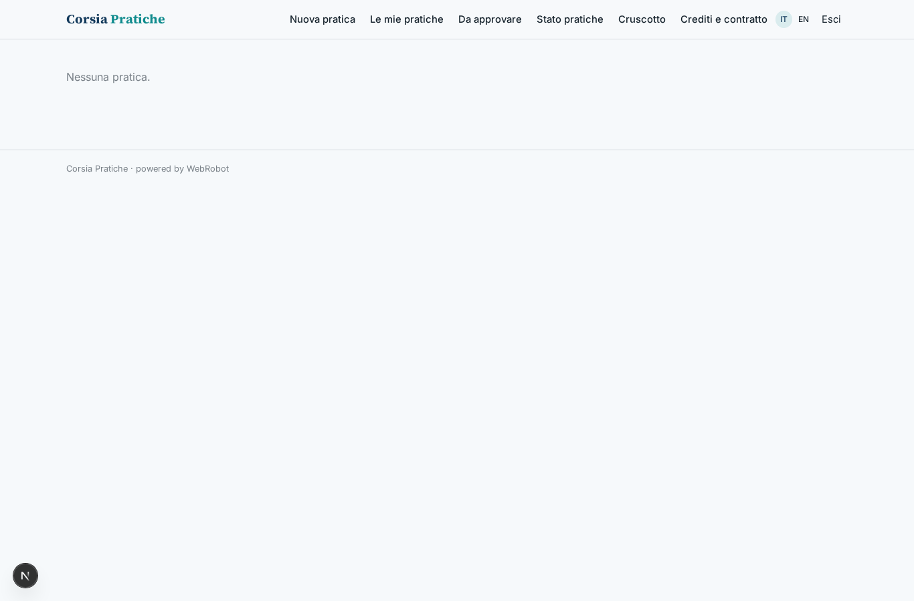
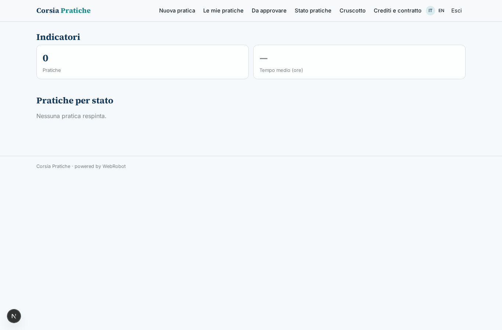
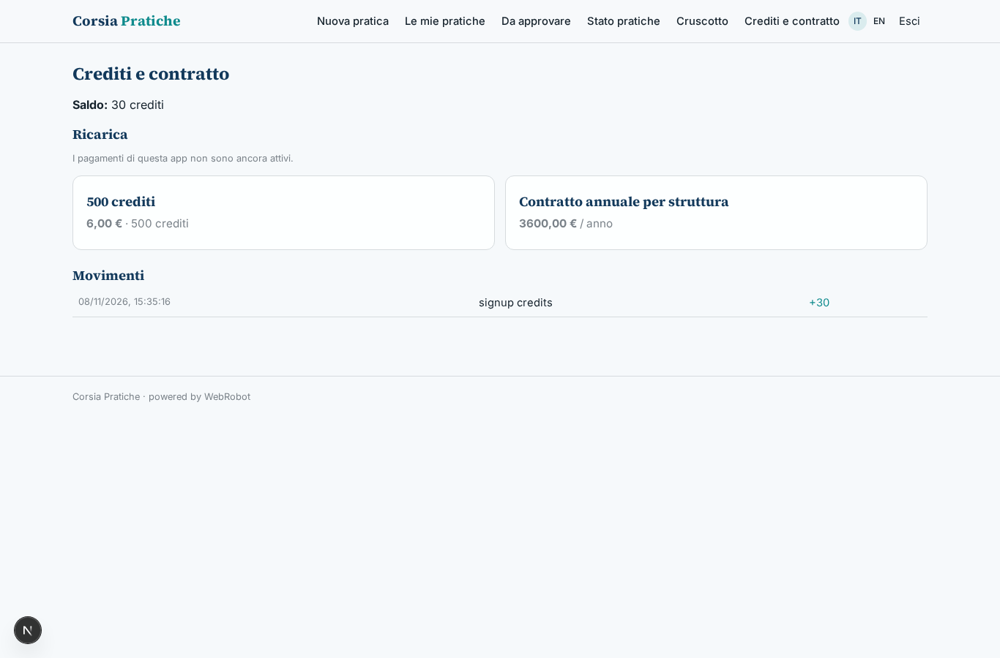

# Corsia Pratiche

_Le pratiche amministrative sanitarie, pronte e verificate prima dell'invio._

**Stato manifest:** valido (validatore Python + contratto runtime)

## Descrizione data all'app builder

Vorrei Corsia Pratiche, uno strumento di agenti per gli uffici amministrativi delle strutture sanitarie. Descrivo solo lo strato software amministrativo: niente decisioni cliniche, e i dati sanitari sono trattati con base giuridica e misure adeguate. Il personale dell'ufficio carica o riceve le pratiche: richieste di autorizzazione, prescrizioni, documentazione per rimborsi dalle assicurazioni sanitarie, codifica delle schede di dimissione. Un agente legge i documenti, estrae i dati necessari, controlla la completezza rispetto alle regole del fondo o della regione, compila i moduli e segnala ciò che manca. Le pratiche dovrebbero arrivare direttamente dai sistemi informativi dell'ospedale e i moduli compilati inviati ai portali delle assicurazioni. Ogni pratica deve essere verificata e approvata da un operatore prima dell'invio. Un agente segue lo stato delle pratiche inviate e avvisa quando un rimborso viene respinto, preparando la risposta. Il responsabile vede una dashboard con tempi medi, pratiche respinte e carico per operatore. Ogni operatore vede solo le pratiche del suo reparto. Contratto annuale per struttura con costo a pratica elaborata.

## Funzioni non esprimibili oggi (spec.extensions)

- **integrazione_his**: Ricezione diretta delle pratiche dai sistemi informativi ospedalieri: non disponibile; per ora il testo si incolla (nessun caricamento file).
- **invio_portali**: Invio dei moduli ai portali delle assicurazioni e lettura automatica dello stato delle pratiche inviate: richiede connettori con credenziali della struttura, non disponibili. L'operatore aggiorna lo stato a mano.
- **avvisi_dinieghi**: Avvisi automatici (email) quando un rimborso è respinto: notifiche non disponibili; l'operatore incolla il diniego e ottiene la bozza di risposta.
- **reparto_struttura**: Visibilità per reparto, multi-struttura e cruscotto del responsabile con carico per operatore: oggi i record sono per utente; serve un ambito per reparto e per struttura.
- **protezione_dati**: Base giuridica, DPA, registro dei trattamenti e misure di sicurezza dei dati sanitari da definire con ciascuna struttura titolare prima della produzione.

## Screenshot (runtime interpretativo)

### home-anon

### home-mobile

### home

### nuova

### storico

### approvazioni

### elenco

### cruscotto

### account

