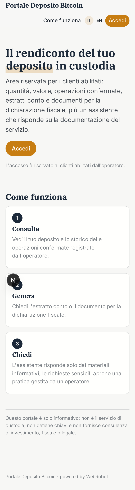
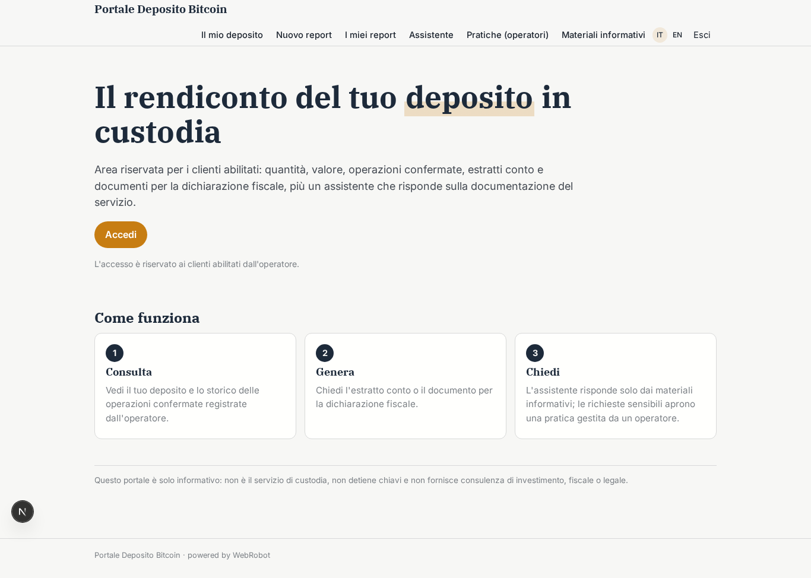
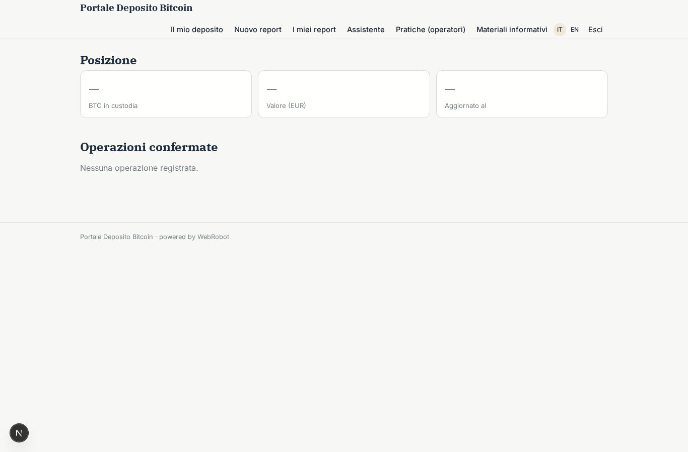
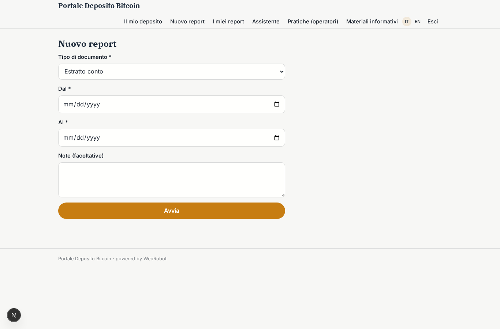
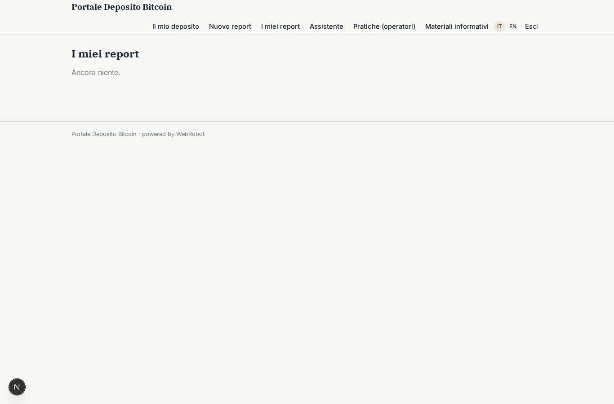
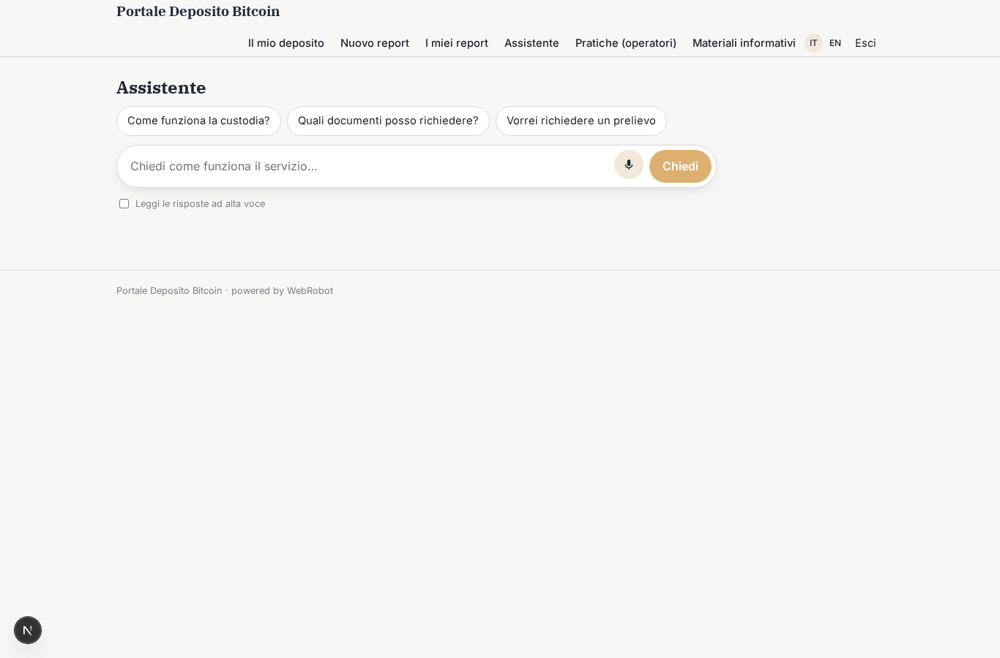
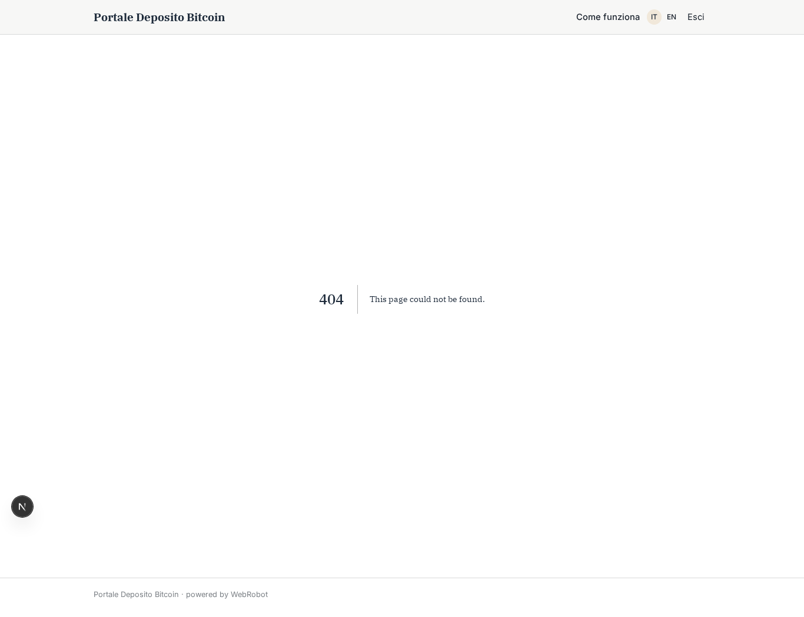
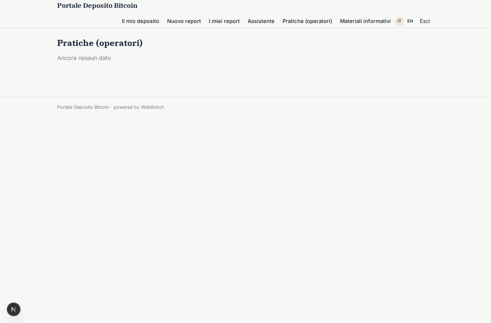
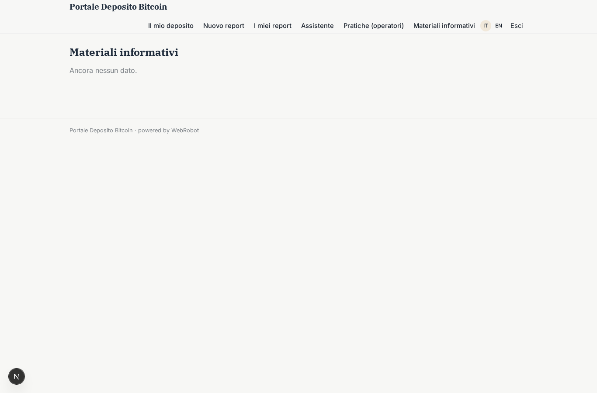

# Portale Deposito Bitcoin

_Il rendiconto del tuo deposito in custodia, sempre a portata di mano._

**Stato manifest:** valido (validatore Python + contratto runtime)

## Descrizione data all'app builder

Descrivo esclusivamente lo strato software di un servizio di custodia di bitcoin: il portale informativo e di rendicontazione per i clienti, non la custodia regolamentata vera e propria ne la detenzione delle chiavi, che sono un servizio finanziario a parte. Il cliente, dopo essere stato abilitato offline, accede a un'area riservata dove vede il rendiconto del proprio deposito: quantita in custodia, valore corrente, storico delle operazioni confermate che l'operatore ha registrato. Un agente genera report periodici (estratto conto, documento per la dichiarazione fiscale) e risponde in chat a domande sul funzionamento del servizio e sulla documentazione, basandosi solo sui materiali informativi caricati dall'azienda, senza dare consigli di investimento. Per ogni richiesta sensibile l'app apre semplicemente una pratica che un operatore umano autorizzato lavora fuori dalla piattaforma. Il cliente vede solo il proprio deposito, l'operatore i clienti assegnati, l'admin tutto. Report inviati via email. Il servizio software e incluso nella commissione di custodia. In italiano e inglese.

## Funzioni non esprimibili oggi (spec.extensions)

- **email_delivery**: Sending reports by email is not available yet: reports are read and printed in the portal. Needs the email notification feature.
- **operator_assignment**: Operators should see only their assigned clients' records and cases, and record positions and confirmed operations on behalf of clients. The runtime has no per-operator assignment scope nor write-on-behalf: today operators/admins enter data through the back office and ownedBy user records.
- **live_valuation**: Current value is the valuation registered by the operator with its source and date; no live price feed is connected.
- **document_upload**: File upload is not available: information materials are pasted as text or linked by URL in info_docs.

## Screenshot (runtime interpretativo)

### home-anon

### home-mobile

### home

### deposit

### new_report

### reports

### assistant_chat

### my_cases

### ops_cases

### docs_admin

