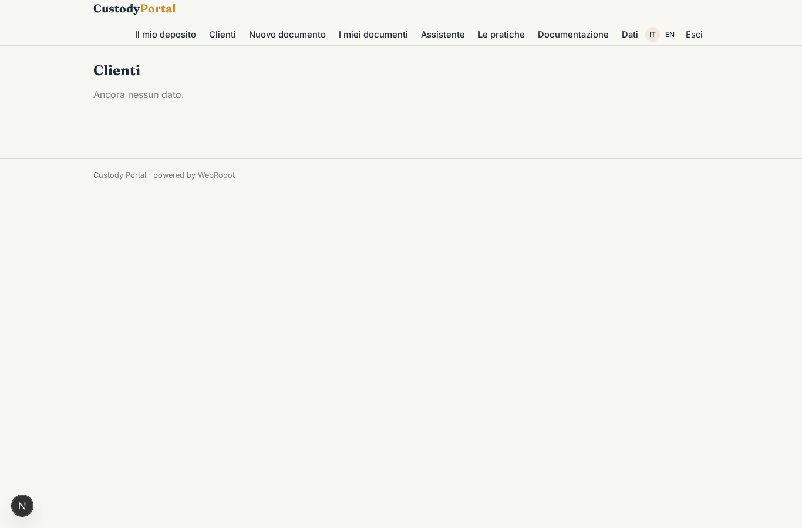
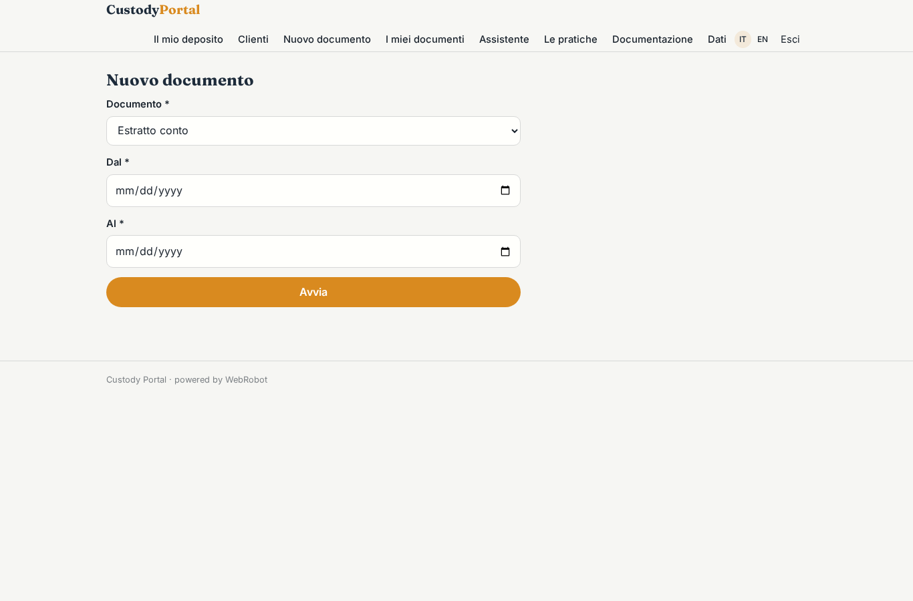
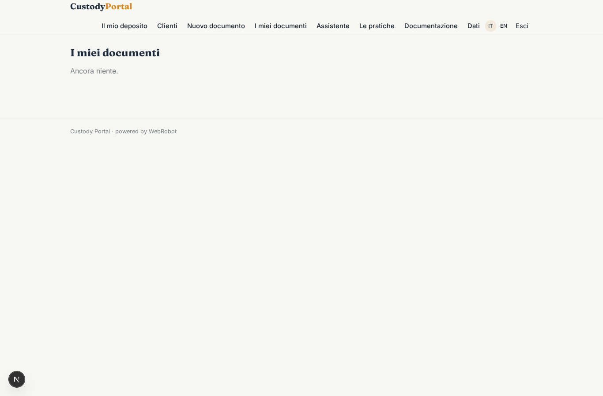
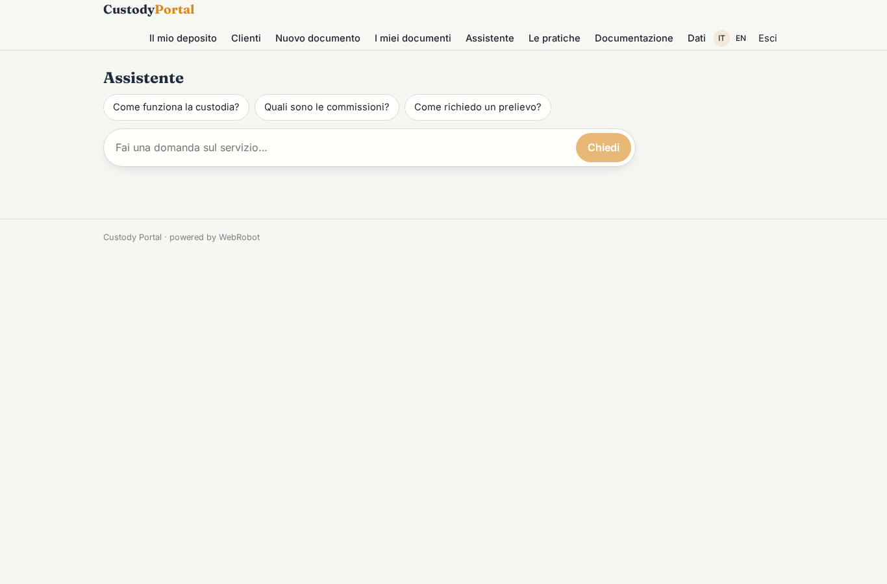
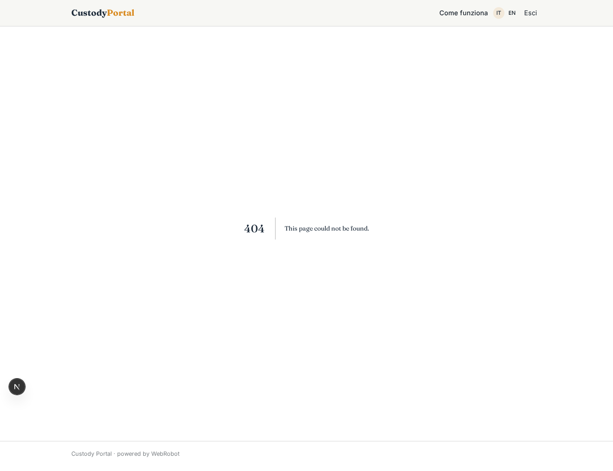
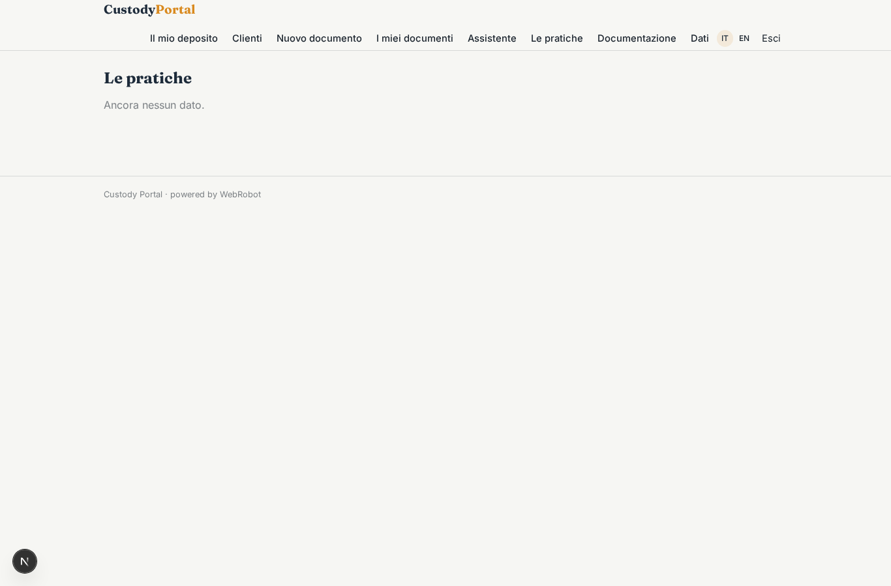
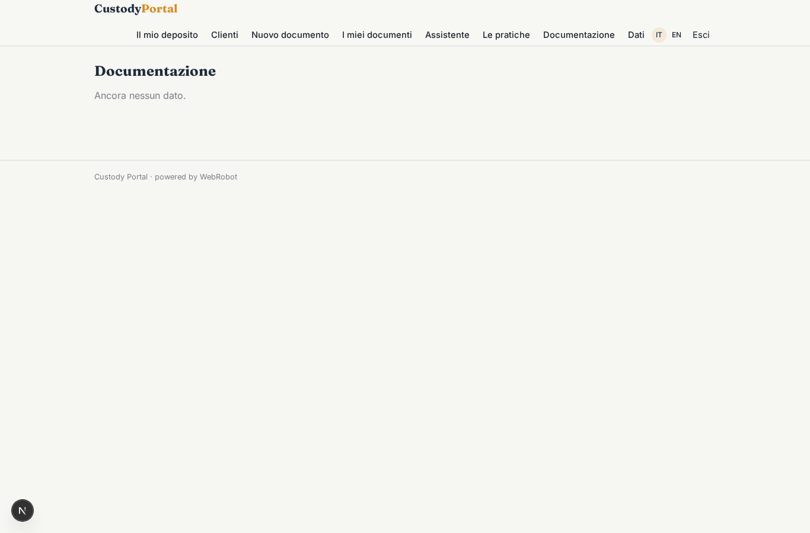

# Custody Portal

_Il rendiconto del tuo deposito in bitcoin, sempre a portata di mano._

**Manifest:** valid (schema + runtime contract) · **Functional test:** passed (19 checks passed)

## Description given to the app builder (Italian)

Descrivo esclusivamente lo strato software di un servizio di custodia di bitcoin: il portale informativo e di rendicontazione per i clienti, non la custodia regolamentata vera e propria ne la detenzione delle chiavi, che sono un servizio finanziario a parte. Il cliente, dopo essere stato abilitato offline, accede a un'area riservata dove vede il rendiconto del proprio deposito: quantita in custodia, valore corrente, storico delle operazioni confermate che l'operatore ha registrato. Un agente genera report periodici (estratto conto, documento per la dichiarazione fiscale) e risponde in chat a domande sul funzionamento del servizio e sulla documentazione, basandosi solo sui materiali informativi caricati dall'azienda, senza dare consigli di investimento. Per ogni richiesta sensibile l'app apre semplicemente una pratica che un operatore umano autorizzato lavora fuori dalla piattaforma. Il cliente vede solo il proprio deposito, l'operatore i clienti assegnati, l'admin tutto. Report inviati via email. Il servizio software e incluso nella commissione di custodia. In italiano e inglese.

## Functional test: what did not pass

- **form saves a record** (form new_case): only role customer may fill it, and the test cannot hold that role _(warning)_
- **page opened by a role allowed to** (view new_case): only role customer may open it, the test cannot hold it _(warning)_

## Features not expressible today (spec.extensions)

- **case_assignment**: Cases are visible to all operators; automatic assignment of a case to the client's own operator is not available yet.
- **no_custody**: The app only shows data entered by the operator; custody, keys and sensitive operations stay outside the platform.

## Screenshots (interpretive runtime, no data)

### home-anon

### home-mobile

### home

### deposit

### clients

### new_report

### reports

### assistant_chat

### new_case

### my_cases

### docs

